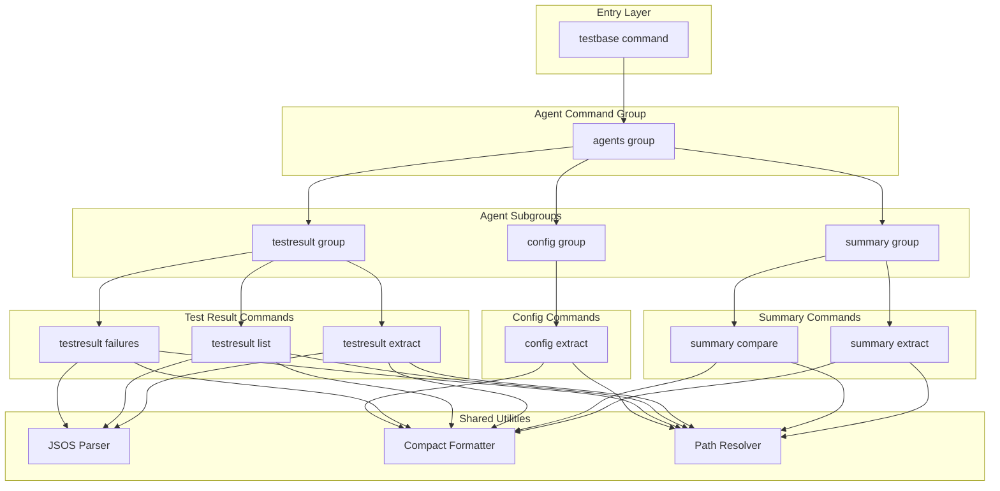
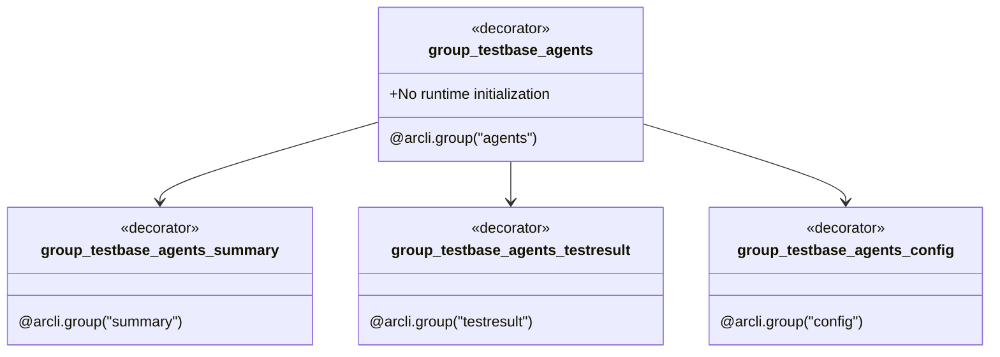
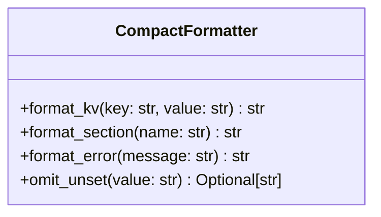
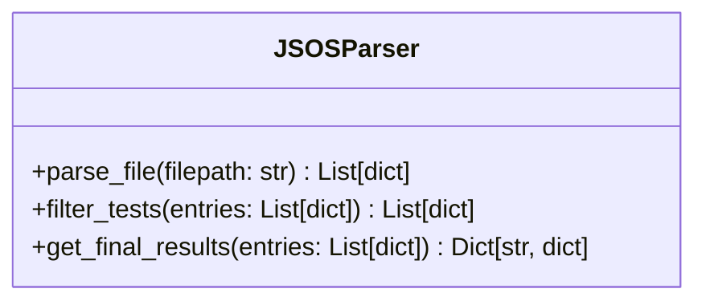
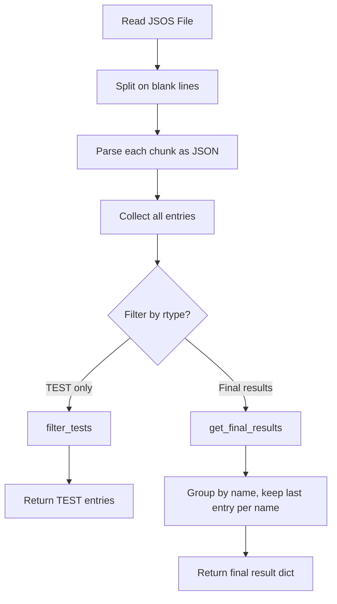
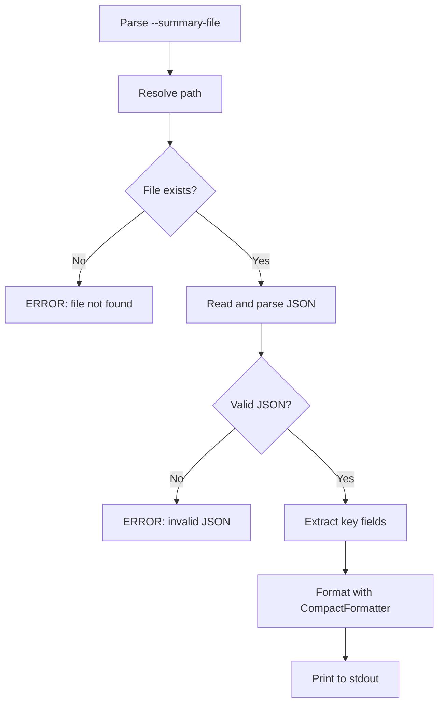
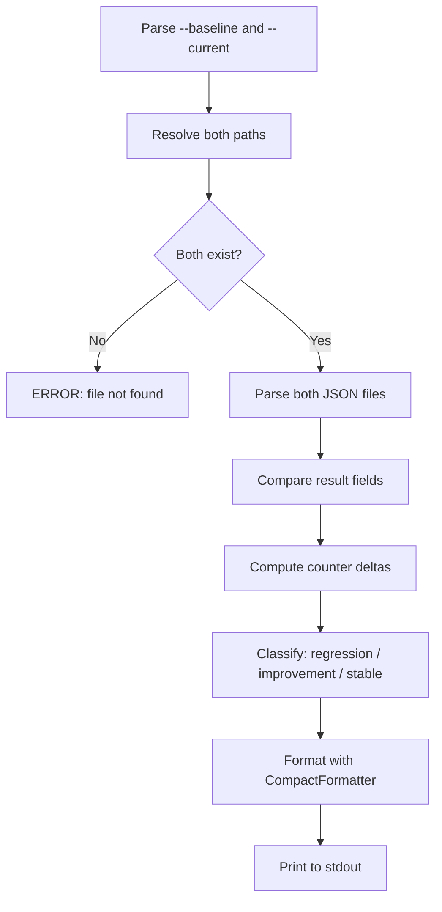
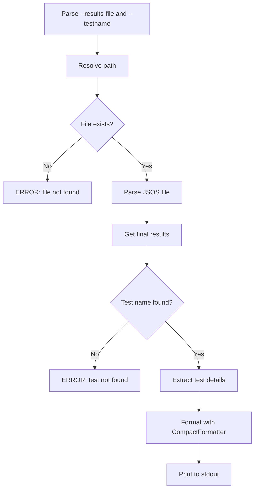
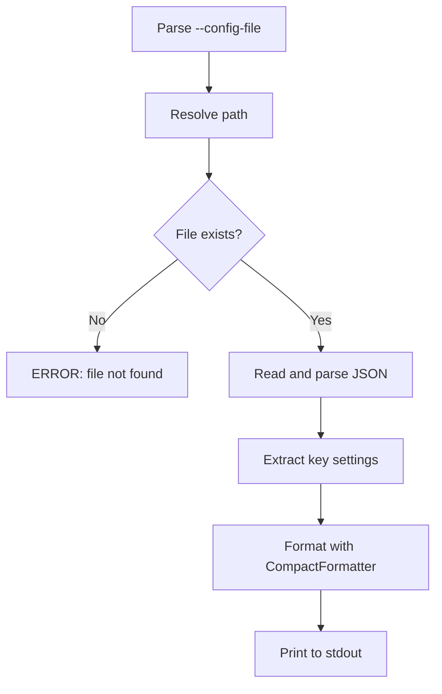
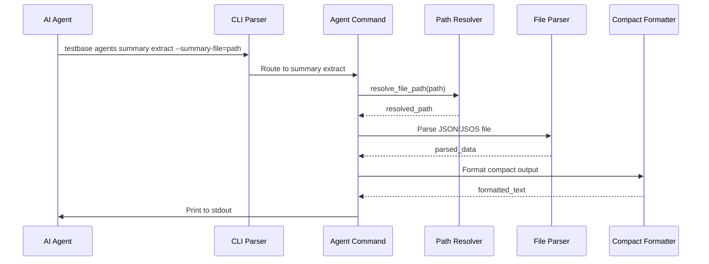

# Agent Tooling - Design Document

## Overview

The Agent Tooling feature adds a `testbase agents` command group that provides compact, machine-readable
commands for AI coding agents and automation scripts to extract and analyze test result data. These commands
operate on standard TestBase result artifacts without requiring runtime initialization or a test environment.

The design follows two key principles:
- **Offline operation**: Commands read result files directly — no running test session needed
- **Compact output**: Key-value text format optimized for agent context windows, not human readability

## Architecture

### Command Tree Structure

```
testbase
└── agents
    ├── summary
    │   ├── extract      # Extract compact summary from testrun_summary.json
    │   └── compare      # Compare two summary files for regressions
    ├── testresult
    │   ├── extract      # Extract a single test result by name
    │   ├── list         # List all tests and their results
    │   └── failures     # List only failed/errored tests
    └── config
        └── extract      # Extract key config from startup-configuration.json
```

### High-Level Component Diagram



### Components

#### 1. Agents Command Group (`cmdtree/agents/__init__.py`)

The agents group is a top-level command group registered on the root `testbase` command.
It does **not** call `initialize_testbase_runtime()` because agent commands only read result files.



#### 2. Compact Formatter (`agents/formatting.py`)

A shared utility module that provides consistent compact output formatting across all agent commands.



**Output Format Rules:**

| Rule | Format | Example |
|------|--------|---------|
| Key-Value | `key: value` | `result: PASSED` |
| Section Header | `section:` | `detail:` |
| Nested Field | `  key: value` (2-space indent) | `  passed: 3` |
| Omitted Field | (not printed) | When value is `None`, `(not-set)`, or `(unknown)` |

**Example compact output for `summary extract`:**

```
result: PASSED
start: 2026-02-24T22:04:46.299524
stop: 2026-02-24 22:04:50.357629
detail:
  passed: 3
  failed: 0
  errors: 0
  skipped: 0
  total: 3
job:
  id: 8344f668-a0e3-4ef6-89ca-acf007fcb3a0
  type: TestRun
```

#### 3. JSOS Parser (`agents/jsosparser.py`)

A shared utility for parsing `testrun_results_stream.jsos` files. JSOS files contain
multiple JSON objects separated by blank lines.



**Parsing Logic:**



**JSOS Entry Structure (rtype=TEST):**

| Field | Type | Description |
|-------|------|-------------|
| `name` | `str` | Fully qualified test name (e.g., `pkg.mod#test_func`) |
| `instance` | `str` | UUID instance identifier |
| `parent` | `str` | Parent container UUID |
| `rtype` | `str` | `TEST`, `TEST_CONTAINER`, or `JOB` |
| `result` | `str` | `PASSED`, `FAILED`, `ERRORED`, `SKIPPED`, or `UNSET` |
| `start` | `str` | ISO timestamp |
| `stop` | `str` | ISO timestamp |
| `detail` | `dict` | Optional — contains `errors` list with error info |

#### 4. Path Resolver (`agents/pathresolver.py`)

A shared utility for resolving and validating file paths.

```python
def resolve_file_path(filepath: str) -> str:
    """Expand vars, expand user, resolve to absolute, validate existence."""
    resolved = os.path.abspath(os.path.expandvars(os.path.expanduser(filepath)))
    if not os.path.isfile(resolved):
        raise FileNotFoundError(f"File not found: {resolved}")
    return resolved
```

#### 5. Summary Extract Command (`agents/summary/extract.py`)



**Extracted Fields:**

| Source Path | Output Key | Condition |
|-------------|-----------|-----------|
| `$.result` | `result` | Always |
| `$.start` | `start` | Always |
| `$.stop` | `stop` | Always |
| `$.detail.passed` | `detail.passed` | Always |
| `$.detail.failed` | `detail.failed` | Always |
| `$.detail.errors` | `detail.errors` | Always |
| `$.detail.skipped` | `detail.skipped` | Always |
| `$.detail.total` | `detail.total` | Always |
| `$.job.id` | `job.id` | When not `(not-set)` |
| `$.job.name` | `job.name` | When not `(not-set)` |
| `$.job.type` | `job.type` | When not `(not-set)` |
| `$.build.branch` | `build.branch` | When not `(not-set)` |
| `$.build.build` | `build.build` | When not `(not-set)` |

#### 6. Summary Compare Command (`agents/summary/compare.py`)



**Example output:**

```
overall: PASSED->FAILED (regression)
delta:
  passed: -2
  failed: +2
  errors: 0
  skipped: 0
  total: 0
```

#### 7. Test Result Extract Command (`agents/testresult/extract.py`)



**Example output:**

```
name: pkg.mod#test_something
result: FAILED
start: 2026-02-24T22:04:46.345818
stop: 2026-02-24T22:04:50.350592
errors:
  - TypeError: expected str, got int
```

#### 8. Test Result List Command (`agents/testresult/list.py`)

Lists all test names and their final results. Supports filtering by result code.

**Example output:**

```
pkg.mod#test_alpha: PASSED
pkg.mod#test_beta: FAILED
pkg.mod#test_gamma: SKIPPED
```

#### 9. Test Result Failures Command (`agents/testresult/failures.py`)

Lists only FAILED and ERRORED tests with brief error summaries.

**Example output:**

```
pkg.mod#test_beta: FAILED
  error: AssertionError: 3 != 4
pkg.mod#test_delta: ERRORED
  error: ConnectionError: connection refused
```

#### 10. Configuration Extract Command (`agents/config/extract.py`)



### Data Flow

#### Agent Command Execution Flow



## Integration Points

### With Existing CLI

The `agents` command group integrates with the CLI by registering on the root `testbase` command:

```python
# In testbase_command.py
testbase_root_command.add_command(group_testbase_agents)
```

The agents group intentionally does **not** integrate with:
- Runtime initialization (`initialize_testbase_runtime`)
- Option overrides (`AM_RUNTIME_OPTION_OVERRIDES`)
- Test execution engine

This keeps the agent commands lightweight and fast.

### With Result Artifacts

Agent commands operate on the standard TestBase result artifacts:

| Artifact | Producer | Agent Consumer |
|----------|----------|----------------|
| `testrun_summary.json` | `ResultRecorder.__exit__` | `summary extract`, `summary compare` |
| `testrun_results_stream.jsos` | `ResultRecorder` (streaming) | `testresult extract`, `testresult list`, `testresult failures` |
| `startup-configuration.json` | `initialize_testbase_results` | `config extract` |

## Error Handling

### Error Format

All errors are printed to stderr in the format:

```
ERROR: <description>
```

### Error Conditions

| Condition | Exit Code | Error Message |
|-----------|-----------|---------------|
| File not found | 1 | `ERROR: File not found: <resolved_path>` |
| Invalid JSON | 1 | `ERROR: Invalid JSON in file: <resolved_path>` |
| Test name not found | 1 | `ERROR: Test '<testname>' not found in results file` |
| Invalid JSOS format | 1 | `ERROR: Invalid JSOS format in file: <resolved_path>` |

## Testing Strategy

### Unit Testing Focus Areas

1. **JSOS Parser** — Parsing multi-object JSOS streams, filtering by rtype, deduplicating final results
2. **Compact Formatter** — Key-value formatting, section nesting, omission of unset values
3. **Path Resolver** — Environment variable expansion, home directory expansion, file existence validation
4. **Individual Commands** — Correct extraction of fields, error handling for missing/invalid inputs

### Test Organization

| Test Module | Tests |
|-------------|-------|
| `test_jsosparser.py` | JSOS parsing, filtering, final result deduplication |
| `test_compact_formatter.py` | Output format consistency, indentation, field omission |
| `test_summary_extract.py` | Summary field extraction, error cases |
| `test_summary_compare.py` | Delta computation, regression classification |
| `test_testresult_extract.py` | Single test extraction, UNSET deduplication |
| `test_testresult_list.py` | Full listing, result filtering |
| `test_testresult_failures.py` | Failure collection, error summary extraction |
| `test_config_extract.py` | Configuration field extraction |

## Usage Examples

### Summary Operations

```bash
# Extract summary from a test run
testbase agents summary extract --summary-file=~/ccai/results/testresults/2026-02-24T2204S46/testrun_summary.json

# Compare two runs for regressions
testbase agents summary compare \
    --baseline=~/ccai/results/testresults/run1/testrun_summary.json \
    --current=~/ccai/results/testresults/run2/testrun_summary.json
```

### Test Result Operations

```bash
# Extract a specific test result
testbase agents testresult extract \
    --results-file=./testrun_results_stream.jsos \
    --testname="ccai.tests.testbase.injection.test_constraints#test_activity_logging"

# List all test results
testbase agents testresult list --results-file=./testrun_results_stream.jsos

# List only failed tests
testbase agents testresult list --results-file=./testrun_results_stream.jsos --result-filter=FAILED

# List failures with error summaries
testbase agents testresult failures --results-file=./testrun_results_stream.jsos
```

### Configuration Operations

```bash
# Extract configuration for a test run
testbase agents config extract --config-file=./startup-configuration.json
```

## File Structure

```
source/packages/ccai/testbase/cli/
└── cmdtree/
    └── agents/
        ├── __init__.py              # Agents group definition
        ├── formatting.py            # CompactFormatter utility
        ├── jsosparser.py            # JSOS file parser
        ├── pathresolver.py          # File path resolution utility
        ├── summary/
        │   ├── __init__.py          # Summary subgroup definition
        │   ├── extract.py           # Summary extract command
        │   └── compare.py           # Summary compare command
        ├── testresult/
        │   ├── __init__.py          # Test result subgroup definition
        │   ├── extract.py           # Test result extract command
        │   ├── list.py              # Test result list command
        │   └── failures.py          # Test result failures command
        └── config/
            ├── __init__.py          # Config subgroup definition
            └── extract.py           # Config extract command

source/tests/ccai_tests/testbase/cli/agents/
├── __init__.py
├── test_jsosparser.py
├── test_compact_formatter.py
├── test_summary_extract.py
├── test_summary_compare.py
├── test_testresult_extract.py
├── test_testresult_list.py
├── test_testresult_failures.py
└── test_config_extract.py
```
