# Command Line Interface - Design Document

## Overview

The Command Line Interface (CLI) is the primary user-facing entry point for the TestBase framework. It provides a hierarchical command structure for:

- Running test collections with configurable options
- Querying test information and metadata
- Managing test jobs and their execution
- Launching testing services (e.g., result server)
- Providing utility commands for automation pipelines

The CLI is built on the `ccai.arcli` framework, which provides decorator-based command definition, option groups for reusable parameters, and automatic help generation.

## Architecture

### High-Level Component Diagram

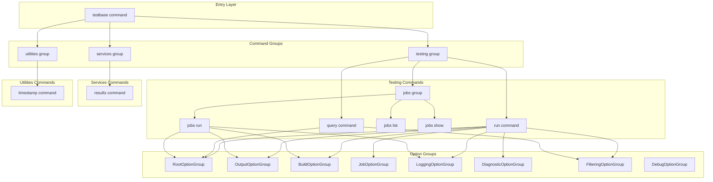

### Command Tree Structure

```
testbase
├── testing
│   ├── run          # Execute test collections
│   ├── query        # Query test information
│   └── jobs
│       ├── list     # List available test jobs
│       ├── show     # Show job details
│       └── run      # Execute a specific job
├── services
│   └── results      # Launch test results server
└── utilities
    └── timestamp    # Print current timestamp
```

### Components

#### 1. Root Command (`testbase_command.py`)

The root command initializes the TestBase runtime and sets up global options.

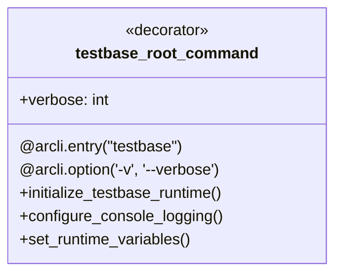

**Responsibilities:**

| Responsibility | Description |
|----------------|-------------|
| Runtime Initialization | Calls `initialize_testbase_runtime()` to set up the framework |
| Verbosity Control | Maps `-v` counter to log levels (WARNING → INFO → DEBUG → NOTSET) |
| Console Mode | Sets interactive console mode based on verbosity |
| Variable Override | Overrides runtime variables via `ThisApplicationSingleton` |

**Verbosity Mapping:**

| Flag Count | Log Level | Interactive Console |
|------------|-----------|---------------------|
| 0 (default) | WARNING | True |
| 1 (`-v`) | INFO | False |
| 2 (`-vv`) | DEBUG | False |
| 3+ (`-vvv`) | NOTSET | False |

#### 2. Option Groups (`options.py`)

Reusable option groups provide consistent parameter definitions across commands.

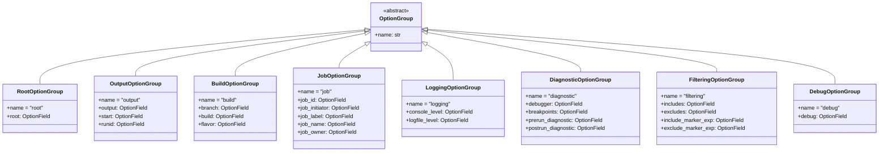

**Option Group Details:**

| Group | Options | Purpose |
|-------|---------|---------|
| RootOptionGroup | `--root` | Test root directory specification |
| OutputOptionGroup | `--output`, `--start`, `--runid` | Result output configuration |
| BuildOptionGroup | `--branch`, `--build`, `--flavor` | Build metadata association |
| JobOptionGroup | `--job-id`, `--job-initiator`, `--job-label`, `--job-name`, `--job-owner` | Job identification |
| LoggingOptionGroup | `--console-level`, `--logfile-level` | Log level configuration |
| DiagnosticOptionGroup | `--debugger`, `--breakpoint`, `--prerun-diagnostic`, `--postrun-diagnostic` | Debug and diagnostic options |
| FilteringOptionGroup | `--includes`, `--excludes`, `--include-marker-exp`, `--exclude-marker-exp` | Test filtering |
| DebugOptionGroup | `--debug` | Debug output flag |

#### 3. Testing Command Group (`cmdtree/testing/`)

The testing group contains commands for test execution and querying.

##### Run Command (`run.py`)

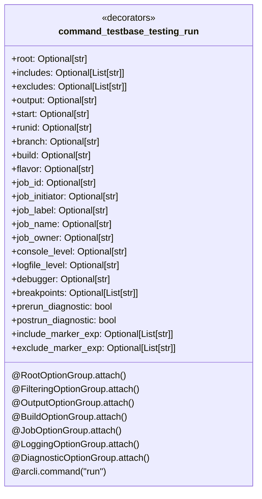

**Execution Flow:**

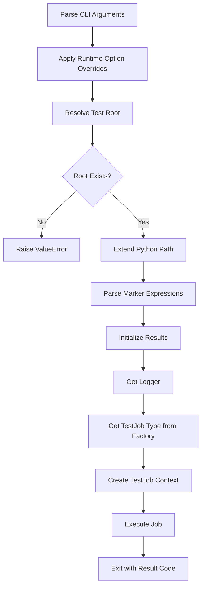

##### Query Command (`query.py`)

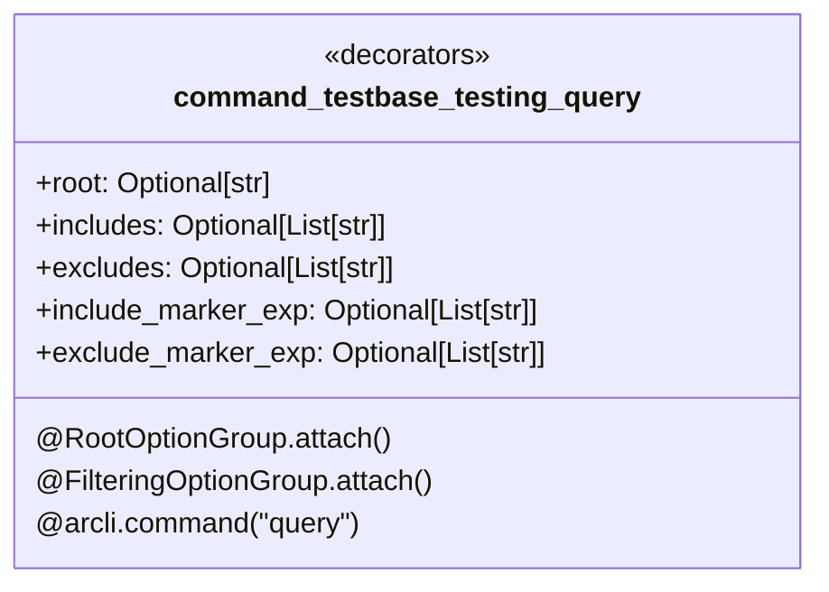

**Output Format:**

```
Tests:
    package.module@test_function_1
        param1: FactorySource(scope=session)
        param2: FactorySource(scope=module)
    package.module@test_function_2
        ...

IMPORT ERRORS:
    path/to/module.py
```

##### Jobs Group (`jobs.py`)

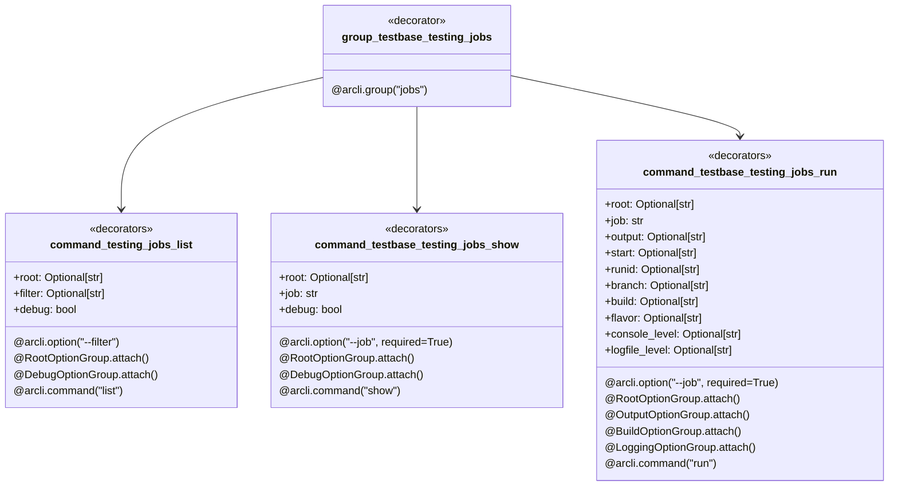

**Job Specification Format:**

```
package.module@JobClass
```

#### 4. Services Command Group (`cmdtree/services/`)

##### Results Server Command (`results.py`)

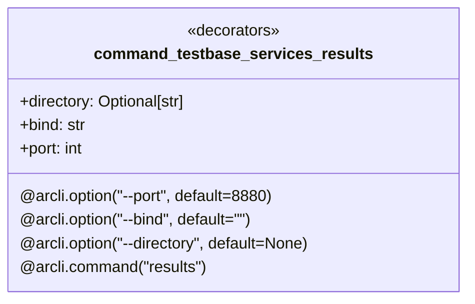

**Server Configuration:**

| Parameter | Default | Description |
|-----------|---------|-------------|
| `--directory` | `<presence_dir>/results` | Root directory for serving results |
| `--bind` | `""` (all interfaces) | IP address to bind to |
| `--port` | `8880` | Port number |

#### 5. Utilities Command Group (`cmdtree/utilities/`)

##### Timestamp Command (`timestamp.py`)

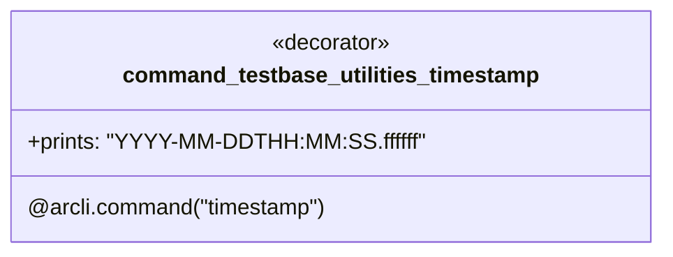

### Data Flow

#### Command Execution Flow

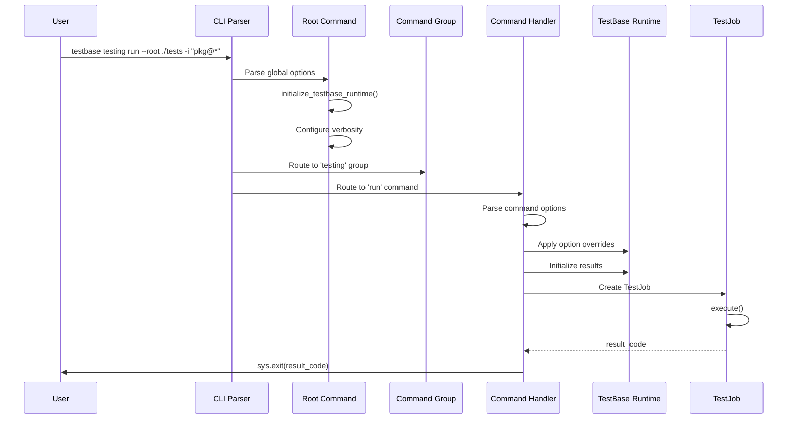

#### Option Override Flow

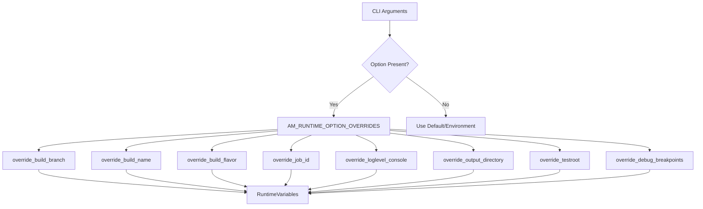

### Design Patterns

#### 1. Decorator Pattern

Commands and options are defined using decorators from `ccai.arcli`:

```python
@arcli.option('-v', '--verbose', default=0, mode=OptionMode.Counter)
@arcli.entry("testbase")
def testbase_root_command(verbose: int):
    ...
```

#### 2. Composite Pattern

Command groups compose individual commands into a tree structure:

```python
@arcli.group("testing")
def group_testbase_testing():
    ...

group_testbase_testing.add_command(command_testbase_testing_run)
group_testbase_testing.add_command(command_testbase_testing_query)
group_testbase_testing.add_command(group_testbase_testing_jobs)
```

#### 3. Template Method Pattern

Option groups provide reusable templates with customizable help text:

```python
@RootOptionGroup.attach(help_fill={"action": "run"})
@FilteringOptionGroup.attach(help_fill={"action": "run"})
@arcli.command("run")
def command_testbase_testing_run(...):
    ...
```

#### 4. Factory Pattern

Test job types are obtained through the factory protocol:

```python
sfactory = ConfiguredSuperFactorySingleton()
TestJobType = sfactory.get_override_types_by_order(
    TestBaseFactoryProtocol.get_testbase_default_job_type
)
```

#### 5. Context Manager Pattern

Test jobs are executed within context managers for proper lifecycle management:

```python
with TestJobType(logger, test_root, includes=includes, excludes=excludes) as tjob:
    result_code = tjob.execute()
```

## Integration Points

### With Test Execution Engine

The CLI integrates with the execution engine through:

- `TestJob` creation and execution
- Runtime option overrides
- Result initialization

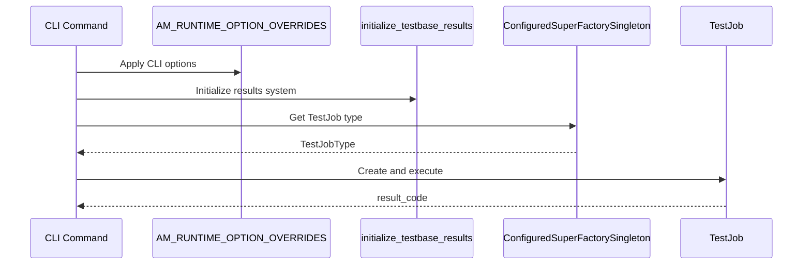

### With Runtime System

The CLI configures the runtime through:

- `initialize_testbase_runtime()` - Framework initialization
- `AM_RUNTIME_OPTION_OVERRIDES` - Option value overrides
- `RuntimeVariables` - Environment variable access
- `ThisApplicationSingleton` - Application-wide settings

### With Logging System

The CLI configures logging through:

- Verbosity flag mapping to log levels
- Console and file log level options
- Interactive console mode setting

### With Result Recording System

The CLI integrates with results through:

- `initialize_testbase_results()` - Result system setup
- Output directory configuration
- Run ID and start time specification

### With Dependency Injection System

The CLI uses the factory system to obtain:

- Default test job types
- Extension-provided job types
- Custom job implementations via `--job` parameter

## Configuration

### Environment Variables

The CLI respects these environment variables:

| Variable | CLI Override | Description |
|----------|--------------|-------------|
| `AM_TESTROOT` | `--root` | Default test root directory |
| `AM_OUTPUT` | `--output` | Default output directory |
| `AM_LOG_LEVEL_CONSOLE` | `--console-level` | Console log level |
| `AM_LOG_LEVEL_FILE` | `--logfile-level` | File log level |
| `AM_BUILD_BRANCH` | `--branch` | Build branch name |
| `AM_BUILD_NAME` | `--build` | Build name |
| `AM_BUILD_FLAVOR` | `--flavor` | Build flavor |

### Command Line Precedence

Options are resolved in this order (highest to lowest precedence):

1. Command line arguments
2. Environment variables
3. Configuration files
4. Default values

### Help Text Customization

Option groups support dynamic help text through `help_fill`:

```python
HELP_ROOT = "The root directory to use when scanning for tests to {action}."

@RootOptionGroup.attach(help_fill={"action": "run"})
# Results in: "The root directory to use when scanning for tests to run."
```

## Error Handling

### Validation Errors

| Error Condition | Handling |
|-----------------|----------|
| Invalid root directory | Raise `ValueError` with descriptive message |
| Invalid job specification | Raise `ValueError` with format hint |
| Import failure for job module | Raise `argparse.ArgumentError` |
| Missing job class in module | Raise `argparse.ArgumentError` |

### Exit Codes

| Code | Meaning |
|------|---------|
| 0 | All tests passed |
| 1+ | Number of failed/errored tests |
| -1 | Configuration or setup error |

### Error Messages

Error messages include context for debugging:

```python
errmsg = "The specified root folder does not exist. root=%s" % root
if test_root != root:
    errmsg += " expanded=%s" % test_root
raise ValueError(errmsg)
```

## Testing Strategy

### Unit Testing Focus Areas

1. **Option Parsing**
   - Option group attachment
   - Default value handling
   - Multiple value accumulation
   - Choice validation

2. **Command Routing**
   - Group hierarchy navigation
   - Command dispatch
   - Help generation

3. **Option Override Application**
   - Override method invocation
   - Value propagation to runtime

4. **Path Resolution**
   - Root directory expansion
   - Python path modification
   - Directory existence validation

### Integration Testing

1. **End-to-End Command Execution**
   - `testbase testing run` with sample tests
   - `testbase testing query` output validation
   - `testbase services results` server startup

2. **Option Combination Testing**
   - Multiple include/exclude expressions
   - Marker expression parsing
   - Build metadata propagation

### Test Categories

| Category | Components | Focus |
|----------|------------|-------|
| Parsing | Option groups, decorators | Argument parsing correctness |
| Routing | Command tree | Command dispatch |
| Integration | Run command | Full execution flow |
| Validation | All commands | Error handling |

## Usage Examples

### Running Tests

```bash
# Run all tests in a directory
testbase testing run --root ./tests

# Run specific tests with includes
testbase testing run --root ./tests -i "package.module@test_*"

# Run with exclusions
testbase testing run --root ./tests -i "package@*" -x "package@test_slow_*"

# Run with marker filtering
testbase testing run --root ./tests --include-marker-exp "priority=high"

# Run with verbose output
testbase -vv testing run --root ./tests

# Run with custom output directory
testbase testing run --root ./tests -o ./results

# Run with build metadata
testbase testing run --root ./tests --branch main --build 1.0.0

# Run with debugging
testbase testing run --root ./tests --debugger debugpy --breakpoint test-discovery
```

### Querying Tests

```bash
# List all tests
testbase testing query --root ./tests

# Query with filtering
testbase testing query --root ./tests -i "package.module@*"

# Query with marker filtering
testbase testing query --root ./tests --include-marker-exp "smoke"
```

### Running Jobs

```bash
# Run a specific job class
testbase testing jobs run --root ./tests --job "package.jobs@SmokeTestJob"

# List available jobs
testbase testing jobs list --root ./tests

# Show job details
testbase testing jobs show --root ./tests --job "package.jobs@SmokeTestJob"
```

### Services

```bash
# Start results server on default port
testbase services results

# Start on custom port and directory
testbase services results --port 9000 --directory ./test-results

# Bind to specific interface
testbase services results --bind 127.0.0.1 --port 8880
```

### Utilities

```bash
# Get current timestamp for pipeline use
testbase utilities timestamp
# Output: 2025-01-15T10:30:45.123456
```

## File Structure

```
source/packages/ccai/testbase/cli/
├── __init__.py                    # Package initialization
├── options.py                     # Reusable option groups
├── testbase_command.py            # Root command entry point
└── cmdtree/
    ├── testing/
    │   ├── __init__.py            # Testing group definition
    │   ├── run.py                 # Run command
    │   ├── query.py               # Query command
    │   └── jobs.py                # Jobs subgroup
    ├── services/
    │   ├── __init__.py            # Services group definition
    │   └── results.py             # Results server command
    └── utilities/
        ├── __init__.py            # Utilities group definition
        └── timestamp.py           # Timestamp command
```
