# Constraints System - Design Document

## Overview

The Constraints System provides a mechanism for passing configuration parameters and feature requirements from external sources to test execution. It enables:

- Defining constraint sets as dictionary-like objects
- Storing constraints from multiple origins (site parameters, override parameters)
- Looking up constraints with priority-based resolution
- Filtering resources based on feature constraints
- Merging multiple constraint sets into unified configurations

The system integrates with the Dependency Injection System to pass constraints to resource factories and with the Feature Tagging System to enable feature-based resource filtering.

## Architecture

### High-Level Component Diagram

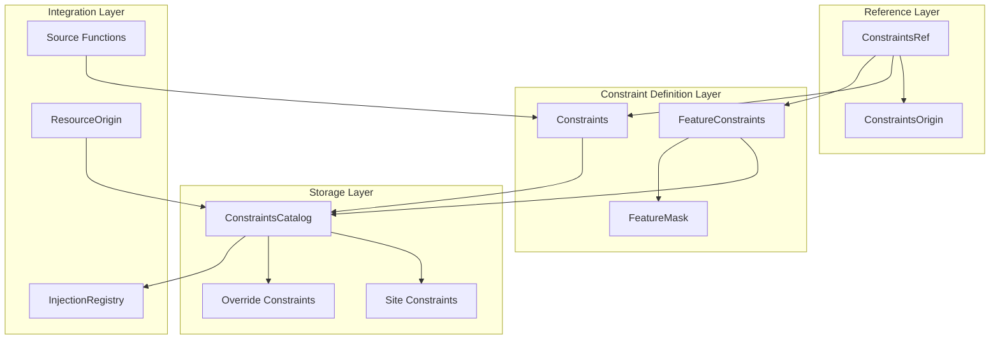

### Components

#### 1. Constraints (Dictionary Wrapper)

The `Constraints` class is a dictionary subclass that represents a set of key-value constraint pairs.

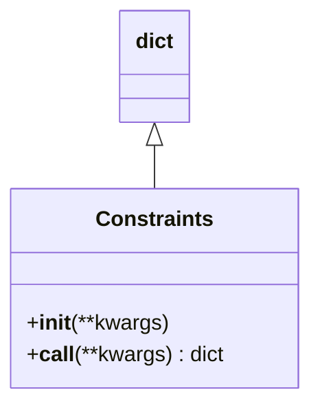

**Key Behaviors:**

| Method | Purpose | Return Type |
|--------|---------|-------------|
| `__init__` | Initialize with keyword arguments | `None` |
| `__call__` | Create copy with additional/updated values | `dict` |

**Usage Pattern:**

```python
# Define base constraints
base_constraints = Constraints(timeout=30, retries=3)

# Create derived constraints with overrides
test_constraints = base_constraints(timeout=60)
# Result: {"timeout": 60, "retries": 3}
```

#### 2. ConstraintsOrigin (Enumeration)

The `ConstraintsOrigin` enumeration defines the sources from which constraints may be provided.

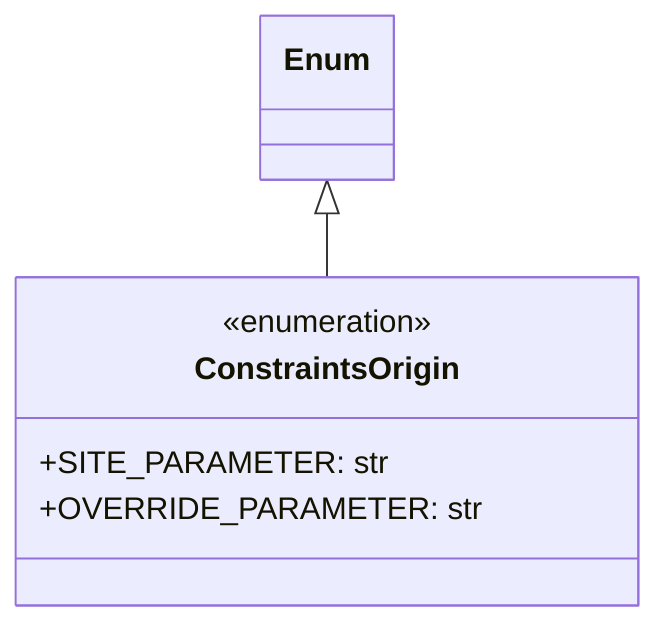

**Origin Types:**

| Origin | Value | Priority | Description |
|--------|-------|----------|-------------|
| `SITE_PARAMETER` | `"site-parameter"` | Lower | Default constraints from site configuration |
| `OVERRIDE_PARAMETER` | `"override-parameter"` | Higher | Runtime overrides that take precedence |

#### 3. ConstraintsCatalog (Singleton)

The `ConstraintsCatalog` is a singleton that manages all registered constraints and provides lookup functionality.

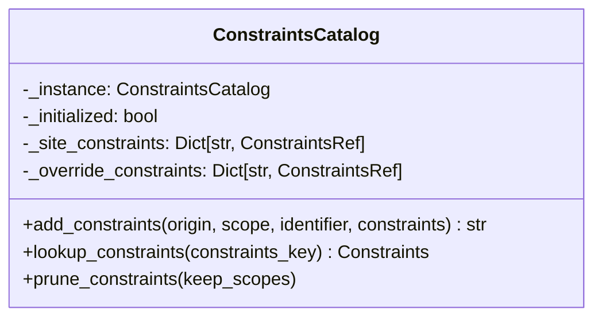

**Key Methods:**

| Method | Purpose | Return Type |
|--------|---------|-------------|
| `add_constraints` | Register constraints with origin and scope | `str` (key) |
| `lookup_constraints` | Retrieve constraints by key with priority | `Constraints` or `None` |
| `prune_constraints` | Remove constraints not in specified scopes | `None` |

**Constraint Key Format:**

```
{originating_scope}:{identifier}
```

Example: `tests.integration#test_login:device_config`

#### 4. ConstraintsRef (Reference Object)

The `ConstraintsRef` class associates constraints with their origin metadata.

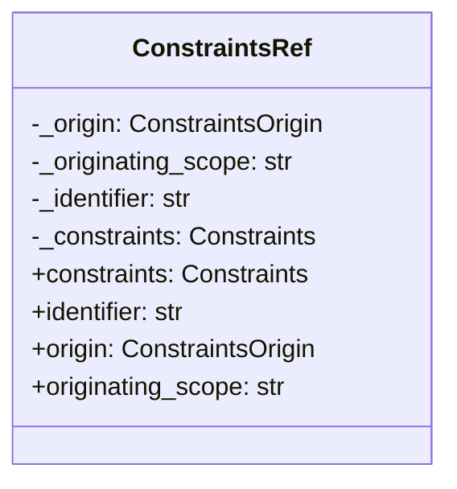

**Properties:**

| Property | Type | Description |
|----------|------|-------------|
| `constraints` | `Constraints` | The constraint object |
| `identifier` | `str` | Unique identifier for the constraint set |
| `origin` | `ConstraintsOrigin` | Source of the constraints |
| `originating_scope` | `str` | Scope to which constraints apply |

#### 5. FeatureConstraintKeys (Enumeration)

Standard keys used when defining feature-based constraints.

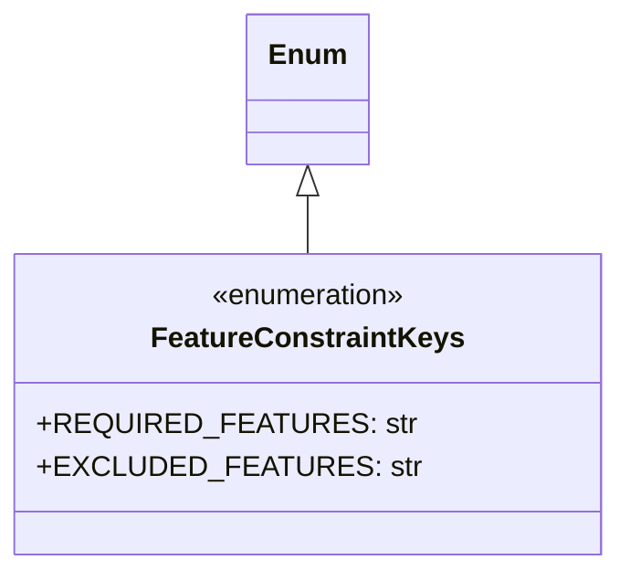

#### 6. FeatureConstraints (Feature Mask Extension)

The `FeatureConstraints` class extends `FeatureMask` to provide feature-based constraint definitions.

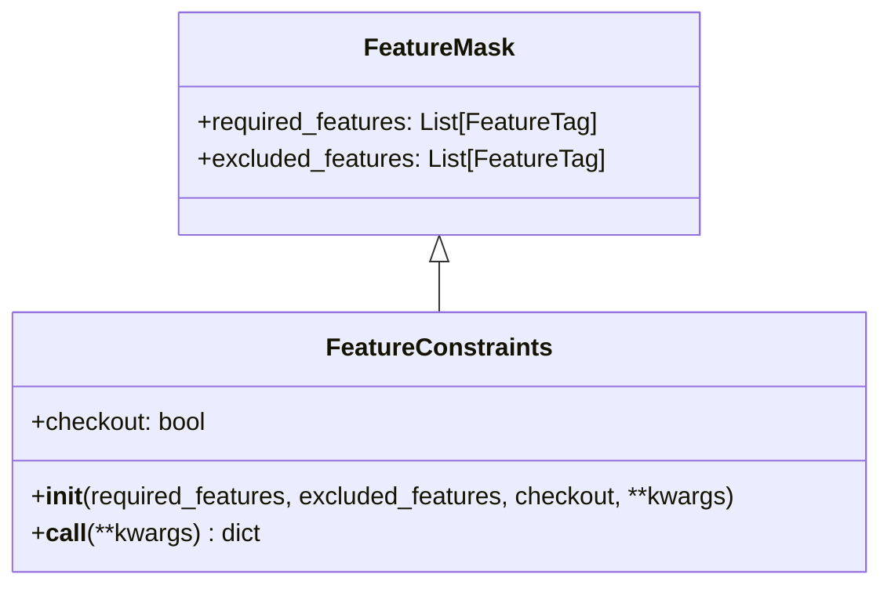

**Additional Parameters:**

| Parameter | Type | Default | Description |
|-----------|------|---------|-------------|
| `checkout` | `bool` | `False` | Whether to checkout/reserve the resource |

### Data Flow

#### Constraint Registration Flow

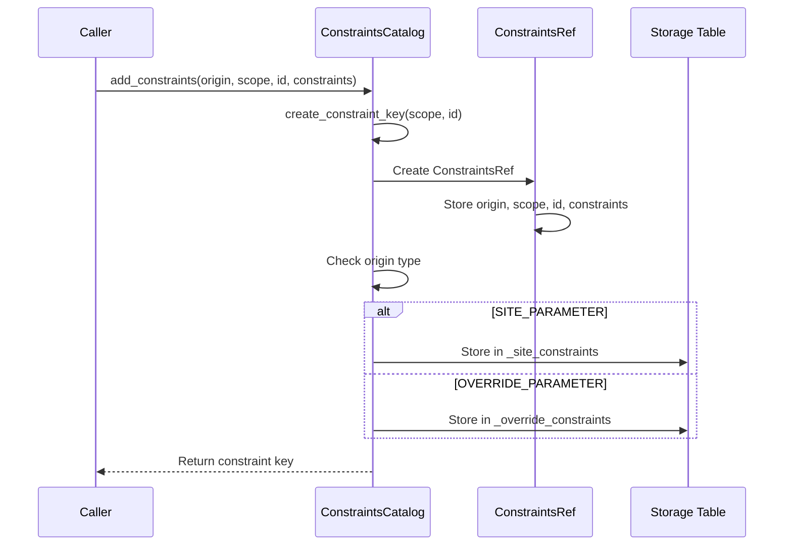

#### Constraint Lookup Flow

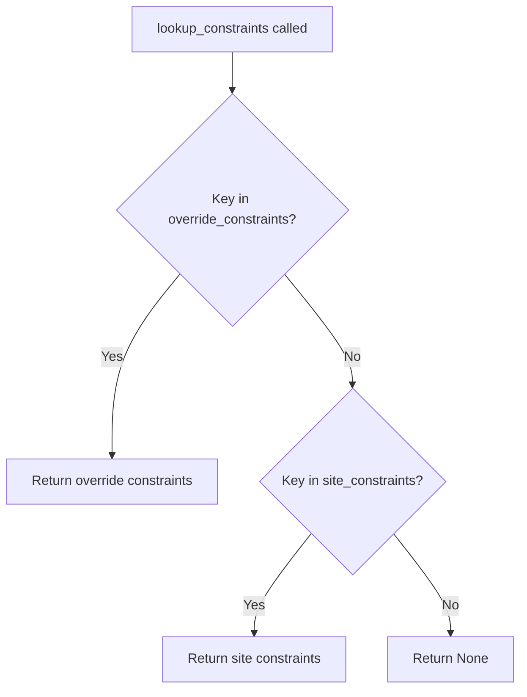

#### Constraint Pruning Flow

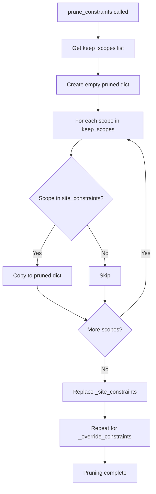

#### Constraint Merge Flow

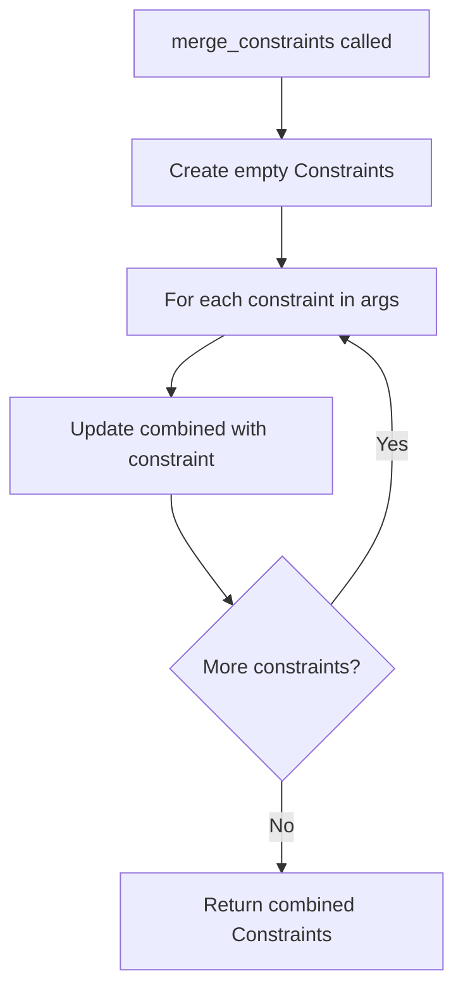

### Design Patterns

#### 1. Singleton Pattern

The `ConstraintsCatalog` uses the singleton pattern to ensure a single global catalog:

```python
class ConstraintsCatalog:
    _instance = None
    _initialized = False

    def __new__(cls):
        if cls._instance is None:
            cls._instance = super(ConstraintsCatalog, cls).__new__(cls)
        return cls._instance

    def __init__(self):
        thisType = type(self)
        if not thisType._initialized:
            thisType._initialized = True
            self._site_constraints = {}
            self._override_constraints = {}
```

#### 2. Prototype Pattern

The `Constraints.__call__` method implements a prototype pattern, creating copies with modifications:

```python
def __call__(self, **kwargs):
    inst = dict(self)
    inst.update(kwargs)
    return inst
```

#### 3. Strategy Pattern

The priority-based lookup in `ConstraintsCatalog.lookup_constraints` implements a strategy for constraint resolution:

1. Check override constraints first (higher priority)
2. Fall back to site constraints (lower priority)
3. Return `None` if not found

#### 4. Flyweight Pattern

`ConstraintsRef` objects act as flyweights, storing references to constraint objects rather than duplicating them.

### Constraint Key Generation

The `create_constraint_key` function generates unique keys for constraint storage:

```python
def create_constraint_key(source: str, identifier: str):
    return f"{source}:{identifier}"
```

**Key Components:**

| Component | Description | Example |
|-----------|-------------|---------|
| `source` | Originating scope path | `tests.integration#test_login` |
| `identifier` | Constraint set name | `device_config` |
| **Result** | Combined key | `tests.integration#test_login:device_config` |

## Integration Points

### With Dependency Injection System

- `ResourceOrigin` objects store `constraints_key` for constraint lookup
- Source functions receive `constraints` parameter when called
- The injection system passes constraints during resource instantiation

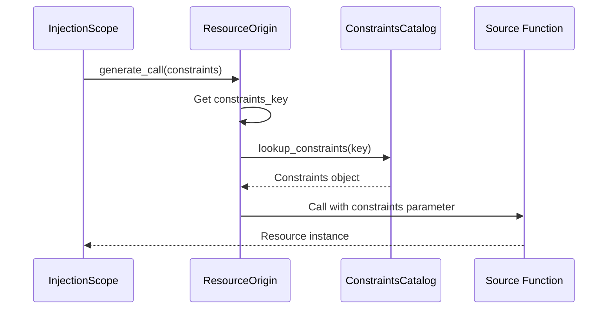

### With Feature Tagging System

- `FeatureConstraints` extends `FeatureMask` for feature-based filtering
- Feature requirements can be specified as constraints
- Resources can be filtered based on feature constraints

### With Test Execution Engine

- Constraints are pruned to relevant scopes before execution
- Override constraints allow runtime configuration changes
- Site constraints provide default configurations

### With Coupling System

- Integration couplings can receive constraints for configuration
- Configuration couplings use constraints for setup parameters
- Validator couplings can validate against constraint requirements

## Configuration

### Constraint Definition

```python
# Simple constraints
db_constraints = Constraints(
    host="localhost",
    port=5432,
    timeout=30
)

# Feature constraints
device_constraints = FeatureConstraints(
    required_features=[DeviceFeatures.Bluetooth],
    excluded_features=[DeviceFeatures.Legacy],
    checkout=True
)
```

### Constraint Registration

```python
catalog = ConstraintsCatalog()

# Register site-level constraints
catalog.add_constraints(
    origin=ConstraintsOrigin.SITE_PARAMETER,
    originating_scope="tests.integration",
    identifier="db_config",
    constraints=db_constraints
)

# Register override constraints
catalog.add_constraints(
    origin=ConstraintsOrigin.OVERRIDE_PARAMETER,
    originating_scope="tests.integration",
    identifier="db_config",
    constraints=Constraints(timeout=60)  # Override timeout only
)
```

### Constraint Lookup

```python
# Lookup returns override if exists, else site, else None
constraints = catalog.lookup_constraints("tests.integration:db_config")
```

### Constraint Merging

```python
# Merge multiple constraint sets
combined = merge_constraints(
    base_constraints,
    environment_constraints,
    test_specific_constraints
)
# Later constraints override earlier ones for same keys
```

## Error Handling

### ValueError

The system raises `ValueError` for:

1. **Unknown constraint origin**:
   ```
   Unknown constraint origin='{origin}' scope='{scope}' identifier={identifier}
   ```

### Constraint Resolution Failures

When constraints cannot be resolved:

1. `lookup_constraints` returns `None`
2. Calling code must handle missing constraints appropriately
3. Source functions may use default values when constraints are not provided

## Testing Strategy

### Unit Testing Focus Areas

1. **Constraints Class**
   - Test initialization with keyword arguments
   - Test `__call__` creates copy with updates
   - Verify dictionary inheritance behavior

2. **ConstraintsCatalog**
   - Verify singleton behavior
   - Test `add_constraints` for both origins
   - Test `lookup_constraints` priority resolution
   - Test `prune_constraints` scope filtering
   - Test constraint key generation

3. **ConstraintsRef**
   - Test property access
   - Verify origin, scope, identifier storage
   - Test constraints reference integrity

4. **FeatureConstraints**
   - Test inheritance from FeatureMask
   - Test `checkout` parameter handling
   - Test `__call__` behavior

5. **merge_constraints Function**
   - Test merging empty constraints
   - Test merging with overlapping keys
   - Test merge order (last wins)

### Test Categories

| Category | Components | Focus |
|----------|------------|-------|
| Storage | `ConstraintsCatalog`, `ConstraintsRef` | Registration, lookup, pruning |
| Definition | `Constraints`, `FeatureConstraints` | Creation, copying, merging |
| Integration | Injection system integration | Constraint passing to sources |

### Edge Cases

1. **Empty constraints**: Behavior with no key-value pairs
2. **Duplicate registration**: Same key registered multiple times
3. **Missing constraints**: Lookup for non-existent keys
4. **Scope pruning**: Pruning with empty keep_scopes list
5. **Merge order**: Verifying last-wins behavior in merge

## Scope Management

### Scope Hierarchy

Constraints follow the same scope hierarchy as the injection system:

```
<session> (root)
├── package_a
│   ├── module_1
│   │   └── test_function_1
│   └── module_2
└── package_b
    └── module_3
```

### Scope Pruning

The `prune_constraints` method removes constraints that are not relevant to the current execution context:

```python
# Keep only constraints for specific scopes
catalog.prune_constraints([
    "tests.integration",
    "tests.unit"
])
```

This optimization reduces memory usage and improves lookup performance for large test suites.

## Known Limitations

### No Hierarchical Lookup

Constraints are looked up by exact key match only. There is no automatic inheritance from parent scopes.

### No Constraint Validation

The system does not validate constraint values against expected types or ranges.

### Single Override Layer

Only one level of override is supported. Multiple override sources would require additional priority handling.

## Future Enhancements

### Potential Additions

1. **Hierarchical Lookup**: Inherit constraints from parent scopes
2. **Constraint Schemas**: Define expected constraint structure with validation
3. **Multiple Override Levels**: Support priority-ordered override sources
4. **Constraint Events**: Callbacks when constraints are added or modified
5. **Lazy Evaluation**: Support callable constraint values
6. **Constraint Serialization**: JSON/YAML import/export of constraint sets
7. **Constraint Profiles**: Named constraint configurations for different environments
8. **Constraint Inheritance**: Explicit inheritance between constraint sets
