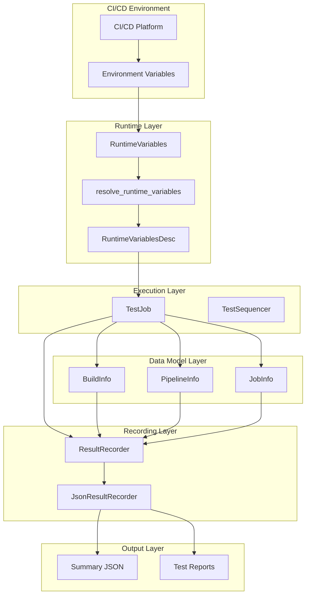
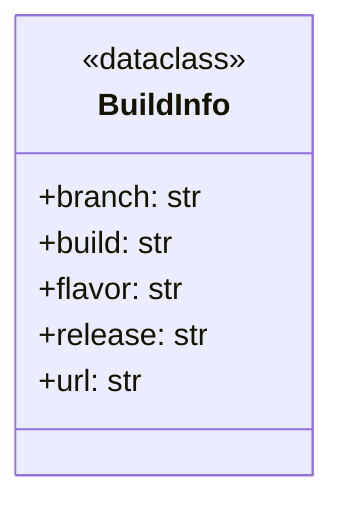
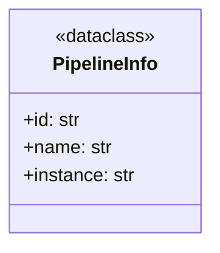
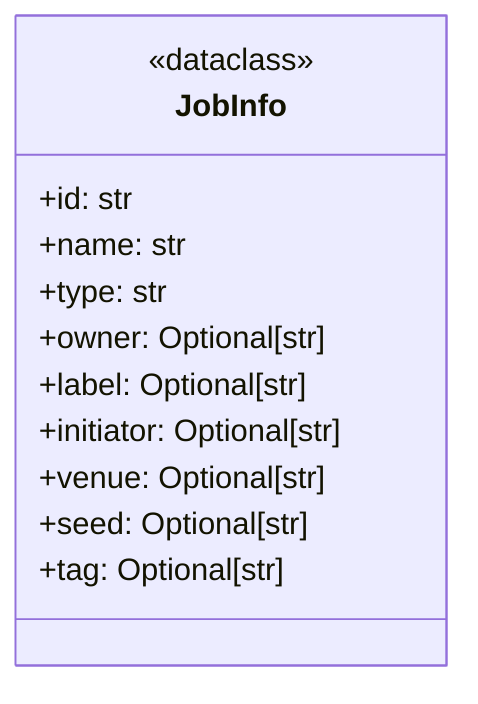
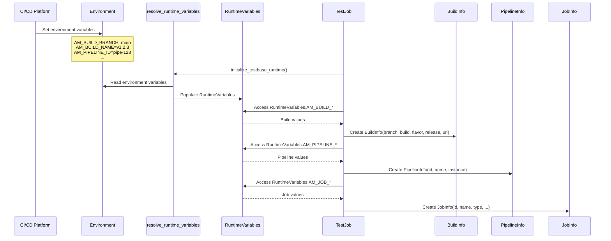
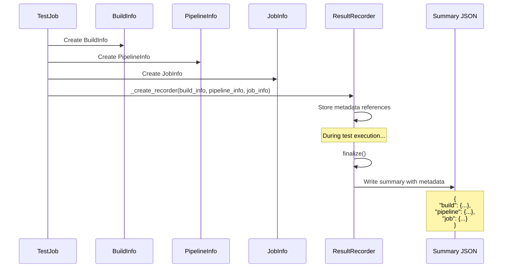

# Build and Pipeline Integration - Design Document

## Overview

The Build and Pipeline Integration system provides a standardized mechanism for capturing and associating CI/CD metadata with test execution results in the TestBase framework. It enables:

- Extraction of build information from environment variables
- Association of pipeline and job metadata with test runs
- Traceability between test results and source code builds
- Integration with various CI/CD platforms (Jenkins, GitHub Actions, GitLab CI, etc.)

The system operates through three primary data models: `BuildInfo` (build metadata), `PipelineInfo` (pipeline context), and `JobInfo` (job execution details). These models are populated from runtime variables and attached to result recorders for inclusion in test reports.

## Architecture

### High-Level Component Diagram



### Components

#### 1. BuildInfo Data Model

The `BuildInfo` dataclass captures metadata about the software build under test.



**Field Descriptions:**

| Field | Type | Description | Environment Variable |
|-------|------|-------------|---------------------|
| `branch` | `str` | Name of the code branch being tested | `AM_BUILD_BRANCH` |
| `build` | `str` | Name or identifier of the product build | `AM_BUILD_NAME` |
| `flavor` | `str` | Build flavor/variant (e.g., debug, release) | `AM_BUILD_FLAVOR` |
| `release` | `str` | Release version or name | `AM_BUILD_RELEASE` |
| `url` | `str` | URL to the build artifacts or CI job | `AM_BUILD_URL` |

#### 2. PipelineInfo Data Model

The `PipelineInfo` dataclass captures metadata about the CI/CD pipeline context.



**Field Descriptions:**

| Field | Type | Description | Environment Variable |
|-------|------|-------------|---------------------|
| `id` | `str` | Unique identifier for the pipeline definition | `AM_PIPELINE_ID` |
| `name` | `str` | Human-readable name of the pipeline | `AM_PIPELINE_NAME` |
| `instance` | `str` | Unique identifier for this pipeline execution | `AM_PIPELINE_INSTANCE` |

#### 3. JobInfo Data Model

The `JobInfo` dataclass captures metadata about the specific job execution.



**Field Descriptions:**

| Field | Type | Description | Environment Variable |
|-------|------|-------------|---------------------|
| `id` | `str` | Unique identifier for the job | `AM_JOB_ID` |
| `name` | `str` | Human-readable name of the job | `AM_JOB_NAME` |
| `type` | `str` | Type classification of the job | `AM_JOB_TYPE` |
| `owner` | `Optional[str]` | Owner or team responsible for the job | `AM_JOB_OWNER` |
| `label` | `Optional[str]` | Label for categorization | `AM_JOB_LABEL` |
| `initiator` | `Optional[str]` | User or system that triggered the job | `AM_JOB_INITIATOR` |
| `venue` | `Optional[str]` | Execution venue or environment | `AM_JOB_VENUE` |
| `seed` | `Optional[str]` | Random seed for reproducibility | `AM_JOB_SEED` |
| `tag` | `Optional[str]` | Correlation tag for tracking | `AM_JOB_TAG` |

### Data Flow

#### Environment Variable Resolution Flow



#### Integration with Result Recording



### Design Patterns

#### 1. Dataclass Pattern

All metadata models use Python's `@dataclass` decorator for clean, immutable data structures:

```python
@dataclass
class BuildInfo:
    branch: str
    build: str
    flavor: str
    release: str
    url: str
```

#### 2. Environment Variable Abstraction

The `RuntimeVariables` class provides an abstraction layer over environment variables:

```python
class TestJob:
    def __init__(self, ...):
        self._branch = RuntimeVariables.AM_BUILD_BRANCH
        self._build = RuntimeVariables.AM_BUILD_NAME
        # ...
```

#### 3. Optional Pipeline Pattern

Pipeline information is conditionally created only when pipeline variables are set:

```python
pipeline_info = None
if self._pipeline_id is not None:
    pipeline_info = PipelineInfo(
        id=self._pipeline_id,
        name=self._pipeline_name,
        instance=self._pipeline_instance
    )
```

#### 4. Factory Method Pattern

The `TestJob` class uses a factory method for recorder creation, allowing customization:

```python
def _create_recorder(self, runid, start, render_info, build_info,
                     pipeline_info, job_info) -> ResultRecorder:
    inst = JsonResultRecorder(
        runid=runid, start=start, render_info=render_info,
        apod=self._apod, build_info=build_info,
        pipeline_info=pipeline_info, job_info=job_info
    )
    return inst
```

### Summary Output Structure

The CI/CD metadata is included in the test summary JSON:

```json
{
    "version": "2",
    "title": "Test Run",
    "runid": "uuid-string",
    "build": {
        "release": "1.0.0",
        "branch": "main",
        "build": "build-123",
        "flavor": "release",
        "url": "https://ci.example.com/build/123"
    },
    "pipeline": {
        "id": "pipeline-uuid",
        "name": "CI Pipeline",
        "instance": "instance-uuid"
    },
    "job": {
        "id": "job-uuid",
        "initiator": "user@example.com",
        "label": "nightly",
        "name": "Integration Tests",
        "owner": "QA Team",
        "type": "TestRun",
        "venue": "staging",
        "seed": "12345",
        "tag": "correlation-tag"
    },
    "start": "2025-02-20T10:00:00",
    "stop": "2025-02-20T10:30:00",
    "result": "PASSED",
    "apod": "automation-pod-1",
    "totals": {...}
}
```

## Integration Points

### With CI/CD Platforms

The system integrates with CI/CD platforms through environment variables:

| Platform | Build Branch | Build Name | Pipeline ID |
|----------|--------------|------------|-------------|
| Jenkins | `GIT_BRANCH` | `BUILD_NUMBER` | `JOB_NAME` |
| GitHub Actions | `GITHUB_REF_NAME` | `GITHUB_RUN_NUMBER` | `GITHUB_WORKFLOW` |
| GitLab CI | `CI_COMMIT_BRANCH` | `CI_PIPELINE_ID` | `CI_PIPELINE_NAME` |
| Azure DevOps | `BUILD_SOURCEBRANCHNAME` | `BUILD_BUILDNUMBER` | `SYSTEM_DEFINITIONNAME` |

**Note:** Users must map platform-specific variables to `AM_*` variables in their CI configuration.

### With Result Recording System

The CI/CD metadata integrates with the Result Recording system through:

- `ResultRecorder` constructor accepts `build_info`, `pipeline_info`, and `job_info`
- Metadata is serialized into the summary JSON
- HTML reports display build and pipeline information

### With Test Execution Engine

The `TestJob` class orchestrates the integration:

1. Reads runtime variables during initialization
2. Creates metadata objects before test execution
3. Passes metadata to the result recorder
4. Metadata persists throughout the test run

## Configuration

### Environment Variables Reference

#### Build Information Variables

| Variable | Required | Description |
|----------|----------|-------------|
| `AM_BUILD_BRANCH` | No | Source code branch name |
| `AM_BUILD_NAME` | No | Build identifier or number |
| `AM_BUILD_FLAVOR` | No | Build variant (debug/release) |
| `AM_BUILD_RELEASE` | No | Release version string |
| `AM_BUILD_URL` | No | URL to build artifacts |

#### Pipeline Information Variables

| Variable | Required | Description |
|----------|----------|-------------|
| `AM_PIPELINE_ID` | No | Pipeline definition identifier |
| `AM_PIPELINE_NAME` | No | Pipeline display name |
| `AM_PIPELINE_INSTANCE` | No | Pipeline execution instance ID |

#### Job Information Variables

| Variable | Required | Description |
|----------|----------|-------------|
| `AM_JOB_ID` | No | Job execution identifier |
| `AM_JOB_NAME` | No | Job display name |
| `AM_JOB_TYPE` | No | Job type classification |
| `AM_JOB_OWNER` | No | Responsible owner/team |
| `AM_JOB_LABEL` | No | Categorization label |
| `AM_JOB_INITIATOR` | No | Trigger source (user/system) |
| `AM_JOB_VENUE` | No | Execution environment |
| `AM_JOB_SEED` | No | Random seed for reproducibility |
| `AM_JOB_TAG` | No | Correlation tag |

#### Additional Variables

| Variable | Required | Description |
|----------|----------|-------------|
| `AM_RUN_ID` | No | Unique test run identifier |
| `AM_AUTOMATION_POD` | No | Automation pod identifier |
| `AM_STARTTIME` | No | Test run start time |

### Example CI Configuration

#### Jenkins Pipeline

```groovy
pipeline {
    environment {
        AM_BUILD_BRANCH = "${env.GIT_BRANCH}"
        AM_BUILD_NAME = "${env.BUILD_NUMBER}"
        AM_BUILD_URL = "${env.BUILD_URL}"
        AM_PIPELINE_ID = "${env.JOB_NAME}"
        AM_PIPELINE_INSTANCE = "${env.BUILD_ID}"
        AM_JOB_INITIATOR = "${env.BUILD_USER}"
    }
    stages {
        stage('Test') {
            steps {
                sh 'testbase testing run --root ./tests'
            }
        }
    }
}
```

#### GitHub Actions

```yaml
jobs:
  test:
    runs-on: ubuntu-latest
    env:
      AM_BUILD_BRANCH: ${{ github.ref_name }}
      AM_BUILD_NAME: ${{ github.run_number }}
      AM_BUILD_URL: ${{ github.server_url }}/${{ github.repository }}/actions/runs/${{ github.run_id }}
      AM_PIPELINE_ID: ${{ github.workflow }}
      AM_PIPELINE_INSTANCE: ${{ github.run_id }}
      AM_JOB_INITIATOR: ${{ github.actor }}
    steps:
      - uses: actions/checkout@v3
      - run: testbase testing run --root ./tests
```

## Error Handling

### Missing Environment Variables

When environment variables are not set, the system uses default values:

```python
self._branch = RuntimeVariables.AM_BUILD_BRANCH  # May be None or DefaultValue.NotSet
```

The `DefaultValue.NotSet` sentinel indicates an unset variable, allowing distinction from explicitly empty values.

### Conditional Pipeline Info

Pipeline information is only created when the pipeline ID is available:

```python
pipeline_info = None
if self._pipeline_id is not None:
    pipeline_info = PipelineInfo(...)
```

This prevents incomplete pipeline metadata from being recorded.

### Graceful Degradation

The system operates correctly even without CI/CD metadata:

- Test execution proceeds normally
- Results are recorded without build/pipeline context
- Reports display available information only

## Testing Strategy

### Unit Testing Focus Areas

1. **BuildInfo**
   - Dataclass instantiation
   - Field validation
   - Serialization to dict/JSON

2. **PipelineInfo**
   - Dataclass instantiation
   - Field validation
   - Serialization to dict/JSON

3. **JobInfo**
   - Dataclass instantiation with required fields
   - Optional field handling
   - Serialization to dict/JSON

4. **Integration with TestJob**
   - RuntimeVariable reading
   - Metadata object creation
   - Recorder initialization

### Test Categories

| Category | Components | Focus |
|----------|------------|-------|
| Data Model | BuildInfo, PipelineInfo, JobInfo | Instantiation, serialization |
| Integration | TestJob, ResultRecorder | Metadata flow, recording |
| Environment | RuntimeVariables | Variable resolution |
| Output | Summary JSON | Correct metadata inclusion |

### Integration Testing

1. **End-to-End CI Integration**
   - Set environment variables
   - Execute test run
   - Verify metadata in output

2. **Missing Variables**
   - Test with partial environment
   - Verify graceful handling

3. **Report Generation**
   - Verify HTML report displays metadata
   - Verify JSON summary structure

