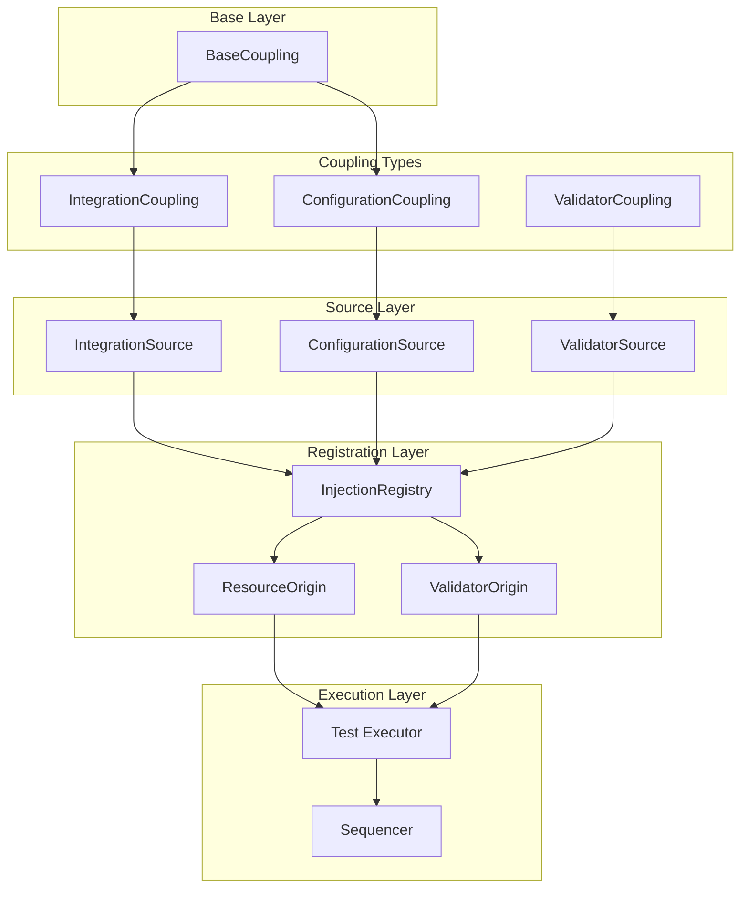
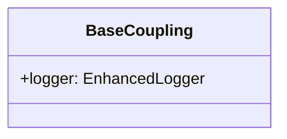
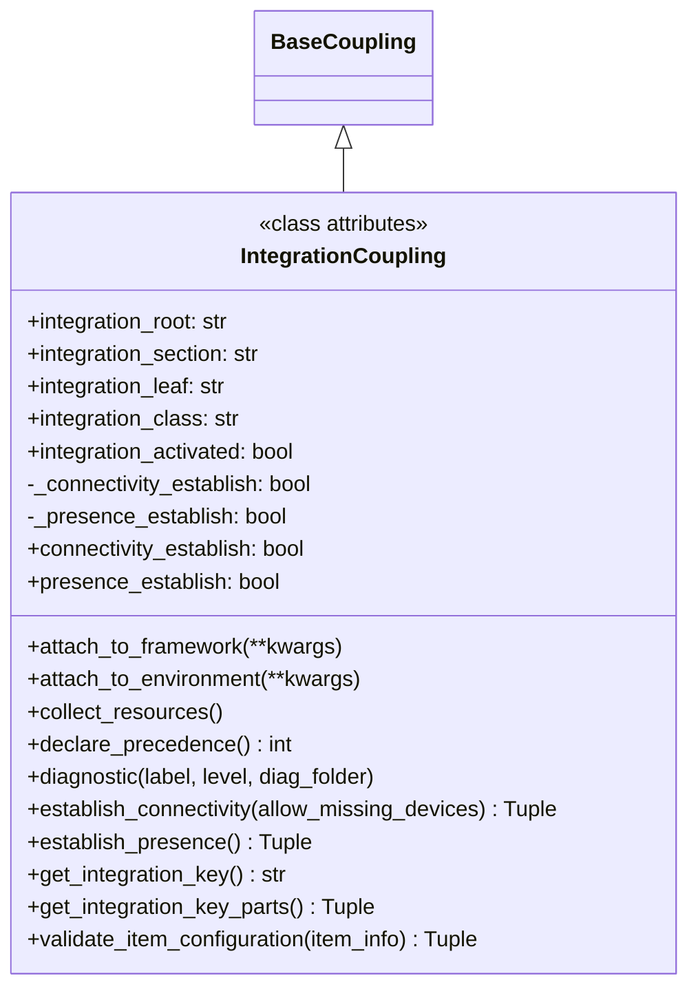
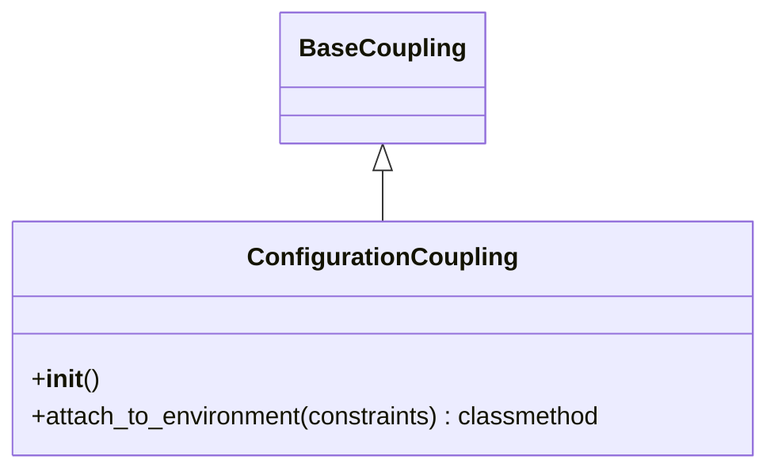
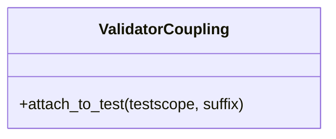
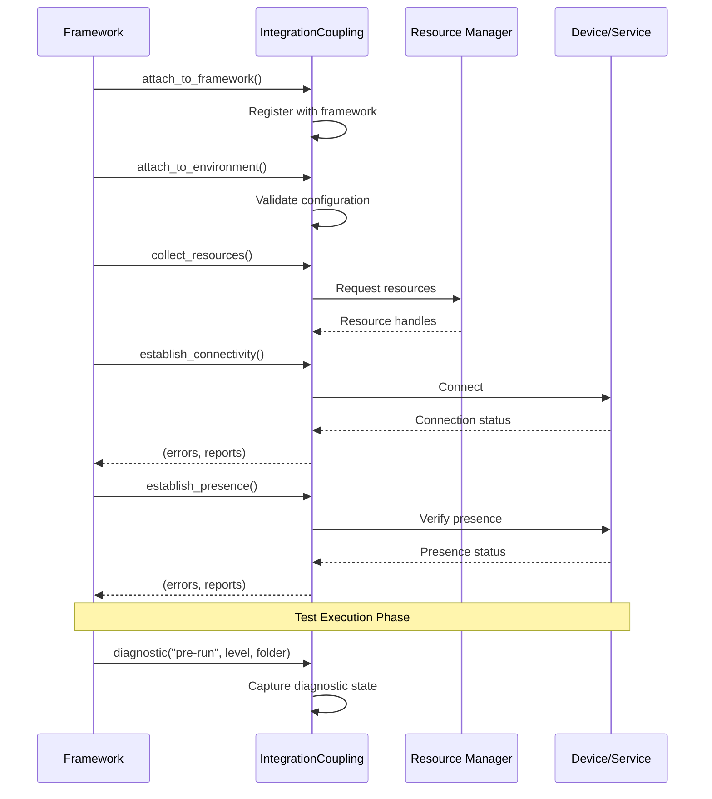
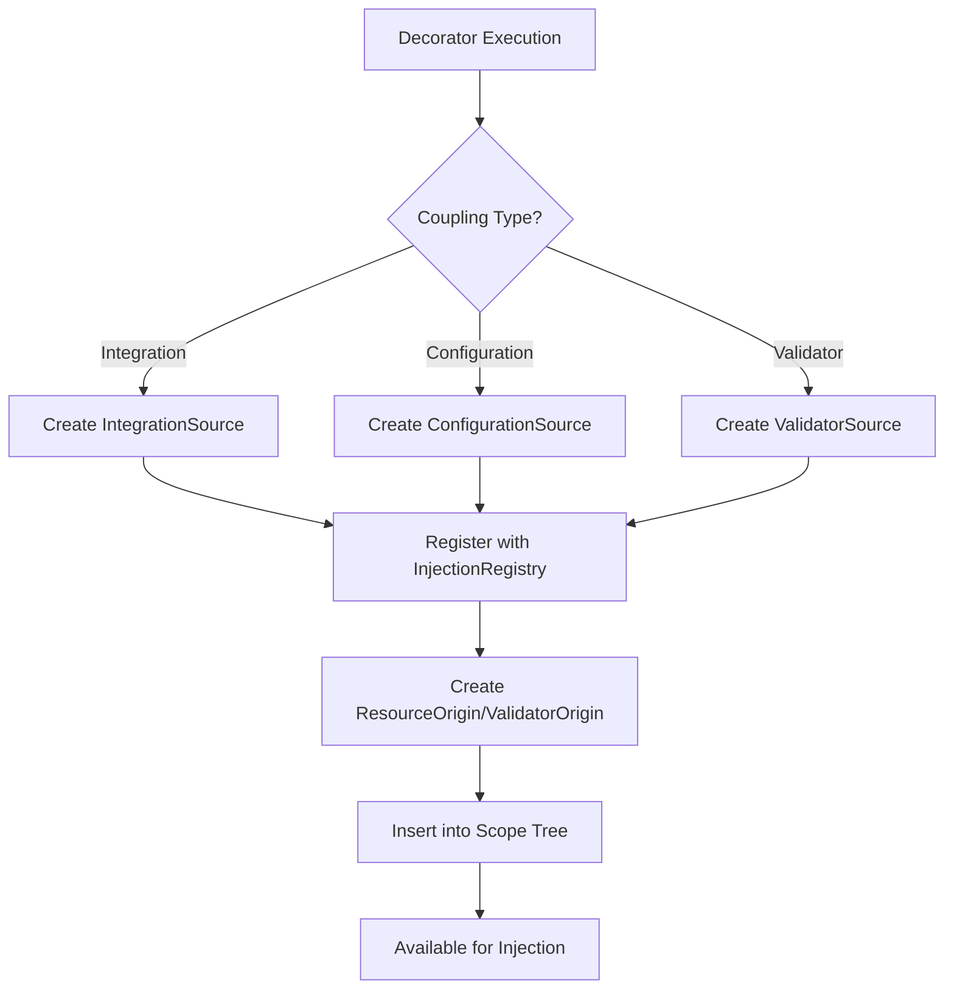
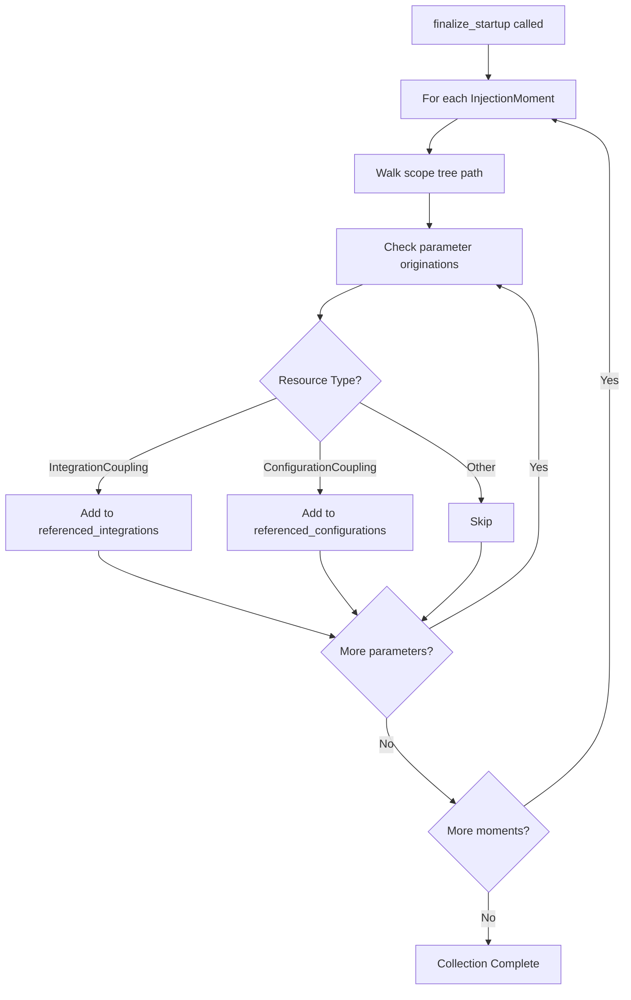
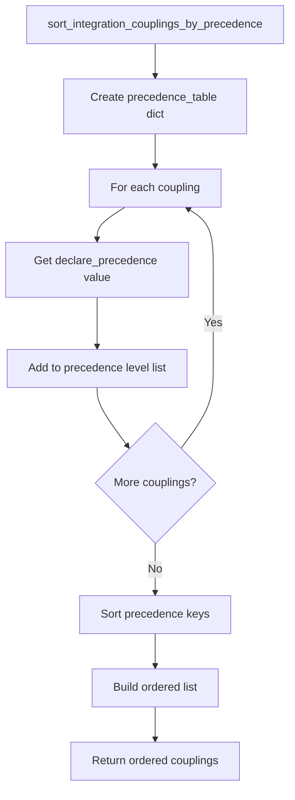
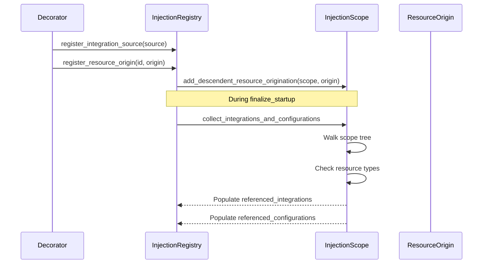

# Coupling System - Design Document

## Overview

The Coupling System provides a mechanism for integrating external resources, configurations, and validators into the TestBase test execution framework. It enables:

- Defining integration points with external systems (devices, services, databases)
- Managing configuration resources that provide test environment setup
- Creating validators that verify test outcomes
- Establishing lifecycle hooks for resource management
- Supporting hierarchical resource organization with precedence ordering

The system works in conjunction with the Dependency Injection System to provide injectable resources and with the Test Execution Engine to manage resource lifecycles during test runs.

## Architecture

### High-Level Component Diagram



### Components

#### 1. BaseCoupling (Abstract Base)

The `BaseCoupling` class serves as the foundational type for all coupling-based resources. It provides common infrastructure including logging capabilities.



**Key Characteristics:**

| Attribute | Type | Purpose |
|-----------|------|---------|
| `logger` | `EnhancedLogger` | Shared logging instance for all coupling operations |

#### 2. IntegrationCoupling (External Resource Integration)

The `IntegrationCoupling` class is the primary mechanism for integrating external automation resources into the test environment. It provides a structured lifecycle for resource discovery, connectivity, and diagnostics.



**Integration Key Structure:**

The integration key uniquely identifies an integration coupling using a hierarchical naming scheme:

```
{integration_root}:{integration_section}:{integration_leaf}:{integration_class}
```

| Component | Purpose | Example |
|-----------|---------|---------|
| `integration_root` | Top-level category | `"devices"` |
| `integration_section` | Subcategory | `"network"` |
| `integration_leaf` | Specific type | `"router"` |
| `integration_class` | Implementation class | `"CiscoRouter"` |

**Lifecycle Methods:**

| Method | Phase | Purpose |
|--------|-------|---------|
| `attach_to_framework` | Registration | Register with test framework for participation |
| `attach_to_environment` | Configuration | Process configuration and validate environment |
| `collect_resources` | Resource Acquisition | Connect to resource management system |
| `establish_connectivity` | Connection | Establish connections to compute/storage resources |
| `establish_presence` | Presence | Verify resource availability and readiness |
| `diagnostic` | Diagnostics | Generate diagnostic information at checkpoints |

**State Tracking:**

| Property | Type | Purpose |
|----------|------|---------|
| `connectivity_establish` | `bool` | Whether connectivity has been established |
| `presence_establish` | `bool` | Whether presence has been established |
| `integration_activated` | `bool` | Class-level flag indicating activation status |

#### 3. ConfigurationCoupling (Environment Configuration)

The `ConfigurationCoupling` class provides a mechanism for declaring configuration specifications that must be satisfied for a test environment to function.



**Key Methods:**

| Method | Purpose | Parameters |
|--------|---------|------------|
| `attach_to_environment` | Process configuration with optional constraints | `constraints: Optional[Dict]` |

**Usage Pattern:**

```python
class DatabaseConfiguration(ConfigurationCoupling):
    """Configuration for database connectivity."""
    
    @classmethod
    def attach_to_environment(cls, constraints=None):
        # Load database configuration
        # Validate connection parameters
        # Set up connection pool
        pass
```

#### 4. ValidatorCoupling (Test Validation)

The `ValidatorCoupling` class provides a base type for validator objects that verify test outcomes and attach to test scopes.



**Key Methods:**

| Method | Purpose | Parameters |
|--------|---------|------------|
| `attach_to_test` | Attach validator to test scope | `testscope: Any`, `suffix: str` |

**Usage Pattern:**

```python
class ResponseValidator(ValidatorCoupling):
    """Validates HTTP response characteristics."""
    
    def attach_to_test(self, testscope, suffix):
        # Bind validator to test scope
        # Configure validation rules
        pass
```

### Data Flow

#### Integration Coupling Lifecycle Flow



#### Coupling Registration Flow



#### Coupling Collection Flow



#### Precedence-Based Ordering Flow



### Design Patterns

#### 1. Template Method Pattern

`IntegrationCoupling` defines a template for integration lifecycle with abstract methods that derived classes must implement:

```python
class IntegrationCoupling(BaseCoupling):
    
    @classmethod
    def attach_to_framework(cls, **kwargs):
        """Must be overloaded by derived types."""
        raise AbstractMethodError(...)
    
    @classmethod
    def attach_to_environment(cls, **kwargs):
        """Must be overloaded by derived types."""
        raise AbstractMethodError(...)
    
    # ... other abstract methods
```

#### 2. Strategy Pattern

The precedence-based ordering uses a strategy pattern to determine coupling initialization order:

```python
def sort_integration_couplings_by_precedence(coupling_list):
    precedence_table = {}
    
    for coupling in coupling_list:
        precedence = coupling.declare_precedence()
        # Group by precedence level
        if precedence not in precedence_table:
            precedence_table[precedence] = []
        precedence_table[precedence].append(coupling)
    
    # Sort and flatten
    ordered = []
    for key in sorted(precedence_table.keys()):
        ordered.extend(precedence_table[key])
    
    return ordered
```

#### 3. Factory Pattern

Coupling instances are created through factory functions registered with decorators:

```python
@testbase.register.integration_factory()
def create_device_coupling() -> Generator[DeviceCoupling, None, None]:
    coupling = DeviceCoupling()
    yield coupling
    # Cleanup on generator close
```

#### 4. Observer Pattern

The diagnostic system implements an observer-like pattern where couplings respond to diagnostic events:

```python
# Framework notifies all couplings at diagnostic points
for coupling in active_couplings:
    coupling.diagnostic("pre-run", level, diag_folder)
```

### Integration Key System

The integration key system provides a hierarchical naming scheme for organizing and identifying integration couplings.

#### Key Format

```
{root}:{section}:{leaf}:{class}
```

#### Key Components

| Level | Purpose | Example Values |
|-------|---------|----------------|
| Root | Top-level category | `devices`, `services`, `databases` |
| Section | Subcategory | `network`, `storage`, `compute` |
| Leaf | Specific type | `router`, `switch`, `server` |
| Class | Implementation | `CiscoRouter`, `JuniperSwitch` |

#### Key Operations

```python
# Get full key string
key = coupling.get_integration_key()
# Result: "devices:network:router:CiscoRouter"

# Get key parts tuple
parts = coupling.get_integration_key_parts()
# Result: ("devices", "network", "router", "CiscoRouter")
```

### Helper Functions

#### is_integration_coupling

Determines if a type is an `IntegrationCoupling` subclass (but not the base class itself):

```python
def is_integration_coupling(cls):
    is_integmi = False
    if inspect.isclass(cls) and cls is not IntegrationCoupling and issubclass(cls, IntegrationCoupling):
        is_integmi = True
    return is_integmi
```

#### sort_integration_couplings_by_precedence

Orders integration couplings based on their declared precedence values:

```python
def sort_integration_couplings_by_precedence(coupling_list):
    # Groups couplings by precedence level
    # Returns ordered list from lowest to highest precedence
```

## Integration Points

### With Dependency Injection System

- `IntegrationSource`, `ConfigurationSource`, and `ValidatorSource` wrap coupling factory functions
- `ResourceOrigin` and `ValidatorOrigin` track coupling instances in the scope tree
- `InjectionRegistry` maintains tables of referenced integrations and configurations
- The `collect_integrations_and_configurations_for_injection_moment` method identifies all couplings needed for execution



### With Test Declaration System

- The `@integration_factory` decorator registers integration coupling factories
- The `@configuration_factory` decorator registers configuration coupling factories
- The `@validator_factory` decorator registers validator coupling factories
- Type checking ensures correct coupling base classes are used

### With Test Execution Engine

- The execution engine uses `referenced_integrations` to determine which integrations to activate
- The execution engine uses `referenced_configurations` to determine which configurations to load
- Couplings are initialized in precedence order before test execution
- Diagnostic methods are called at pre-run and post-run checkpoints

### With Constraints System

- `ConfigurationCoupling.attach_to_environment` accepts optional constraints
- Constraints can be used to parameterize configuration behavior
- Integration couplings can validate item configurations against constraints

## Configuration

### Integration Coupling Definition

```python
class DeviceIntegration(IntegrationCoupling):
    """Integration coupling for device automation."""
    
    integration_root = "devices"
    integration_section = "network"
    integration_leaf = "router"
    integration_class = "DeviceIntegration"
    
    @classmethod
    def attach_to_framework(cls, **kwargs):
        # Register with framework
        pass
    
    @classmethod
    def attach_to_environment(cls, **kwargs):
        # Validate environment configuration
        pass
    
    @classmethod
    def collect_resources(cls):
        # Acquire resources from resource manager
        pass
    
    @classmethod
    def declare_precedence(cls) -> int:
        return 100  # Lower values initialize first
    
    @classmethod
    def establish_connectivity(cls, allow_missing_devices=False):
        errors = []
        reports = {}
        # Establish connections
        return (errors, reports)
    
    @classmethod
    def establish_presence(cls):
        errors = []
        reports = {}
        # Verify presence
        return (errors, reports)
    
    @classmethod
    def diagnostic(cls, label, level, diag_folder):
        # Generate diagnostic output
        pass
    
    @classmethod
    def validate_item_configuration(cls, item_info):
        errors = []
        warnings = []
        # Validate configuration
        return (errors, warnings)
```

### Configuration Coupling Definition

```python
class TestConfiguration(ConfigurationCoupling):
    """Configuration coupling for test environment."""
    
    @classmethod
    def attach_to_environment(cls, constraints=None):
        # Load and validate configuration
        if constraints:
            # Apply constraint-based configuration
            pass
```

### Validator Coupling Definition

```python
class ResponseValidator(ValidatorCoupling):
    """Validator for HTTP responses."""
    
    def attach_to_test(self, testscope, suffix):
        # Bind to test scope
        self._testscope = testscope
        self._suffix = suffix
```

### Factory Registration

```python
@testbase.register.integration_factory()
def create_device_integration() -> Generator[DeviceIntegration, None, None]:
    integration = DeviceIntegration()
    yield integration
    # Cleanup

@testbase.register.configuration_factory()
def create_test_configuration() -> Generator[TestConfiguration, None, None]:
    config = TestConfiguration()
    yield config

@testbase.register.validator_factory()
def create_response_validator() -> ResponseValidator:
    return ResponseValidator()
```

## Error Handling

### AbstractMethodError

Raised when abstract methods are called without being overloaded:

```python
@classmethod
def attach_to_framework(cls, **kwargs):
    errmsg = "The 'attach_to_framework' method must be overloaded by derived integration coupling types."
    raise AbstractMethodError(errmsg)
```

### SemanticError

Raised for semantic violations during registration:

- Using `@integration_factory` on non-`IntegrationCoupling` types
- Using `@configuration_factory` on non-`ConfigurationCoupling` types
- Returning instead of yielding from integration factories

### Connectivity Errors

The `establish_connectivity` method returns error information:

```python
errors, reports = coupling.establish_connectivity(allow_missing_devices=False)
# errors: List[str] - Error messages for failed connections
# reports: Dict - Connectivity reports per device
```

### Configuration Validation Errors

The `validate_item_configuration` method returns validation results:

```python
errors, warnings = coupling.validate_item_configuration(item_info)
# errors: List[str] - Critical configuration errors
# warnings: List[str] - Non-critical configuration warnings
```

## Testing Strategy

### Unit Testing Focus Areas

1. **BaseCoupling**
   - Logger initialization
   - Inheritance behavior

2. **IntegrationCoupling**
   - Integration key generation and parsing
   - State tracking properties
   - Abstract method enforcement
   - Precedence declaration

3. **ConfigurationCoupling**
   - Constraint handling in `attach_to_environment`
   - Inheritance from BaseCoupling

4. **ValidatorCoupling**
   - Abstract method enforcement
   - Test scope attachment

5. **Helper Functions**
   - `is_integration_coupling` type checking
   - `sort_integration_couplings_by_precedence` ordering

### Test Categories

| Category | Components | Focus |
|----------|------------|-------|
| Type Hierarchy | All coupling classes | Inheritance, abstract methods |
| Integration Keys | `IntegrationCoupling` | Key generation, parsing |
| Lifecycle | `IntegrationCoupling` | Method call ordering, state transitions |
| Registration | Factory decorators | Source creation, registry integration |
| Collection | `InjectionScope` | Coupling discovery, type filtering |

### Edge Cases

1. **Empty integration key components**: Behavior with `None` or empty string values
2. **Duplicate precedence values**: Multiple couplings with same precedence
3. **Missing abstract implementations**: Proper error raising
4. **Circular dependencies**: Couplings that depend on each other
5. **Constraint propagation**: Constraints passed through configuration chain

## Scope Management

### Coupling Scope Hierarchy

Couplings follow the same scope hierarchy as the injection system:

```
<session> (root)
├── package_a
│   ├── module_1
│   │   └── test_function_1
│   └── module_2
└── package_b
    └── module_3
```

### Coupling Lifespan

| Coupling Type | Typical Lifespan | Scope Level |
|---------------|------------------|-------------|
| IntegrationCoupling | Session | Root (`<session>`) |
| ConfigurationCoupling | Session/Package | Root or Package |
| ValidatorCoupling | Test | Injection moment |

### Coupling Collection

The `collect_integrations_and_configurations_for_injection_moment` method walks the scope tree and identifies all couplings referenced by tests:

```python
# In InjectionScope
def collect_integrations_and_configurations_for_injection_moment(
    self, 
    integration_table: Dict[Callable, IntegrationCoupling],
    configuration_table: Dict[Callable, ConfigurationCoupling]
):
    for param_orig in self._parameter_originations.values():
        if not param_orig.implied:
            resource_type = param_orig.source_resource_type
            if issubclass(resource_type, IntegrationCoupling):
                integration_table[source_function] = resource_type
            elif issubclass(resource_type, ConfigurationCoupling):
                configuration_table[source_function] = resource_type
```

## Known Limitations

### No Dynamic Coupling Discovery

Couplings must be statically declared and registered at import time. Runtime coupling discovery is not supported.

### Single Precedence Level

Each coupling can only declare a single precedence value. Complex ordering requirements may need manual coordination.

### No Coupling Dependencies

The system does not support explicit dependency declarations between couplings. Precedence ordering is the only mechanism for controlling initialization order.

### Limited Validator Lifecycle

`ValidatorCoupling` has a simpler lifecycle than `IntegrationCoupling`, with only the `attach_to_test` method for customization.

## Future Enhancements

### Potential Additions

1. **Coupling Dependencies**: Explicit dependency declarations between couplings
2. **Dynamic Discovery**: Runtime coupling registration and discovery
3. **Coupling Groups**: Logical grouping of related couplings
4. **Health Checks**: Periodic health verification during test execution
5. **Coupling Metrics**: Performance and usage metrics collection
6. **Async Lifecycle**: Asynchronous lifecycle method support
7. **Coupling Profiles**: Named coupling configurations for different environments
8. **Coupling Events**: Event-based notifications for coupling state changes
9. **Resource Pooling**: Shared resource pools across couplings
10. **Coupling Versioning**: Version compatibility checking between couplings
