# Debugging Support - Design Document

## Overview

The Debugging Support system provides infrastructure for interactive debugging of test execution within the TestBase framework. It enables developers to pause test execution at well-known breakpoints using either the built-in Python debugger (pdb) or the remote debugging protocol (debugpy) for IDE integration.

The system supports:
- **Well-known breakpoints**: Predefined pause points at key stages of test execution
- **Multiple debugger backends**: Support for pdb (local) and debugpy (remote/IDE)
- **Code generation integration**: Automatic insertion of breakpoint code into generated test sequence documents
- **Remote debugging assistant**: Background thread for on-demand remote debugging connections

## Architecture

### High-Level Component Diagram

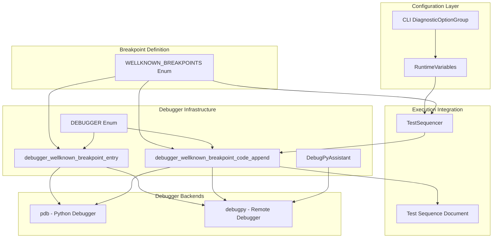

### Components

#### 1. WELLKNOWN_BREAKPOINTS Enum

The `WELLKNOWN_BREAKPOINTS` enum defines predefined breakpoint locations within the test execution lifecycle.

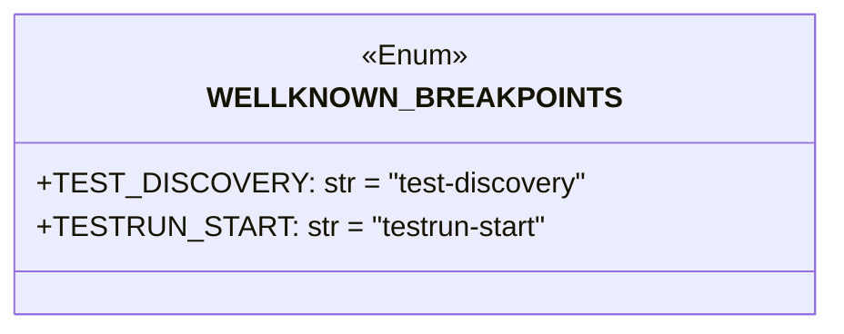

**Breakpoint Definitions:**

| Breakpoint | Value | Description | Trigger Point |
|------------|-------|-------------|---------------|
| `TEST_DISCOVERY` | `"test-discovery"` | Pause during test discovery phase | Before test collection begins |
| `TESTRUN_START` | `"testrun-start"` | Pause at the start of test execution | Entry point of session() in sequence document |

#### 2. DEBUGGER Enum

The `DEBUGGER` enum identifies supported debugger backends.

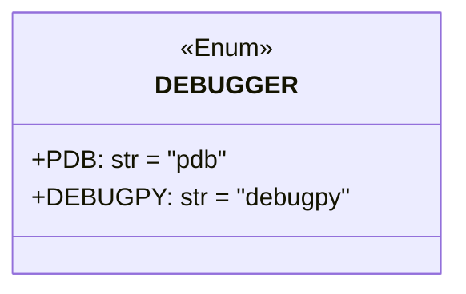

**Debugger Backends:**

| Debugger | Value | Use Case | Features |
|----------|-------|----------|----------|
| `PDB` | `"pdb"` | Local terminal debugging | Built-in, no setup required |
| `DEBUGPY` | `"debugpy"` | Remote/IDE debugging | VS Code integration, remote attach |

#### 3. Breakpoint Entry Function

The `debugger_wellknown_breakpoint_entry` function triggers a breakpoint at runtime when the named breakpoint is enabled.

```python
def debugger_wellknown_breakpoint_entry(
    debugger: str, 
    breakpoint_name: str, 
    configured_breakpoints: List[str]
) -> None
```

**Parameters:**

| Parameter | Type | Description |
|-----------|------|-------------|
| `debugger` | `str` | Debugger backend to use (`pdb` or `debugpy`) |
| `breakpoint_name` | `str` | Well-known breakpoint identifier |
| `configured_breakpoints` | `List[str]` | List of enabled breakpoints |

**Behavior by Debugger:**

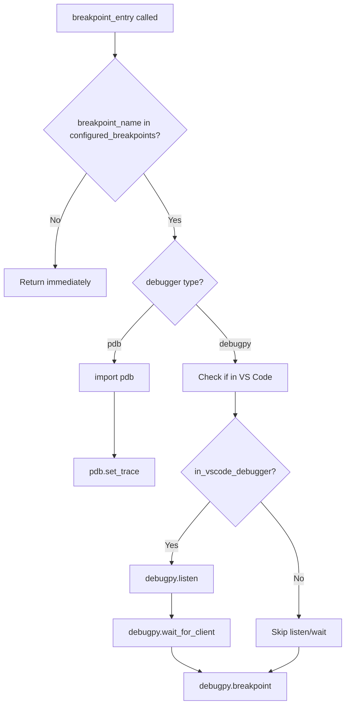

#### 4. Breakpoint Code Generation Function

The `debugger_wellknown_breakpoint_code_append` function generates source code lines that trigger breakpoints when the test sequence document is executed.

```python
def debugger_wellknown_breakpoint_code_append(
    debugger: str, 
    breakpoint_name: str, 
    code_lines: list, 
    current_indent: str,
    configured_breakpoints: List[str]
) -> None
```

**Parameters:**

| Parameter | Type | Description |
|-----------|------|-------------|
| `debugger` | `str` | Debugger backend to use |
| `breakpoint_name` | `str` | Well-known breakpoint identifier |
| `code_lines` | `list` | List of code lines being generated |
| `current_indent` | `str` | Current indentation prefix |
| `configured_breakpoints` | `List[str]` | List of enabled breakpoints |

**Generated Code Examples:**

For `pdb`:
```python
# The debug flag was passed on the commandline so we break here.
import pdb
pdb.set_trace()
```

For `debugpy`:
```python
# The remote debug flag was passed on the commandline so we break here.
import debugpy
debugpy.listen(("0.0.0.0", 5678))
debugpy.wait_for_client()
debugpy.breakpoint()
```

#### 5. DebugPyAssistant Class

The `DebugPyAssistant` provides a background daemon thread that exposes a debugpy endpoint for on-demand remote debugging.

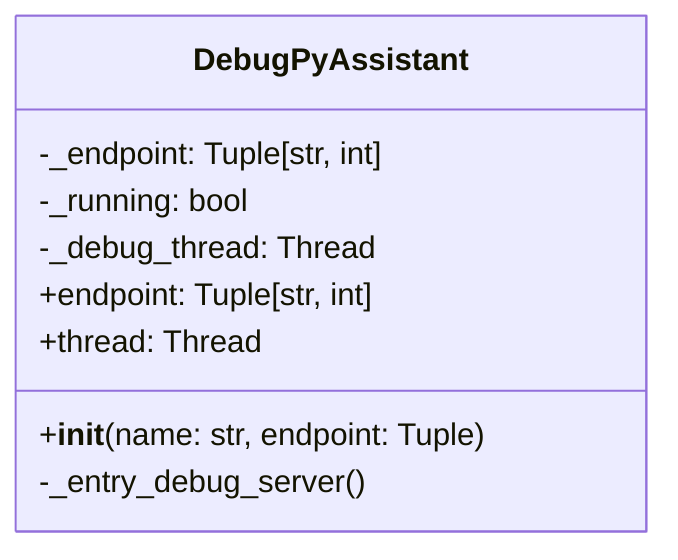

**Default Configuration:**

| Setting | Value | Description |
|---------|-------|-------------|
| Default Port | `5678` | Standard debugpy port |
| Assistant Port | `5679` | DebugPyAssistant dedicated port |
| Listen Address | `"0.0.0.0"` | Accept connections from any interface |

**Thread Lifecycle:**

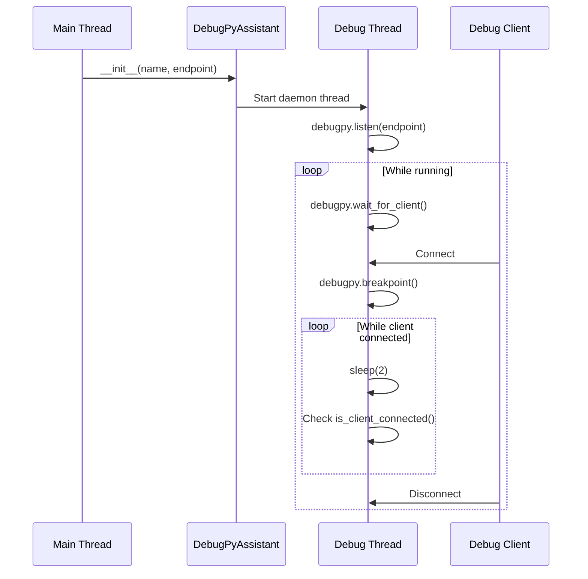

#### 6. VS Code Detection Function

The `in_vscode_debugger` function detects whether the current process is running under VS Code's debugger.

```python
def in_vscode_debugger() -> bool
```

**Detection Logic:**

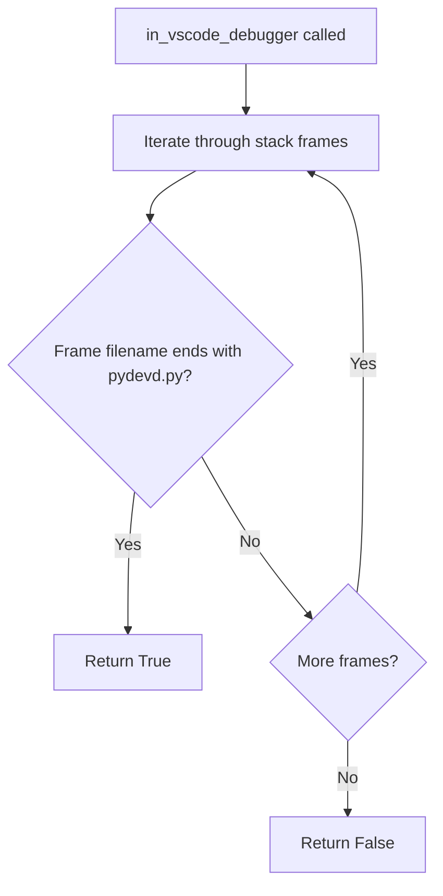

### Data Flow

#### Breakpoint Configuration Flow

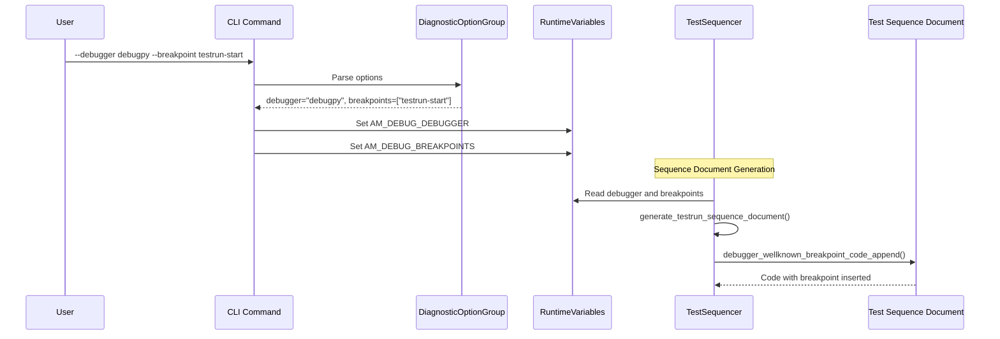

#### Runtime Breakpoint Execution Flow

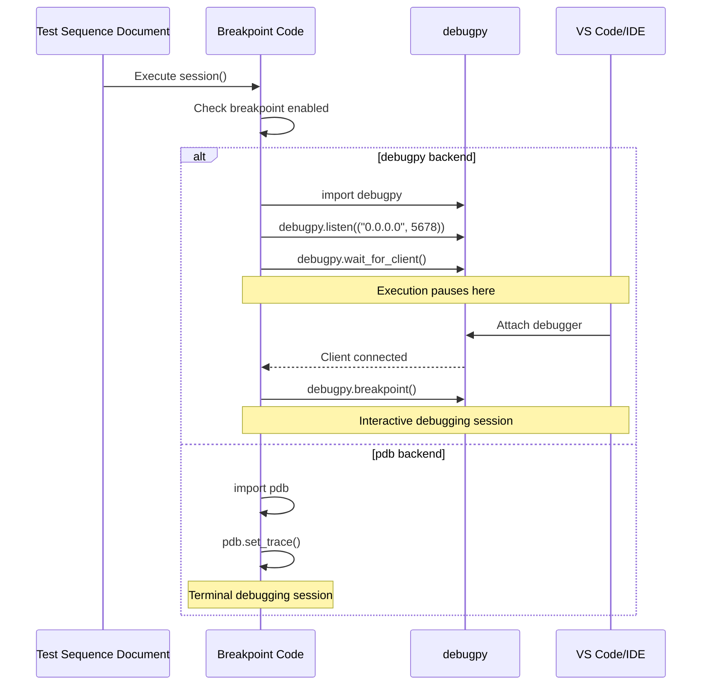

### Design Patterns

#### 1. Strategy Pattern

Different debugger backends implement different breakpoint strategies:

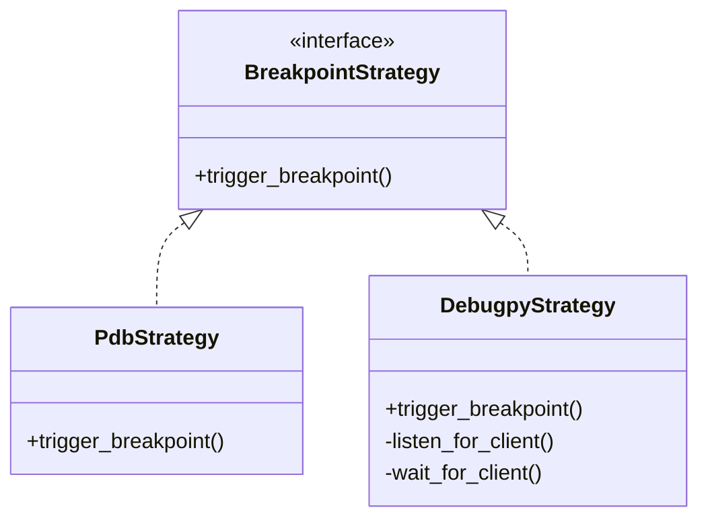

#### 2. Template Method Pattern

The breakpoint code generation follows a template with debugger-specific implementations:

```python
def debugger_wellknown_breakpoint_code_append(...):
    if breakpoint_name in configured_breakpoints:
        if debugger == DEBUGGER.PDB:
            # PDB-specific code generation
        elif debugger == DEBUGGER.DEBUGPY:
            # debugpy-specific code generation
```

#### 3. Daemon Thread Pattern

The `DebugPyAssistant` uses a daemon thread to provide non-blocking debug endpoint availability:

```python
self._debug_thread = threading.Thread(
    name=name, 
    target=self._entry_debug_server, 
    daemon=True  # Thread terminates when main program exits
)
```

## Integration Points

### With CLI System

The debugging system integrates with the CLI through the `DiagnosticOptionGroup`:

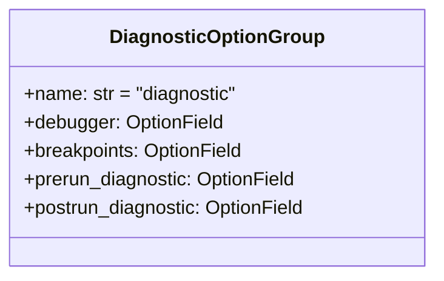

**CLI Options:**

| Option | Type | Choices | Description |
|--------|------|---------|-------------|
| `--debugger` | Choice | `pdb`, `debugpy` | Debugger backend to activate |
| `--breakpoint` | Multiple Choice | `test-discovery`, `testrun-start` | Breakpoints to enable |

### With Test Sequencer

The `TestSequencer` uses debugging functions during sequence document generation:

```python
# In _generate_session_method()
debugger_name = RuntimeVariables.AM_DEBUG_DEBUGGER
configured_breakpoints = RuntimeVariables.AM_DEBUG_BREAKPOINTS

if debugger_name is not None and configured_breakpoints is not None:
    debugger_wellknown_breakpoint_code_append(
        debugger_name, 
        WELLKNOWN_BREAKPOINTS.TESTRUN_START, 
        method_lines, 
        current_indent, 
        configured_breakpoints
    )
```

### With Runtime Variables

The debugging configuration is stored in runtime variables:

| Variable | Type | Description |
|----------|------|-------------|
| `AM_DEBUG_DEBUGGER` | `str` | Selected debugger backend |
| `AM_DEBUG_BREAKPOINTS` | `List[str]` | List of enabled breakpoints |

### With Generated Test Sequence Documents

Breakpoint code is inserted into the generated `testrun_sequence.py`:

```python
def session(sequencer):
    """
    This is the entry point for the test run sequence document.
    """

    # The remote debug flag was passed on the commandline so we break here.
    import debugpy
    debugpy.listen(("0.0.0.0", 5678))
    debugpy.wait_for_client()
    debugpy.breakpoint()

    with sequencer.enter_session_scope_context() as ssc:
        # ... test execution continues
```

## Configuration

### Network Configuration

| Setting | Default | Environment Variable | Description |
|---------|---------|---------------------|-------------|
| Debug Port | `5678` | - | Standard debugpy listen port |
| Assistant Port | `5679` | - | DebugPyAssistant dedicated port |
| Listen Address | `"0.0.0.0"` | - | Network interface to bind |

### VS Code Launch Configuration

Example `launch.json` for attaching to a TestBase debug session:

```json
{
    "version": "0.2.0",
    "configurations": [
        {
            "name": "TestBase: Attach",
            "type": "debugpy",
            "request": "attach",
            "connect": {
                "host": "localhost",
                "port": 5678
            },
            "pathMappings": [
                {
                    "localRoot": "${workspaceFolder}",
                    "remoteRoot": "."
                }
            ]
        }
    ]
}
```

## Error Handling

### Debugger Import Errors

If the selected debugger is not installed, an `ImportError` will be raised:

```python
# For debugpy
import debugpy  # Raises ImportError if not installed
```

### Connection Timeout

When using debugpy, `wait_for_client()` blocks indefinitely until a client connects. Users should be aware that test execution will not proceed until a debugger attaches.

### Port Conflicts

If the debug port is already in use, debugpy will raise an exception. The `DebugPyAssistant` uses a separate port (5679) to avoid conflicts with direct debugging sessions.

## Usage Examples

### Enabling Breakpoints via CLI

```bash
# Enable testrun-start breakpoint with pdb
testbase testing run --root ./tests --debugger pdb --breakpoint testrun-start

# Enable testrun-start breakpoint with debugpy for remote debugging
testbase testing run --root ./tests --debugger debugpy --breakpoint testrun-start

# Enable multiple breakpoints
testbase testing run --root ./tests --debugger debugpy \
    --breakpoint test-discovery \
    --breakpoint testrun-start
```

### Programmatic Breakpoint Entry

```python
from ccai.xmodules.debugging import debugger_wellknown_breakpoint_entry, DEBUGGER

# Trigger a breakpoint if configured
debugger_wellknown_breakpoint_entry(
    debugger=DEBUGGER.DEBUGPY,
    breakpoint_name="testrun-start",
    configured_breakpoints=["testrun-start"]
)
```

### Using DebugPyAssistant

```python
from ccai.xmodules.debugging import DebugPyAssistant

# Start a background debug endpoint
assistant = DebugPyAssistant(
    name="TestDebugAssistant",
    endpoint=("0.0.0.0", 5679)
)

# The assistant runs in a daemon thread
# Connect to port 5679 from your IDE to debug
```

### Checking VS Code Debugger Status

```python
from ccai.xmodules.debugging import in_vscode_debugger

if in_vscode_debugger():
    print("Running under VS Code debugger")
else:
    print("Not running under VS Code debugger")
```

## File Structure

```
source/packages/ccai/testbase/
├── breakpoints.py              # WELLKNOWN_BREAKPOINTS enum
├── cli/
│   └── options.py              # DiagnosticOptionGroup with debugger options
└── sequencing/
    └── testsequencer.py        # Breakpoint code generation integration

.venv/src/codecraftai-xmodules/source/packages/ccai/xmodules/
└── debugging.py                # Core debugging infrastructure
                                # - DEBUGGER enum
                                # - debugger_wellknown_breakpoint_entry()
                                # - debugger_wellknown_breakpoint_code_append()
                                # - DebugPyAssistant class
                                # - in_vscode_debugger()
```

## Testing Strategy

### Unit Testing Focus Areas

1. **WELLKNOWN_BREAKPOINTS Enum**
   - Verify enum values are correct strings
   - Ensure enum members are accessible

2. **DEBUGGER Enum**
   - Verify enum values match expected debugger names
   - Test string comparison behavior

3. **in_vscode_debugger Function**
   - Test detection when running under VS Code
   - Test detection when running standalone

4. **debugger_wellknown_breakpoint_entry Function**
   - Test with breakpoint not in configured list (should return immediately)
   - Test with pdb debugger (mock pdb.set_trace)
   - Test with debugpy debugger (mock debugpy functions)

5. **debugger_wellknown_breakpoint_code_append Function**
   - Test code generation for pdb
   - Test code generation for debugpy
   - Test code generation when breakpoint not configured
   - Verify correct indentation in generated code

6. **DebugPyAssistant Class**
   - Test initialization creates daemon thread
   - Test endpoint property returns correct value
   - Test thread property returns thread object

### Integration Testing

1. **CLI Integration**
   - Test `--debugger` option parsing
   - Test `--breakpoint` option parsing (single and multiple)
   - Verify runtime variables are set correctly

2. **Sequence Document Generation**
   - Generate sequence document with breakpoints enabled
   - Verify breakpoint code is inserted at correct location
   - Verify generated code is syntactically correct

3. **End-to-End Debugging**
   - Run test with pdb breakpoint and verify pause
   - Run test with debugpy breakpoint and verify remote attach works

### Test Categories

| Category | Components | Focus |
|----------|------------|-------|
| Enums | `WELLKNOWN_BREAKPOINTS`, `DEBUGGER` | Value correctness |
| Detection | `in_vscode_debugger` | Environment detection |
| Entry | `debugger_wellknown_breakpoint_entry` | Runtime breakpoint triggering |
| Code Gen | `debugger_wellknown_breakpoint_code_append` | Source code generation |
| Assistant | `DebugPyAssistant` | Background thread management |
| CLI | `DiagnosticOptionGroup` | Option parsing |
| Integration | `TestSequencer` | Breakpoint insertion |
