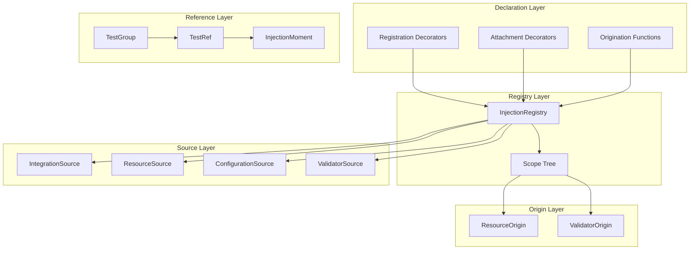
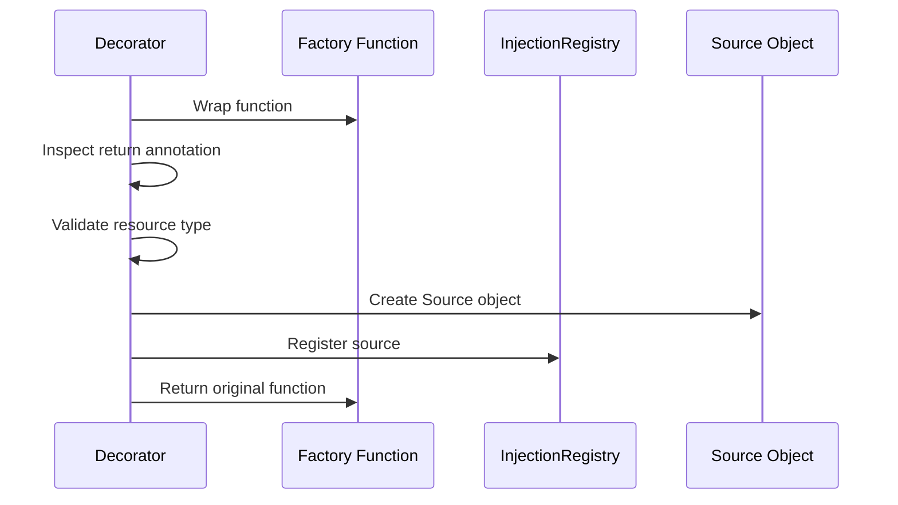
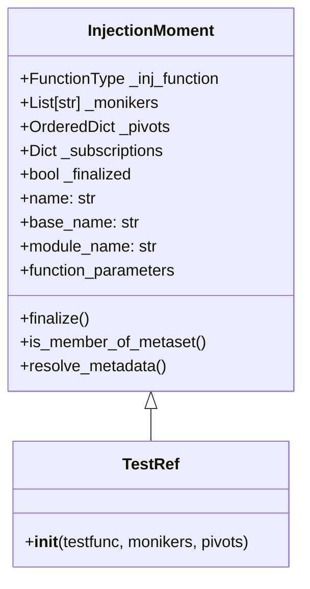
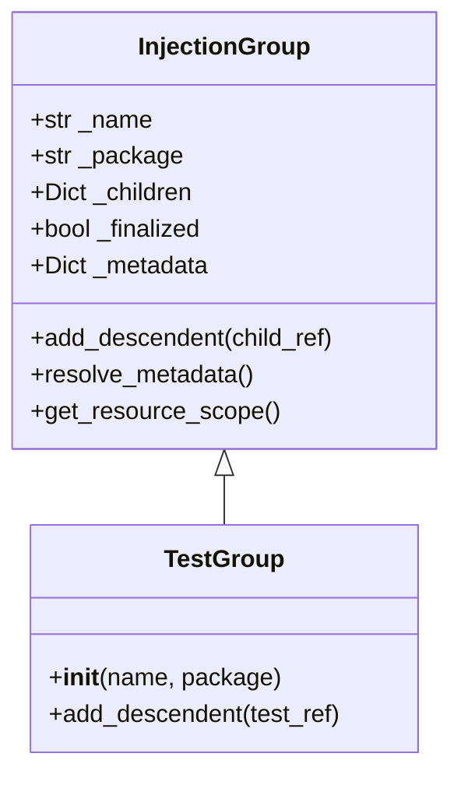
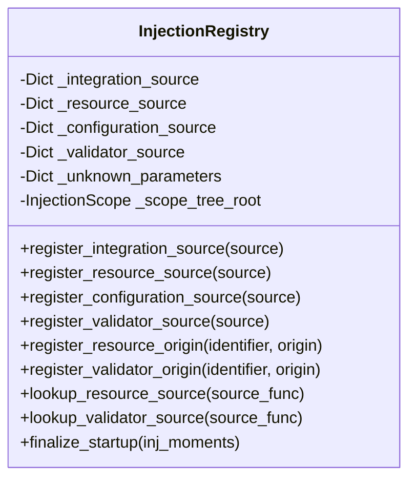
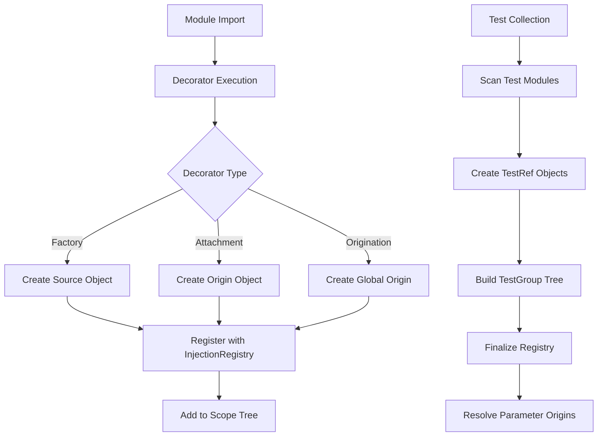
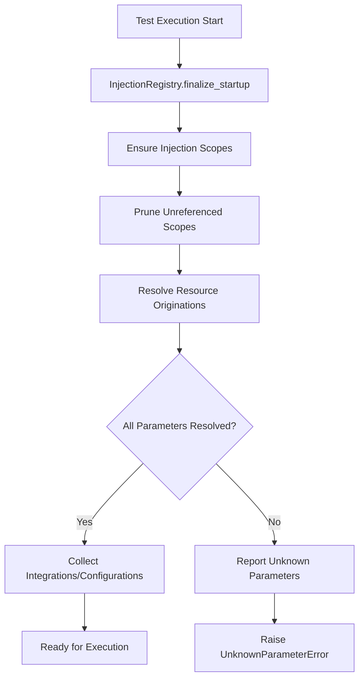

# Test Declaration and Registration - Design Document

## Overview

The Test Declaration and Registration system is the foundational component of the TestBase framework. It provides the mechanisms for declaring test functions, registering resource factories, and managing the lifecycle of injectable resources. The system uses Python decorators and a centralized registry to enable dependency injection and resource management across test execution scopes.

## Architecture

### High-Level Component Diagram



### Components

#### 1. Registration Decorators (`registrations.py`)

The registration decorators are factory functions that register resource providers with the injection registry.

| Decorator | Purpose | Resource Type |
|-----------|---------|---------------|
| `@integration_factory` | Registers integration coupling factories | `IntegrationCoupling` |
| `@resource_factory` | Registers general resource factories | Any type |
| `@configuration_factory` | Registers configuration coupling factories | `ConfigurationCoupling` |
| `@validator_factory` | Registers validator coupling factories | `ValidatorCoupling` |

**Registration Flow:**



#### 2. Attachment Decorators (`attachments.py`)

Attachment decorators bind resource sources to specific test functions, creating localized parameter origins.

| Decorator | Purpose |
|-----------|---------|
| `@parameter` | Attaches a resource source to a test function |
| `@validation` | Attaches a validator source to a test function |

#### 3. Origination Functions (`originiations.py`)

Origination functions create global parameter origins that are available across multiple scopes.

| Function | Purpose |
|----------|---------|
| `parameter()` | Creates a package or session-scoped parameter origin |

#### 4. TestRef Class (`testref.py`)

The `TestRef` class represents a reference to a test function. It extends `InjectionMoment` and provides:

- Delayed instantiation of test runtime state
- Memory-efficient test collection for large test suites
- Moniker and pivot support for test variations



#### 5. TestGroup Class (`testgroup.py`)

The `TestGroup` class organizes test references into a hierarchical tree structure based on module paths.



#### 6. InjectionRegistry (Singleton)

The `InjectionRegistry` is a singleton that manages all registered sources and origins:



### Data Flow

#### Test Discovery and Registration Flow



#### Resource Resolution Flow



### Design Patterns

#### 1. Singleton Pattern
The `InjectionRegistry` uses the singleton pattern to ensure a single global registry instance.

```python
class InjectionRegistry:
    _instance = None
    _initialized = False

    def __new__(cls):
        if cls._instance is None:
            cls._instance = super(InjectionRegistry, cls).__new__(cls)
        return cls._instance
```

#### 2. Decorator Pattern
Factory decorators wrap functions to register them while preserving their original behavior.

#### 3. Composite Pattern
`TestGroup` and `TestRef` form a composite tree structure where groups contain other groups or test references.

#### 4. Factory Method Pattern
Source objects (`IntegrationSource`, `ResourceSource`, etc.) encapsulate factory function metadata.

## Integration Points

### With Dependency Injection System
- Sources registered via decorators are consumed by the injection system
- Origins define parameter visibility and lifespan
- The scope tree manages parameter resolution across execution scopes

### With Test Execution Engine
- `TestRef` objects are consumed by the sequencer
- `TestGroup` hierarchy determines execution order
- Resource origins are resolved before test execution

### With Coupling System
- `IntegrationCoupling` resources are registered via `@integration_factory`
- `ConfigurationCoupling` resources are registered via `@configuration_factory`
- `ValidatorCoupling` resources are registered via `@validator_factory`

### With Markers System
- Test metadata is attached via marker decorators
- `MetaFilter` objects filter tests based on metadata
- Metadata resolution propagates through the group hierarchy

## Configuration

### Resource Lifespan Options

| Lifespan | Scope | Description |
|----------|-------|-------------|
| `Session` | Global | Resource lives for entire test session |
| `Package` | Module hierarchy | Resource lives within package scope |
| `Test` | Single test | Resource created/destroyed per test |

### Constraint Support

Factory decorators accept optional `constraints` parameter for conditional resource creation:

```python
@integration_factory(constraints={"platform": "linux"})
def linux_integration() -> Generator[LinuxIntegration, None, None]:
    ...
```

## Source and Origin Types

### Source Types

| Type | Base Class | Purpose |
|------|------------|---------|
| `IntegrationSource` | `SourceBase` | Wraps integration factory functions |
| `ResourceSource` | `SourceBase` | Wraps general resource factories |
| `ConfigurationSource` | `SourceBase` | Wraps configuration factory functions |
| `ValidatorSource` | `SourceBase` | Wraps validator factory functions |

### Origin Types

| Type | Purpose |
|------|---------|
| `ResourceOrigin` | Describes where a resource parameter originates |
| `ValidatorOrigin` | Describes where a validator parameter originates |

## Error Handling

### Semantic Errors

The system raises `SemanticError` for:
- Missing return type annotations on factory functions
- Invalid resource types (not subclassing required coupling types)
- Duplicate identifier registration in the same scope
- Using reserved identifier names (e.g., "constraints")
- Misuse of decorator APIs

### Unknown Parameter Errors

`UnknownParameterError` is raised when:
- A test function references a parameter that cannot be resolved
- No source is registered for a required parameter type

## Testing Strategy

### Unit Testing Focus Areas

1. **Decorator Registration**
   - Verify sources are correctly registered
   - Validate return type annotation enforcement
   - Test constraint handling

2. **Origin Creation**
   - Test scope assignment
   - Verify lifespan determination
   - Validate identifier uniqueness

3. **TestRef/TestGroup**
   - Test tree construction
   - Verify metadata resolution
   - Test filtering operations

4. **Registry Operations**
   - Test source lookup
   - Verify scope tree construction
   - Test finalization process

### Integration Testing

- End-to-end test discovery and registration
- Parameter resolution across scopes
- Integration with execution engine
