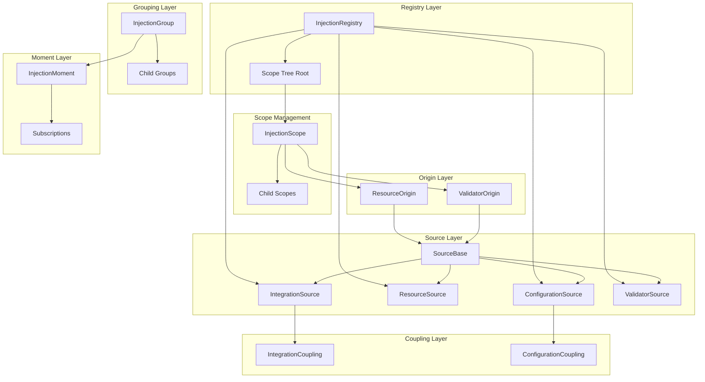
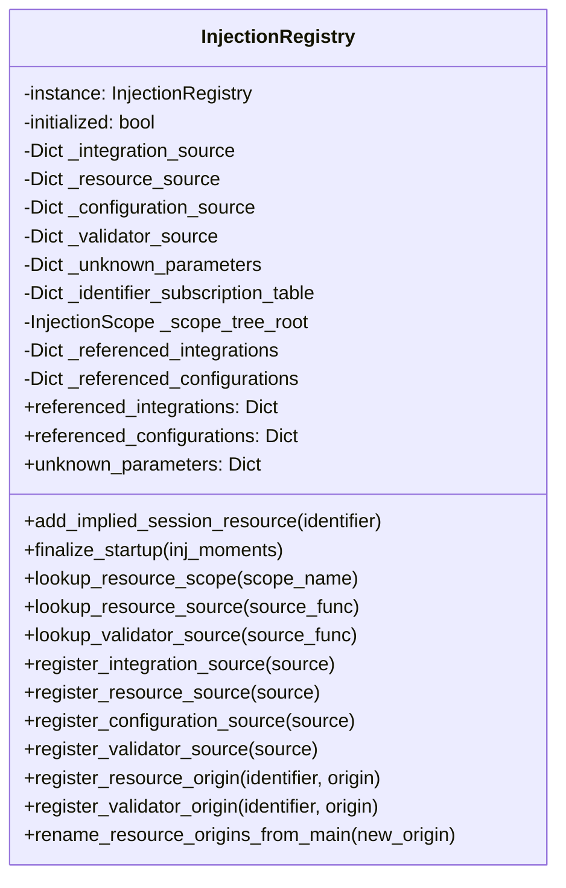
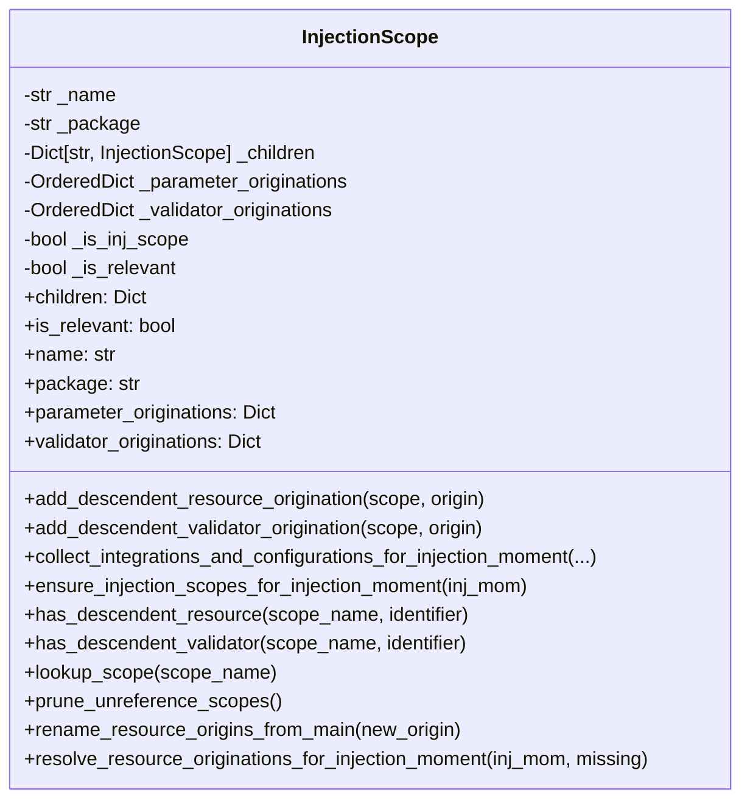
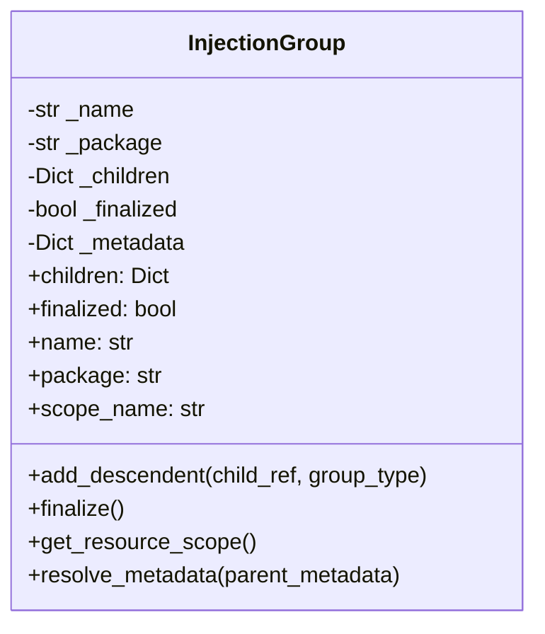
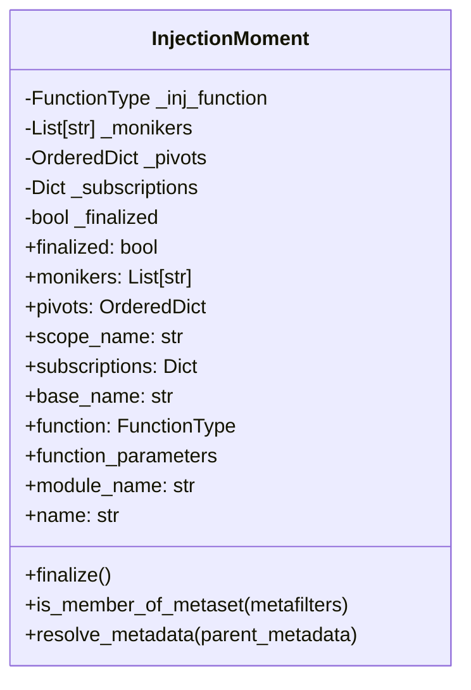
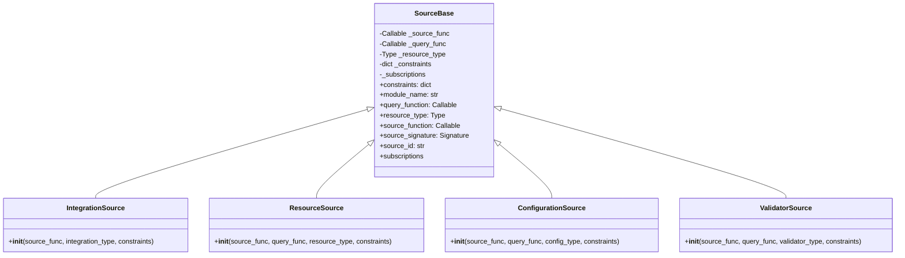
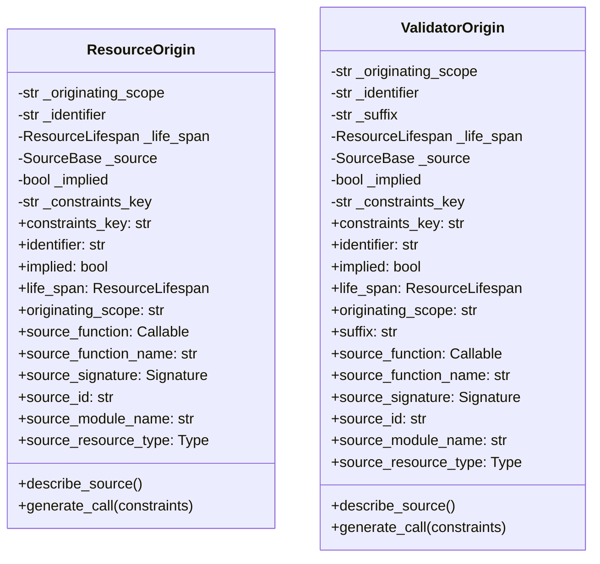
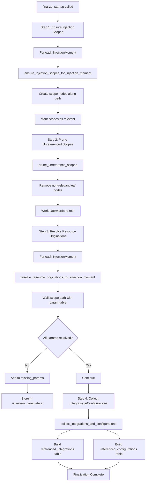
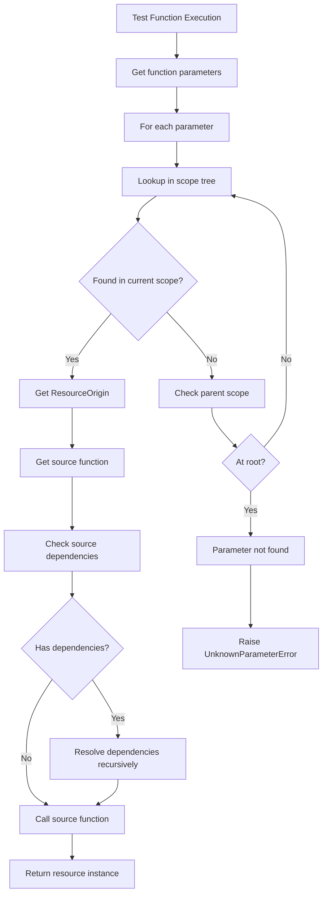
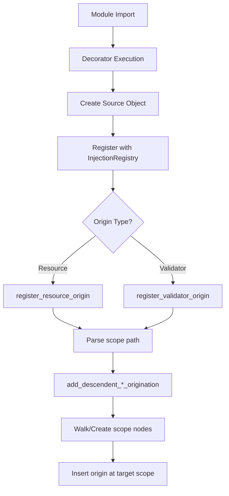

# Dependency Injection System - Design Document

## Overview

The Dependency Injection (DI) System is a core component of the TestBase framework that manages the resolution, instantiation, and lifecycle of injectable resources during test execution. It provides a hierarchical scope tree for parameter visibility, supports multiple resource lifespans, and enables automatic dependency resolution for test functions and resource factories.

The system works in conjunction with the Test Declaration and Registration system to transform registered sources and origins into a runtime dependency graph that can be traversed during test execution.

## Architecture

### High-Level Component Diagram



### Components

#### 1. InjectionRegistry (Singleton)

The `InjectionRegistry` is the central singleton that orchestrates the entire dependency injection system. It maintains:

- Source tables for different resource types (integration, resource, configuration, validator)
- A scope tree for hierarchical parameter resolution
- Tables for tracking unknown parameters and referenced couplings



**Key Responsibilities:**

| Method | Purpose |
|--------|---------|
| `finalize_startup()` | Completes the injection setup after all moments are discovered |
| `register_*_source()` | Registers factory functions for different resource types |
| `register_*_origin()` | Registers parameter origins in the scope tree |
| `lookup_*_source()` | Retrieves source objects by factory function |
| `lookup_resource_scope()` | Finds a scope node by its full path name |

#### 2. InjectionScope

The `InjectionScope` class represents a node in the hierarchical scope tree. Each scope can contain:

- Child scopes (forming a tree structure)
- Parameter originations (resources available at this scope)
- Validator originations (validators available at this scope)



**Scope Tree Structure:**

```
<session> (root)
├── package_a
│   ├── module_1
│   │   ├── test_function_1 (injection moment)
│   │   └── test_function_2 (injection moment)
│   └── module_2
│       └── test_function_3 (injection moment)
└── package_b
    └── module_3
        └── test_function_4 (injection moment)
```

#### 3. InjectionGroup

The `InjectionGroup` class organizes injection moments into a hierarchical tree based on module paths. It provides:

- Grouping of related injection moments
- Metadata resolution and propagation
- Resource scope lookup



#### 4. InjectionMoment

The `InjectionMoment` class represents a point in the execution flow where injection occurs. It captures:

- The injectable function reference
- Monikers for test variations
- Pivots for parameterized execution
- Subscription information for dependencies



#### 5. Source Classes

Source classes wrap factory functions and provide metadata about injectable resources:



#### 6. Origin Classes

Origin classes describe where injectable parameters come from:



### Data Flow

#### Injection Startup Finalization Flow

The `finalize_startup()` method orchestrates the complete injection setup:



#### Parameter Resolution Flow



#### Scope Tree Construction



### Design Patterns

#### 1. Singleton Pattern

The `InjectionRegistry` uses the singleton pattern to ensure a single global registry:

```python
class InjectionRegistry:
    _instance = None
    _initialized = False

    def __new__(cls):
        if cls._instance is None:
            cls._instance = super(InjectionRegistry, cls).__new__(cls)
        return cls._instance

    def __init__(self):
        thisType = type(self)
        if not thisType._initialized:
            thisType._initialized = True
            # Initialize instance variables
```

#### 2. Composite Pattern

`InjectionScope` and `InjectionGroup` form composite tree structures where nodes can contain other nodes or leaf elements (origins/moments).

#### 3. Chain of Responsibility Pattern

Parameter resolution walks up the scope tree, checking each scope until a matching origin is found or the root is reached.

#### 4. Template Method Pattern

The `SourceBase` class defines the interface for all source types, with subclasses providing specific implementations.

#### 5. Visitor Pattern

The scope tree traversal methods (`ensure_injection_scopes_for_injection_moment`, `resolve_resource_originations_for_injection_moment`) implement visitor-like behavior to process tree nodes.

## Integration Points

### With Test Declaration System

- Sources registered via decorators are stored in the registry's source tables
- Origins created by attachment decorators are inserted into the scope tree
- The registry provides lookup methods for the declaration system

### With Test Execution Engine

- The execution engine calls `finalize_startup()` before test execution
- Resolved parameters are passed to test functions during execution
- The `referenced_integrations` and `referenced_configurations` tables inform the execution engine about required couplings

### With Coupling System

- `IntegrationCoupling` and `ConfigurationCoupling` types are tracked through the source tables
- The `collect_integrations_and_configurations_for_injection_moment()` method identifies all couplings needed for execution

### With Constraints System

- Origins can have associated constraints via `constraints_key`
- The `ConstraintsCatalog` manages constraint storage and lookup
- Constraints are passed to source functions during resource creation

## Configuration

### Resource Lifespan Options

| Lifespan | Scope Level | Description |
|----------|-------------|-------------|
| `Session` | Root (`<session>`) | Resource persists for entire test session |
| `Package` | Package nodes | Resource persists within package scope |
| `Test` | Injection moment | Resource created/destroyed per test |
| `Task` | Sub-test level | Resource created/destroyed per task |

### Scope Naming Convention

Scopes follow a hierarchical naming pattern:

| Pattern | Example | Description |
|---------|---------|-------------|
| `<session>` | `<session>` | Root session scope |
| `package.module` | `tests.unit.test_auth` | Module scope |
| `package.module#function` | `tests.unit.test_auth#test_login` | Injection moment scope |

### Reserved Parameter Names

The following parameter names are reserved and handled specially:

| Name | Purpose |
|------|---------|
| `constraints` | Passes constraint dictionary to source functions |

## Error Handling

### Semantic Errors

`SemanticError` is raised for:

- Attempting to call `add_descendent` on non-root scope
- Duplicate identifier registration in the same scope
- Invalid scope path operations

### Unknown Parameter Tracking

The registry tracks unknown parameters in `_unknown_parameters`:

```python
{
    "module#test_function": [
        ["param_name", param_origin_info],
        ...
    ]
}
```

### Scope Resolution Failures

When a parameter cannot be resolved:

1. The parameter is added to `missing_params` list
2. After finalization, `unknown_parameters` contains all unresolved dependencies
3. The execution engine can report these before test execution

## Testing Strategy

### Unit Testing Focus Areas

1. **InjectionRegistry**
   - Singleton behavior verification
   - Source registration and lookup
   - Origin registration and scope tree insertion
   - Finalization process

2. **InjectionScope**
   - Tree construction and traversal
   - Parameter origination management
   - Scope pruning logic
   - Resource resolution

3. **InjectionGroup**
   - Hierarchical grouping
   - Metadata resolution
   - Descendent management

4. **InjectionMoment**
   - Function reference handling
   - Moniker and pivot management
   - Subscription tracking

5. **Source Classes**
   - Source metadata extraction
   - Signature inspection
   - Constraint handling

6. **Origin Classes**
   - Origin property access
   - Call generation
   - Constraint key management

### Integration Testing

- End-to-end dependency resolution
- Cross-scope parameter visibility
- Integration with execution engine
- Coupling collection verification

### Property-Based Testing Candidates

1. **Scope Tree Invariants**
   - All registered origins are retrievable
   - Pruning preserves relevant scopes
   - No orphaned scope nodes after finalization

2. **Parameter Resolution**
   - Parameters visible in parent scopes are visible in child scopes
   - Local parameters shadow parent parameters with same name
   - Resolution order is deterministic

