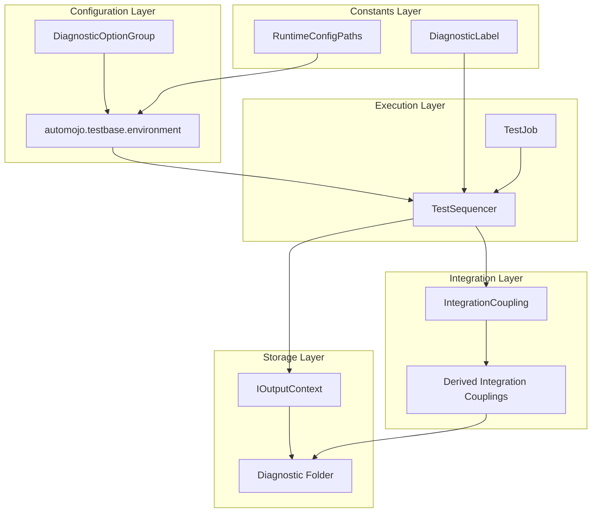
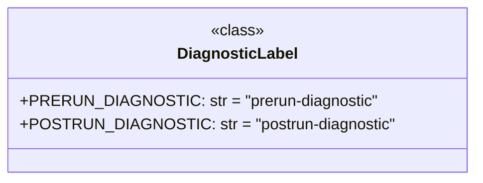
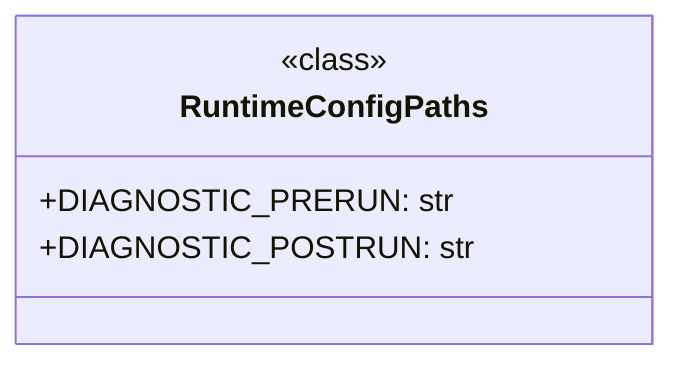
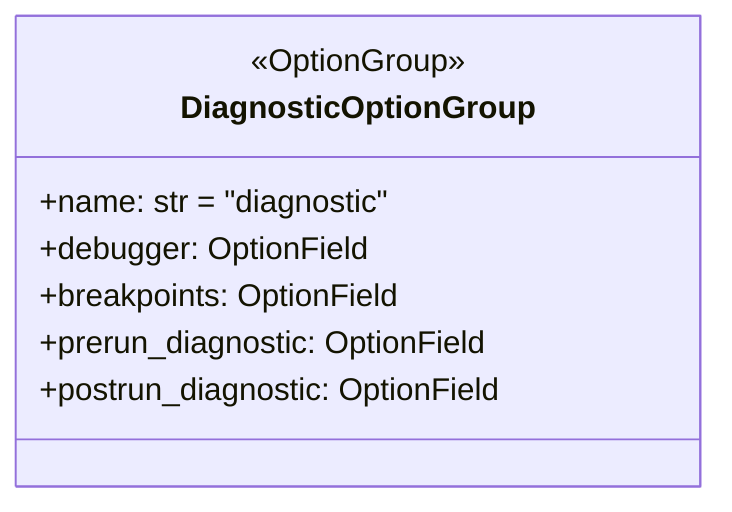
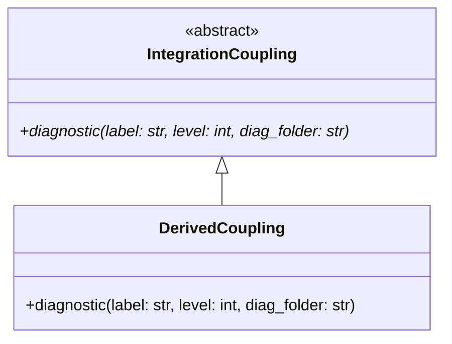
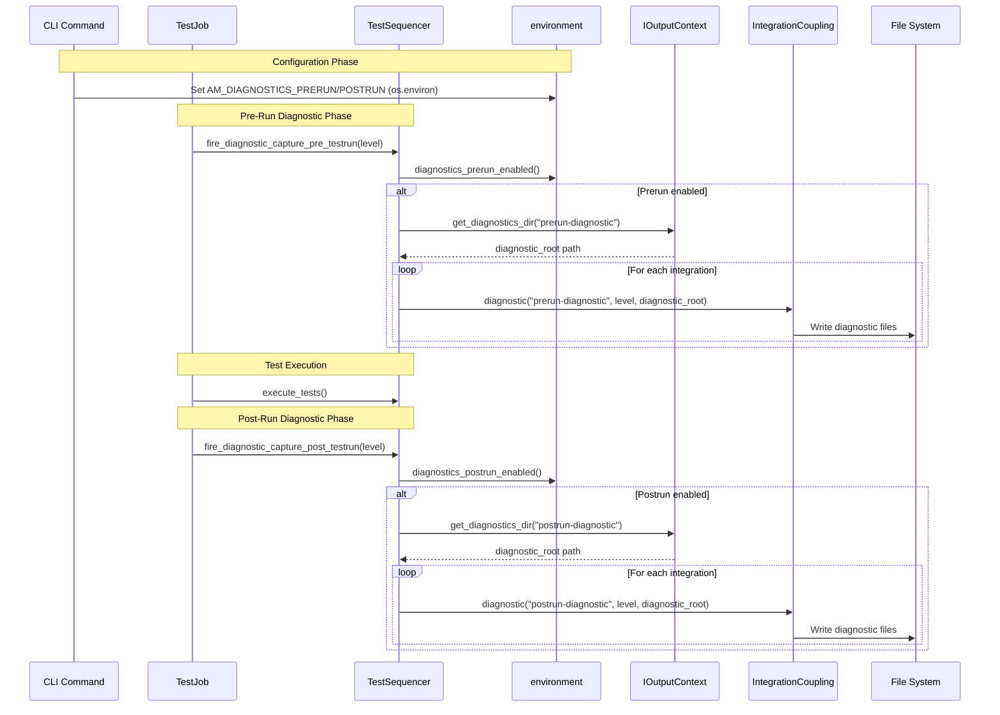
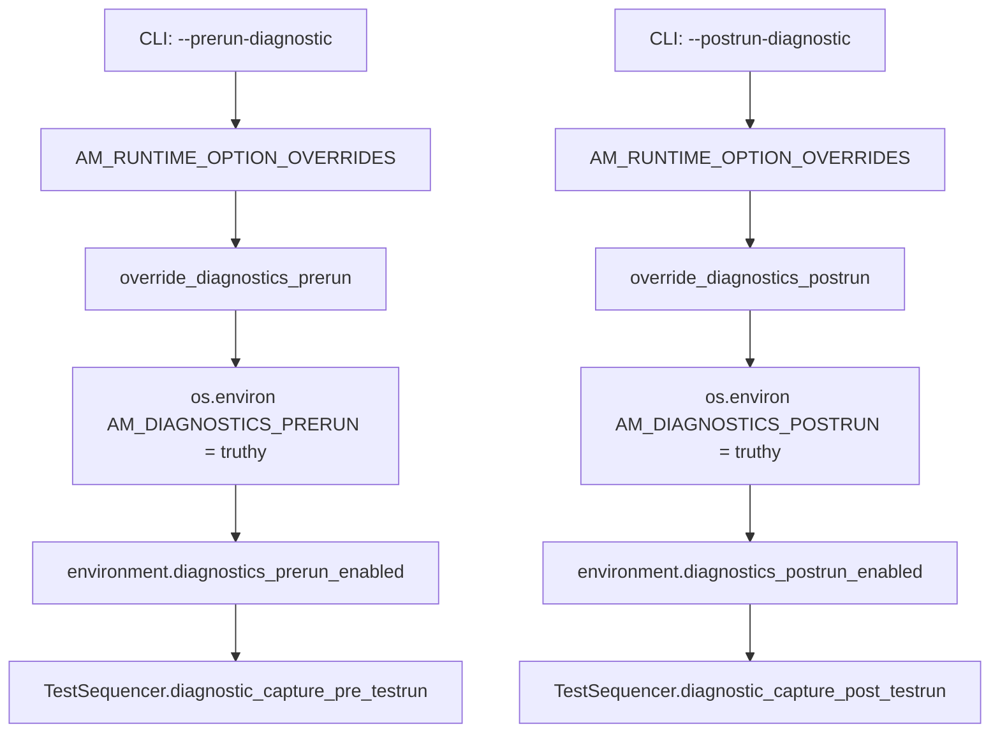
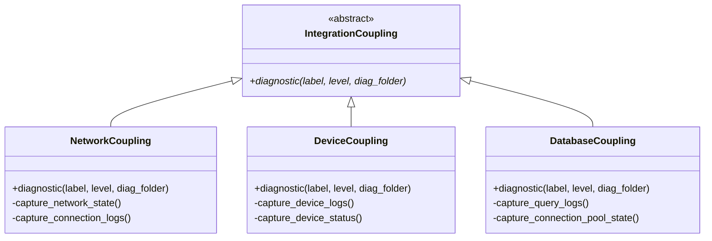
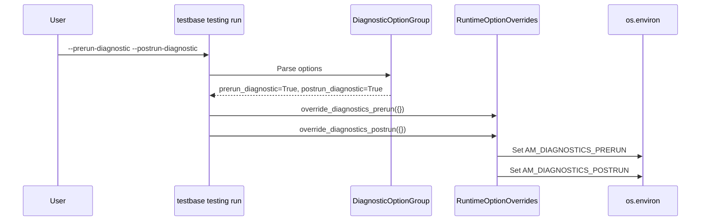

# Diagnostics System - Design Document

## Overview

The Diagnostics System provides a framework for capturing diagnostic information at key points during test execution. It enables integration couplings to collect and store diagnostic data about the test environment, devices, and system state at predefined stages of the test run lifecycle.

The system supports two primary diagnostic capture points:
- **Pre-run diagnostics**: Captured before test execution begins
- **Post-run diagnostics**: Captured after test execution completes

This diagnostic capability is essential for:
- Debugging test failures by capturing system state
- Auditing test environment conditions
- Collecting device logs and status information
- Supporting post-mortem analysis of test runs

## Architecture

### High-Level Component Diagram



### Components

#### 1. DiagnosticLabel Class

The `DiagnosticLabel` class defines constants that identify well-known diagnostic stages in the test execution lifecycle.



**Label Definitions:**

| Label | Value | Description |
|-------|-------|-------------|
| `PRERUN_DIAGNOSTIC` | `"prerun-diagnostic"` | Identifies diagnostics captured before test execution |
| `POSTRUN_DIAGNOSTIC` | `"postrun-diagnostic"` | Identifies diagnostics captured after test execution |

#### 2. RuntimeConfigPaths Class

The `RuntimeConfigPaths` class defines configuration paths for diagnostic runtime information within the application's configuration tree.



**Path Definitions:**

| Path Constant | Value | Purpose |
|---------------|-------|---------|
| `DIAGNOSTIC_PRERUN` | `/configuration/runtime/diagnostics/prerun-diagnostic` | Configuration path for pre-run diagnostic settings |
| `DIAGNOSTIC_POSTRUN` | `/configuration/runtime/diagnostics/postrun-diagnostic` | Configuration path for post-run diagnostic settings |

#### 3. DiagnosticOptionGroup (CLI Integration)

The `DiagnosticOptionGroup` provides command-line options for controlling diagnostic behavior during test runs.



**CLI Options:**

| Option | Type | Default | Description |
|--------|------|---------|-------------|
| `--debugger` | Choice['pdb', 'debugpy'] | None | Debugger to activate during test run |
| `--breakpoint` | Multiple Choice | None | Breakpoints to activate |
| `--prerun-diagnostic` | Boolean | False | Enable pre-run diagnostic capture |
| `--postrun-diagnostic` | Boolean | False | Enable post-run diagnostic capture |

#### 4. IntegrationCoupling.diagnostic() Method

The abstract `diagnostic()` method on `IntegrationCoupling` defines the contract for diagnostic capture by integration types.



**Method Signature:**

```python
@classmethod
def diagnostic(cls, label: str, level: int, diag_folder: str):
    """
    Capture diagnostic information for the integration.
    
    :param label: The label associated with this diagnostic (e.g., "prerun-diagnostic")
    :param level: The maximum diagnostic level to run diagnostics for (1-9)
    :param diag_folder: The output folder path where diagnostic information should be written
    """
```

**Parameters:**

| Parameter | Type | Description |
|-----------|------|-------------|
| `label` | `str` | Diagnostic stage identifier from `DiagnosticLabel` |
| `level` | `int` | Maximum diagnostic level (1-9, higher = more detailed) |
| `diag_folder` | `str` | Output directory for diagnostic files |

### Data Flow

#### Diagnostic Capture Flow



#### Configuration Flow



### Design Patterns

#### 1. Template Method Pattern

The `IntegrationCoupling.diagnostic()` method defines a template that derived classes must implement:

```python
class IntegrationCoupling:
    @classmethod
    def diagnostic(cls, label: str, level: int, diag_folder: str):
        """Abstract method - must be overloaded by derived types."""
        raise AbstractMethodError(...)

class DeviceIntegrationCoupling(IntegrationCoupling):
    @classmethod
    def diagnostic(cls, label: str, level: int, diag_folder: str):
        # Concrete implementation for device diagnostics
        cls._capture_device_logs(diag_folder)
        cls._capture_device_status(diag_folder)
```

#### 2. Strategy Pattern

Different integration couplings implement different diagnostic strategies based on their resource types:



#### 3. Observer Pattern

The TestSequencer acts as an observer coordinator, notifying all registered integrations when diagnostic capture is triggered:

```python
def diagnostic_capture_post_testrun(self, level: int=9):
    postrun_info = environment.diagnostics_postrun_enabled()
    if postrun_info is not None and postrun_info == True:
        label = DiagnosticLabel.POSTRUN_DIAGNOSTIC
        diagnostic_root = self._output_context.get_diagnostics_dir(label)
        
        # Notify all integrations
        for _, integ_type in self._integrations.items():
            integ_type.diagnostic(label, level, diagnostic_root)
```

## Integration Points

### With CLI System

The diagnostics system integrates with the CLI through the `DiagnosticOptionGroup`:



### With Test Execution Engine

The TestJob orchestrates diagnostic capture at appropriate points in the test lifecycle:

| Phase | Method | Timing |
|-------|--------|--------|
| Pre-run | `fire_diagnostic_capture_pre_testrun()` | After integration setup, before test execution |
| Post-run | `fire_diagnostic_capture_post_testrun()` | After test execution, before finalization |

### With Integration Coupling System

Each `IntegrationCoupling` subclass implements its own diagnostic capture logic:

```python
class MyDeviceCoupling(IntegrationCoupling):
    @classmethod
    def diagnostic(cls, label: str, level: int, diag_folder: str):
        if level >= 1:
            cls._capture_basic_status(diag_folder)
        if level >= 5:
            cls._capture_detailed_logs(diag_folder)
        if level >= 9:
            cls._capture_full_memory_dump(diag_folder)
```

### With Results System

Diagnostic folders are excluded from result traversal to prevent diagnostic data from being processed as test results:

```python
DEFAULT_DO_NOT_DESCEND_DIRS = [
    "diagnostics"
]
```

## Configuration

### Environment Knobs

The pre/post-run diagnostic ENABLE flags are read through the dependency-free `automojo.testbase.environment` module, which resolves these knobs directly from `os.environ`. The core does NOT read them via `RuntimeVariables`.

| Variable | Accessor | Type | Description |
|----------|----------|------|-------------|
| `AM_DIAGNOSTICS_PRERUN` | `environment.diagnostics_prerun_enabled()` | `bool` | Enable pre-run diagnostic capture |
| `AM_DIAGNOSTICS_POSTRUN` | `environment.diagnostics_postrun_enabled()` | `bool` | Enable post-run diagnostic capture |

### Diagnostic Levels

The diagnostic level parameter controls the verbosity of captured diagnostics:

| Level | Description | Typical Use |
|-------|-------------|-------------|
| 1-3 | Basic diagnostics | Quick status checks |
| 4-6 | Standard diagnostics | Normal debugging |
| 7-9 | Detailed diagnostics | Deep investigation |

### File System Structure

The diagnostics output directory is resolved through the injected `IOutputContext` seam rather than well-known-path helpers. The default `SimpleOutputContext.get_diagnostics_dir(label)` roots diagnostics under the single output base dir (`<test_results_dir>/diagnostics/<label>/`). The presence-folder-rooted variant is an integration concern provided by `RuntimeOutputContext.get_diagnostics_dir` in `automojo-integration-runtime`, which delegates to the well-known presence-folder paths.

```
<test_results_dir>/
├── diagnostics/
│   ├── prerun-diagnostic/
│   │   ├── <integration_1>/
│   │   │   └── diagnostic_files...
│   │   └── <integration_2>/
│   │       └── diagnostic_files...
│   └── postrun-diagnostic/
│       ├── <integration_1>/
│       │   └── diagnostic_files...
│       └── <integration_2>/
│           └── diagnostic_files...
├── testrun_results.json
└── testrun_summary.json
```

## Error Handling

### Diagnostic Capture Errors

Errors during diagnostic capture are caught and logged but do not fail the test run:

```python
try:
    self.fire_diagnostic_capture_post_testrun(tseq)
except Exception:
    err_msg = traceback.format_exc()
    self._logger.error(err_msg)
```

### Abstract Method Errors

Calling `diagnostic()` on `IntegrationCoupling` directly raises `AbstractMethodError`:

```python
errmsg = "The 'diagnostic' method must be overloaded by derived integration coupling types."
raise AbstractMethodError(errmsg)
```

## Usage Examples

### Enabling Diagnostics via CLI

```bash
# Enable pre-run diagnostics only
testbase testing run --root ./tests --prerun-diagnostic

# Enable post-run diagnostics only
testbase testing run --root ./tests --postrun-diagnostic

# Enable both pre-run and post-run diagnostics
testbase testing run --root ./tests --prerun-diagnostic --postrun-diagnostic
```

### Implementing Custom Diagnostic Capture

```python
from automojo.testbase.coupling.integrationcoupling import IntegrationCoupling
import os
import json

class MyServiceCoupling(IntegrationCoupling):
    
    integration_root = "services"
    integration_section = "api"
    integration_leaf = "myservice"
    integration_class = "MyServiceCoupling"
    
    @classmethod
    def diagnostic(cls, label: str, level: int, diag_folder: str):
        """Capture diagnostic information for MyService."""
        
        # Create integration-specific subfolder
        service_diag_folder = os.path.join(diag_folder, "myservice")
        os.makedirs(service_diag_folder, exist_ok=True)
        
        # Level 1+: Basic status
        if level >= 1:
            status = cls._get_service_status()
            status_file = os.path.join(service_diag_folder, "status.json")
            with open(status_file, 'w') as f:
                json.dump(status, f, indent=2)
        
        # Level 5+: Connection logs
        if level >= 5:
            logs = cls._get_connection_logs()
            logs_file = os.path.join(service_diag_folder, "connection_logs.txt")
            with open(logs_file, 'w') as f:
                f.write(logs)
        
        # Level 9: Full diagnostic dump
        if level >= 9:
            full_dump = cls._get_full_diagnostic_dump()
            dump_file = os.path.join(service_diag_folder, "full_dump.json")
            with open(dump_file, 'w') as f:
                json.dump(full_dump, f, indent=2)
```

### Accessing Diagnostic Labels

```python
from automojo.testbase.diagnostics import DiagnosticLabel

def process_diagnostics(label: str):
    if label == DiagnosticLabel.PRERUN_DIAGNOSTIC:
        print("Processing pre-run diagnostics")
    elif label == DiagnosticLabel.POSTRUN_DIAGNOSTIC:
        print("Processing post-run diagnostics")
```

## File Structure

```
source/packages/automojo/testbase/
├── diagnostics.py              # DiagnosticLabel and RuntimeConfigPaths
├── environment.py              # AM_DIAGNOSTICS_PRERUN/POSTRUN enable-flag accessors (os.environ)
├── testjob.py                  # TestJob with diagnostic fire methods
├── cli/
│   └── options.py              # DiagnosticOptionGroup
├── coupling/
│   └── integrationcoupling.py  # IntegrationCoupling.diagnostic()
├── output/
│   └── outputcontext.py        # IOutputContext / SimpleOutputContext.get_diagnostics_dir
└── sequencing/
    └── testsequencer.py        # Diagnostic capture implementation
```

> The presence-folder-rooted diagnostics path is an integration concern. It lives in `automojo-integration-runtime` as `RuntimeOutputContext.get_diagnostics_dir` (wired through `IntegratedTestJob`), which delegates to the well-known presence-folder paths. The testbase core resolves diagnostics only through the injected `IOutputContext` seam.

## Testing Strategy

### Unit Testing Focus Areas

1. **DiagnosticLabel Constants**
   - Verify constant values are correct
   - Ensure constants are strings

2. **RuntimeConfigPaths Constants**
   - Verify path format is correct
   - Ensure paths follow configuration tree structure

3. **DiagnosticOptionGroup**
   - Test option parsing
   - Verify default values
   - Test boolean parameter handling

4. **TestSequencer Diagnostic Methods**
   - Test `diagnostic_capture_pre_testrun()` with enabled/disabled settings
   - Test `diagnostic_capture_post_testrun()` with enabled/disabled settings
   - Verify integration iteration
   - Test diagnostic level propagation

5. **TestJob Fire Methods**
   - Test `fire_diagnostic_capture_pre_testrun()` delegation
   - Test `fire_diagnostic_capture_post_testrun()` delegation
   - Verify error handling during diagnostic capture

### Integration Testing

1. **End-to-End Diagnostic Capture**
   - Run test with diagnostics enabled
   - Verify diagnostic folders are created
   - Verify integration diagnostic methods are called

2. **CLI Integration**
   - Test `--prerun-diagnostic` flag
   - Test `--postrun-diagnostic` flag
   - Verify the AM_DIAGNOSTICS_PRERUN/POSTRUN environment knobs are set correctly (and read back via `automojo.testbase.environment`)

### Test Categories

| Category | Components | Focus |
|----------|------------|-------|
| Constants | `DiagnosticLabel`, `RuntimeConfigPaths` | Value correctness |
| CLI | `DiagnosticOptionGroup` | Option parsing |
| Execution | `TestSequencer`, `TestJob` | Diagnostic flow |
| Integration | `IntegrationCoupling` | Contract compliance |
