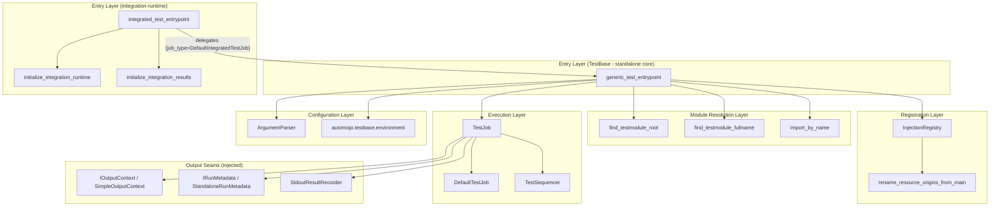
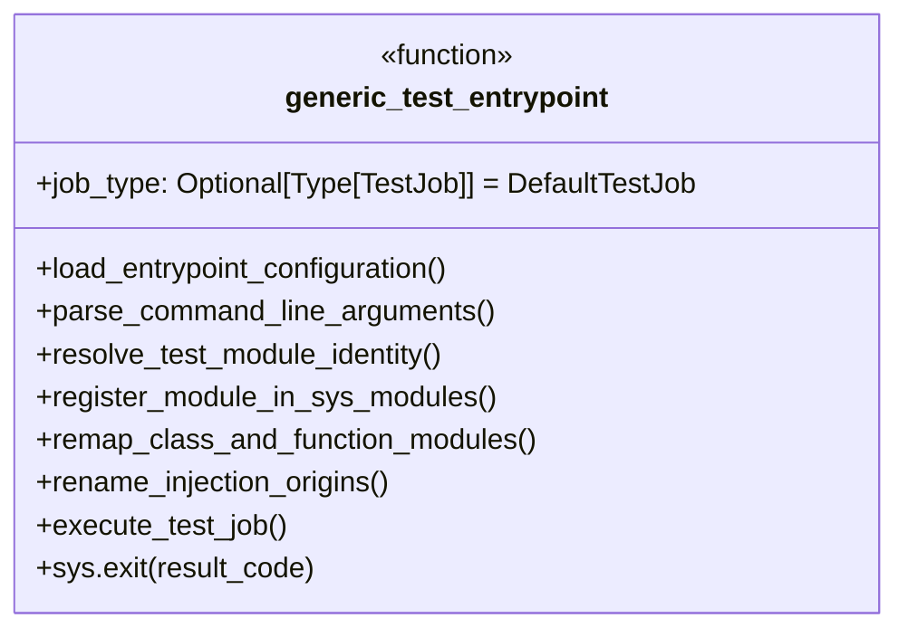
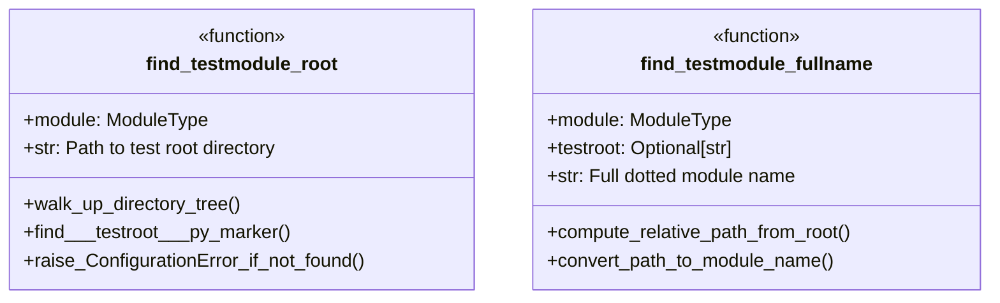
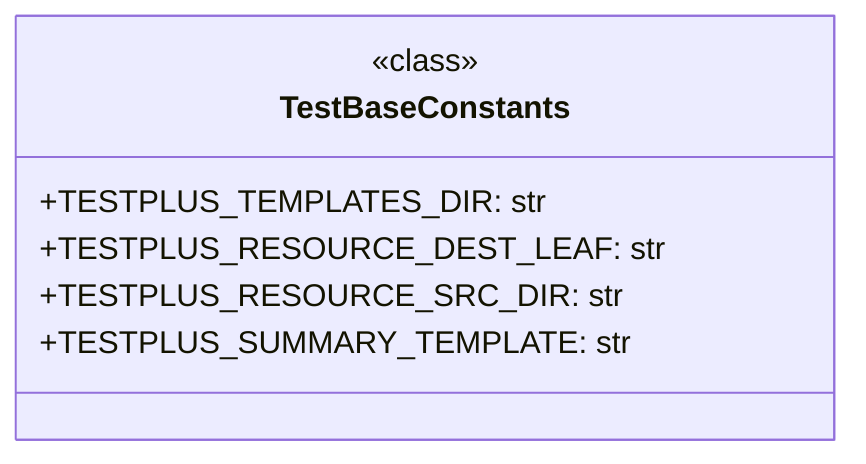
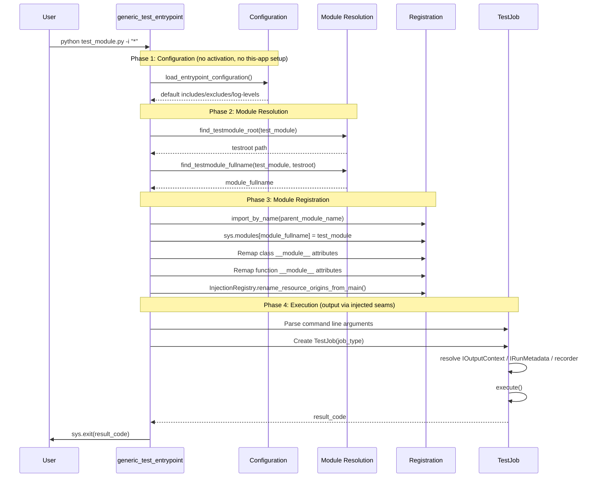
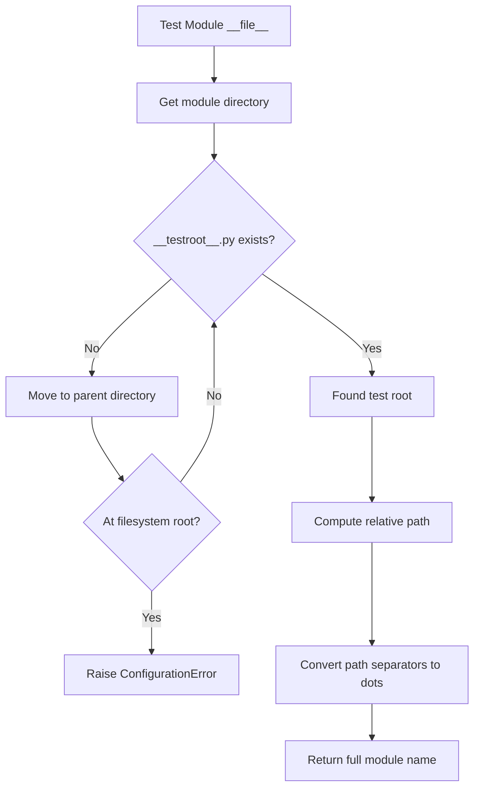
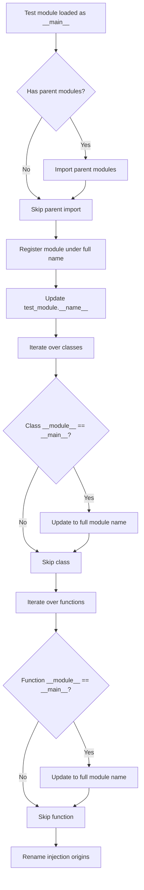
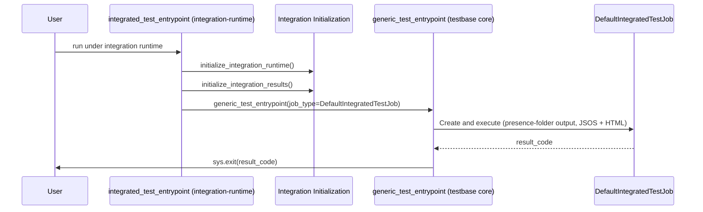
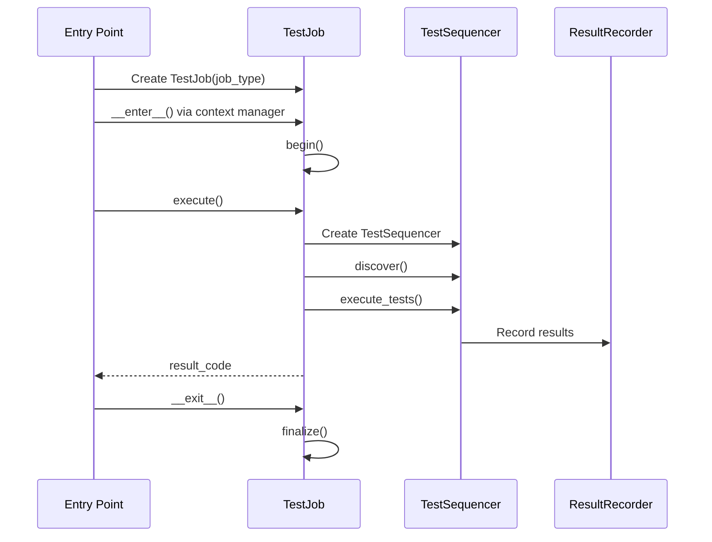
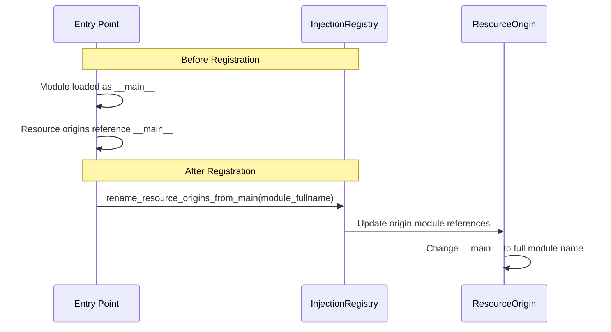

# Test Entry Points - Design Document

## Overview

The Test Entry Points system provides standardized mechanisms for initiating test execution in the TestBase framework. There are two distinct entry points:

- **`generic_test_entrypoint`** — the DECOUPLED standalone core that lives in TestBase (`automojo.testbase.entrypoints`). It runs an individual test module directly for debugging, performs NO integration/activation initialization and NO this-app environment setup, and lets the `TestJob` it builds resolve output through injected seams (`IOutputContext` / recorder) rather than reading `env["output_directory"]` or runtime/this-app well-known paths.
- **`integrated_test_entrypoint`** — the integration counterpart that lives in `automojo-integration-runtime` (`automojo.integrationruntime.entrypoints`), NOT in TestBase. It performs the this-app activation (persona + runtime-variable resolution + `activate_profile_job`), then delegates to the same decoupled TestBase core with a `DefaultIntegratedTestJob` (an `IntegratedTestJob`-derived type).

This document describes the TestBase standalone core; the integration entry point is summarized in the Integration Points section for context.

The standalone core handles these tasks (and nothing that couples it to runtime/this-app):

- Test module name resolution and registration
- Python path management for proper module imports
- Command-line argument parsing for test filtering
- Test job creation and execution orchestration, with output resolved via injected seams

## Architecture

### High-Level Component Diagram



The integration entry point (`integrated_test_entrypoint`, in `automojo-integration-runtime`) is the only place where activation initialization happens; it delegates into the decoupled `generic_test_entrypoint` after activating. The standalone core never touches `automojo.runtime` or `automojo.thisapp`.

### Components

#### 1. Generic Test Entry Point (`generic_test_entrypoint`)

The primary, DECOUPLED standalone entry point function for running test modules as standalone scripts. This is the recommended way to enable debugging of individual test files. It performs NO integration/activation initialization and NO this-app environment setup; it imports nothing from `automojo.runtime` / `automojo.thisapp`. Output location and run identity are resolved by the `TestJob` it builds through injected seams (`IOutputContext` / `IRunMetadata` / recorder), not by reading `env["output_directory"]` or well-known runtime/this-app paths.



**Responsibilities:**

| Responsibility | Description |
|----------------|-------------|
| Configuration Loading | Loads default include/exclude/log-level options from configuration files |
| Module Resolution | Finds test root and computes full module name |
| Module Registration | Registers the `__main__` module under its proper name |
| Class/Function Remapping | Updates `__module__` attributes for proper identification |
| Injection Renaming | Updates resource origins from `__main__` to proper module name |
| Job Execution | Creates and executes the test job; output is resolved by the job's injected `IOutputContext` / recorder |

**Explicitly NOT a responsibility of the standalone core:** runtime initialization, profile activation, results-resource initialization, or any this-app environment configuration. Those belong to `integrated_test_entrypoint` in `automojo-integration-runtime` (see Integration Points).

**Command Line Arguments:**

| Argument | Short | Description | Default |
|----------|-------|-------------|---------|
| `--include` | `-i` | Add an include search statement | `[]` |
| `--exclude` | `-x` | Add an exclude filter statement | `[]` |
| `--console-level` | | Logging level for console output | `INFO` |
| `--logfile-level` | | Logging level for logfile output | `DEBUG` |

#### 2. Integration Initialization (in `automojo-integration-runtime`)

Activation initialization is NOT part of the standalone core. It is performed by `integrated_test_entrypoint`, which calls `initialize_integration_runtime` (establishes the application persona — name "automojo", home `~/automojo`, "TB" logger prefix, "testrun" log basename — and resolves runtime variables) and `initialize_integration_results` (configures the static-resource source/destination directories and the HTML summary template, and activates the `JobType.TestRun` profile). These live in `automojo.integrationruntime.initialize`. The standalone `generic_test_entrypoint` invokes none of them.

> Historical note: the legacy `automojo.testbase.initialize` module (`initialize_testbase_runtime` / `initialize_testbase_results`) still exists on disk but is no longer called by the standalone entry point; its runtime/this-app coupling is the reason this responsibility was moved to the integration entry point.

#### 3. Output Resolution via Injected Seams

The standalone core does not configure output directories itself. The `TestJob` it builds resolves output and run identity through injected hooks:

| Seam | Default (standalone core) | Purpose |
|------|---------------------------|---------|
| `IOutputContext` | `SimpleOutputContext` | Roots artefacts under a single base directory; supplies result dir and (optional) summary-template source |
| `IRunMetadata` | `StandaloneRunMetadata` | Supplies run id, start time, title, timeout, and build/pipeline/job info |
| `ResultRecorder` | `StdoutResultRecorder` | Emits a stdout summary; writes JSOS/JSON when an output dir is given; SKIPS HTML |

The integration variants (presence-folder paths via `RuntimeOutputContext`, `RuntimeVariables`-sourced `RuntimeRunMetadata`, and JSOS-to-disk plus HTML via `JsonResultRecorder`) are supplied by `DefaultIntegratedTestJob` in `automojo-integration-runtime` by overriding these same hooks. Core test-execution knobs (`AM_TESTROOT`, `AM_OUTPUT_DIRECTORY`, `AM_RUN_ID`, `AM_TESTRUN_TIMEOUT`, `AM_DEBUG_*`, `AM_DIAGNOSTICS_PRERUN/POSTRUN`) are read directly from `os.environ` through the dependency-free `automojo.testbase.environment` module.

#### 4. Module Resolution Functions

Functions that resolve test module identity and location.



**Test Root Discovery:**

The test root is identified by walking up the directory tree from the test module until a `__testroot__.py` marker file is found. This marker file:

- Defines the boundary of the test package namespace
- Enables proper module name resolution
- Is required for all TestBase test directories

#### 5. TestBase Constants

Constants defining standard paths used by the framework.



### Data Flow

#### Entry Point Execution Flow



#### Module Name Resolution Flow



#### Module Registration Flow



### Design Patterns

#### 1. Template Method Pattern

The entry point provides a template for test execution that can be customized through the `job_type` parameter:

```python
def generic_test_entrypoint(job_type: Optional[Type[TestJob]] = DefaultTestJob):
    # Standalone core: no activation, no this-app setup
    file_config = load_entrypoint_configuration()

    # ... module resolution and registration ...

    # Customizable job execution; the job resolves output via its injected seams
    with job_type(logger, testroot, includes=includes, excludes=excludes, metafilters=metafilters, test_module=test_module) as tjob:
        result_code = tjob.execute()
```

#### 2. Injected Seam (Dependency Injection) Pattern

Rather than reading runtime/this-app singletons or `env["output_directory"]`, the standalone core delegates output-location and run-identity decisions to seams that the `TestJob` injects via overridable hooks. The default `TestJob` returns `SimpleOutputContext` / `StandaloneRunMetadata` / `StdoutResultRecorder`; `DefaultIntegratedTestJob` overrides the same hooks to use presence-folder paths and HTML rendering:

```python
def _create_output_context(self) -> IOutputContext:
    inst = SimpleOutputContext()
    return inst

def _create_run_metadata(self) -> IRunMetadata:
    inst = StandaloneRunMetadata(title=run_title)
    return inst
```

#### 3. Registry Pattern

The `InjectionRegistry` maintains a registry of resource origins that must be updated when module names change:

```python
resource_registry = InjectionRegistry()
resource_registry.rename_resource_origins_from_main(module_fullname)
```

#### 4. Context Manager Pattern

Test jobs are executed within context managers for proper lifecycle management:

```python
with job_type(logger, testroot, includes=includes, excludes=excludes, test_module=test_module) as tjob:
    result_code = tjob.execute()
```

## Integration Points

### With the Integration Entry Point (`integrated_test_entrypoint`)

The standalone core is wrapped — not duplicated — by the integration entry point that lives in `automojo-integration-runtime`. The integration entry point performs activation and then delegates into the same decoupled core:



**Division of responsibility:**

| Concern | Standalone core (`generic_test_entrypoint`, testbase) | Integration entry point (`integrated_test_entrypoint`, integration-runtime) |
|---------|-------------------------------------------------------|------------------------------------------------------------------------------|
| Activation / persona / runtime variables | None | `initialize_integration_runtime()` |
| Result resources / profile activation | None | `initialize_integration_results()` |
| Output resolution | Injected `SimpleOutputContext` + `StdoutResultRecorder` (stdout; JSOS/JSON when an output dir is given; no HTML) | `DefaultIntegratedTestJob` overrides hooks for presence-folder paths + JSOS-to-disk + HTML |
| Module resolution / registration / job execution | Performed here | Delegated to the standalone core |
| `InjectionRegistry` | Updated for `__main__` modules | Inherited from the delegated core |

> The TestBase CLI move and the relocation of HTML rendering are pending later phases; this section describes the entry-point split only.

### With Test Execution Engine

The entry point creates and executes test jobs:



### With Dependency Injection System

The entry point updates injection origins when running modules as `__main__`:



### With Logging System

The entry point configures logging through the enhanced logger:

```python
logger = getEnhancedLogger()
tpmod = sys.modules["automojo.testbase"]
tpmod.logger = logger
```

## Configuration

### Environment Variables

The standalone core reads core test-execution knobs directly from `os.environ` through the dependency-free `automojo.testbase.environment` module (it does NOT go through `RuntimeVariables` or this-app):

| Variable | Purpose |
|----------|---------|
| `AM_TESTROOT` | Default test root directory |
| `AM_OUTPUT_DIRECTORY` | Base output directory for artefacts (consumed by the injected `IOutputContext`) |
| `AM_RUN_ID` | Externally supplied run identifier |
| `AM_TESTRUN_TIMEOUT` | Overall test-run timeout (seconds) |
| `AM_DEBUG_DEBUGGER`, `AM_DEBUG_BREAKPOINTS` | Debugger selection and breakpoint list |
| `AM_DIAGNOSTICS_PRERUN`, `AM_DIAGNOSTICS_POSTRUN` | Enable pre-/post-run diagnostic capture |

Presence-folder paths and `RuntimeVariables`/this-app-sourced values are NOT consumed by the standalone core; they are introduced by `DefaultIntegratedTestJob` in `automojo-integration-runtime`.

### Test Root Marker

Every test directory must contain a `__testroot__.py` marker file:

```
tests/
├── __testroot__.py    # Required marker file
├── __init__.py
├── package/
│   ├── __init__.py
│   └── test_module.py
└── another_package/
    ├── __init__.py
    └── test_another.py
```

The marker file can be empty or contain test root configuration.

### Command Line Configuration

When running a test module directly:

```bash
# Run all tests in the module
python test_module.py

# Run specific tests
python test_module.py -i "test_specific_*"

# Exclude certain tests
python test_module.py -i "*" -x "test_slow_*"

# Set logging levels
python test_module.py --console-level DEBUG --logfile-level INFO
```

## Error Handling

### Configuration Errors

| Error Condition | Handling |
|-----------------|----------|
| Missing `__testroot__.py` | Raise `ConfigurationError` with descriptive message |
| Invalid test root path | Raise `ValueError` |
| Module import failure | Captured in import errors list |

### Exit Codes

| Code | Meaning |
|------|---------|
| 0 | All tests passed |
| Non-zero | Test failures or errors occurred |

### Error Messages

```python
errmsg = "TestBase test files must exist inside a test root directory marked with a __testroot__.py file."
raise ConfigurationError(errmsg)
```

## Usage Examples

### Basic Entry Point Usage

Add to the bottom of any test module:

```python
# test_example.py

from automojo.testbase.declaration import testcontainer, test

@testcontainer()
class TestExample:
    
    @test()
    def test_something(self):
        assert True

# Enable direct execution for debugging
if __name__ == "__main__":
    from automojo.testbase.entrypoints import generic_test_entrypoint
    generic_test_entrypoint()
```

### Custom Job Type

Use a custom test job for specialized execution:

```python
from automojo.testbase.testjob import TestJob

class CustomTestJob(TestJob):
    name = "Custom Test Suite"
    description = "Tests with custom configuration"
    
    def _create_sequencer(self):
        # Custom sequencer configuration
        return CustomSequencer(...)

if __name__ == "__main__":
    from automojo.testbase.entrypoints import generic_test_entrypoint
    generic_test_entrypoint(job_type=CustomTestJob)
```

### Running with Filters

```bash
# Run only tests matching pattern
python test_module.py -i "test_feature_*"

# Run all except slow tests
python test_module.py -i "*" -x "test_slow_*"

# Multiple includes
python test_module.py -i "test_unit_*" -i "test_integration_*"
```

### Debug Configuration

```bash
# Verbose console output
python test_module.py --console-level DEBUG

# Minimal console, detailed log file
python test_module.py --console-level WARNING --logfile-level DEBUG
```

## File Structure

```
# TestBase (standalone core)
source/packages/automojo/testbase/
├── entrypoints.py          # generic_test_entrypoint (decoupled standalone core)
├── environment.py          # Dependency-free os.environ knob accessors (AM_TESTROOT, etc.)
├── utilities.py            # Module resolution utilities
├── testjob.py              # TestJob base class + injected output/recorder hooks
├── output/
│   ├── outputcontext.py    # IOutputContext / SimpleOutputContext
│   └── runmetadata.py      # IRunMetadata / StandaloneRunMetadata
├── results/recorders/
│   └── stdoutresultrecorder.py  # Default StdoutResultRecorder
└── injection/
    └── injectionregistry.py     # Resource origin management

# Integration entry point (separate package/repo)
source/packages/automojo/integrationruntime/
├── entrypoints.py          # integrated_test_entrypoint (activation + delegation)
├── initialize.py           # initialize_integration_runtime / initialize_integration_results
└── integratedtestjob.py    # DefaultIntegratedTestJob (RuntimeOutputContext / JsonResultRecorder + HTML)
```

> Note: `automojo.testbase.initialize` (legacy `initialize_testbase_runtime` / `initialize_testbase_results`) still exists on disk but is no longer used by the standalone entry point.

## Testing Strategy

### Unit Testing Focus Areas

1. **Module Resolution**
   - `find_testmodule_root()` with valid test hierarchies
   - `find_testmodule_root()` with missing marker files
   - `find_testmodule_fullname()` path to module name conversion

2. **Module Registration**
   - Class `__module__` attribute remapping
   - Function `__module__` attribute remapping
   - `sys.modules` registration

3. **Argument Parsing**
   - Include/exclude argument accumulation
   - Log level validation
   - Default value handling

4. **Output Seams**
   - `SimpleOutputContext` base-dir resolution
   - `StandaloneRunMetadata` run-id / title / timeout
   - `StdoutResultRecorder` stdout summary, JSOS/JSON when an output dir is given, no HTML

### Integration Testing

1. **End-to-End Entry Point**
   - Execute test module via the standalone core
   - Verify result code reflects test outcomes
   - Validate stdout summary (and JSOS/JSON when an output dir is supplied)

2. **Integration Entry Point Delegation**
   - Verify `integrated_test_entrypoint` activates then delegates to `generic_test_entrypoint`
   - Verify `DefaultIntegratedTestJob` produces presence-folder JSOS + HTML

### Test Categories

| Category | Components | Focus |
|----------|------------|-------|
| Resolution | `find_testmodule_root`, `find_testmodule_fullname` | Path handling, marker detection |
| Registration | Module remapping, injection renaming | Identity management |
| Output Seams | `SimpleOutputContext`, `StandaloneRunMetadata`, `StdoutResultRecorder` | Injected output resolution |
| Execution | Job creation, execution | End-to-end flow |
