# Test Entry Points - Design Document

## Overview

The Test Entry Points system provides standardized mechanisms for initiating test execution in the TestBase framework. It serves as the bridge between:

- Individual test modules that need to be run directly for debugging
- The CLI command system for production test runs
- Custom test job implementations for specialized execution scenarios

The entry point system handles critical initialization tasks including:

- Runtime environment setup and configuration
- Test module name resolution and registration
- Python path management for proper module imports
- Command-line argument parsing for test filtering
- Test job creation and execution orchestration

## Architecture

### High-Level Component Diagram

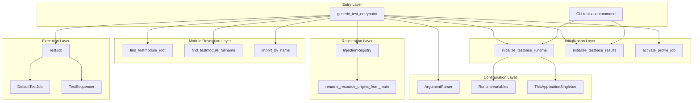

### Components

#### 1. Generic Test Entry Point (`generic_test_entrypoint`)

The primary entry point function for running test modules as standalone scripts. This is the recommended way to enable debugging of individual test files.

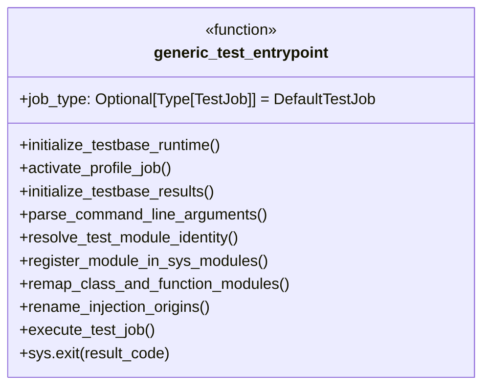

**Responsibilities:**

| Responsibility | Description |
|----------------|-------------|
| Runtime Initialization | Sets up the TestBase runtime environment |
| Profile Activation | Activates the test run job profile |
| Results Initialization | Configures the results recording system |
| Module Resolution | Finds test root and computes full module name |
| Module Registration | Registers the `__main__` module under its proper name |
| Class/Function Remapping | Updates `__module__` attributes for proper identification |
| Injection Renaming | Updates resource origins from `__main__` to proper module name |
| Job Execution | Creates and executes the test job |

**Command Line Arguments:**

| Argument | Short | Description | Default |
|----------|-------|-------------|---------|
| `--include` | `-i` | Add an include search statement | `[]` |
| `--exclude` | `-x` | Add an exclude filter statement | `[]` |
| `--console-level` | | Logging level for console output | `INFO` |
| `--logfile-level` | | Logging level for logfile output | `DEBUG` |

#### 2. Runtime Initialization (`initialize_testbase_runtime`)

Establishes the application persona and resolves runtime variables.

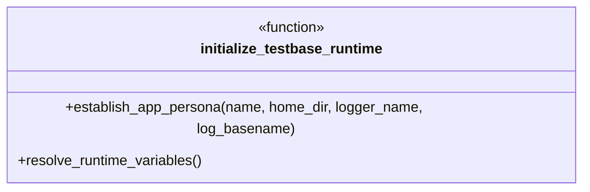

**Initialization Steps:**

| Step | Action | Purpose |
|------|--------|---------|
| 1 | Set application name | Identifies the application as "automojo" |
| 2 | Set home directory | Creates `~/automojo` for configuration |
| 3 | Set logger name | Uses "TB" prefix for log messages |
| 4 | Set log basename | Uses "testrun" for log file naming |
| 5 | Resolve runtime variables | Loads environment and configuration values |

#### 3. Results Initialization (`initialize_testbase_results`)

Configures the results recording system with appropriate paths and templates.

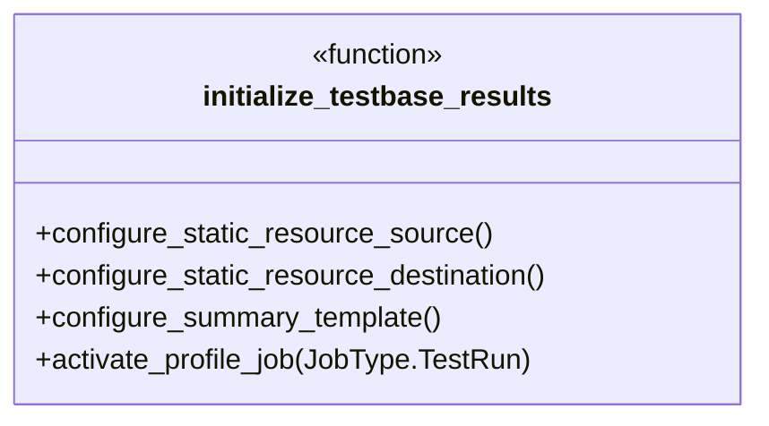

**Configuration Variables:**

| Variable | Default Value | Description |
|----------|---------------|-------------|
| `AM_RESULTS_STATIC_RESOURCE_SRC_DIR` | `<testbase>/templates/v2/static` | Source for static resources |
| `AM_RESULTS_STATIC_RESOURCE_DEST_DIR` | `<presence>/results/static/v2` | Destination for static resources |
| `AM_RESULTS_STATIC_SUMMARY_TEMPLATE` | `<testbase>/templates/v2/testsummary.html` | HTML summary template |

#### 4. Module Resolution Functions

Functions that resolve test module identity and location.

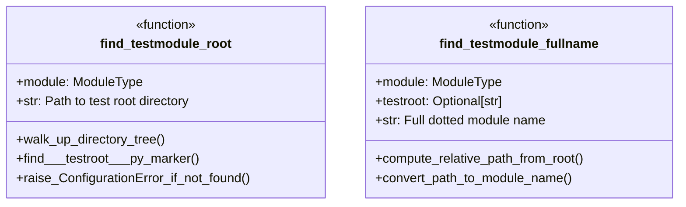

**Test Root Discovery:**

The test root is identified by walking up the directory tree from the test module until a `__testroot__.py` marker file is found. This marker file:

- Defines the boundary of the test package namespace
- Enables proper module name resolution
- Is required for all TestBase test directories

#### 5. TestBase Constants

Constants defining standard paths used by the framework.

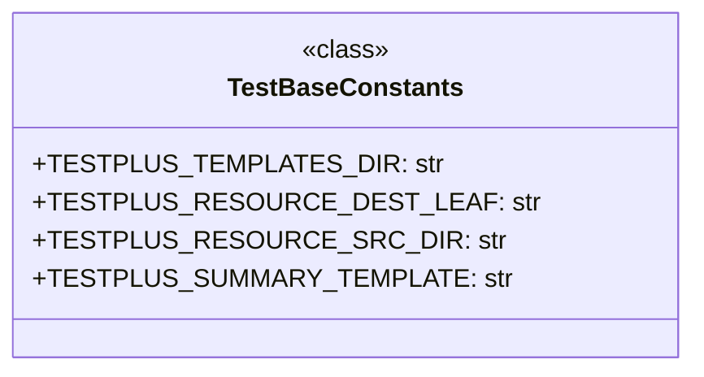

### Data Flow

#### Entry Point Execution Flow

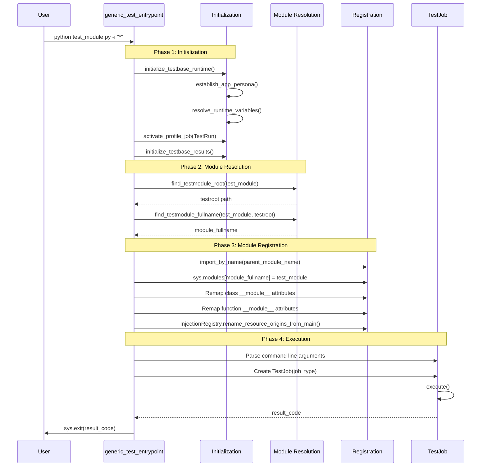

#### Module Name Resolution Flow

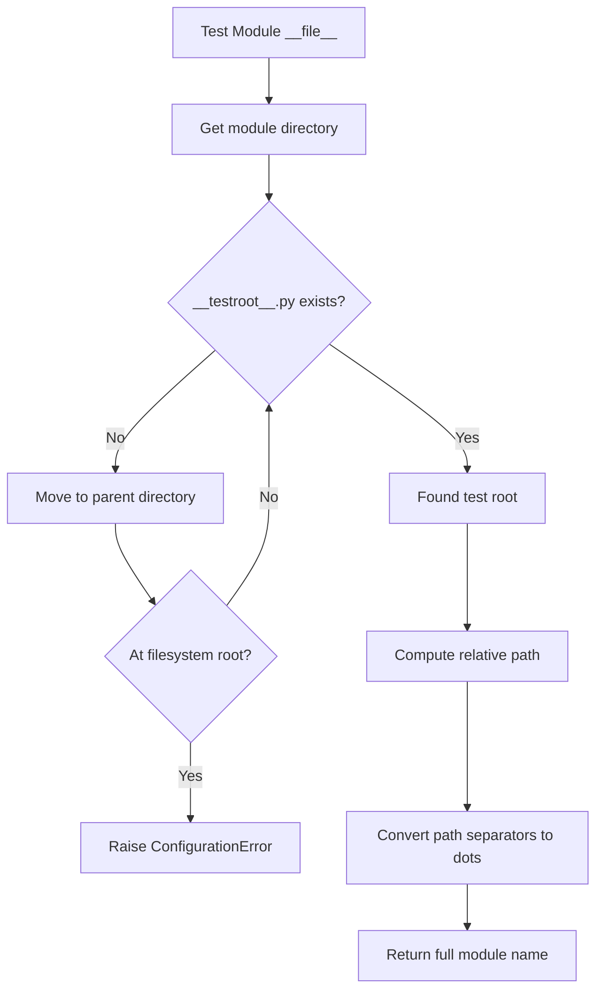

#### Module Registration Flow

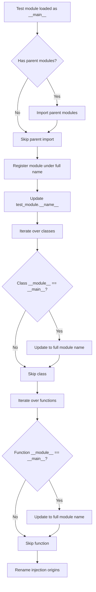

### Design Patterns

#### 1. Template Method Pattern

The entry point provides a template for test execution that can be customized through the `job_type` parameter:

```python
def generic_test_entrypoint(job_type: Optional[Type[TestJob]] = DefaultTestJob):
    # Fixed initialization steps
    initialize_testbase_runtime()
    activate_profile_job(job_type=JobType.TestRun)
    initialize_testbase_results()
    
    # ... module resolution and registration ...
    
    # Customizable job execution
    with job_type(logger, testroot, includes=includes, excludes=excludes, test_module=test_module) as tjob:
        result_code = tjob.execute()
```

#### 2. Singleton Pattern

The entry point uses singletons for application-wide state:

```python
this_app = ThisApplicationSingleton()
env = this_app.context.lookup("/environment")
```

#### 3. Registry Pattern

The `InjectionRegistry` maintains a registry of resource origins that must be updated when module names change:

```python
resource_registry = InjectionRegistry()
resource_registry.rename_resource_origins_from_main(module_fullname)
```

#### 4. Context Manager Pattern

Test jobs are executed within context managers for proper lifecycle management:

```python
with job_type(logger, testroot, includes=includes, excludes=excludes, test_module=test_module) as tjob:
    result_code = tjob.execute()
```

## Integration Points

### With CLI System

The entry point system integrates with the CLI through shared initialization:

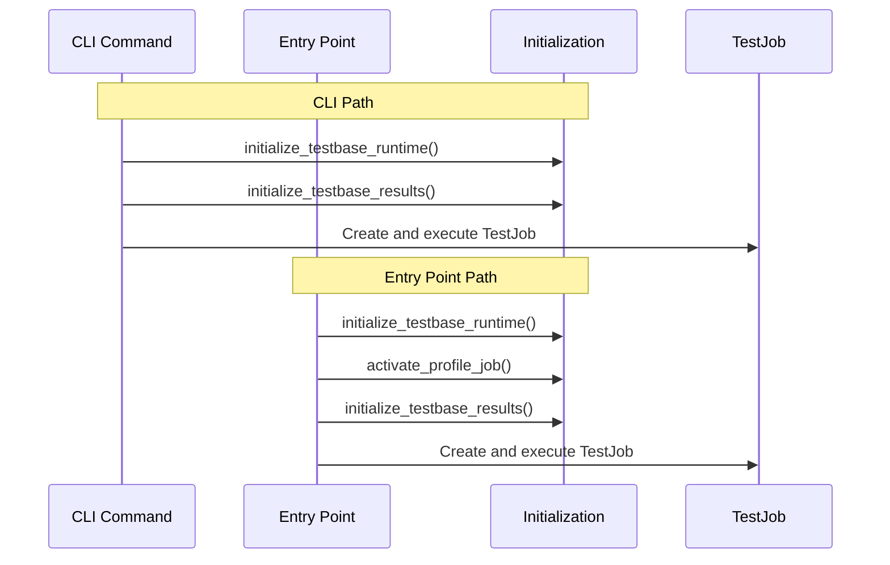

**Shared Components:**

| Component | CLI Usage | Entry Point Usage |
|-----------|-----------|-------------------|
| `initialize_testbase_runtime()` | Called by root command | Called at entry |
| `initialize_testbase_results()` | Called by run command | Called at entry |
| `TestJob` | Created with CLI options | Created with parsed args |
| `InjectionRegistry` | Used during execution | Updated for `__main__` modules |

### With Test Execution Engine

The entry point creates and executes test jobs:

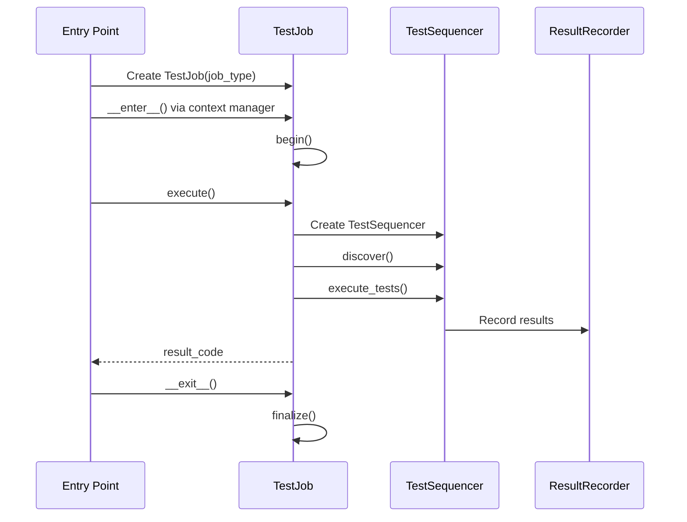

### With Dependency Injection System

The entry point updates injection origins when running modules as `__main__`:

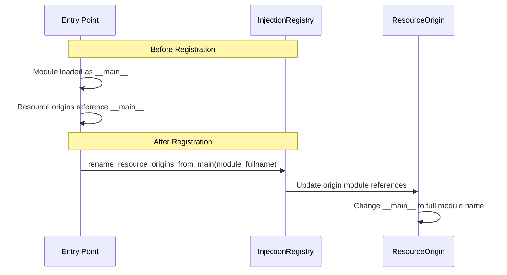

### With Logging System

The entry point configures logging through the enhanced logger:

```python
logger = getEnhancedLogger()
tpmod = sys.modules["automojo.testbase"]
tpmod.logger = logger
```

## Configuration

### Environment Variables

The entry point respects these environment variables through `RuntimeVariables`:

| Variable | Purpose |
|----------|---------|
| `AM_TESTROOT` | Default test root directory |
| `AM_OUTPUT` | Output directory for results |
| `AM_LOG_LEVEL_CONSOLE` | Console logging level |
| `AM_LOG_LEVEL_FILE` | File logging level |
| `AM_PRESENCE_DIR` | Presence directory for results |

### Test Root Marker

Every test directory must contain a `__testroot__.py` marker file:

```
tests/
├── __testroot__.py    # Required marker file
├── __init__.py
├── package/
│   ├── __init__.py
│   └── test_module.py
└── another_package/
    ├── __init__.py
    └── test_another.py
```

The marker file can be empty or contain test root configuration.

### Command Line Configuration

When running a test module directly:

```bash
# Run all tests in the module
python test_module.py

# Run specific tests
python test_module.py -i "test_specific_*"

# Exclude certain tests
python test_module.py -i "*" -x "test_slow_*"

# Set logging levels
python test_module.py --console-level DEBUG --logfile-level INFO
```

## Error Handling

### Configuration Errors

| Error Condition | Handling |
|-----------------|----------|
| Missing `__testroot__.py` | Raise `ConfigurationError` with descriptive message |
| Invalid test root path | Raise `ValueError` |
| Module import failure | Captured in import errors list |

### Exit Codes

| Code | Meaning |
|------|---------|
| 0 | All tests passed |
| Non-zero | Test failures or errors occurred |

### Error Messages

```python
errmsg = "TestBase test files must exist inside a test root directory marked with a __testroot__.py file."
raise ConfigurationError(errmsg)
```

## Usage Examples

### Basic Entry Point Usage

Add to the bottom of any test module:

```python
# test_example.py

from automojo.testbase.declaration import testcontainer, test

@testcontainer()
class TestExample:
    
    @test()
    def test_something(self):
        assert True

# Enable direct execution for debugging
if __name__ == "__main__":
    from automojo.testbase.entrypoints import generic_test_entrypoint
    generic_test_entrypoint()
```

### Custom Job Type

Use a custom test job for specialized execution:

```python
from automojo.testbase.testjob import TestJob

class CustomTestJob(TestJob):
    name = "Custom Test Suite"
    description = "Tests with custom configuration"
    
    def _create_sequencer(self):
        # Custom sequencer configuration
        return CustomSequencer(...)

if __name__ == "__main__":
    from automojo.testbase.entrypoints import generic_test_entrypoint
    generic_test_entrypoint(job_type=CustomTestJob)
```

### Running with Filters

```bash
# Run only tests matching pattern
python test_module.py -i "test_feature_*"

# Run all except slow tests
python test_module.py -i "*" -x "test_slow_*"

# Multiple includes
python test_module.py -i "test_unit_*" -i "test_integration_*"
```

### Debug Configuration

```bash
# Verbose console output
python test_module.py --console-level DEBUG

# Minimal console, detailed log file
python test_module.py --console-level WARNING --logfile-level DEBUG
```

## File Structure

```
source/packages/automojo/testbase/
├── entrypoints.py          # Entry point functions
├── initialize.py           # Runtime and results initialization
├── utilities.py            # Module resolution utilities
├── testjob.py              # TestJob base class
└── injection/
    └── injectionregistry.py  # Resource origin management
```

## Testing Strategy

### Unit Testing Focus Areas

1. **Module Resolution**
   - `find_testmodule_root()` with valid test hierarchies
   - `find_testmodule_root()` with missing marker files
   - `find_testmodule_fullname()` path to module name conversion

2. **Module Registration**
   - Class `__module__` attribute remapping
   - Function `__module__` attribute remapping
   - `sys.modules` registration

3. **Argument Parsing**
   - Include/exclude argument accumulation
   - Log level validation
   - Default value handling

4. **Initialization**
   - Runtime variable resolution
   - Results configuration
   - Profile activation

### Integration Testing

1. **End-to-End Entry Point**
   - Execute test module via entry point
   - Verify result code reflects test outcomes
   - Validate result file generation

2. **CLI Integration**
   - Verify shared initialization behavior
   - Compare entry point vs CLI execution results

### Test Categories

| Category | Components | Focus |
|----------|------------|-------|
| Resolution | `find_testmodule_root`, `find_testmodule_fullname` | Path handling, marker detection |
| Registration | Module remapping, injection renaming | Identity management |
| Initialization | Runtime, results setup | Configuration correctness |
| Execution | Job creation, execution | End-to-end flow |
