# Test Execution Engine - Design Document

## Overview

The Test Execution Engine is the core orchestration system of the TestBase framework responsible for:

- Coordinating the complete test run lifecycle from discovery to result recording
- Managing hierarchical scope contexts (session, module, test setup, test)
- Generating and executing test sequence documents for reproducible test runs
- Integrating with the Dependency Injection System for resource provisioning
- Recording test results through the Result Recording System
- Supporting debugging workflows with breakpoint integration

The engine operates through three primary components: the `TestJob` (high-level orchestrator), the `TestSequencer` (execution state machine), and the Scope Context Managers (lifecycle management).

## Architecture

### High-Level Component Diagram

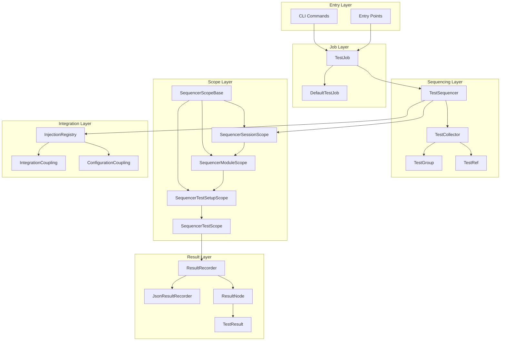

### Components

#### 1. TestJob (High-Level Orchestrator)

The `TestJob` class spans the execution of all test packs and organizes the flow of test execution. It serves as the primary entry point for test runs.

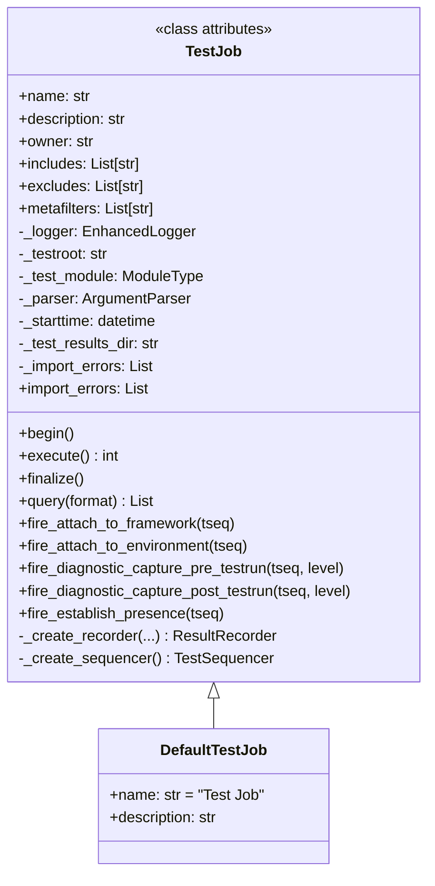

**Key Responsibilities:**

| Responsibility | Description |
|----------------|-------------|
| Lifecycle Management | Manages test run begin/execute/finalize phases |
| Sequencer Creation | Creates and configures the TestSequencer |
| Recorder Creation | Creates and configures the ResultRecorder |
| Integration Coordination | Fires integration lifecycle events |
| Result Aggregation | Collects and reports final test results |

**Context Manager Support:**

```python
with TestJob(logger, testroot, includes=includes, excludes=excludes) as tjob:
    result_code = tjob.execute()
```

#### 2. TestSequencer (Execution State Machine)

The `TestSequencer` is the central state machine that orchestrates test discovery, collection, and execution flow.

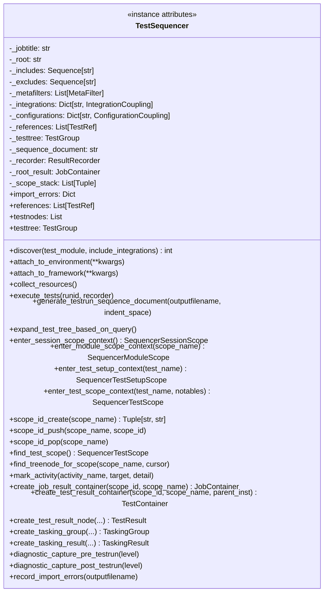

**Sequencer Phases:**

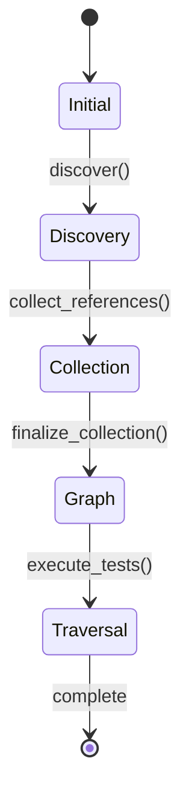

| Phase | Description |
|-------|-------------|
| Initial | Sequencer created, not yet started |
| Discovery | Test modules being discovered and imported |
| Collection | Test references being collected and organized |
| Graph | Test tree structure being built |
| Traversal | Tests being executed via sequence document |

#### 3. TestCollector (Test Discovery)

The `TestCollector` processes include/exclude expressions to discover and collect test references.

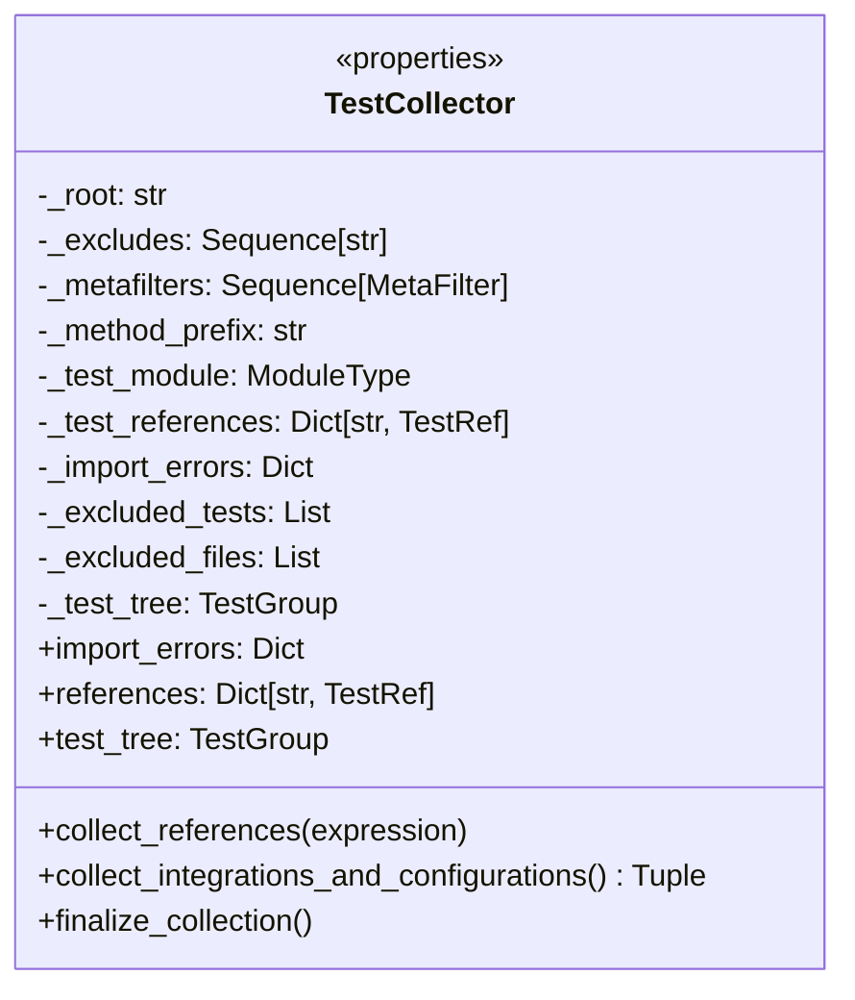

**Collection Process:**

1. Parse include expressions to identify target packages/modules
2. Find included files while applying exclusion filters
3. Import modules and collect test function references
4. Apply metadata filters to refine test set
5. Build hierarchical test tree structure
6. Collect integration and configuration couplings

#### 4. Scope Context Managers

The scope context managers provide lifecycle management for different execution scopes.

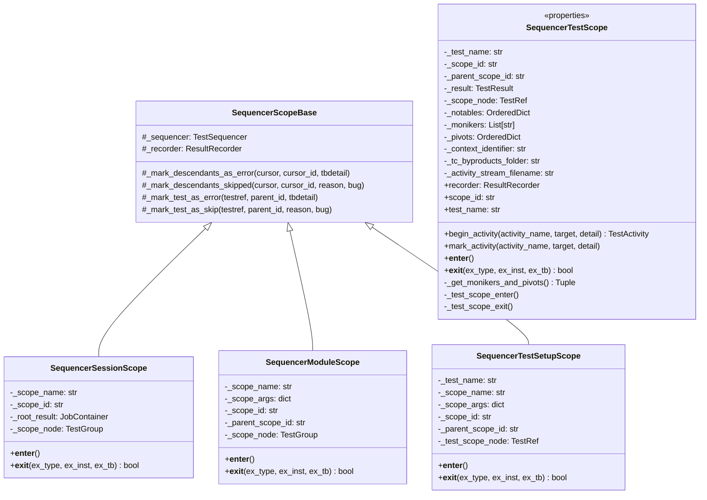

**Scope Hierarchy:**

```
Session Scope (root)
├── Module Scope (package.module)
│   ├── Test Setup Scope (setup:test_name)
│   │   └── Test Scope (test_name)
│   └── Test Setup Scope (setup:test_name_2)
│       └── Test Scope (test_name_2)
└── Module Scope (package.module_2)
    └── ...
```

#### 5. TestActivity (Activity Tracking)

The `TestActivity` class records timing information for test activities.

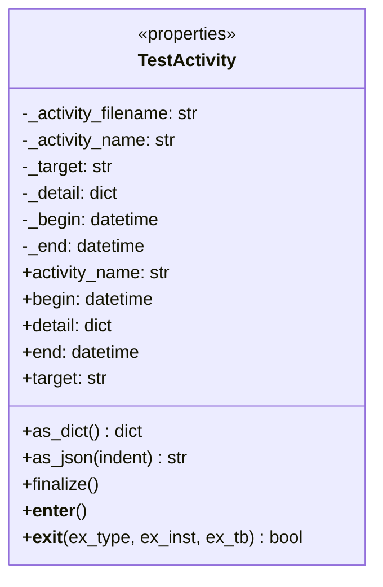

### Data Flow

#### Test Execution Flow

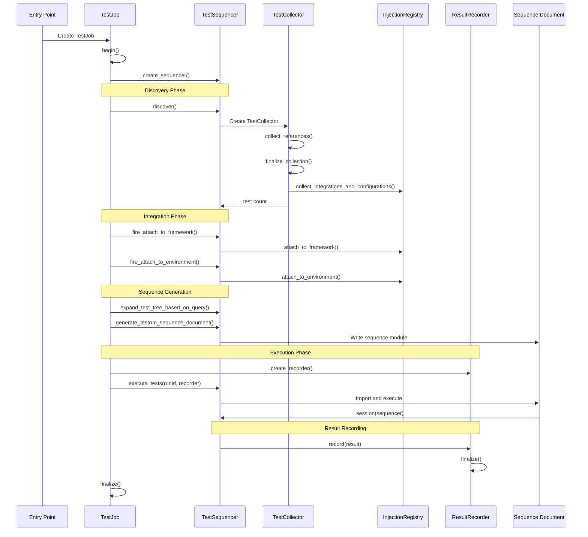

#### Scope Context Flow

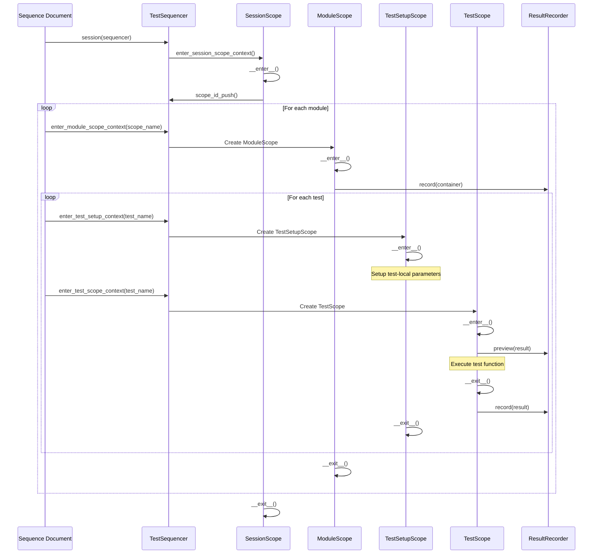

#### Sequence Document Generation Flow

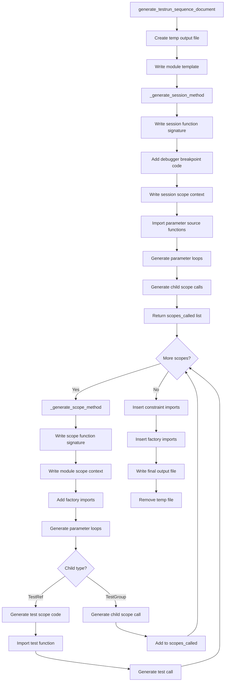

### Design Patterns

#### 1. Template Method Pattern

The `TestJob` class defines a template for test execution with hook methods that derived classes can override:

```python
class TestJob:
    def execute(self) -> int:
        with self._create_sequencer() as tseq:
            # Template steps
            count = tseq.discover()
            self.fire_attach_to_framework(tseq)
            self.fire_attach_to_environment(tseq)
            tseq.generate_testrun_sequence_document(...)
            
            with self._create_recorder(...) as recorder:
                tseq.execute_tests(runid, recorder)
                self.fire_diagnostic_capture_post_testrun(tseq)
        
        return result_code
    
    def _create_sequencer(self):
        """Hook for customizing sequencer creation."""
        return TestSequencer(...)
    
    def _create_recorder(self, ...):
        """Hook for customizing recorder creation."""
        return JsonResultRecorder(...)
```

#### 2. Context Manager Pattern

All scope classes implement the context manager protocol for resource lifecycle management:

```python
class SequencerTestScope:
    def __enter__(self):
        self._parent_scope_id, self._scope_id = self._sequencer.scope_id_create(...)
        self._result = self._sequencer.create_test_result_node(...)
        self._recorder.preview(self._result)
        return self
    
    def __exit__(self, ex_type, ex_inst, ex_tb):
        if ex_type is not None:
            # Handle exceptions
            if issubclass(ex_type, SkipError):
                self._result.mark_skip(...)
            elif issubclass(ex_type, AssertionError):
                self._result.add_failure(...)
            else:
                self._result.add_error(...)
        else:
            self._result.mark_passed()
        
        self._result.finalize()
        self._recorder.record(self._result)
        return True  # Suppress exception
```

#### 3. State Machine Pattern

The `TestSequencer` implements a state machine with distinct phases:

```python
class TEST_SEQUENCER_PHASES:
    Initial = 0
    Discovery = 1
    Collection = 2
    Graph = 3
    Traversal = 4
```

#### 4. Factory Method Pattern

Result objects are created through factory methods on the sequencer:

```python
class TestSequencer:
    def create_job_result_container(self, scope_id, scope_name):
        return JobContainer(scope_id, scope_name)
    
    def create_test_result_container(self, scope_id, scope_name, parent_inst):
        return TestContainer(scope_id, scope_name, parent_inst)
    
    def create_test_result_node(self, scope_id, name, monikers, pivots, parent_inst):
        return TestResult(scope_id, name, parent_inst, monikers, pivots)
```

#### 5. Visitor Pattern

The sequence document generation visits each node in the test tree:

```python
def _generate_scope_method(self, outf, scope_module, scope_name, scope_node, ...):
    for child_name in scope_node.children.keys():
        child_node = scope_node.children[child_name]
        
        if isinstance(child_node, TestRef):
            # Generate test execution code
            self._generate_test_code(...)
        else:
            # Generate child scope call
            scopes_called.append((scope_module, scope_name, child_node, ...))
```

### Sequence Document Architecture

The Test Execution Engine generates a Python sequence document that encodes the test execution order and parameter provisioning.

#### Document Structure

```python
"""
    ======= CODE GENERATED - DO NOT EDIT =======
    This is a code generated execution sequence document.
"""

__traceback_format_policy__ = "Brief"

import logging
from ccai.xmodules.xlogging.enhancedloggers import getEnhancedLogger
from ccai.testbase.constraints import ConstraintsCatalog

logger = getEnhancedLogger()
constraints_catalog = ConstraintsCatalog()

# ------- INSERT CONSTRAINT IMPORTS HERE -------
# ------- INSERT FACTORY IMPORTS HERE -------

def session(sequencer):
    """Entry point for the test run sequence document."""
    with sequencer.enter_session_scope_context() as ssc:
        # Import session-scoped parameter factories
        from package.factories import create_session_resource
        
        # Create session-scoped parameters
        for session_param in create_session_resource():
            scope_package_module(sequencer, session_param)
    return

def scope_package_module(sequencer, session_param):
    """Entry point for the 'package.module' test scope."""
    with sequencer.enter_module_scope_context("package.module") as msc:
        # Module-scoped parameter creation
        for module_param in create_module_resource():
            
            # ================ Test Scope: test_function ================
            test_scope_name = "test_function"
            
            with sequencer.enter_test_setup_context(test_scope_name) as tsetup:
                # Test-local parameter creation
                for test_param in create_test_resource():
                    notables = {'test_param': test_param}
                    
                    with sequencer.enter_test_scope_context(test_scope_name, notables=notables) as tscope:
                        from package.module import test_function
                        test_function(session_param, module_param, test_param)
    return
```

#### Generation Process

| Step | Action | Output |
|------|--------|--------|
| 1 | Write module template | Base imports and globals |
| 2 | Generate session method | `session(sequencer)` function |
| 3 | Generate scope methods | `scope_*()` functions for each module |
| 4 | Generate test code | Test setup and execution code |
| 5 | Insert imports | Constraint and factory imports |
| 6 | Finalize document | Complete Python module |


## Integration Points

### With Dependency Injection System

The execution engine integrates with the injection system for resource provisioning:

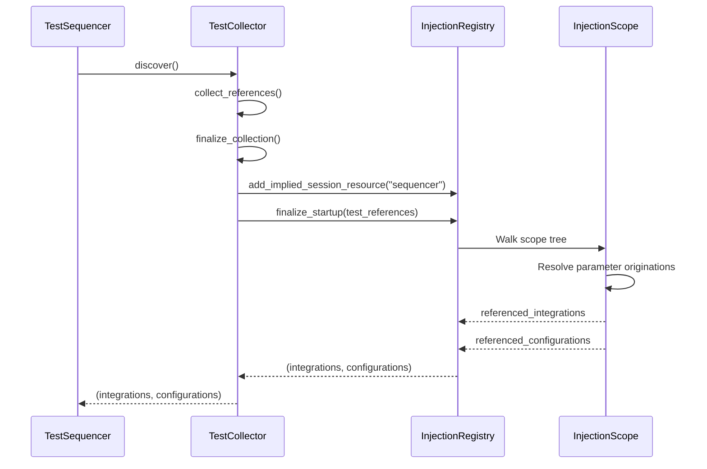

**Key Integration Points:**

| Component | Integration |
|-----------|-------------|
| `InjectionRegistry` | Provides parameter originations for sequence document |
| `ResourceOrigin` | Defines factory functions for parameter creation |
| `InjectionScope` | Organizes parameters by scope level |
| `IntegrationCoupling` | External resource integration |
| `ConfigurationCoupling` | Environment configuration |

### With Test Declaration System

The execution engine consumes test declarations:

- `TestRef` objects represent individual test functions
- `TestGroup` objects represent module/package groupings
- Test metadata (markers, features) influences execution filtering
- Parameter signatures determine injection requirements

### With Result Recording System

The execution engine produces results through the recorder:

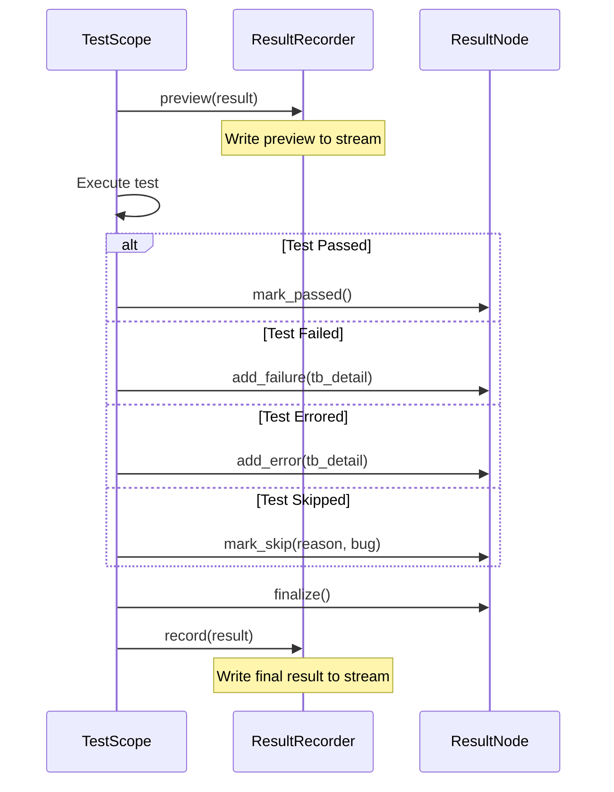

### With Coupling System

The execution engine coordinates coupling lifecycle:

| Phase | Coupling Method | Purpose |
|-------|-----------------|---------|
| Framework Attachment | `attach_to_framework()` | Register with test framework |
| Environment Attachment | `attach_to_environment()` | Validate configuration |
| Resource Collection | `collect_resources()` | Acquire external resources |
| Presence Establishment | `establish_presence()` | Verify resource availability |
| Pre-run Diagnostics | `diagnostic("pre-run", ...)` | Capture initial state |
| Post-run Diagnostics | `diagnostic("post-run", ...)` | Capture final state |

### With Constraints System

The execution engine passes constraints to factory functions:

```python
# In sequence document generation
if 'constraints' in sp_parameter_names:
    constraints_key = porigin.constraints_key
    if constraints_key is not None:
        sp_constraints = constraints_catalog.lookup_constraints(constraints_key)
        method_lines.append('constraints=constraints_catalog.lookup_constraints({})'.format(
            repr(constraints_key)))
```

## Configuration

### TestJob Configuration

```python
class CustomTestJob(TestJob):
    """Custom test job with specific configuration."""
    
    name = "Custom Test Suite"
    description = "Tests for custom functionality"
    owner = "test-team@example.com"
    
    includes = ["package.module@*"]  # Include all tests in module
    excludes = ["package.module@test_slow_*"]  # Exclude slow tests
    metafilters = [MetaFilter("priority", "high")]  # Only high priority
```

### TestJob Parameters

| Parameter | Type | Description |
|-----------|------|-------------|
| `logger` | `EnhancedLogger` | Logger instance for output |
| `testroot` | `str` | Root directory for test discovery |
| `includes` | `List[str]` | Include expressions |
| `excludes` | `List[str]` | Exclude expressions |
| `metafilters` | `List[MetaFilter]` | Metadata filters |
| `test_module` | `ModuleType` | Optional specific test module |
| `parser` | `ArgumentParser` | Optional argument parser |

### Runtime Variables

The execution engine reads configuration from runtime variables:

| Variable | Purpose |
|----------|---------|
| `AM_STARTTIME` | Test run start time |
| `AM_RUN_ID` | Unique run identifier |
| `AM_BUILD_*` | Build information (release, branch, etc.) |
| `AM_PIPELINE_*` | Pipeline information |
| `AM_JOB_*` | Job information |
| `AM_DEBUG_DEBUGGER` | Debugger name for breakpoints |
| `AM_DEBUG_BREAKPOINTS` | Configured breakpoint locations |
| `AM_DIAGNOSTICS_PRERUN` | Enable pre-run diagnostics |
| `AM_DIAGNOSTICS_POSTRUN` | Enable post-run diagnostics |

### Entry Point Configuration

```python
# Generic test entry point for debugging
if __name__ == "__main__":
    from ccai.testbase.entrypoints import generic_test_entrypoint
    generic_test_entrypoint()
```

**Command Line Arguments:**

| Argument | Description |
|----------|-------------|
| `-i, --include` | Add include expression |
| `-x, --exclude` | Add exclude expression |
| `--console-level` | Console logging level |
| `--logfile-level` | Log file logging level |

## Error Handling

### Exception Handling in Scopes

Each scope context manager handles exceptions appropriately:

```python
def __exit__(self, ex_type, ex_inst, ex_tb):
    handled = False
    
    if ex_type is not None:
        if issubclass(ex_type, SkipError):
            # Mark as skipped with reason
            self._mark_descendants_skipped(...)
        else:
            # Mark as error with traceback
            tb_detail = create_traceback_detail(ex_inst)
            self._mark_descendants_as_error(...)
        
        handled = True  # Suppress exception
    
    return handled
```

### Exception Types

| Exception Type | Handling | Result Code |
|----------------|----------|-------------|
| `SkipError` | Mark as skipped | `SKIPPED` |
| `AssertionError` | Mark as failure | `FAILED` |
| Other exceptions | Mark as error | `ERRORED` |

### Scope Failure Propagation

When a scope fails, all descendant tests are marked appropriately:

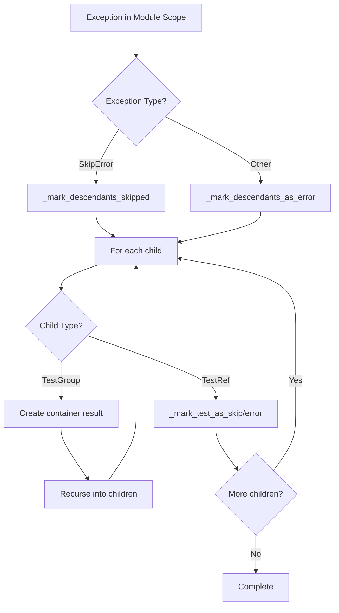

### Import Error Handling

Import errors during discovery are captured and recorded:

```python
def record_import_errors(self, outputfilename: str):
    with open(outputfilename, 'w') as ief:
        for modname, filename, errmsg in self._import_errors.values():
            ief.write(CHAR_RECORD_SEPERATOR)
            ieitem = {
                "module": modname,
                "filename": filename,
                "trace": errmsg.splitlines(False)
            }
            json.dump(ieitem, ief, indent=4)
```

### Empty Test Set Handling

When no tests are found, the engine reports an error:

```python
if count == 0:
    err_msg_lines = [
        "The include and exclude parameters specified resulted in an empty test set."
    ]
    # Log includes and excludes
    self._logger.error(err_msg)
    result_code = -1
```

## Testing Strategy

### Unit Testing Focus Areas

1. **TestJob**
   - Lifecycle method ordering (begin, execute, finalize)
   - Sequencer and recorder creation hooks
   - Integration event firing
   - Result code determination

2. **TestSequencer**
   - Phase transitions
   - Scope stack management
   - Sequence document generation
   - Result container creation

3. **Scope Context Managers**
   - Context manager protocol compliance
   - Exception handling and propagation
   - Result recording integration
   - Scope ID management

4. **TestCollector**
   - Include/exclude expression parsing
   - Test reference collection
   - Metadata filtering
   - Integration/configuration collection

5. **TestActivity**
   - Timing capture
   - JSON serialization
   - File output

### Test Categories

| Category | Components | Focus |
|----------|------------|-------|
| Lifecycle | TestJob, Scopes | Method ordering, state transitions |
| Discovery | TestCollector | Expression parsing, filtering |
| Execution | TestSequencer | Sequence generation, traversal |
| Results | Scopes, Recorder | Result creation, recording |
| Error Handling | All scopes | Exception handling, propagation |

### Integration Testing

1. **End-to-End Execution**
   - Complete test run with sample tests
   - Result file generation and validation
   - Import error handling

2. **Scope Nesting**
   - Proper scope entry/exit ordering
   - Exception propagation across scopes
   - Result hierarchy correctness

3. **Parameter Injection**
   - Factory function invocation
   - Parameter passing to tests
   - Constraint propagation

## Scope Management

### Scope Stack

The sequencer maintains a scope stack for tracking the current execution context:

```python
def scope_id_create(self, scope_name: str) -> Tuple[str, str]:
    parent_id = None
    if len(self._scope_stack) > 0:
        parent_id = self._scope_stack[-1][1]
    
    scope_id = str(uuid.uuid4())
    self._scope_stack.append((scope_name, scope_id))
    
    return parent_id, scope_id

def scope_id_pop(self, scope_name: str):
    top_entry_name, _ = self._scope_stack.pop()
    if top_entry_name != scope_name:
        raise RuntimeError(f"Attempting to pop '{scope_name}' but encountered '{top_entry_name}'")
```

### Scope Lifespan

| Scope Type | Lifespan | Purpose |
|------------|----------|---------|
| Session | Entire test run | Root scope, session-level resources |
| Module | Module execution | Module-level resources, test grouping |
| Test Setup | Test preparation | Test-local parameter creation |
| Test | Single test | Test execution, result recording |

### Scope Context Identifiers

Test scopes use context identifiers that include parameter monikers:

```python
self._context_identifier = "{}:{}".format(self._test_name, ",".join(self._monikers))
```

This allows distinguishing between parameterized test instances.

## Known Limitations

### Sequential Execution Only

The current implementation executes tests sequentially. Parallel execution is not supported.

### Single Sequence Document

Only one sequence document is generated per test run. Dynamic test addition is not supported.

### No Test Retry

Failed tests are not automatically retried. Retry logic must be implemented externally.

### Limited Debugger Integration

Debugger breakpoints are only supported at specific well-known locations:
- `TEST_DISCOVERY`
- `TESTRUN_START`

### No Streaming Results

Results are written to files; real-time streaming to external systems requires custom recorder implementation.

## Future Enhancements

### Potential Additions

1. **Parallel Execution**: Support for concurrent test execution
2. **Test Retry**: Automatic retry of failed tests with configurable policies
3. **Dynamic Test Addition**: Runtime test registration and execution
4. **Streaming Results**: Real-time result streaming to external systems
5. **Distributed Execution**: Support for distributed test execution across nodes
6. **Test Prioritization**: Dynamic test ordering based on failure history
7. **Resource Pooling**: Shared resource pools across test scopes
8. **Checkpoint/Resume**: Ability to resume interrupted test runs
9. **Test Isolation**: Process-level test isolation for stability
10. **Performance Metrics**: Detailed timing and resource usage metrics
