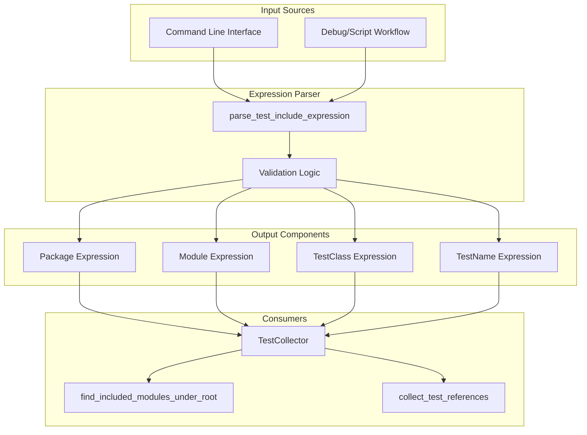
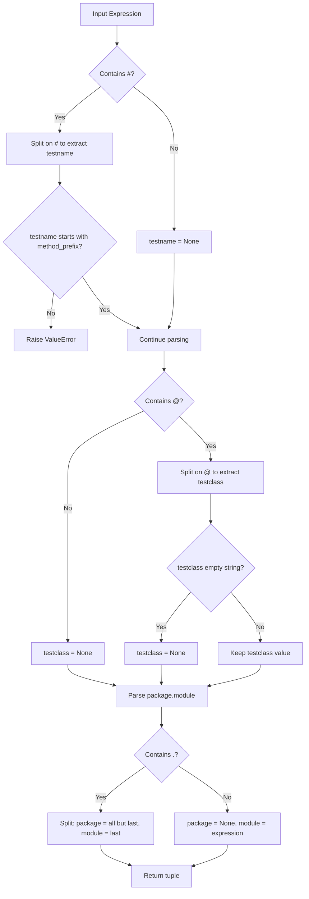
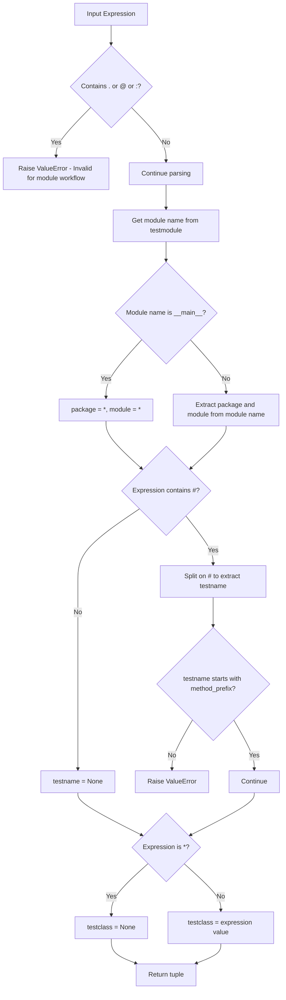

# Expression Parsing - Design Document

## Overview

The Expression Parsing system provides a mechanism for parsing test include expressions that specify which tests to run. These expressions follow a structured format that identifies test packages, modules, test classes, and individual test methods. The parser supports two primary workflows: command-line test execution and single-module debugging/scripting.

## Architecture

### High-Level Component Diagram



### Expression Grammar

The expression parser recognizes the following grammar:

```
expression      := package_module_expr ["@" testclass_expr] ["#" testname_expr]
                 | testclass_expr ["#" testname_expr]  (module workflow only)

package_module_expr := package "." module
                     | module

package         := identifier ("." identifier)*
module          := identifier | "*"

testclass_expr  := identifier | ""
testname_expr   := method_prefix identifier_suffix

method_prefix   := "test" (default) | custom_prefix
identifier      := [a-zA-Z_][a-zA-Z0-9_]*
```

### Expression Format Examples

| Expression | Package | Module | TestClass | TestName |
|------------|---------|--------|-----------|----------|
| `pkg.mod` | `pkg` | `mod` | `None` | `None` |
| `pkg.mod@TestClass` | `pkg` | `mod` | `TestClass` | `None` |
| `pkg.mod@TestClass#test_demo` | `pkg` | `mod` | `TestClass` | `test_demo` |
| `pkg.mod@#test_demo` | `pkg` | `mod` | `None` | `test_demo` |
| `pkg.subpkg.mod` | `pkg.subpkg` | `mod` | `None` | `None` |
| `mod` | `None` | `mod` | `None` | `None` |
| `*` (with module) | from module | from module | `None` | `None` |
| `TestClass#test_demo` (with module) | from module | from module | `TestClass` | `test_demo` |

### Components

#### 1. Expression Parser Function (`expressions.py`)

The `parse_test_include_expression` function is the core component that parses test include expressions.

**Function Signature:**

```python
def parse_test_include_expression(
    expression: str, 
    testmodule: Optional[ModuleType], 
    method_prefix: str = "test"
) -> Tuple[Optional[str], Optional[str], Optional[str], Optional[str]]
```

**Parameters:**

| Parameter | Type | Description |
|-----------|------|-------------|
| `expression` | `str` | The test include expression to parse |
| `testmodule` | `Optional[ModuleType]` | Test module for debug/script workflow |
| `method_prefix` | `str` | Prefix identifying test methods (default: "test") |

**Returns:**

A tuple of four optional strings: `(expr_package, expr_module, expr_testclass, expr_testname)`

### Data Flow

#### Command-Line Workflow (testmodule is None)



#### Module Debug/Script Workflow (testmodule is not None)



### Design Patterns

#### 1. Strategy Pattern (Implicit)

The parser uses different parsing strategies based on whether a `testmodule` is provided:
- **Module Workflow Strategy**: Extracts package/module from the module object, restricts expression format
- **CLI Workflow Strategy**: Full expression parsing with all components

#### 2. Fail-Fast Validation

The parser validates inputs early and raises `ValueError` with descriptive messages when:
- Module workflow expressions contain invalid characters (`.`, `@`, `:`)
- Test names don't start with the required method prefix

### Parsing Rules

#### Delimiter Precedence

The expression is parsed from right to left using these delimiters:

1. `#` - Separates test name from the rest
2. `@` - Separates test class from package.module
3. `.` - Separates package components and module

#### Special Cases

| Case | Behavior |
|------|----------|
| Empty testclass (`@#`) | `testclass` becomes `None` |
| Wildcard (`*`) in module workflow | Matches all tests in module |
| `__main__` module name | Uses wildcards for package and module |
| Single identifier (no `.`) | Treated as module only, package is `None` |

## Integration Points

### With TestCollector

The `TestCollector` class uses `parse_test_include_expression` to:
1. Parse include expressions provided by users
2. Extract components for file discovery via `find_included_modules_under_root`
3. Filter test references based on parsed components

```python
# In TestCollector.collect_references()
expr_package, expr_module, expr_testclass, expr_testname = \
    parse_test_include_expression(expression, self._test_module, self._method_prefix)
```

### With CLI System

The CLI passes include expressions from command-line arguments to the `TestCollector`, which uses the expression parser to interpret them.

### With Debug/Script Workflow

When running a test module directly (e.g., `python test_module.py`), the module object is passed to enable simplified expression syntax.

## Configuration

### Method Prefix Configuration

The `method_prefix` parameter allows customization of the test method naming convention:

| Prefix | Example Test Names |
|--------|-------------------|
| `test` (default) | `test_login`, `test_validation` |
| `check` | `check_login`, `check_validation` |
| `verify` | `verify_login`, `verify_validation` |

## Error Handling

### ValueError Conditions

| Condition | Error Message |
|-----------|---------------|
| Module workflow with `.`, `@`, or `:` | "The include expression for test module runs should only have a test class and test method." |
| Test name without method prefix | "The testname component of the expression must start with the method_prefix={prefix}. expression={expr}" |

### Error Message Format

Error messages include:
- Function name for context (`parse_test_include_expression:`)
- Description of the constraint violated
- Relevant parameter values for debugging

## Testing Strategy

### Unit Testing Focus Areas

1. **Module Workflow Parsing**
   - Valid wildcard expressions
   - Package/module extraction from module name
   - Test class and test name extraction
   - Invalid expression rejection

2. **CLI Workflow Parsing**
   - Full expression parsing (package.module@class#method)
   - Partial expressions (package.module, module only)
   - Empty testclass handling
   - Method prefix validation

3. **Edge Cases**
   - `__main__` module name handling
   - Single-component expressions
   - Nested package paths
   - Empty string components

### Test Coverage Matrix

| Scenario | Module Workflow | CLI Workflow |
|----------|-----------------|--------------|
| Full expression | N/A (invalid) | ✓ |
| Package.module only | N/A | ✓ |
| Module only | N/A | ✓ |
| Wildcard (*) | ✓ | N/A |
| Class#method | ✓ | ✓ |
| Empty testclass (@#) | N/A | ✓ |
| Invalid prefix | ✓ | ✓ |
| Invalid characters | ✓ | N/A |

### Integration Testing

- End-to-end test collection with various expression formats
- CLI argument parsing to expression parsing flow
- Debug workflow with actual module objects
