# Feature Tagging System - Design Document

## Overview

The Feature Tagging System provides a hierarchical, type-safe mechanism for categorizing and filtering objects based on feature capabilities. It enables test authors and framework users to:

- Define feature tags using a class-based hierarchy
- Attach feature tags to objects via a mixin class
- Filter collections of objects based on required or excluded features
- Create feature masks for declarative feature requirements

The system uses Python's metaclass mechanism to automatically generate unique identifiers from class hierarchies, enabling intuitive nested feature definitions.

## Architecture

### High-Level Component Diagram

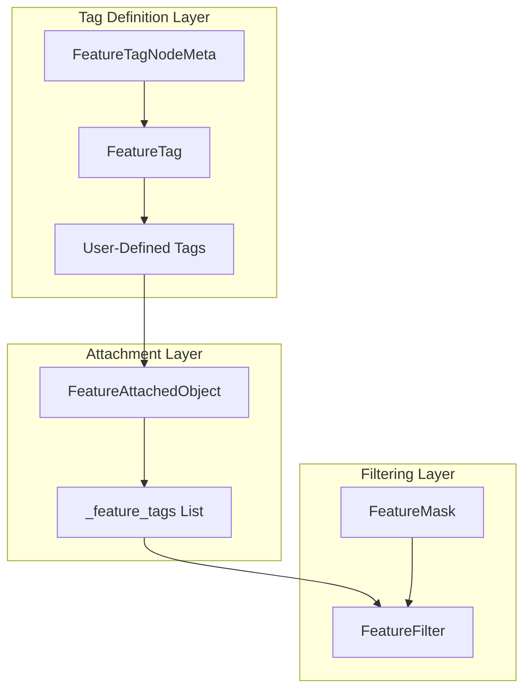

### Components

#### 1. FeatureTagNodeMeta (Metaclass)

The `FeatureTagNodeMeta` metaclass automatically generates unique identifiers for feature tag classes based on their qualified name.

**Key Behaviors:**

| Method | Purpose |
|--------|---------|
| `__new__` | Creates new tag class and assigns `ID` attribute |
| `__repr__` | Returns quoted tag identifier string |
| `__str__` | Returns tag identifier string |

**ID Generation Algorithm:**

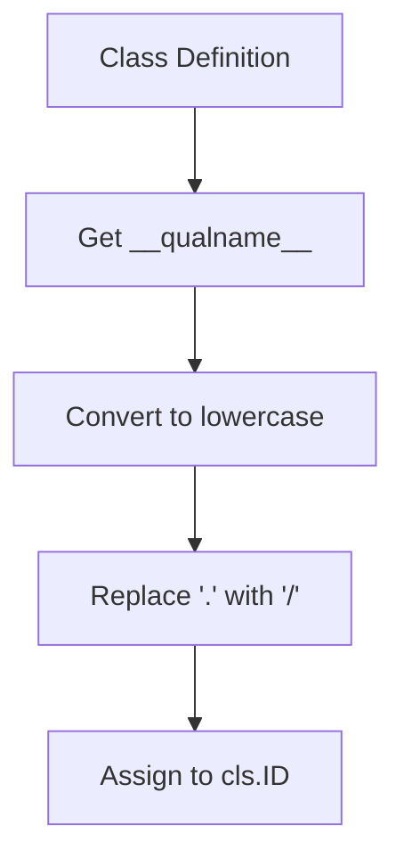

**Example ID Generation:**

| Class Definition | Generated ID |
|------------------|--------------|
| `class Network(FeatureTag)` | `network` |
| `class Network.Wifi(FeatureTag)` | `network/wifi` |
| `class Network.Wifi.Band5GHz(FeatureTag)` | `network/wifi/band5ghz` |

#### 2. FeatureTag (Base Class)

The `FeatureTag` class serves as the base type for all feature tag definitions. It uses `FeatureTagNodeMeta` as its metaclass.

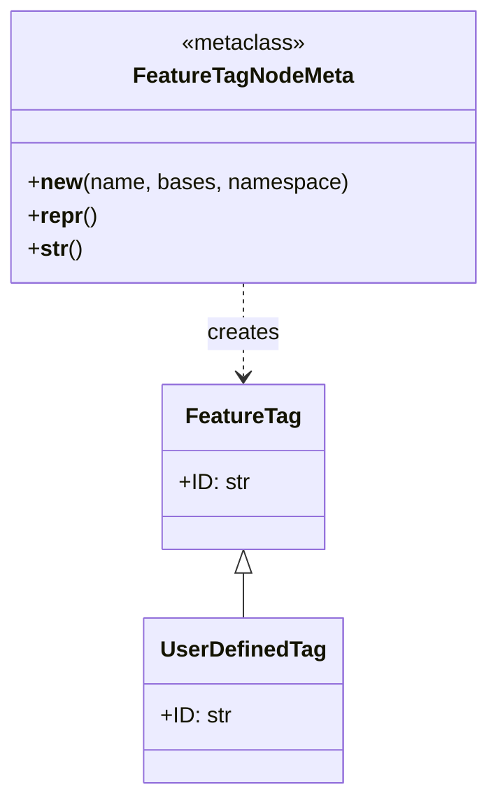

**Usage Pattern:**

```python
class DeviceFeatures(FeatureTag):
    class Bluetooth(FeatureTag):
        class BLE(FeatureTag):
            pass
        class Classic(FeatureTag):
            pass
    class Display(FeatureTag):
        class OLED(FeatureTag):
            pass
```

#### 3. FeatureAttachedObject (Mixin Class)

The `FeatureAttachedObject` mixin provides feature tag support to any derived class.

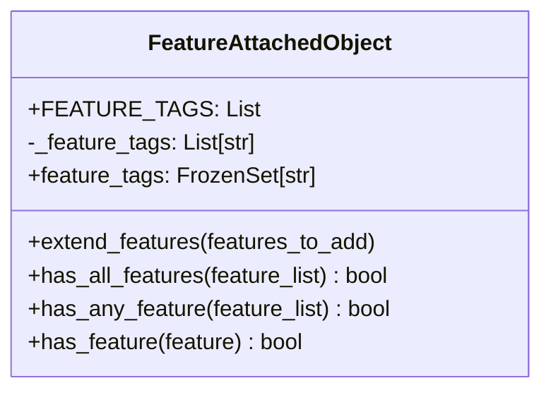

**Key Methods:**

| Method | Purpose | Return Type |
|--------|---------|-------------|
| `extend_features` | Add features to the object | `None` |
| `has_all_features` | Check if all features are present | `bool` |
| `has_any_feature` | Check if any feature is present | `bool` |
| `has_feature` | Check if a specific feature is present | `bool` |

**Feature Storage:**

Features are stored in a sorted list using `bisect.insort` for efficient lookup:

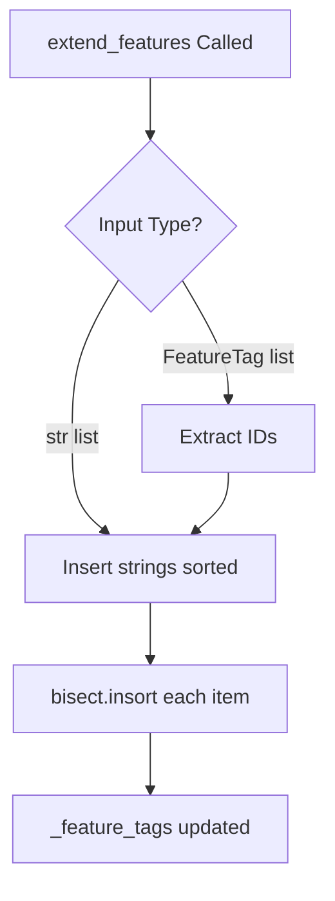

#### 4. FeatureMask (Dictionary Wrapper)

The `FeatureMask` class provides a declarative way to specify feature requirements.

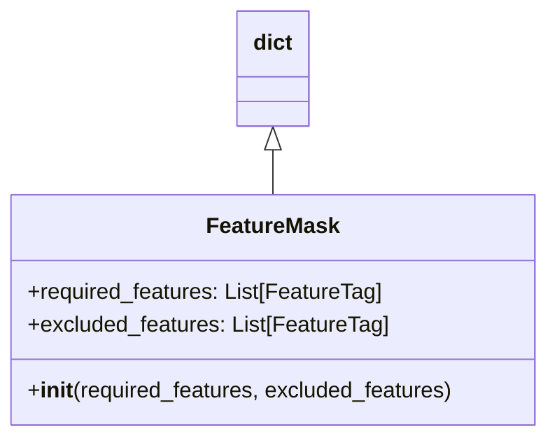

**Structure:**

```python
{
    "required_features": [FeatureTag1, FeatureTag2],
    "excluded_features": [FeatureTag3]
}
```

#### 5. FeatureFilter (Filtering Utility)

The `FeatureFilter` class filters collections of `FeatureAttachedObject` instances based on feature criteria.

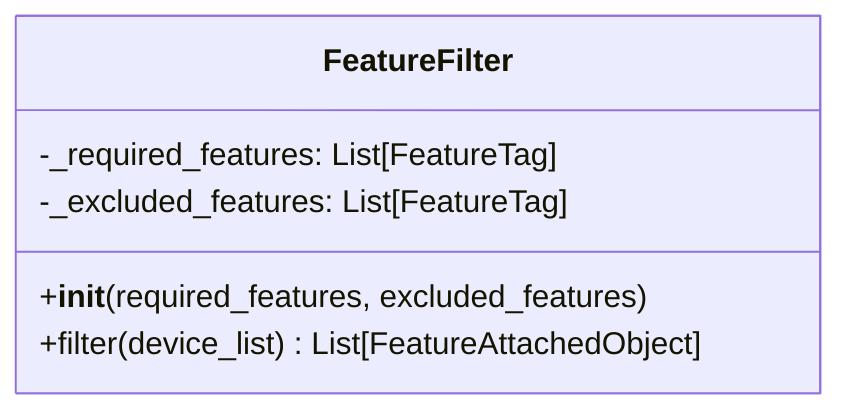

**Filter Logic:**

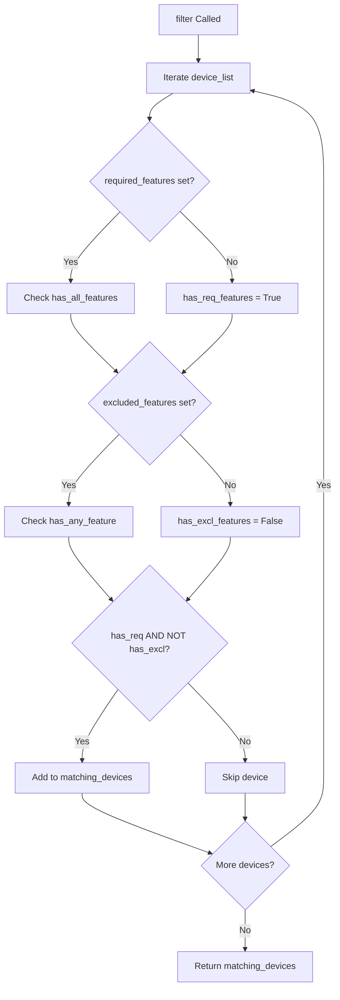

### Data Flow

#### Feature Tag Definition Flow

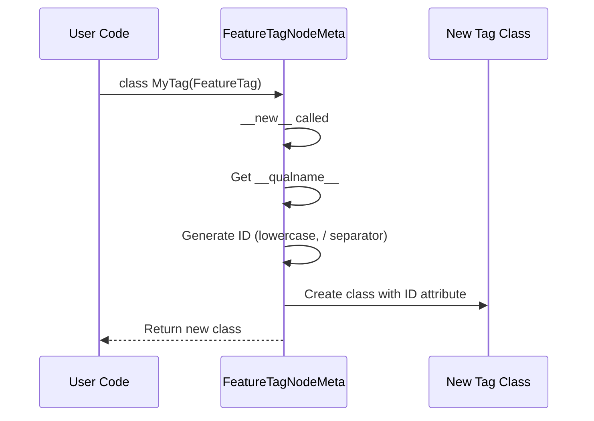

#### Feature Attachment Flow

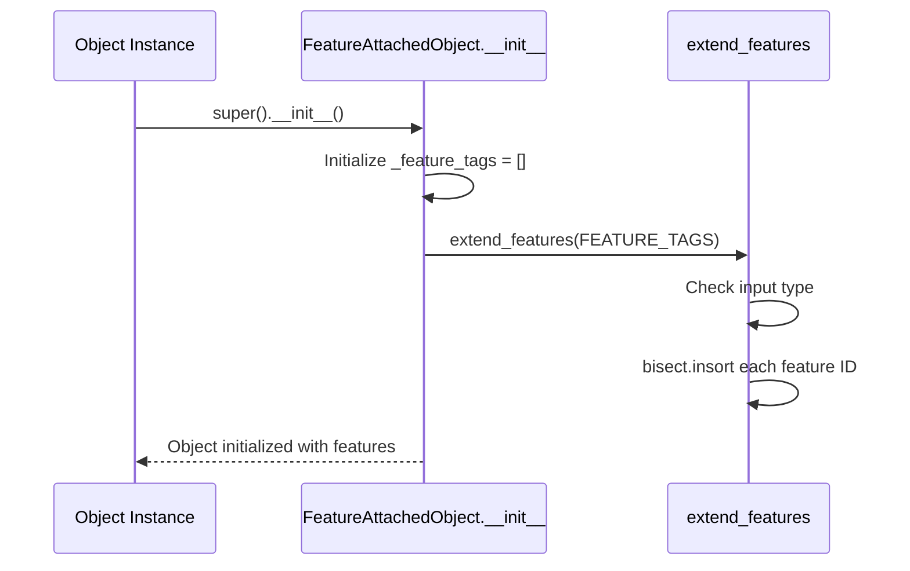

#### Feature Filtering Flow

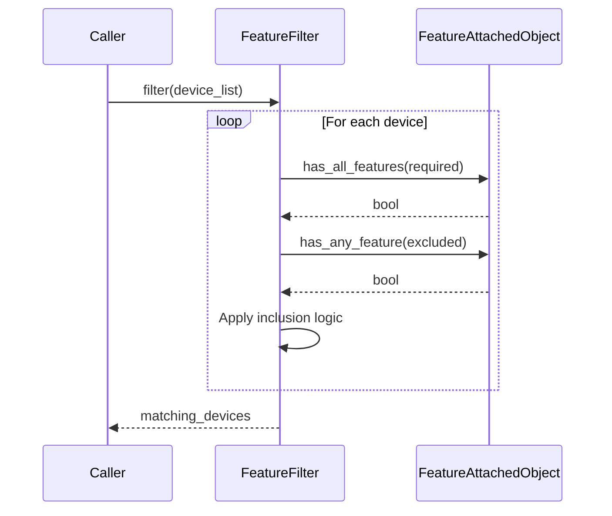

### Design Patterns

#### 1. Metaclass Pattern

`FeatureTagNodeMeta` uses Python's metaclass mechanism to customize class creation:

```python
class FeatureTagNodeMeta(type):
    def __new__(metacls, name, bases, namespace, **kwargs):
        cls = super().__new__(metacls, name, bases, namespace, **kwargs)
        cls.ID = cls.__qualname__.lower().replace(".", "/")
        return cls
```

This enables automatic ID generation without explicit assignment.

#### 2. Mixin Pattern

`FeatureAttachedObject` is designed as a mixin class that can be combined with other base classes:

```python
class Device(FeatureAttachedObject, SomeOtherBase):
    FEATURE_TAGS = [DeviceFeatures.Bluetooth]
```

#### 3. Strategy Pattern

`FeatureFilter` encapsulates the filtering algorithm, allowing different filter configurations to be applied to the same collection:

```python
wifi_filter = FeatureFilter(required_features=[Network.Wifi])
bluetooth_filter = FeatureFilter(required_features=[Network.Bluetooth])

wifi_devices = wifi_filter.filter(all_devices)
bluetooth_devices = bluetooth_filter.filter(all_devices)
```

#### 4. Composite Pattern

Feature tags form a hierarchical tree structure through class nesting:

```python
class Features(FeatureTag):
    class Network(FeatureTag):
        class Wifi(FeatureTag):
            pass
```

## Integration Points

### With Test Declaration System

- Test containers can extend `FeatureAttachedObject` to support feature-based filtering
- Feature tags can be used to categorize tests by capability requirements
- `TestRef` objects can resolve feature metadata from test functions

### With Dependency Injection System

- Resource factories can be filtered based on feature requirements
- Integration couplings can declare feature prerequisites
- Feature masks can specify resource availability constraints

### With Test Execution Engine

- Tests can be filtered by feature requirements before execution
- Feature-based test selection enables targeted test runs
- Execution can be scoped to specific feature combinations

### With Constraints System

- Feature tags can serve as constraint identifiers
- `FeatureMask` can define constraint requirements
- Feature filtering integrates with constraint evaluation

## Configuration

### Class-Level Configuration

| Attribute | Type | Purpose |
|-----------|------|---------|
| `FEATURE_TAGS` | `List[FeatureTag]` | Default features for all instances |

### Instance-Level Configuration

| Property | Type | Access |
|----------|------|--------|
| `feature_tags` | `FrozenSet[str]` | Read-only feature set |

### Filter Configuration

| Parameter | Type | Purpose |
|-----------|------|---------|
| `required_features` | `List[FeatureTag]` | Features that must be present |
| `excluded_features` | `List[FeatureTag]` | Features that must not be present |

## Error Handling

### SemanticError

The system raises `SemanticError` for:

1. **Invalid feature type in extend_features**:
   ```
   The 'features_to_add' parameter must contain items of type 'FeatureTag' or 'str'.
   ```

2. **Invalid feature type in has_all_features**:
   ```
   The 'feature_list' parameter must contain items of type 'FeatureTag' or 'str'.
   ```

3. **Empty feature list in has_all_features/has_any_feature**:
   ```
   has_all_features: 'feature_list' cannot be empty.
   ```

4. **Invalid feature type in has_feature**:
   ```
   The 'feature' parameter must be of type 'FeatureTag' or 'str'.
   ```

### Type Validation

All feature-related methods validate input types and raise `SemanticError` with descriptive messages when invalid types are provided.

## Testing Strategy

### Unit Testing Focus Areas

1. **FeatureTagNodeMeta**
   - Verify ID generation from class names
   - Test nested class ID generation
   - Verify `__repr__` and `__str__` output

2. **FeatureTag**
   - Test base class ID assignment
   - Verify inheritance behavior
   - Test nested tag hierarchies

3. **FeatureAttachedObject**
   - Test `extend_features` with string lists
   - Test `extend_features` with FeatureTag lists
   - Verify sorted insertion behavior
   - Test `has_all_features` with various inputs
   - Test `has_any_feature` with various inputs
   - Test `has_feature` with single features
   - Verify `feature_tags` property returns frozen set

4. **FeatureMask**
   - Test dictionary structure
   - Verify required/excluded feature storage

5. **FeatureFilter**
   - Test filtering with required features only
   - Test filtering with excluded features only
   - Test filtering with both required and excluded
   - Test filtering with None parameters
   - Verify empty list handling

### Test Categories

| Category | Components | Focus |
|----------|------------|-------|
| Metaclass | `FeatureTagNodeMeta` | ID generation, class creation |
| Base Class | `FeatureTag` | Inheritance, ID assignment |
| Mixin | `FeatureAttachedObject` | Feature attachment, queries |
| Filtering | `FeatureMask`, `FeatureFilter` | Collection filtering |

### Edge Cases

1. **Empty feature lists**: Behavior when no features are attached
2. **Duplicate features**: Handling of duplicate feature additions
3. **Mixed input types**: Mixing string and FeatureTag inputs (should raise error)
4. **Deep nesting**: Feature tags with many levels of nesting
5. **Unicode in class names**: ID generation with non-ASCII characters

## Known Issues

### Sorted List Performance

The `_feature_tags` list uses `bisect.insort` for sorted insertion, which has O(n) complexity for each insertion. For objects with many features, this could impact performance.

### No Duplicate Prevention

The `extend_features` method does not prevent duplicate feature additions. The same feature ID can appear multiple times in `_feature_tags`.

### Type Mixing Not Supported

Methods like `has_all_features` check only the first item's type and assume all items are the same type. Mixed lists of strings and FeatureTag objects will cause unexpected behavior.

## Future Enhancements

### Potential Additions

1. **Duplicate Prevention**: Add deduplication logic to `extend_features`
2. **Set-Based Storage**: Consider using a set instead of sorted list for O(1) lookup
3. **Feature Removal**: Add method to remove features from an object
4. **Wildcard Matching**: Support pattern matching for feature IDs (e.g., `network/*`)
5. **Feature Inheritance**: Automatic inheritance of parent tag features
6. **Feature Validation**: Validate feature tags against a registry of known tags
7. **Feature Events**: Callbacks when features are added or removed
8. **Serialization**: JSON/YAML serialization of feature configurations
