# HTML Report Templates - Design Document

## Overview

The HTML Report Templates system provides a client-side web application for rendering and displaying test execution results in the TestBase framework. It delivers:

- A single-page application (SPA) architecture using vanilla JavaScript and Web Components
- Dynamic data loading from JSON/JSOS result files generated by the Result Recording system
- Modular, reusable UI components for displaying test summaries, configurations, results, and artifacts
- Specialized tab pages for rendering media artifacts (images, sounds, time series charts)
- Themeable styling through CSS custom properties for branding customization

The system operates entirely client-side, loading test result data via AJAX requests and rendering it through a component-based architecture.

## Architecture

### High-Level Component Diagram

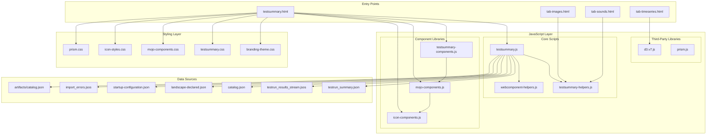

### Components

#### 1. Page Structure (testsummary.html)

The main entry point establishes the page layout with custom web components:

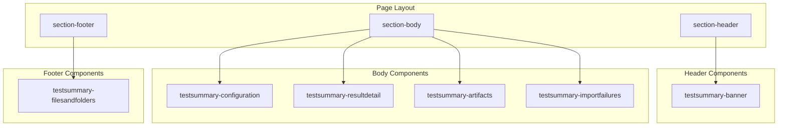

#### 2. Web Component Hierarchy

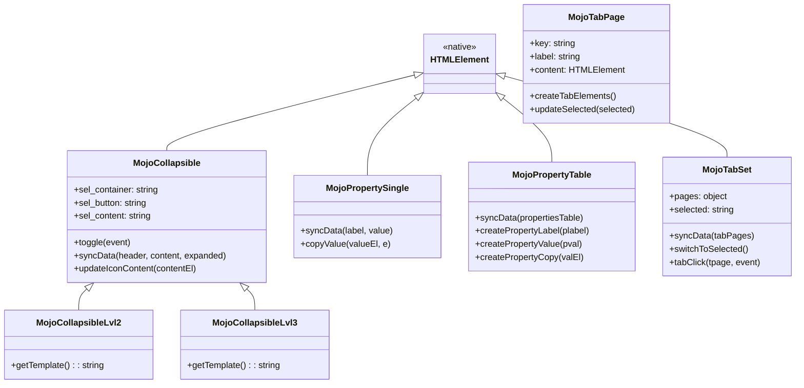

#### 3. TestSummary Components

```mermaid
classDiagram
    class TestSummaryBanner {
        +summary: object
        +syncData(summary)
    }
    
    class TestSummaryConfiguration {
        +landscape: object
        +command: string
        +environment: object
        +packages: object
        +syncData(startup, landscape)
    }
    
    class TestSummaryConfigurationLandscape {
        +landscape: object
        +syncData(header, landscape)
    }
    
    class TestSummaryResultDetail {
        +syncData(renderFormat, resultsDetail)
        +renderTestsGroupedByPackage(gridResultsEl, resultsDetail)
    }
    
    class TestSummaryResultGroup {
        +syncData(groupName, groupInfo)
    }
    
    class TestSummaryResultItem {
        +syncData(testItem)
    }
    
    class TestSummaryTaskGroup {
        +syncData(groupInfo)
    }
    
    class TestSummaryTaskResult {
        +syncData(taskItem)
    }
    
    class TestSummaryArtifacts {
        +syncData(artifacts_catalog, artifacts_folder_catalogs)
    }
    
    class TestSummaryImportFailures {
        +syncData(importFailures)
    }
    
    class TestSummaryFilesAndFolders {
        +syncData(files, folders)
        +createFileElement(label, path)
        +createFolderElement(label, path)
    }
    
    HTMLElement <|-- TestSummaryBanner
    HTMLElement <|-- TestSummaryConfiguration
    MojoCollapsible <|-- TestSummaryConfigurationLandscape
    HTMLElement <|-- TestSummaryResultDetail
    HTMLElement <|-- TestSummaryResultGroup
    HTMLElement <|-- TestSummaryResultItem
    HTMLElement <|-- TestSummaryTaskGroup
    HTMLElement <|-- TestSummaryTaskResult
    HTMLElement <|-- TestSummaryArtifacts
    HTMLElement <|-- TestSummaryImportFailures
    HTMLElement <|-- TestSummaryFilesAndFolders
```

#### 4. Error and Failure Display Components

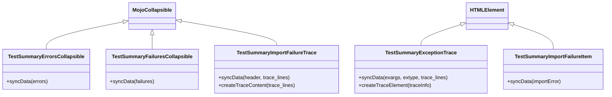

#### 5. Landscape Configuration Components

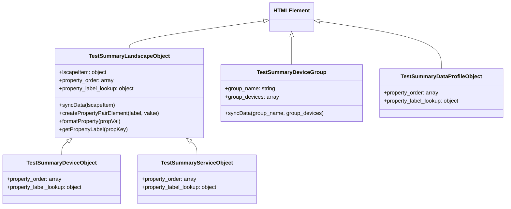

### Data Flow

#### Page Load Sequence

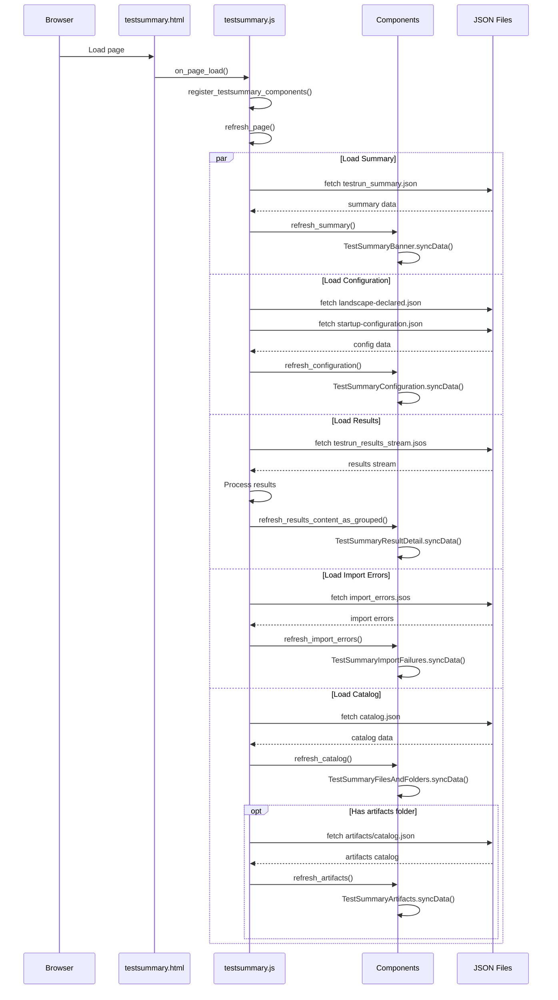

#### Result Processing Flow

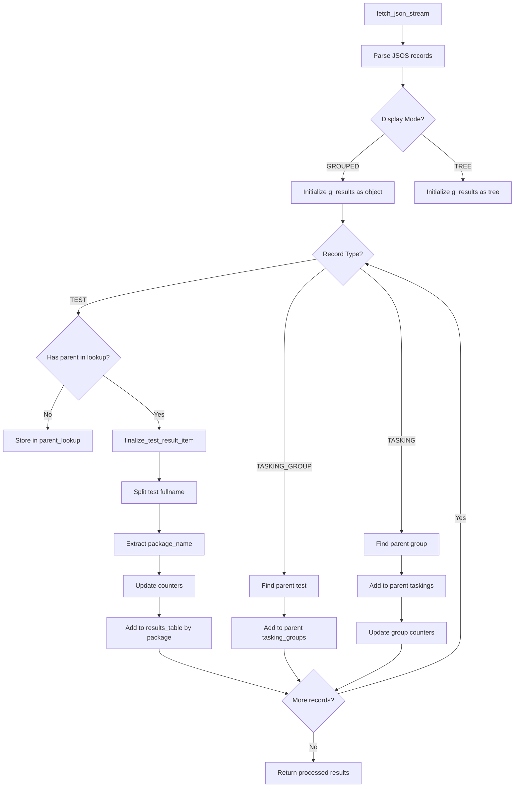

#### Component Data Binding

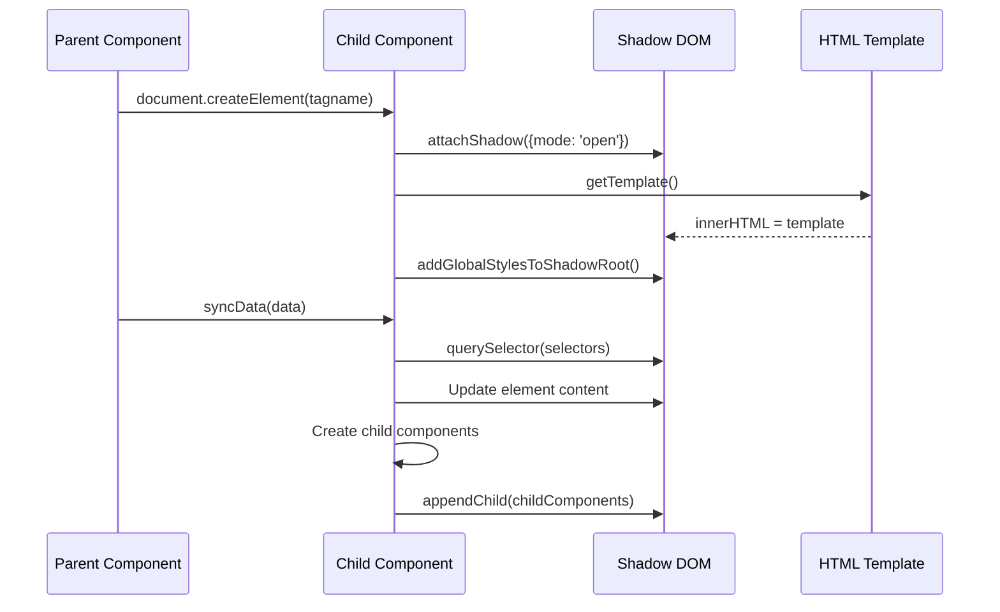

### Design Patterns

#### 1. Web Components Pattern

All UI components extend `HTMLElement` and use Shadow DOM for encapsulation:

```javascript
class TestSummaryBanner extends HTMLElement {
    static tagname = 'testsummary-banner'
    static template = `<div class='ts-banner'>...</div>`
    
    constructor() {
        super();
        const shadowRoot = this.attachShadow({mode: 'open'});
        shadowRoot.innerHTML = this.getTemplate();
        addGlobalStylesToShadowRoot(shadowRoot);
    }
    
    getTemplate() {
        return TestSummaryBanner.template;
    }
    
    syncData(summary) {
        // Update shadow DOM elements with data
    }
}
```

#### 2. Template Method Pattern

Base components define template methods that derived classes override:

```javascript
class MojoCollapsible extends HTMLElement {
    getTemplate() {
        return MojoCollapsible.template;  // Override in subclass
    }
    
    syncData(header, content, expanded) {
        // Common implementation
    }
}

class TestSummaryConfigurationLandscape extends MojoCollapsible {
    getTemplate() {
        return TestSummaryConfigurationLandscape.template;  // Custom template
    }
    
    syncData(header, landscape) {
        // Custom implementation
        super.syncData(header, undefined, false);
    }
}
```

#### 3. Composite Pattern

Result display uses nested components to represent hierarchical data:

```
TestSummaryResultDetail
├── TestSummaryResultGroup (per package)
│   ├── TestSummaryResultItem (per test)
│   │   ├── TestSummaryErrorsCollapsible
│   │   │   └── TestSummaryExceptionTrace
│   │   ├── TestSummaryFailuresCollapsible
│   │   │   └── TestSummaryExceptionTrace
│   │   └── TestSummaryTaskGroup (per tasking group)
│   │       └── TestSummaryTaskResult (per tasking)
```

#### 4. Observer Pattern (Event-Driven)

Components respond to user interactions through event listeners:

```javascript
class MojoCollapsible extends HTMLElement {
    constructor() {
        super();
        var buttonEl = this.shadowRoot.querySelector(this.sel_button);
        var thisComp = this;
        buttonEl.addEventListener("click", (event) => { thisComp.toggle(event) });
    }
    
    toggle(event) {
        var contentEl = this.shadowRoot.querySelector(this.sel_content);
        contentEl.style.display = contentEl.style.display == "none" ? "" : "none";
        this.updateIconContent(contentEl);
    }
}
```

#### 5. Factory Pattern

Component registration creates custom element factories:

```javascript
function register_testsummary_components() {
    register_mojo_components();
    
    customElements.define(TestSummaryBanner.tagname, TestSummaryBanner);
    customElements.define(TestSummaryConfiguration.tagname, TestSummaryConfiguration);
    customElements.define(TestSummaryResultDetail.tagname, TestSummaryResultDetail);
    // ... more component registrations
}
```

#### 6. Strategy Pattern

Result rendering supports multiple display strategies:

```javascript
syncData(renderFormat, resultsDetail) {
    if (renderFormat == "render_by_package") {
        this.renderTestsGroupedByPackage(gridResultsEl, resultsDetail);
    } else if (renderFormat == "render_as_tree") {
        this.renderTestsAsTree(gridResultsEl, resultsDetail);
    }
}
```

### Styling Architecture

#### CSS Custom Properties (Theming)

```css
@property --color-error {
    syntax: "<color>";
    inherits: false;
    initial-value: maroon;
}

@property --color-fail {
    syntax: "<color>";
    inherits: false;
    initial-value: red;
}

@property --color-pass {
    syntax: "<color>";
    inherits: false;
    initial-value: green;
}

@property --color-skip {
    syntax: "<color>";
    inherits: false;
    initial-value: gray;
}

@property --image-logo {
    syntax: "<url>";
    inherits: false;
    initial-value: url("/static/v2/images/test-report-banner-background-image.png");
}
```

#### Global Style Adoption

Shadow DOM components adopt global styles:

```javascript
function getGlobalStyleSheets() {
    if (globalSheets === null) {
        globalSheets = Array.from(document.styleSheets)
            .map(x => {
                const sheet = new CSSStyleSheet();
                const css = Array.from(x.cssRules).map(rule => rule.cssText).join(' ');
                sheet.replaceSync(css);
                return sheet;
            });
    }
    return globalSheets;
}

function addGlobalStylesToShadowRoot(shadowRoot) {
    shadowRoot.adoptedStyleSheets.push(...getGlobalStyleSheets());
}
```

### Tab Pages Architecture

#### Images Tab (tab-images.html)

Displays image artifacts (PNG, JPG) from the test output directory:

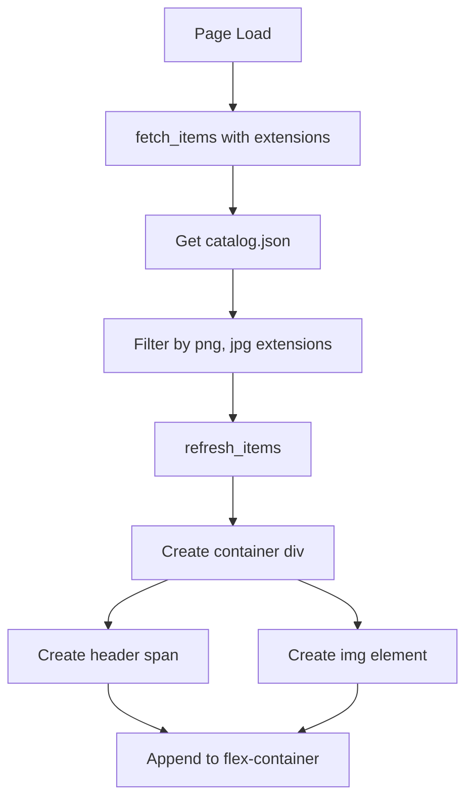

#### Sounds Tab (tab-sounds.html)

Displays audio artifacts (MP3, WAV) with playback controls:

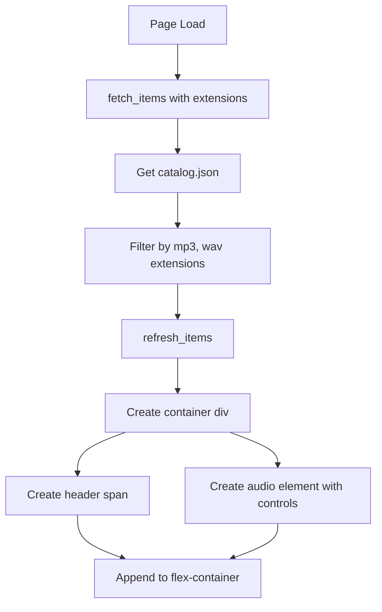

#### Time Series Tab (tab-timeseries.html)

Renders time series charts using D3.js:

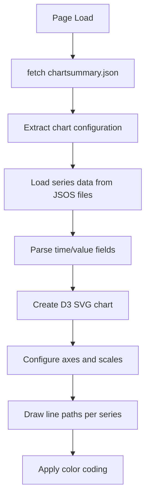

## Integration Points

### With Result Recording System

The HTML templates consume output from the Result Recording system:

| File | Source | Purpose |
|------|--------|---------|
| `testrun_summary.json` | `ResultRecorder.update_summary()` | Banner metrics display |
| `testrun_results_stream.jsos` | `JsonResultRecorder.record()` | Detailed result display |
| `catalog.json` | `ResultRecorder.catalog_output_directory()` | File/folder navigation |
| `landscape-declared.json` | Test configuration | Landscape display |
| `startup-configuration.json` | Test configuration | Environment display |
| `import_errors.jsos` | Test discovery | Import failure display |

### With Static Resource Deployment

The Result Recording system deploys static resources:

```
static/v2/
├── images/
│   └── test-report-banner-background-image.png
├── javascript/
│   ├── d3.v7.js
│   ├── icon-components.js
│   ├── mojo-components.js
│   ├── prism.js
│   ├── testsummary-components.js
│   ├── testsummary-helpers.js
│   ├── testsummary.js
│   └── webcomponent-helpers.js
└── styles/
    ├── branding-theme.css
    ├── icon-styles.css
    ├── mojo-components.css
    ├── prism.css
    └── testsummary.css
```

### With Artifact System

Artifacts are displayed through embedded iframes:

```javascript
syncData(artifacts_catalog, artifacts_folder_catalogs) {
    for (var afolder of artifacts_catalog.folders) {
        var afolder_catalog = artifacts_folder_catalogs[afolder];
        if (afolder_catalog.files.includes("tab.html")) {
            var tabURL = "artifacts/" + afolder + "/tab.html";
            var iframeEl = document.createElement("iframe");
            iframeEl.setAttribute("src", tabURL);
            // Add to tab set
        }
    }
}
```

## Configuration

### Branding Customization

Override CSS custom properties for branding:

```css
:root {
    --color-banner-background-color: #custom-color;
    --color-banner-color: #custom-text-color;
    --color-section-header-background-color: #custom-header-bg;
    --image-logo: url("/path/to/custom-logo.png");
}
```

### Result Display Modes

| Mode | Description | Data Structure |
|------|-------------|----------------|
| `GROUPED` | Results grouped by package | `{ package_name: [results] }` |
| `TREE` | Results in hierarchical tree | Nested object structure |

### Filter Modes

| Mode | Description |
|------|-------------|
| `NONE` | Show all results |
| `PASSED` | Show only passed tests |
| `FAILED` | Show only failed tests |
| `ERRORED` | Show only errored tests |
| `SKIPPED` | Show only skipped tests |

## Error Handling

### Data Loading Errors

```javascript
load_configuration().then(() => {
    refresh_configuration();
}).catch(err => {
    console.log("Unable to load configuration file.");
});
```

### Missing Artifact Handling

```javascript
var artifact_catalog = await fetch_json(folderCatalogURL).catch(err => {
    console.log("The '" + folder + "' artifacts folder does not have a 'catalog.json' file.");
});

if ((artifact_catalog != null) && (artifact_catalog != "")) {
    // Process artifacts
}
```

### Component Graceful Degradation

Components hide themselves when data is unavailable:

```javascript
if (this.landscape != undefined) {
    landscapeEl.syncData("Landscape", this.landscape);
} else {
    landscapeEl.style.display = "None";
}
```

## Testing Strategy

### Unit Testing Focus Areas

1. **Helper Functions**
   - `fetch_json` / `fetch_json_stream` - AJAX data loading
   - `get_time_difference` - Time formatting
   - `split_test_fullname` - Name parsing
   - `entity_escape` - HTML escaping

2. **Component Data Binding**
   - `syncData` methods for each component
   - Template rendering correctness
   - Shadow DOM element selection

3. **Result Processing**
   - `finalize_test_result_item` - Result categorization
   - Counter accuracy (pass/fail/error/skip)
   - Package grouping logic

### Integration Testing

1. **Page Load Sequence**
   - All data sources load correctly
   - Components render with sample data
   - Error states handled gracefully

2. **User Interactions**
   - Collapsible expand/collapse
   - Tab switching
   - Copy to clipboard

3. **Cross-Browser Compatibility**
   - Web Components support
   - CSS custom properties
   - Shadow DOM styling

### Test Categories

| Category | Components | Focus |
|----------|------------|-------|
| Data Loading | testsummary.js | AJAX, JSOS parsing |
| Rendering | All components | syncData, templates |
| Interaction | MojoCollapsible, MojoTabSet | Event handling |
| Styling | CSS files | Theme variables, layout |
| Artifacts | Tab pages | Media rendering |

## File Structure

```
templates/v2/
├── testsummary.html              # Main entry point
├── tabs/
│   ├── tab-images.html           # Image artifact viewer
│   ├── tab-sounds.html           # Audio artifact player
│   └── tab-timeseries.html       # Time series chart viewer
└── static/
    ├── images/
    │   └── test-report-banner-background-image.png
    ├── javascript/
    │   ├── d3.v7.js              # D3.js charting library
    │   ├── icon-components.js     # SVG icon components
    │   ├── mojo-components.js     # Base UI components
    │   ├── prism.js              # Code syntax highlighting
    │   ├── testsummary-components.js  # TestSummary components
    │   ├── testsummary-helpers.js     # Utility functions
    │   ├── testsummary.js            # Main application logic
    │   └── webcomponent-helpers.js   # Shadow DOM helpers
    └── styles/
        ├── branding-theme.css    # Theme variables
        ├── icon-styles.css       # Icon styling
        ├── mojo-components.css   # Base component styles
        ├── prism.css             # Code highlighting styles
        └── testsummary.css       # TestSummary styles
```
