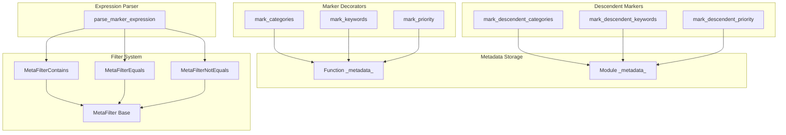
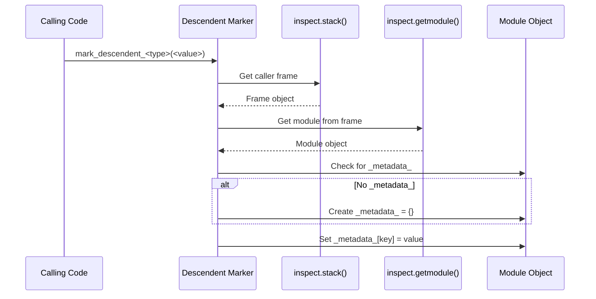
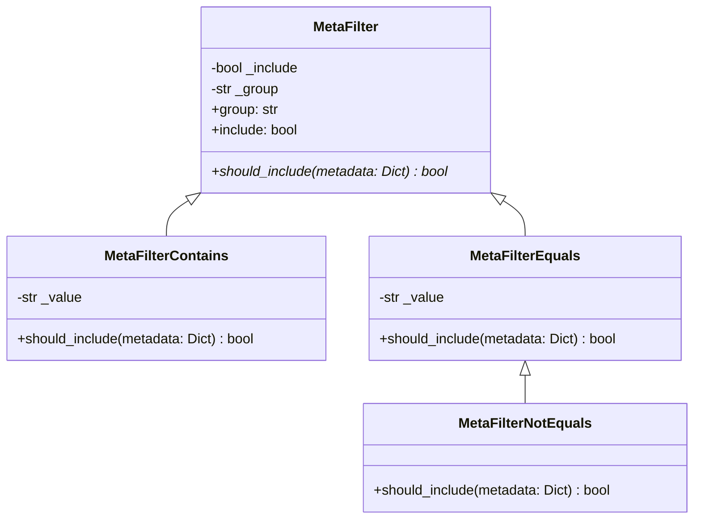
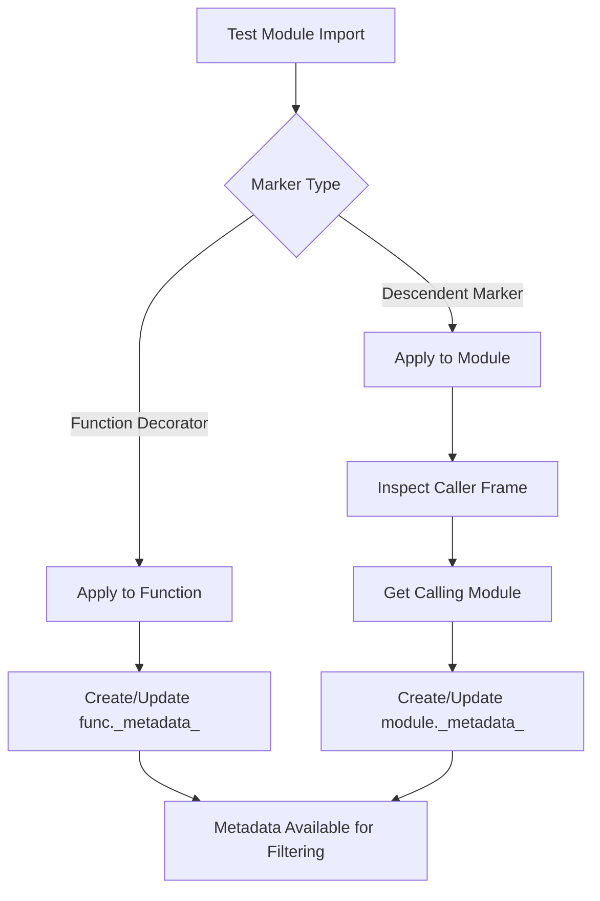
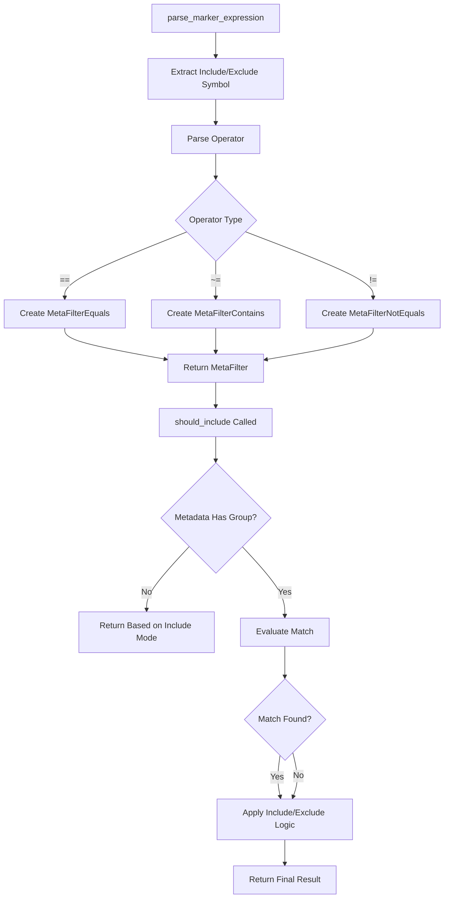
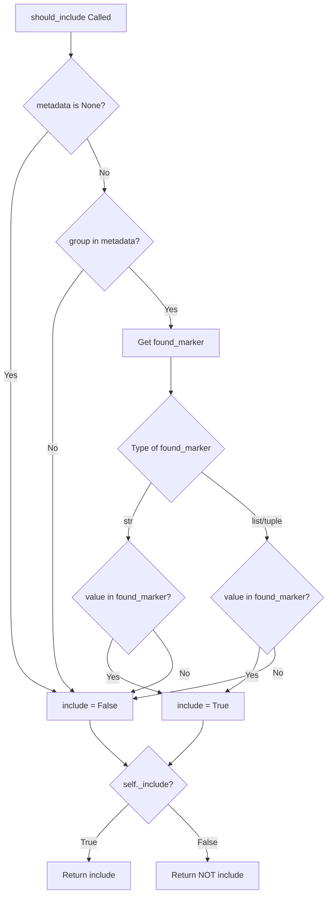

# Test Markers and Metadata - Design Document

## Overview

The Test Markers and Metadata system provides mechanisms for annotating tests and test modules with metadata that can be used for filtering, categorization, and prioritization during test execution. The system supports both function-level markers (applied via decorators) and module-level markers (applied via descendent functions) that propagate to all tests within a module hierarchy.

The marker system enables test authors to:
- Categorize tests by functional area or test type
- Tag tests with searchable keywords
- Assign priority levels for execution ordering
- Filter test execution based on metadata expressions

## Architecture

### High-Level Component Diagram



### Components

#### 1. Function-Level Marker Decorators

Function-level markers are decorators that attach metadata directly to test functions.

| Decorator | Metadata Key | Value Type | Purpose |
|-----------|--------------|------------|---------|
| `@mark_categories` | `categories` | `List[str]` | Assign category labels to a test |
| `@mark_keywords` | `keywords` | `List[str]` | Assign searchable keywords to a test |
| `@mark_priority` | `priority` | `str` | Assign execution priority (stored as string) |

**Decorator Implementation Pattern:**

```python
def mark_<type>(*, <param>: <type>):
    def decorator(func: Callable) -> Callable:
        if not hasattr(func, "_metadata_"):
            func._metadata_ = {}
        func._metadata_["<key>"] = <value>
        return func
    return decorator
```

#### 2. Module-Level Descendent Markers

Descendent markers apply metadata to a module, which propagates to all tests within that module's hierarchy.

| Function | Metadata Key | Value Type | Purpose |
|----------|--------------|------------|---------|
| `mark_descendent_categories` | `categories` | `List[str]` | Apply categories to all descendant tests |
| `mark_descendent_keywords` | `keywords` | `List[str]` | Apply keywords to all descendant tests |
| `mark_descendent_priority` | `priority` | `str` | Apply priority to all descendant tests |

**Descendent Marker Implementation Pattern:**



#### 3. MetaFilter Base Class

The `MetaFilter` class provides the foundation for metadata-based test filtering.



#### 4. Filter Types

| Filter Class | Operator | Match Behavior |
|--------------|----------|----------------|
| `MetaFilterContains` | `~=` | Matches if value is substring or list member |
| `MetaFilterEquals` | `==` | Matches if value equals exactly |
| `MetaFilterNotEquals` | `!=` | Matches if value does not equal |

**Include/Exclude Logic:**

All filters support both include and exclude modes:
- Include mode (`+`): Test is included if filter matches
- Exclude mode (`-`): Test is excluded if filter matches (logic inverted)

#### 5. Marker Expression Parser

The `parse_marker_expression` function converts string expressions into `MetaFilter` objects.

**Expression Syntax:**

```
(+ | -) <group> (== | ~= | !=) <value>
```

| Component | Description | Examples |
|-----------|-------------|----------|
| `+` / `-` | Include or exclude modifier | `+`, `-` |
| `<group>` | Metadata key to filter on | `categories`, `keywords`, `priority` |
| `==` | Equals operator | `priority==1` |
| `~=` | Contains operator | `categories~=smoke` |
| `!=` | Not equals operator | `priority!=3` |

### Data Flow

#### Marker Application Flow



#### Filter Evaluation Flow



#### MetaFilterContains Matching Logic



### Design Patterns

#### 1. Decorator Pattern

Function-level markers use the decorator pattern to attach metadata without modifying function behavior:

```python
@mark_categories(categories=["smoke", "api"])
def test_example():
    pass
```

#### 2. Strategy Pattern

The `MetaFilter` hierarchy implements the strategy pattern, allowing different matching strategies to be selected at runtime based on the expression operator.

#### 3. Template Method Pattern

`MetaFilterNotEquals` extends `MetaFilterEquals` and inverts the result, demonstrating template method:

```python
class MetaFilterNotEquals(MetaFilterEquals):
    def should_include(self, metadata: Dict[str, Any]) -> bool:
        include = super().should_include(metadata)
        include = False if include else True
        return include
```

#### 4. Factory Pattern

`parse_marker_expression` acts as a factory, creating the appropriate `MetaFilter` subclass based on the operator in the expression.

## Integration Points

### With Test Declaration System

- Markers attach `_metadata_` dictionaries to test functions
- The declaration system reads this metadata during test collection
- `TestRef` and `TestGroup` classes resolve metadata from both function and module levels

### With Test Execution Engine

- Filter expressions are parsed into `MetaFilter` objects
- The execution engine applies filters to determine which tests to run
- Multiple filters can be combined for complex selection criteria

### With CLI System

- Command-line arguments accept marker expressions
- Users can include/exclude tests based on categories, keywords, or priority

## Configuration

### Metadata Keys

| Key | Type | Source | Description |
|-----|------|--------|-------------|
| `categories` | `List[str]` | Decorator/Descendent | Functional categories |
| `keywords` | `List[str]` | Decorator/Descendent | Searchable keywords |
| `priority` | `str` | Decorator/Descendent | Execution priority |

### Expression Operators

| Operator | Symbol | Filter Class | Description |
|----------|--------|--------------|-------------|
| Equals | `==` | `MetaFilterEquals` | Exact match |
| Contains | `~=` | `MetaFilterContains` | Substring or member match |
| Not Equals | `!=` | `MetaFilterNotEquals` | Inverse of equals |

### Include/Exclude Symbols

| Symbol | Mode | Behavior |
|--------|------|----------|
| `+` | Include | Test included if filter matches |
| `-` | Exclude | Test excluded if filter matches |

## Error Handling

### SemanticError

The `parse_marker_expression` function raises `SemanticError` for:

1. **Missing include/exclude symbol**: Expression must start with `+` or `-`
   ```
   Marker expressions must begin with a + (include) or - (exclude) symbol.
   ```

2. **Invalid operator**: Expression must contain `==`, `~=`, or `!=`
   ```
   Marker expressions must be in the form (+ or -)(group)/(marker)(= or ~)(value).
   ```

3. **Missing value**: Operators require a value component
   ```
   Expressions using the "==", "~=", "!=" operators must have a value component.
   ```

## Testing Strategy

### Unit Testing Focus Areas

1. **Decorator Application**
   - Verify `_metadata_` dictionary is created
   - Verify correct key/value pairs are stored
   - Verify decorator returns original function unchanged

2. **Descendent Marker Application**
   - Verify module `_metadata_` is created
   - Verify correct key/value pairs are stored
   - Verify caller frame inspection works correctly

3. **MetaFilter Matching**
   - Test `MetaFilterContains` with string values
   - Test `MetaFilterContains` with list values
   - Test `MetaFilterEquals` exact matching
   - Test `MetaFilterNotEquals` inverse matching
   - Test include vs exclude mode behavior

4. **Expression Parsing**
   - Test valid expressions with all operators
   - Test include and exclude modes
   - Test error handling for invalid expressions

### Test Categories

| Category | Components | Focus |
|----------|------------|-------|
| Decorators | `mark_categories`, `mark_keywords`, `mark_priority` | Metadata attachment |
| Descendent | `mark_descendent_*` functions | Module-level metadata |
| Filters | `MetaFilter*` classes | Matching logic |
| Parser | `parse_marker_expression` | Expression parsing |

### Edge Cases

1. **Empty metadata**: Filter behavior when `_metadata_` is missing
2. **None values**: Filter behavior with None metadata
3. **Empty lists**: Categories/keywords as empty lists
4. **Whitespace**: Expression parsing with extra whitespace
5. **Multiple operators**: Expressions with multiple operator characters

## Known Issues

### Priority Storage as String

The `mark_priority` decorator converts the integer priority to a string:

```python
func._metadata_["priority"] = str(priority)
```

This may cause unexpected behavior when comparing priorities numerically.

### Descendent Marker Scope

Descendent markers use `inspect.stack()` which may have performance implications in deeply nested call stacks.

## Future Enhancements

### Potential Additions

1. **Custom Metadata Keys**: Support for user-defined metadata keys
2. **Compound Expressions**: Support for AND/OR combinations of filters
3. **Regex Matching**: Add regex-based filter operator
4. **Metadata Inheritance**: Explicit control over metadata inheritance from parent modules
5. **Priority as Integer**: Store priority as integer for proper numeric comparison
6. **Validation**: Add validation for metadata values (e.g., valid priority ranges)
