# Mocking Framework - Design Document

## Overview

The Mocking Framework provides a comprehensive system for creating mock objects, managing mock contexts, and patching modules, classes, and instances during test execution. It enables test isolation by replacing real dependencies with configurable mock objects that can track calls, return predetermined values, and execute side effects.

The framework is designed to be lightweight, intuitive, and fully integrated with the TestBase testing ecosystem while providing familiar patterns for developers experienced with Python's `unittest.mock` module.

## Architecture

### High-Level Component Diagram

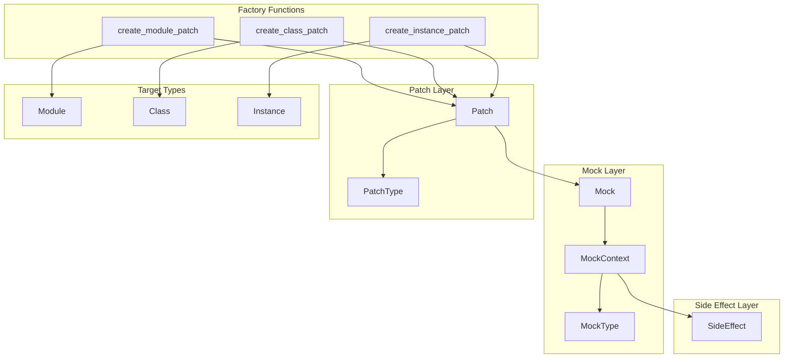

### Components

#### 1. MockType Enumeration

The `MockType` enumeration defines the different types of mock objects that can be created:

| Type | Description |
|------|-------------|
| `Generic` | Default mock type for unspecified references |
| `Class` | Mock representing a class |
| `Instance` | Mock representing an object instance |
| `Property` | Mock representing a property |
| `Function` | Mock representing a standalone function |
| `Method` | Mock representing a bound method |

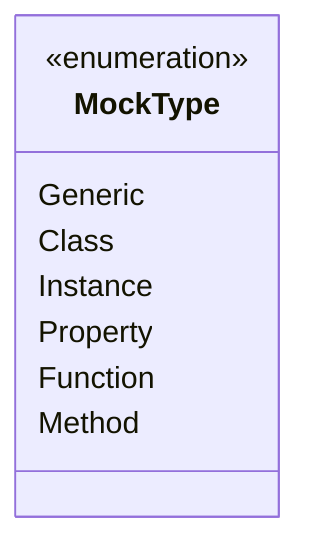

#### 2. SideEffect Class

The `SideEffect` class encapsulates callable behavior that executes when a mock is called:

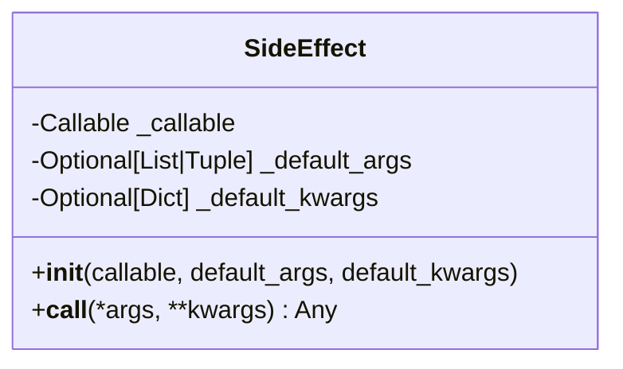

**Key Features:**
- Wraps any callable for execution on mock invocation
- Supports default arguments and keyword arguments
- Falls back to defaults when call-time arguments are not provided

#### 3. MockContext Class

The `MockContext` class stores all state and configuration for a mock object:

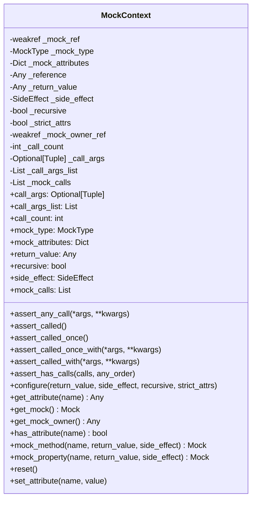

**Key Responsibilities:**

| Method | Purpose |
|--------|---------|
| `configure()` | Sets mock behavior (return value, side effect, recursive mode) |
| `mock_method()` | Creates a child mock method with specified behavior |
| `mock_property()` | Creates a child mock property with specified behavior |
| `reset()` | Resets call tracking and configuration to initial state |
| `assert_*()` | Assertion methods for verifying mock interactions |

**Call Tracking:**

The context maintains comprehensive call tracking:

| Property | Description |
|----------|-------------|
| `call_count` | Number of times the mock was called |
| `call_args` | Arguments from the most recent call as `(args, kwargs)` |
| `call_args_list` | List of all calls as `[(args, kwargs), ...]` |
| `mock_calls` | List of calls including child mock calls as `[(name, args, kwargs), ...]` |

#### 4. Mock Class

The `Mock` class is the primary interface for creating and interacting with mock objects:

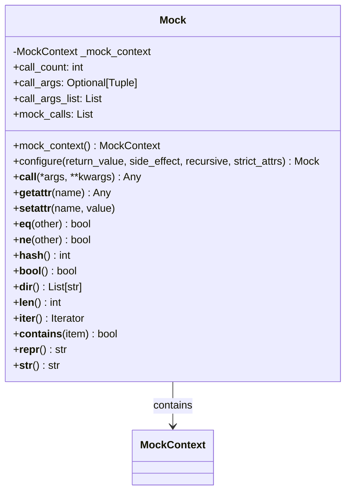

**Constructor Parameters:**

| Parameter | Type | Default | Description |
|-----------|------|---------|-------------|
| `mock_attributes` | `Dict[str, Any]` | `None` | Pre-defined attributes for the mock |
| `return_value` | `Any` | `None` | Value returned when mock is called |
| `reference` | `Any` | `None` | Original object being mocked |
| `mtype` | `MockType` | `None` | Explicit mock type |
| `mock_owner` | `Mock` | `None` | Parent mock (for nested mocks) |
| `side_effect` | `Callable|SideEffect` | `None` | Callable executed on mock invocation |
| `recursive` | `bool` | `False` | Auto-create child mocks for undefined attributes |
| `strict_attrs` | `bool` | `False` | Restrict attribute access to defined attributes only |

**Magic Method Support:**

The Mock class implements comprehensive magic method support:

| Method | Behavior |
|--------|----------|
| `__call__` | Records call and returns `return_value` or executes `side_effect` |
| `__getattr__` | Returns defined attributes or creates new mocks (if recursive) |
| `__setattr__` | Sets attributes in mock context or configures mock behavior |
| `__bool__` | Returns `True` by default or `bool(return_value)` if set |
| `__len__` | Returns `len(return_value)` if return_value supports it |
| `__iter__` | Returns `iter(return_value)` if return_value is iterable |
| `__contains__` | Checks `item in return_value` if return_value is a container |

#### 5. PatchType Enumeration

The `PatchType` enumeration defines the types of targets that can be patched:

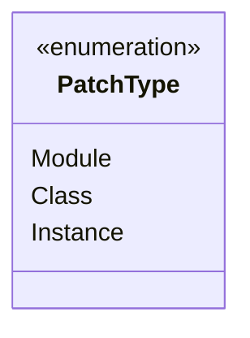

#### 6. Patch Class

The `Patch` class manages the lifecycle of patching an attribute with a mock:

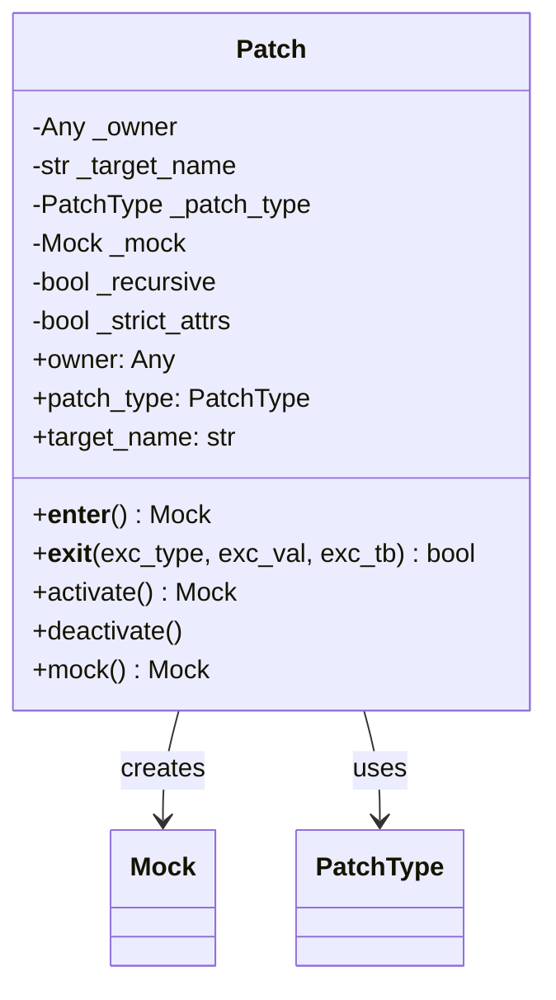

**Key Features:**
- Context manager support for automatic activation/deactivation
- Lazy mock creation on first access
- Automatic restoration of original attribute on deactivation
- Validation of owner type against patch type

### Data Flow

#### Mock Creation Flow

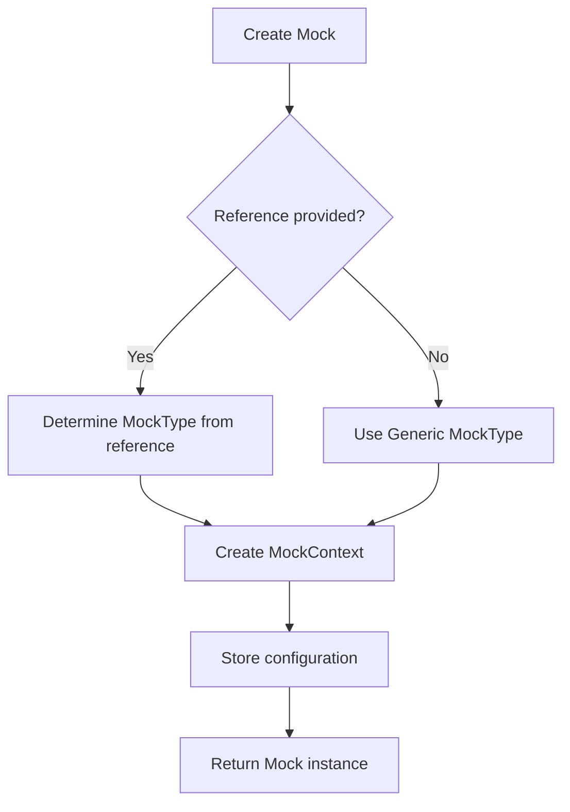

#### Mock Invocation Flow

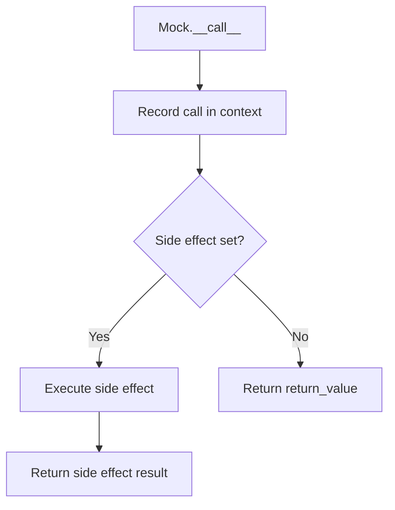

#### Attribute Access Flow

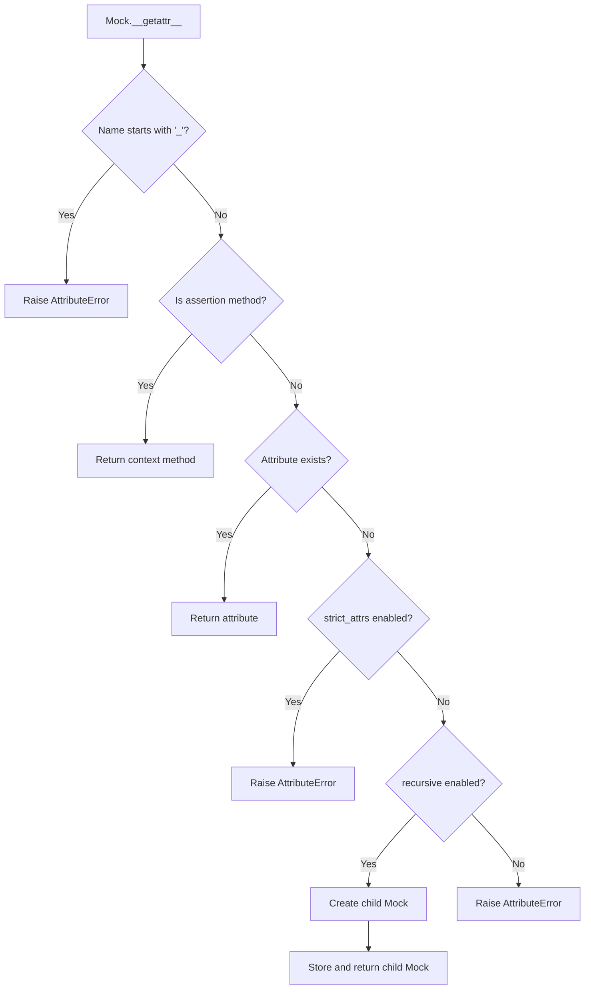

#### Patch Activation Flow

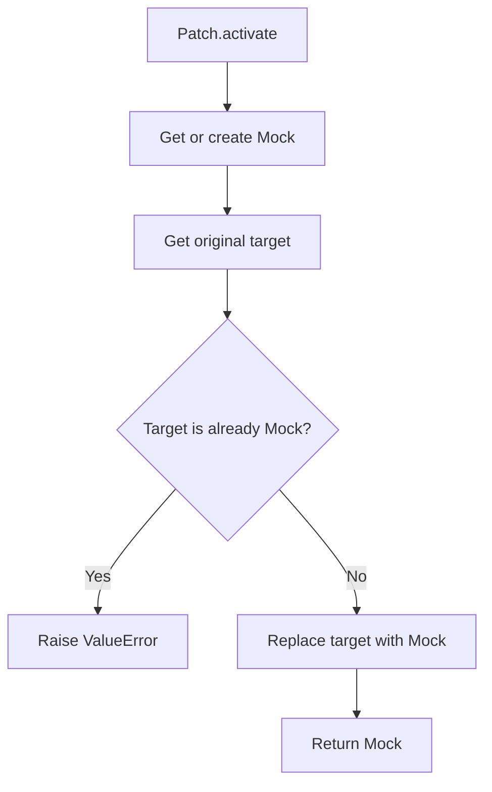

#### Patch Deactivation Flow

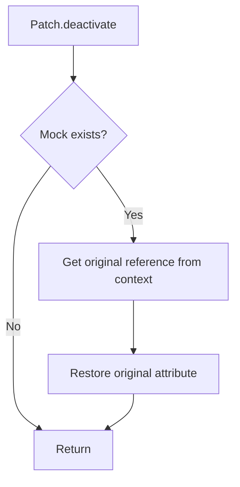

### Design Patterns

#### 1. Context Manager Pattern

The `Patch` class implements the context manager protocol for safe resource management:

```python
with create_module_patch(module, "function_name") as mock:
    mock.return_value = "mocked"
    # Original function is replaced
# Original function is restored
```

#### 2. Fluent Interface Pattern

The `configure()` method returns the mock instance for method chaining:

```python
mock.configure(return_value=42, recursive=True).some_method()
```

#### 3. Proxy Pattern

The `Mock` class acts as a proxy, intercepting attribute access and method calls to provide configurable behavior.

#### 4. Weak Reference Pattern

`MockContext` uses weak references to avoid circular reference memory leaks:

```python
self._mock_ref = weakref.ref(mock)
self._mock_owner_ref = weakref.ref(mock_owner) if mock_owner else None
```

#### 5. Factory Function Pattern

Factory functions provide type-safe patch creation:

```python
create_module_patch(module, "attr")   # For modules
create_class_patch(cls, "attr")       # For classes
create_instance_patch(obj, "attr")    # For instances
```

## Integration Points

### With Test Declaration System

- Mocks can be used as return values from resource factories
- Mock objects can be injected into tests via the dependency injection system

### With Test Execution Engine

- Patches should be activated before test execution and deactivated after
- Mock call tracking can be used for test assertions

### With Verification System

- Mock assertion methods (`assert_called`, `assert_called_with`, etc.) integrate with test verification
- Failed assertions raise `AssertionError` for test failure reporting

## Configuration

### Mock Behavior Options

| Option | Type | Default | Description |
|--------|------|---------|-------------|
| `return_value` | `Any` | `None` | Value returned when mock is called |
| `side_effect` | `Callable|SideEffect` | `None` | Callable executed on invocation |
| `recursive` | `bool` | `False` | Auto-create child mocks for undefined attributes |
| `strict_attrs` | `bool` | `False` | Only allow access to pre-defined attributes |

### Recursive Mock Behavior

When `recursive=True`:
- Accessing undefined attributes creates new Mock objects
- Child mocks inherit `recursive` and `strict_attrs` settings
- Child mocks maintain a reference to their parent mock

### Strict Attribute Mode

When `strict_attrs=True`:
- Only pre-defined attributes can be accessed
- Setting new attributes raises `AttributeError`
- Special mock configuration attributes (`return_value`, `side_effect`, `recursive`) are always allowed

## Error Handling

### Type Validation Errors

`TypeError` is raised for:
- Invalid `owner` type for the specified `PatchType`
- Non-callable `side_effect` that is not a `SideEffect` instance
- Invalid types for `recursive` or `strict_attrs` parameters

### Attribute Errors

`AttributeError` is raised for:
- Accessing undefined attributes when `strict_attrs=True`
- Accessing undefined attributes when `recursive=False`
- Accessing private attributes (starting with `_`)

### Patch Errors

`ValueError` is raised for:
- Attempting to patch an attribute that is already a Mock from this framework

### Assertion Errors

`AssertionError` is raised by assertion methods when:
- `assert_called()`: Mock was never called
- `assert_called_once()`: Mock was not called exactly once
- `assert_called_with()`: Last call arguments don't match
- `assert_called_once_with()`: Not called exactly once with specified arguments
- `assert_any_call()`: No call matches the specified arguments
- `assert_has_calls()`: Expected call sequence not found

## Testing Strategy

### Unit Testing Focus Areas

1. **Mock Creation**
   - Verify MockType determination from references
   - Test constructor parameter handling
   - Validate default values

2. **Mock Invocation**
   - Test return value behavior
   - Verify side effect execution
   - Validate call recording

3. **Attribute Access**
   - Test recursive mock creation
   - Verify strict_attrs enforcement
   - Test attribute storage and retrieval

4. **Call Tracking**
   - Verify call_count accuracy
   - Test call_args and call_args_list
   - Validate mock_calls for nested mocks

5. **Assertion Methods**
   - Test all assertion method variations
   - Verify error messages
   - Test edge cases (no calls, multiple calls)

6. **Patch Operations**
   - Test activation and deactivation
   - Verify original attribute restoration
   - Test context manager behavior

7. **Magic Methods**
   - Test `__bool__`, `__len__`, `__iter__`, `__contains__`
   - Verify `__eq__`, `__ne__`, `__hash__`
   - Test `__repr__`, `__str__`, `__dir__`

### Integration Testing

- End-to-end patching scenarios
- Integration with test execution lifecycle
- Nested mock hierarchies
- Multiple simultaneous patches

### Property-Based Testing Candidates

1. **Call Recording Invariants**
   - `call_count` equals `len(call_args_list)`
   - All recorded calls are retrievable
   - Call order is preserved

2. **Patch Round-Trip**
   - Activating then deactivating restores original state
   - Multiple activate/deactivate cycles work correctly

3. **Recursive Mock Consistency**
   - Accessing same attribute returns same mock
   - Child mocks inherit parent configuration

4. **Assertion Consistency**
   - `assert_called()` passes iff `call_count > 0`
   - `assert_called_once()` passes iff `call_count == 1`
