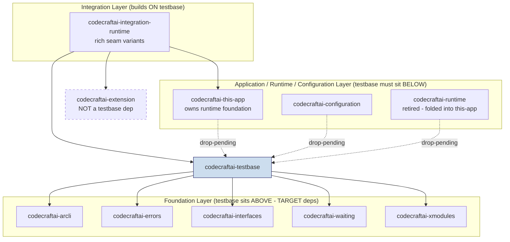
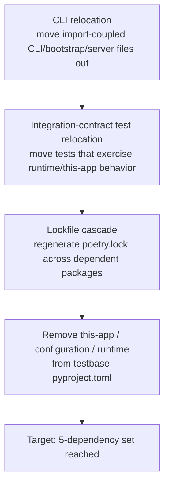
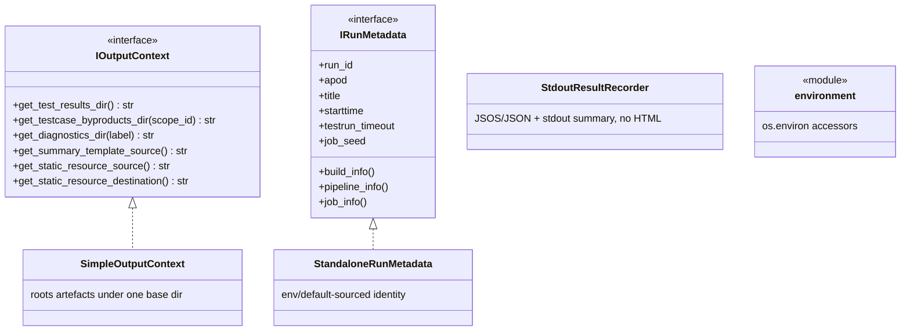
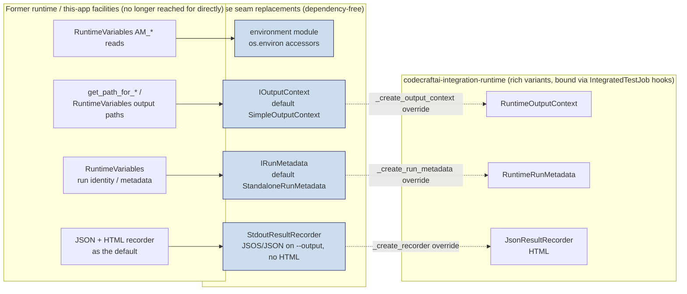
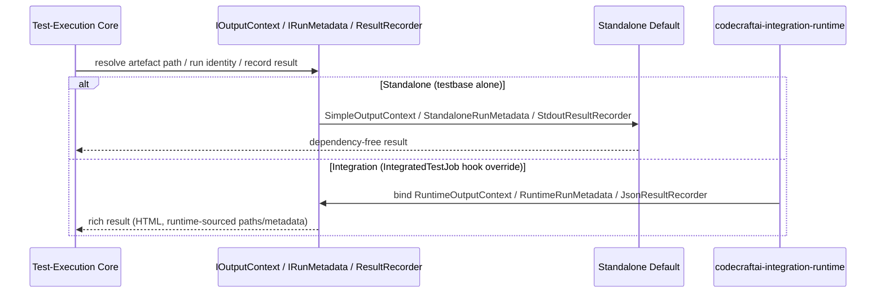
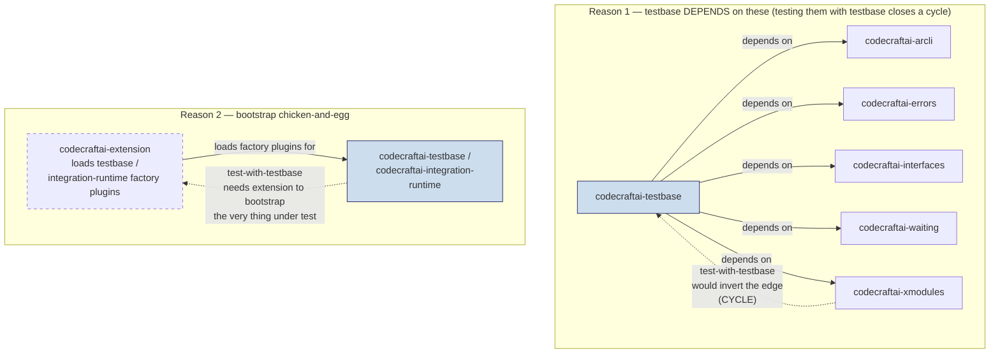

# Package Dependencies - Design Document

## Overview

This document describes the PACKAGE-LEVEL (inter-package) dependency posture of the
`codecraftai-testbase` package: where it sits within the ccai monorepo dependency tree,
the decoupling already achieved, the seam architecture that enables that decoupling, the
import-coupling that still remains, and the work required to reach the target dependency
set. The overarching design goal is that `codecraftai-testbase` must be usable to TEST almost
every other `codecraftai-*` package; to satisfy that goal the test-execution core must sit low
in the dependency tree and must not depend on the application, runtime, or configuration
layers.

The design is responsible for:

- Defining the dependency-tree position of `codecraftai-testbase` relative to the foundation
  packages below it and the application/runtime/configuration layers it must sit below
- Recording the import-direction rule that keeps the tree acyclic
- Documenting the as-built current dependency set (8 packages) and the target dependency
  set (5 packages), with the drop-pending delta marked honestly as pending
- Describing the decoupling MECHANISM — the four dependency-free seam modules and what each
  replaces
- Inventorying the remaining import-coupled CLI, bootstrap, and server files and their
  relocation destinations, and distinguishing them from files that only mention the higher
  layers in docstring negations
- Describing the relationship to `codecraftai-integration-runtime`, where the rich seam
  variants live

### Scope / Not To Be Confused With

This specification describes Python package dependencies declared in `pyproject.toml` and
the resulting position in the monorepo dependency tree. It is deliberately distinct from two
neighbouring testbase specifications whose names invite confusion:

| Spec | Actual Topic | NOT this spec because |
|------|--------------|------------------------|
| [`specs/dependencies`](../dependencies/design.md) | The Dependency Injection System — the `InjectionRegistry` singleton, parameter and validator originations, the scope tree, and resource lifespans (Session/Package/Test/Task). Covers WHAT gets injected and HOW the injection registry resolves it at runtime. | It is about injectable resources resolved at runtime, NOT about which `codecraftai-*` packages `codecraftai-testbase` declares in `pyproject.toml`. |
| [`specs/coupling`](../coupling/design.md) | The Coupling System — `IntegrationCoupling`, `ConfigurationCoupling`, and `ValidatorCoupling` and their integration with the Dependency Injection System. Covers HOW couplings register external resources and attach via the DI system. | It is about couplings attaching via DI, NOT about inter-package dependency edges. |

When this document says "dependency" it means a Python package dependency edge in
`pyproject.toml`, never an injectable resource (DI) or a coupling.

## Architecture

### Dependency-Tree Position

`codecraftai-testbase` must sit BELOW the application, runtime, and configuration layers and
ABOVE only the foundation packages it depends on. The diagram below shows the TARGET
position; the dashed edges are the drop-pending dependencies that still exist today and hold
the package above the higher layers until the import-coupled surface is relocated (see
Requirement 2 and Requirement 7).



The dashed `drop-pending` edges read "today testbase still declares this-app / configuration
/ runtime" and are oriented to show that, while those edges exist, testbase is pulled UP
above those layers. The target state removes those three edges entirely, leaving testbase
strictly above only the five foundation packages.

### Import-Direction Rule

The dependency tree is a directed acyclic graph in which an edge from package A to package B
means A declares B in its `[tool.poetry.dependencies]` and A may `import` from B. The rule
that keeps the tree acyclic and keeps testbase broadly usable is:

> `codecraftai-testbase` MAY import from the foundation layer (arcli, errors, interfaces,
> waiting, xmodules). It MUST NOT import from the application, runtime, or configuration
> layers (this-app, configuration, runtime). The integration layer
> (`codecraftai-integration-runtime`) imports FROM testbase, never the reverse.

A consequence of this rule is the Permanent-Unittest Exclusion Set (Requirement 8): testbase
must never be used to test the packages at or below it in the tree (errors, interfaces,
waiting, xmodules, arcli) plus `codecraftai-extension`, because doing so would invert the
import direction and create a cycle.

### As-Built vs Target Dependency Set

The package currently declares EIGHT dependencies (verified in `pyproject.toml`,
`[tool.poetry.dependencies]`). The target set is FIVE. The delta is the three drop-pending
packages, whose removal is sequenced after the import-coupled surface is relocated. Per
Requirement 9, the table below marks each row honestly as as-built or target.

| Package | Current (8, as-built) | Target (5) | Status |
|---------|:---:|:---:|--------|
| `codecraftai-arcli` | yes | yes | retained |
| `codecraftai-errors` | yes | yes | retained |
| `codecraftai-interfaces` | yes | yes | retained |
| `codecraftai-waiting` | yes | yes | retained |
| `codecraftai-xmodules` | yes | yes | retained |
| `codecraftai-this-app` | yes | no | **drop-pending** |
| `codecraftai-configuration` | yes | no | **drop-pending** |
| `codecraftai-runtime` | yes | no | **drop-pending** |
| `codecraftai-extension` | no | no | never a dep (Requirement 8) |

Python version constraint (both states): `>=3.10,<4.0` (Requirement 1, AC 2).

The drop has NOT happened. The three drop-pending edges remain in `pyproject.toml` today
because the import-coupled CLI/bootstrap/server surface still references them (see the
Import-Coupling Inventory). Removal is sequenced as:



### Components

The decoupling MECHANISM is a set of four dependency-free SEAM modules that the
test-execution core consumes in place of the runtime/this-app/configuration machinery it
previously reached for directly. Each seam is an interface plus a standalone default
implementation; the rich variant lives out-of-package in `codecraftai-integration-runtime`.



#### Component: environment module (`environment.py`)

A dependency-free `os.environ` accessor module. It reads core environment knobs directly
from the process environment without consulting `RuntimeVariables` or
`ThisApplicationSingleton`, satisfying Requirement 4.

| Aspect | Detail |
|--------|--------|
| Provides | Accessors for `AM_DEBUG_DEBUGGER`, `AM_DEBUG_BREAKPOINTS`, `AM_DIAGNOSTICS_PRERUN`, `AM_DIAGNOSTICS_POSTRUN`, `AM_TESTROOT`, `AM_OUTPUT_DIRECTORY`, `AM_RUN_ID`, `AM_TESTRUN_TIMEOUT` |
| Replaces | `ccai.runtime.runtimevariables` `RuntimeVariables` attribute access |
| Real imports of runtime/this-app/configuration | NONE — package names appear only in docstring negations |

#### Component: IOutputContext + SimpleOutputContext (`output/outputcontext.py`)

The seam through which the core resolves all run-artefact locations. The default
`SimpleOutputContext` roots all artefacts under a single base directory; richer
presence-folder layouts are supplied out-of-package. Satisfies Requirement 5.

| Aspect | Detail |
|--------|--------|
| Provides | `IOutputContext` seam + `SimpleOutputContext` default; `get_test_results_dir()`, `get_testcase_byproducts_dir(scope_id)`, `get_diagnostics_dir(label)`, `get_summary_template_source()`, `get_static_resource_source()`, `get_static_resource_destination()` |
| Replaces | the `ccai.thisapp.paths` / runtime well-known `get_path_for_*` family of accessors |
| Real imports of runtime/this-app/configuration | NONE — package names appear only in docstring negations |

#### Component: IRunMetadata + StandaloneRunMetadata (`output/runmetadata.py`)

The seam through which the core resolves run identity and CI/build/pipeline/job context. The
default `StandaloneRunMetadata` sources identity from the environment module and standalone
defaults rather than `RuntimeVariables`. Satisfies Requirement 5.

| Aspect | Detail |
|--------|--------|
| Provides | `IRunMetadata` seam + `StandaloneRunMetadata` default; `run_id`, `apod`, `title`, `starttime`, `testrun_timeout`, `job_seed` properties and `build_info()`, `pipeline_info()`, `job_info()` methods |
| Replaces | the `ccai.runtime.runtimevariables` `RuntimeVariables` descriptor set for CI/build/pipeline/job context |
| Real imports of runtime/this-app/configuration | NONE — package names appear only in docstring negations |

#### Component: StdoutResultRecorder (`results/recorders/stdoutresultrecorder.py`)

The standalone default result recorder. It emits JSOS and JSON artefacts when an output
directory is given and a stdout summary; it SKIPS HTML rendering. It replaces the
heavyweight JSON/HTML recorder as the default. Satisfies Requirement 5.

| Aspect | Detail |
|--------|--------|
| Provides | `StdoutResultRecorder` default; JSOS/JSON artefacts (when an output dir is given) + stdout summary; no HTML |
| Replaces | `ccai.testbase.results.recorders.jsonresultrecorder` `JsonResultRecorder` (HTML rendering) as the DEFAULT |
| Real imports of runtime/this-app/configuration | NONE |

#### Component: Decoupled Test-Execution Core

The dependency-free heart of the package consumes the seams above and contains zero real
imports from `ccai.configuration`, `ccai.runtime`, or `ccai.thisapp` (Requirement
3). It comprises at minimum:

| Core module | Role |
|-------------|------|
| `testjob.py` | High-level test-run orchestrator (`TestJob`) |
| `testgroup.py` | Test-tree grouping |
| `verification.py` | Verification primitives |
| `markers.py` | Test markers |
| `constraints.py` | Constraint primitives |
| `entrypoints.py` | Run entrypoints |
| `sequencing/testsequencer.py` | Sequencing engine |
| `results/recorders/stdoutresultrecorder.py` | Default recorder |

Verified clean: importing `ccai.testbase.testjob`, `ccai.testbase.sequencing.testsequencer`,
`ccai.testbase.entrypoints`, or the default recorders pulls in ZERO modules from
configuration, runtime, or this-app. Where these modules name the higher-layer packages, the
mention is a docstring negation (e.g. "replaces `RuntimeVariables` reads"), never a real
import.

#### Seam-to-Prior Facility Mapping

The four seams above do not map one-to-one onto a single prior facility; each prior
runtime/this-app facility is REPLACED by a distinct seam, and the rich variant of each seam is
re-homed out-of-package in `codecraftai-integration-runtime` and bound back through the
`IntegratedTestJob` hook overrides. The diagram below visualises that 1-to-many split (it
complements, and should be read alongside, the tabular "Seam-to-Replacement Quick Reference" in
the Appendix).



The dotted edges point UP into the integration runtime: the standalone default is what testbase
binds on its own, and `IntegratedTestJob` overrides `_create_output_context`,
`_create_run_metadata`, and `_create_recorder` to substitute the rich variant when running under
the integration runtime. testbase never imports the rich variants.

### Data Flow

#### Seam Resolution (standalone vs integration)

The core never branches on whether it is running standalone or under the integration runtime;
it always consumes a seam. The standalone default is bound when nothing overrides it; the rich
variant is bound by `IntegratedTestJob` hook overrides in `codecraftai-integration-runtime`.



### Import-Coupling Inventory

The only files that still hold `codecraftai-testbase` above the runtime/this-app/configuration
layers are the CLI, bootstrap, and server surface. These are classified as import-coupled
because they contain REAL `import` statements referencing those packages (Requirement 7, AC
3). Each has a relocation destination; once relocated, the drop-pending dependencies can be
removed.

| File | Real imports (runtime/this-app/configuration) | Relocation destination |
|------|-----------------------------------------------|------------------------|
| `initialize.py` | `ccai.thisapp.wellknown.ThisApplicationSingleton`; `ccai.thisapp.persona.establish_app_persona`; `ccai.runtime.enumerations.ActivationProfile`, `JobType`; `ccai.runtime.activation.activate_profile_job`; `ccai.runtime.runtimevariables.RuntimeVariables`, `RuntimeVariablesDesc`, `resolve_runtime_variables` | `codecraftai-integration-runtime` (bootstrap relocation, pending CLI refactor) |
| `cli/testbase_command.py` | `ccai.thisapp.wellknown.ThisApplicationSingleton`; `ccai.runtime.runtimevariables.RuntimeVariablesDesc` | testbase-cli (standalone bootstrap layer, pending CLI relocation) |
| `cli/utilities.py` | `ccai.runtime.runtimevariables.RuntimeVariables` | testbase-cli (fallback to `AM_TESTROOT` via `environment.py`) |
| `cli/cmdtree/testing/run.py` | `ccai.runtime.runtimevariables.RuntimeVariables`; `ccai.runtime.optionoverrides.AM_RUNTIME_OPTION_OVERRIDES`; `ccai.thisapp.wellknown.ConfiguredSuperFactorySingleton` | testbase-cli (pending CLI relocation) |
| `cli/cmdtree/testing/jobs.py` | `ccai.runtime.activation.activate_runtime`, `ActivationProfile`; `ccai.runtime.optionoverrides.AM_RUNTIME_OPTION_OVERRIDES`; `ccai.thisapp.wellknown.ConfiguredSuperFactorySingleton` | testbase-cli (pending CLI relocation) |
| `cli/cmdtree/testing/query.py` | `ccai.runtime.optionoverrides.AM_RUNTIME_OPTION_OVERRIDES`; `ccai.thisapp.wellknown.ConfiguredSuperFactorySingleton` | testbase-cli (pending CLI relocation) |
| `cli/cmdtree/services/results.py` | `ccai.thisapp.wellknown.ThisApplicationSingleton`; `ccai.runtime.activation.activate_profile_service`; `ccai.runtime.paths.get_presence_directory`; `ccai.runtime.runtimevariables.RuntimeVariablesDesc` | testbase-cli (pending CLI relocation) |
| `server/resultserver.py` | `ccai.runtime.runtimevariables.RuntimeVariables`, `RuntimeVariablesDesc` | testbase-cli or standalone service (pending refactor) |

#### Import-Coupled vs Docstring-Only Mention

A plain text grep for the package names is misleading: it also matches the seam files, which
mention `runtime` / `this-app` only inside docstring negations and contain NO real import.
Requirement 7 (AC 4) requires these be classified as Docstring-Only Mentions, NOT
import-coupled.

| File | Mentions runtime/this-app names? | Has a REAL import of them? | Classification |
|------|:---:|:---:|----------------|
| `environment.py` | yes (docstring negation) | no | Docstring-Only Mention |
| `output/outputcontext.py` | yes (docstring negation) | no | Docstring-Only Mention |
| `output/runmetadata.py` | yes (docstring negation) | no | Docstring-Only Mention |
| `initialize.py` | yes | **yes** | Import-Coupled |
| `cli/*` (the five CLI files above) | yes | **yes** | Import-Coupled |
| `server/resultserver.py` | yes | **yes** | Import-Coupled |

### Design Patterns

#### 1. Seam (Dependency-Inversion) Pattern

Each capability the core formerly reached for in the runtime/this-app/configuration layers is
abstracted behind a seam interface with a standalone default. The core depends on the seam,
not the heavyweight provider, inverting the dependency so testbase can sit below those layers.

#### 2. Hook Override (Template Method) Pattern

`TestJob` exposes hook points where the seam bindings are produced. `IntegratedTestJob` (in
`codecraftai-integration-runtime`) overrides those hooks to bind `RuntimeOutputContext`,
`RuntimeRunMetadata`, and `JsonResultRecorder`. The core never imports the rich variants; they
are injected from above.

#### 3. Standalone Default Pattern

Every seam ships a zero-dependency default (`SimpleOutputContext`, `StandaloneRunMetadata`,
`StdoutResultRecorder`) so the core is fully functional with no integration layer present —
the precondition for testing almost every other `codecraftai-*` package.

### Integration Points

#### With codecraftai-integration-runtime

The rich integration variants of all three seams live OUT of package, in
`codecraftai-integration-runtime`, which builds ON TOP of testbase via `IntegratedTestJob` hook
overrides (Requirement 6). testbase never depends on the integration runtime; the edge points
only one way.

| Aspect | Detail |
|--------|--------|
| Declared dependencies of `codecraftai-integration-runtime` | `codecraftai-testbase`, `codecraftai-this-app`, `codecraftai-extension`, `codecraftai-errors`, `codecraftai-xmodules` (plus `debugpy`) |
| Variants supplied | `RuntimeOutputContext`, `RuntimeRunMetadata`, `JsonResultRecorder` (HTML) |
| Mechanism | `IntegratedTestJob` hook overrides |
| Runtime foundation ownership | `codecraftai-this-app` now OWNS the runtime foundation (`RuntimeVariables`, well-known paths, `ActivationProfile`/`JobType`, `activate_profile_*`) absorbed from the retired `codecraftai-runtime` |

The TestJob inheritance is, as-built, a set of SIBLINGS: `IntegratedTestJob` and
`InteropLibraryTestJob` both extend `TestJob` directly. The linear chain
`TestJob -> IntegratedTestJob -> InteropLibraryTestJob -> DistributedTestJob` is a Phase-5
TARGET, not the current state (Requirement 9, AC 5-6).

#### With the Permanent-Unittest Exclusion Set

testbase must NOT be used to test, and must NOT sit above, the foundation set: `codecraftai-errors`,
`codecraftai-interfaces`, `codecraftai-waiting`, `codecraftai-xmodules`, `codecraftai-arcli`, and
`codecraftai-extension` (Requirement 8). Note the nuance: `codecraftai-extension` is in the EXCLUSION
set and is NOT a testbase dependency. Where integration with the extension machinery is
required, the attachment occurs in `codecraftai-integration-runtime`, never in testbase.

The rationale is structural, not a policy preference. Two distinct reasons place a package in the
six-member exclusion set; the diagram below shows WHY each membership would otherwise close a
loop:



The dotted back-edges are the cycles that exclusion prevents. For arcli/errors/interfaces/waiting/xmodules
the cycle is `package-under-test -> testbase -> package-under-test`, because testbase already declares
those five as dependencies (see the As-Built vs Target Dependency Set). For `codecraftai-extension` the
problem is a bootstrap chicken-and-egg: extension is the extensibility mechanism that LOADS testbase's
and integration-runtime's factory plugins, so using testbase to test extension would require extension
to bootstrap the harness that is exercising it. extension is therefore in the EXCLUSION set but is NOT
a testbase dependency.

### Configuration

#### pyproject.toml dependency declaration (as-built)

The `[tool.poetry.dependencies]` table currently declares all eight packages plus the Python
version constraint:

```toml
[tool.poetry.dependencies]
python = ">=3.10,<4.0"
codecraftai-errors = { git = "...", branch = "main" }
codecraftai-arcli = { git = "...", branch = "main" }
codecraftai-this-app = { git = "...", branch = "main" }       # drop-pending
codecraftai-configuration = { git = "...", branch = "main" }  # drop-pending
codecraftai-runtime = { git = "...", branch = "main" }        # drop-pending
codecraftai-interfaces = { git = "...", branch = "main" }
codecraftai-xmodules = { git = "...", branch = "main" }
codecraftai-waiting = { git = "...", branch = "main" }
```

#### Environment knobs (read via the dependency-free environment module)

| Variable | Purpose |
|----------|---------|
| `AM_DEBUG_DEBUGGER` | Debugger attach gating |
| `AM_DEBUG_BREAKPOINTS` | Breakpoint gating |
| `AM_DIAGNOSTICS_PRERUN` | Pre-run diagnostics gating |
| `AM_DIAGNOSTICS_POSTRUN` | Post-run diagnostics gating |
| `AM_TESTROOT` | Test root directory |
| `AM_OUTPUT_DIRECTORY` | Output/artefact directory |
| `AM_RUN_ID` | Run identifier |
| `AM_TESTRUN_TIMEOUT` | Overall test-run timeout |

#### Environment-knob consumption (in-core)

The table below maps each `AM_*` knob to its `environment` accessor and the in-core module(s)
that actually CALL that accessor. It was verified against the testbase source on disk
(`environment.py` for the accessors; a call-site grep across the core for each accessor name).
Only seam and test-execution-core consumers are listed; the import-coupled CLI/bootstrap/server
surface (see the Import-Coupling Inventory) is out of scope here because it still reads these
knobs through `RuntimeVariables`, not through the `environment` module.

| `AM_*` knob | `environment` accessor | In-core consumer(s) |
|-------------|------------------------|---------------------|
| `AM_TESTROOT` | `get_testroot()` | NONE in core — no test-execution-core or seam call site. `cli/utilities.py` still reads `RuntimeVariables.AM_TESTROOT` (import-coupled; pending CLI relocation to fall back to this accessor) |
| `AM_OUTPUT_DIRECTORY` | `get_output_directory()` | `output/outputcontext.py` (`SimpleOutputContext`, base-dir resolution) |
| `AM_RUN_ID` | `get_run_id()` | `output/runmetadata.py` (`StandaloneRunMetadata`, run identity) |
| `AM_TESTRUN_TIMEOUT` | `get_testrun_timeout()` | `output/runmetadata.py` (`StandaloneRunMetadata`, timeout resolution) |
| `AM_DEBUG_DEBUGGER` | `get_debugger_name()` | `testjob.py` (`TestJob`) and `sequencing/testsequencer.py` (`TestSequencer`) |
| `AM_DEBUG_BREAKPOINTS` | `get_debug_breakpoints()` | `testjob.py` (`TestJob`) and `sequencing/testsequencer.py` (`TestSequencer`) |
| `AM_DIAGNOSTICS_PRERUN` | `diagnostics_prerun_enabled()` | `sequencing/testsequencer.py` (`TestSequencer`, pre-run diagnostics gating) |
| `AM_DIAGNOSTICS_POSTRUN` | `diagnostics_postrun_enabled()` | `sequencing/testsequencer.py` (`TestSequencer`, post-run diagnostics gating) |

Note: `get_testroot()` / `AM_TESTROOT` currently has NO in-core consumer. The only reader of the
test root today is the import-coupled `cli/utilities.py`, which still reaches through
`RuntimeVariables.AM_TESTROOT`; relocating that file (see the Import-Coupling Inventory) is what
will route the test-root read through the dependency-free accessor.

## Testing Strategy

### Dependency-Posture Verification

1. **Declared-dependency assertion** — Assert `[tool.poetry.dependencies]` contains exactly
   the current set (8) today, and assert the target set (5) once the drop completes. Confirm
   the Python constraint is `>=3.10,<4.0`.
2. **Import-direction assertion** — Static check that no module under the test-execution core
   contains a real `import` of `ccai.configuration`, `ccai.runtime`, or
   `ccai.thisapp`.

### Core Decoupling Smoke Tests

1. **Core import smoke test** — `import ccai.testbase.testjob`,
   `ccai.testbase.sequencing.testsequencer`, `ccai.testbase.entrypoints`, and the
   default recorders must pull in ZERO configuration/runtime/this-app modules (assert via
   `sys.modules` inspection after a clean import).
2. **Seam dependency-freedom** — Assert `environment.py`, `output/outputcontext.py`,
   `output/runmetadata.py`, and `results/recorders/stdoutresultrecorder.py` import none of the
   higher-layer packages.

### Import-Coupling Inventory Verification

1. **Import-coupled set is exactly the CLI/bootstrap/server surface** — Confirm the eight
   import-coupled files and ONLY those contain real imports of the higher layers.
2. **Docstring-only distinction** — Confirm `environment.py`, `output/outputcontext.py`, and
   `output/runmetadata.py` mention the higher-layer package names only in docstrings and never
   in a real import statement.

### Integration-Variant Isolation

1. **Out-of-package variants** — Confirm `RuntimeOutputContext`, `RuntimeRunMetadata`, and
   `JsonResultRecorder` are sourced from `codecraftai-integration-runtime`, not from testbase.
2. **No reverse edge** — Confirm `codecraftai-testbase` declares no dependency on
   `codecraftai-integration-runtime` and no dependency on `codecraftai-extension`.

## Appendix

### Dependency-Set Quick Reference

| Set | Members |
|-----|---------|
| Current (8, as-built) | arcli, errors, interfaces, waiting, xmodules, this-app, configuration, runtime |
| Target (5) | arcli, errors, interfaces, waiting, xmodules |
| Drop-pending (3) | this-app, configuration, runtime |
| Permanent-Unittest Exclusion (6) | errors, interfaces, waiting, xmodules, arcli, extension |
| integration-runtime deps | testbase, this-app, extension, errors, xmodules (+ debugpy) |

### Seam-to-Replacement Quick Reference

| Seam module | Default | Replaces |
|-------------|---------|----------|
| `ccai.testbase.environment` | (module functions) | `RuntimeVariables` attribute reads |
| `ccai.testbase.output.outputcontext` | `SimpleOutputContext` | `get_path_for_*` / well-known path family |
| `ccai.testbase.output.runmetadata` | `StandaloneRunMetadata` | `RuntimeVariables` metadata descriptors |
| `ccai.testbase.results.recorders.stdoutresultrecorder` | `StdoutResultRecorder` | `JsonResultRecorder` (HTML) as the default |

### Related Specifications

- [Dependency Injection](../dependencies/design.md) — the DI registry (NOT inter-package deps)
- [Coupling System](../coupling/design.md) — the coupling DI mechanism (NOT inter-package deps)
- [Sequencer Scopes](../sequencer/design.md) — consumes the `IOutputContext` and environment seams
- [Result Recording](../results/design.md) — the recorder hierarchy the standalone default sits in
