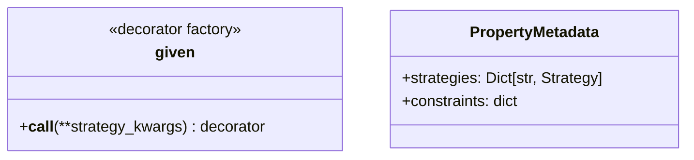
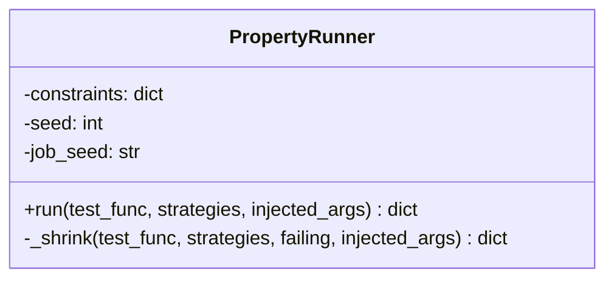
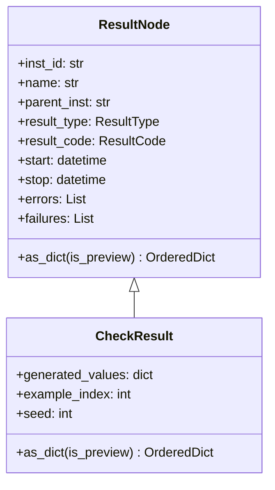
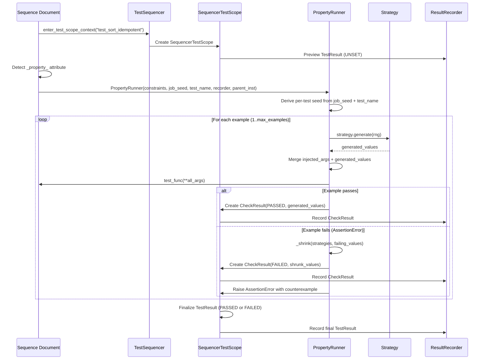
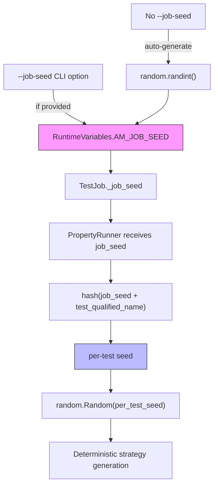
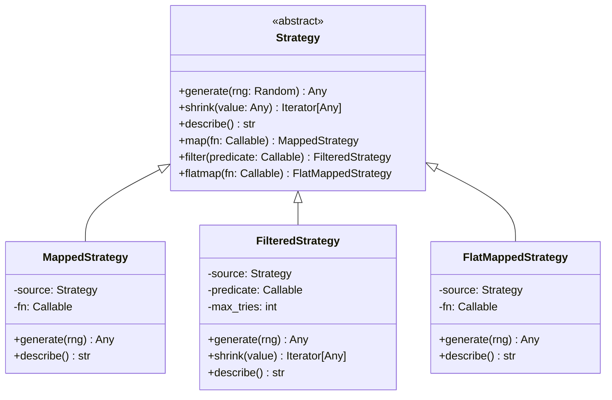
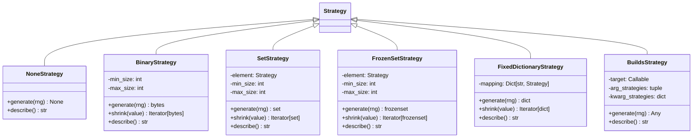
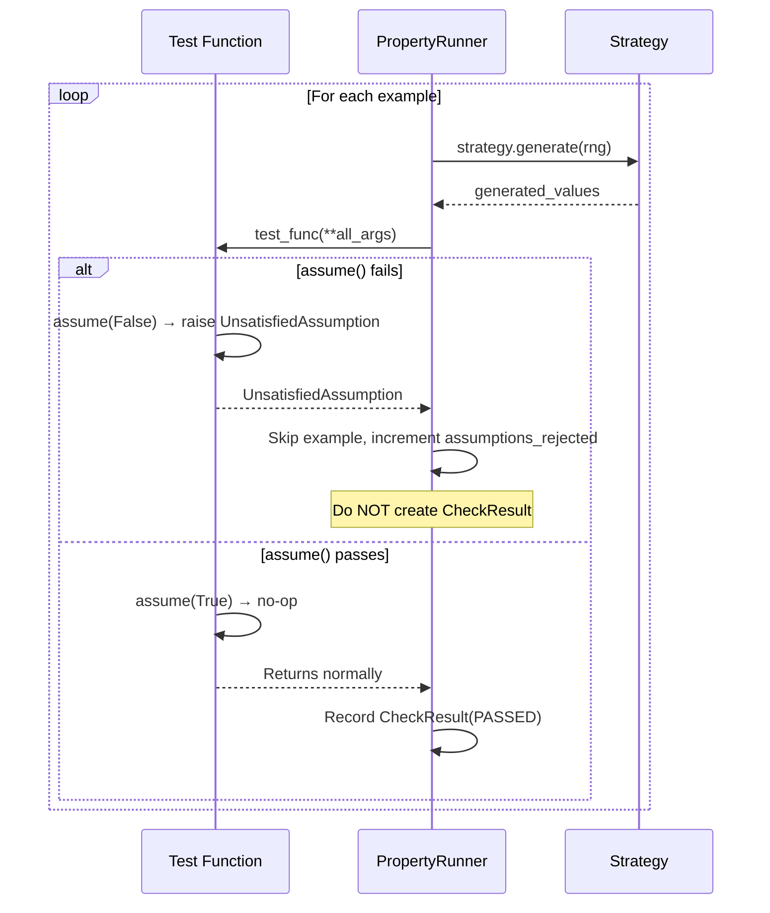

# Property Testing - Design Document

## Overview

The Property Testing feature adds a built-in, stdlib-only property testing engine to TestBase. It enables
test authors to declare invariants via the `@given` decorator and strategies, which are then verified against
randomly generated inputs. Each property test produces a single `TestResult` (preserving test count stability)
with individual example outcomes recorded as `CheckResult` sub-results.

### Design Principles

- **No third-party dependencies** — uses only `random` and `string` from the Python standard library
- **1-to-1 test count** — each `test_` function decorated with `@given` = exactly one test result
- **Seed-based reproducibility** — deterministic per-test seeds derived from the job seed
- **Transparent injection** — generated parameters coexist with injection-resolved parameters
- **Existing pattern alignment** — `CheckResult` follows the same structural pattern as `TaskingResult`

## Architecture

### High-Level Component Diagram

```mermaid
graph TB
    subgraph "User API"
        GV[@given decorator]
        ST[strategies module]
    end

    subgraph "Properties Engine"
        PR[PropertyRunner]
        SH[Shrinking Engine]
        SB[Strategy Base + Built-ins]
    end

    subgraph "TestBase Integration"
        TS[TestSequencer]
        SD[Sequence Document Generator]
        SC[SequencerTestScope]
    end

    subgraph "Result Model"
        TR[TestResult]
        CR[CheckResult]
        RT[ResultType.CHECK]
        RR[ResultRecorder]
    end

    subgraph "Agent Tooling"
        AE[testresult extract]
        AF[testresult failures]
        JP[JSOS Parser]
    end

    GV --> SD
    ST --> PR

    SD --> PR
    PR --> SB
    PR --> SH
    PR --> SC

    SC --> TR
    SC --> CR
    CR --> RR
    TR --> RR

    RR --> JP
    JP --> AE
    JP --> AF
```

### Component Details

#### 1. `@given` Decorator (`properties/decorators.py`)

Marks a test function as property-based by attaching a `_property_` attribute.



**Decoration mechanics:**

```python
@given(x=st.integers(), y=st.integers())
def test_addition_commutative(x, y):
    assert x + y == y + x

# After decoration:
# test_addition_commutative._property_ = {
#     "strategies": {"x": IntegerStrategy(), "y": IntegerStrategy()},
#     "constraints": {}
# }

# With custom constraints:
@given(x=st.integers(), constraints={"max_examples": 50})
def test_positive(x):
    assert x == x

# test_positive._property_ = {
#     "strategies": {"x": IntegerStrategy()},
#     "constraints": {"max_examples": 50}
# }
```

#### 2. Strategy System (`properties/strategies.py`)

All strategies inherit from `Strategy` and implement `generate()`, `shrink()`, and `describe()`.

```mermaid
classDiagram
    class Strategy {
        <<abstract>>
        +generate(rng: Random) Any
        +shrink(value: Any) Iterator[Any]
        +describe() str
    }

    class IntegerStrategy {
        -min_value: int
        -max_value: int
        +generate(rng) int
        +shrink(value) Iterator[int]
        +describe() str
    }

    class TextStrategy {
        -alphabet: str | Strategy
        -min_size: int
        -max_size: int
        +generate(rng) str
        +shrink(value) Iterator[str]
        +describe() str
    }

    class ListStrategy {
        -element: Strategy
        -min_size: int
        -max_size: int
        +generate(rng) list
        +shrink(value) Iterator[list]
        +describe() str
    }

    class BooleanStrategy {
        +generate(rng) bool
        +shrink(value) Iterator[bool]
    }

    class FloatStrategy {
        -min_value: float
        -max_value: float
        +generate(rng) float
        +shrink(value) Iterator[float]
    }

    class SampledFromStrategy {
        -elements: Sequence
        +generate(rng) Any
    }

    class OneOfStrategy {
        -strategies: List[Strategy]
        +generate(rng) Any
    }

    class JustStrategy {
        -value: Any
        +generate(rng) Any
    }

    class TupleStrategy {
        -strategies: List[Strategy]
        +generate(rng) tuple
        +shrink(value) Iterator[tuple]
    }

    class DictionaryStrategy {
        -keys: Strategy
        -values: Strategy
        -min_size: int
        -max_size: int
        +generate(rng) dict
        +shrink(value) Iterator[dict]
    }

    class CharacterStrategy {
        -categories: tuple
        -characters: str
        +generate(rng) str
    }

    class CompositeStrategy {
        -fn: Callable
        +generate(rng) Any
    }

    Strategy <|-- IntegerStrategy
    Strategy <|-- TextStrategy
    Strategy <|-- ListStrategy
    Strategy <|-- BooleanStrategy
    Strategy <|-- FloatStrategy
    Strategy <|-- SampledFromStrategy
    Strategy <|-- OneOfStrategy
    Strategy <|-- JustStrategy
    Strategy <|-- TupleStrategy
    Strategy <|-- DictionaryStrategy
    Strategy <|-- CharacterStrategy
    Strategy <|-- CompositeStrategy
```



**Shrinking heuristics per type:**

| Type | Shrink Strategy |
|------|----------------|
| `int` | Toward zero: `0`, then `value // 2` |
| `str` | Empty, then half-length, then single-character removals |
| `list` | Empty, then half-length, then single-element removals |
| `float` | Toward `0.0`, then `value / 2` |
| `tuple` | Shrink individual elements in order |
| `dict` | Empty, then half the keys, then single-key removals |
| `bool` | `True` → `False` |

#### 3. Property Runner (`properties/propertyrunner.py`)

Orchestrates generation, execution, shrinking, and `CheckResult` creation.



#### 4. CheckResult (`results/model/checkresult.py`)

New result node type for individual property check outcomes.



**`CheckResult.as_dict()` output structure:**

```json
{
    "name": "check_0042",
    "instance": "uuid-...",
    "parent": "parent-test-uuid",
    "rtype": "CHECK",
    "result": "PASSED",
    "start": "2026-03-03T09:12:34.567890",
    "stop": "2026-03-03T09:12:34.568123",
    "generated_values": {"x": 42, "y": -7},
    "example_index": 42,
    "seed": 839271
}
```

#### 5. ResultType Extension

```python
class ResultType(IntEnum):
    JOB = 0
    PACKAGE = 1
    SCOPE = 2
    TASK_CONTAINER = 3
    TASK = 4
    TEST_CONTAINER = 5
    TEST = 6
    STEP_CONATINER = 7
    STEP = 8
    TASKING_GROUP = 9
    TASKING = 10
    CHECK = 11          # NEW
```

## Data Flow

### Property Test Execution Flow



### Seed Derivation Flow



> [!IMPORTANT]
> Per-test seed overrides are **not** supported. The job seed is the single source of truth
> for reproducibility. The per-test seed is always derived from `hash(job_seed + test_name)`.

**Seed derivation algorithm:**

```python
import hashlib

def derive_test_seed(job_seed: int, test_name: str) -> int:
    """Derive a unique, deterministic seed for a specific test from the job seed."""
    combined = f"{job_seed}:{test_name}"
    hash_bytes = hashlib.sha256(combined.encode()).digest()
    return int.from_bytes(hash_bytes[:8], byteorder='big')
```

### Sequence Document Generation

When the sequence document generator encounters a function with `_property_`, it generates:

```python
# --- Generated sequence document code for a property test ---

test_scope_name = "test_sort_is_idempotent"
with sequencer.enter_test_scope_context(test_scope_name) as tscope:
    from mypackage.test_sorting import test_sort_is_idempotent
    from ccai.testbase.properties.propertyrunner import PropertyRunner

    prop_meta = test_sort_is_idempotent._property_
    runner = PropertyRunner(
        constraints=prop_meta.get("constraints", {}),
        job_seed=sequencer.job_seed,
        test_name="mypackage.test_sorting#test_sort_is_idempotent",
        recorder=tscope.recorder,
        parent_inst=tscope.scope_id
    )
    runner.run(
        test_sort_is_idempotent,
        strategies=prop_meta["strategies"],
        injected_args={},   # populated from scope tree for injected params
    )
```

For tests with injected parameters, `injected_args` is populated from the scope tree:

```python
    runner.run(
        test_cache_roundtrip,
        strategies=prop_meta["strategies"],
        injected_args={"cache_client": cache_client},
    )
```

## Integration Points

### With Result Consolidation

The `consolidate_results()` method in `ResultRecorder` needs to handle `CHECK` records:

```python
# In consolidate_results() — new case:
elif ritem_type == ResultType.CHECK.name:
    # Add to parent's checks list (parent is TestResult)
    if "checks" not in parent_node:
        parent_node["checks"] = []
    parent_node_checks: list = parent_node["checks"]
    parent_node_checks.append(ritem)

    # Preview/final merging
    if ritem_inst in node_lookup:
        preview_info: dict = node_lookup[ritem_inst]
        preview_info.update(ritem)
    else:
        node_lookup[ritem_inst] = ritem
```

### With Agent Extraction

The `testresult extract` command output for a property test:

```
name: mypackage.test_sorting#test_sort_is_idempotent
result: FAILED
start: 2026-03-03T09:12:34.123456
stop: 2026-03-03T09:12:35.789012
property:
  examples_run: 37
  max_examples: 100
  seed: 839271
  job_seed: 12345
  counterexample:
    xs: [1, 0, -1]
checks:
  failed: 1
  passed: 36
```

The `testresult failures` command for property tests:

```
mypackage.test_sorting#test_sort_is_idempotent: FAILED
  error: Property falsified after 37 examples. Counterexample: {"xs": [1, 0, -1]}
  seed: 839271 (reproduce with --job-seed=12345)
```

### With Query Mode

In query mode, property test entries include strategy descriptions:

```
mypackage.test_sorting#test_sort_is_idempotent (property)
  strategies:
    xs: lists(integers())
  max_examples: 100
```

### With TestResult Metadata

The `TestResult` for property tests adds property-specific fields to `as_dict()`:

```json
{
    "name": "mypackage.test_sorting#test_sort_is_idempotent",
    "rtype": "TEST",
    "result": "FAILED",
    "property_metadata": {
        "is_property_test": true,
        "examples_run": 37,
        "max_examples": 100,
        "seed": 839271,
        "job_seed": 12345,
        "counterexample": {"xs": [1, 0, -1]},
        "strategy_descriptions": {"xs": "lists(integers())"}
    }
}
```

## Error Handling

### With HTML Report Rendering

The HTML test result report renders property test results by extending the existing stream parsing and web component patterns used for tasking results.

#### Stream Parsing (`testsummary.js`)

The `load_results_from_stream()` function needs a new `CHECK` record case following the `TASKING` pattern. CHECK records are attached to their parent TEST record:

```javascript
} else if (ritem.rtype == "CHECK") {
    // CHECK RECORD PROCESSING
    // Individual check results from property tests.
    // They are linked to their parent TEST's checks array.
    if (parent_lookup.hasOwnProperty(ritem_parentid)) {
        var parent_item = parent_lookup[ritem_parentid];
        if (!parent_item.checks) {
            parent_item.checks = [];
            parent_item.checks_passed = 0;
            parent_item.checks_failed = 0;
            parent_item.checks_errored = 0;
        }
        parent_item.checks.push(ritem);

        // Update check counters
        if (ritem.result == "PASSED") {
            parent_item.checks_passed += 1;
        } else if (ritem.result == "FAILED") {
            parent_item.checks_failed += 1;
        } else if (ritem.result == "ERRORED") {
            parent_item.checks_errored += 1;
        }
    }
}
```

**Important**: CHECK records are NOT counted in the top-level result counters (`counters.passed`, `counters.failed`, etc.).

#### Web Components (`testsummary-components.js`)

Two rendering updates are needed:

1. **`TestSummaryResultItem.syncData()`** — After the existing `tasking_groups` rendering block, add check result rendering:

```javascript
// In TestSummaryResultItem.syncData(), after tasking_groups rendering:
if ("checks" in testItem) {
    var checkGroupEl = document.createElement(TestSummaryCheckGroup.tagname);
    checkGroupEl.syncData(testItem);
    itemDetailEl.appendChild(checkGroupEl);
}

// Also render property_metadata if present:
if ("property_metadata" in testItem) {
    var propMetaEl = document.createElement(TestSummaryPropertyMetadata.tagname);
    propMetaEl.syncData(testItem.property_metadata);
    itemDetailEl.appendChild(propMetaEl);
}
```

2. **New `TestSummaryCheckGroup` component** — Follows the `TestSummaryTaskGroup` pattern with collapsible summary showing passed/failed/errored counters and individual `TestSummaryCheckResult` entries.

3. **New `TestSummaryCheckResult` component** — Follows the `TestSummaryTaskResult` pattern, but displays:
   - Generated values (as key-value pairs)
   - Example index
   - Result status with color coding
   - Start/stop/elapsed time
   - Error/failure detail when applicable

4. **New `TestSummaryPropertyMetadata` component** — Collapsible section displaying:
   - Seed and job seed values
   - Examples run vs max_examples
   - Strategy descriptions for each parameter
   - Counterexample values (when test failed)

## Error Handling

### Property Test Error Categories

| Condition | Result Code | Behavior |
|-----------|-------------|----------|
| All examples pass | `PASSED` | Single PASSED TestResult |
| `AssertionError` during check | `FAILED` | Shrink, record FAILED TestResult + counterexample |
| Unexpected exception during check | `ERRORED` | Record ERRORED TestResult, no shrinking |
| Strategy generation error | `ERRORED` | Record ERRORED TestResult with strategy error detail |
| Import error on property module | `ERRORED` | Handled by existing import error mechanism |

## Testing Strategy

### Unit Test Coverage

| Test Module | Component | Key Tests |
|-------------|-----------|-----------|
| `test_strategies.py` | Strategy classes | Generation range, shrinking correctness, describe() output |
| `test_propertyrunner.py` | PropertyRunner | Pass/fail/error paths, shrinking, seed determinism |
| `test_checkresult.py` | CheckResult | Serialization, as_dict() format, ResultType.CHECK |
| `test_decorators.py` | @given, constraints | Metadata attachment, constraints defaults, composability with markers |
| `test_seed_derivation.py` | Seed logic | Determinism, per-test isolation, override precedence |

### Property Testing the Property Tester

The property testing module can be tested with its own property tests, using direct invocation
of `PropertyRunner` in unit tests rather than going through the full sequencer pipeline.

## File Structure

```
source/packages/ccai/testbase/
├── properties/
│   ├── __init__.py              # Exports: given, expect_exception, assume, strategies
│   ├── decorators.py            # @given decorator, expect_exception decorator
│   ├── strategies.py            # Strategy base class + all built-in strategies
│   ├── propertyrunner.py        # PropertyRunner (generation + shrinking + CheckResult creation)
│   └── assumptions.py           # assume() function, UnsatisfiedAssumption exception
│
├── results/model/
│   ├── checkresult.py           # [NEW] CheckResult class
│   └── resulttype.py            # [MODIFY] Add CHECK = 11
│
├── results/recorders/
│   └── resultrecorder.py        # [MODIFY] Handle CHECK in consolidate_results()
│
├── sequencing/
│   └── testsequencer.py         # [MODIFY] Add create_check_result(), detect _property_
│
└── templates/v2/static/javascript/
    ├── testsummary.js            # [MODIFY] Add CHECK record case in load_results_from_stream()
    └── testsummary-components.js # [MODIFY] Add TestSummaryCheckGroup, TestSummaryCheckResult,
                                 #          TestSummaryPropertyMetadata web components;
                                 #          Update TestSummaryResultItem.syncData()

source/tests/ccai_tests/testbase/properties/
├── __init__.py
├── test_strategies.py
├── test_propertyrunner.py
├── test_checkresult.py
├── test_decorators.py
└── test_seed_derivation.py
```

## Strategy Combinators

### Combinator Class Hierarchy



**Combinator semantics:**

| Method | Behavior | Shrinking |
|--------|----------|-----------|
| `.map(fn)` | Apply `fn` to each generated value | Delegates to source, then re-maps |
| `.filter(pred)` | Retry until `pred(value)` is truthy | Delegates to source, keeps only satisfying |
| `.flatmap(fn)` | Generate value, call `fn(value)` → strategy, generate from it | No shrinking (complex) |

### Additional Strategy Classes



### Assume Function

The `assume()` function provides mid-test precondition filtering. It works by raising a sentinel
exception (`UnsatisfiedAssumption`) that the `PropertyRunner` catches and treats as "skip this example."



**Module structure:** `properties/assumptions.py`

```python
class UnsatisfiedAssumption(Exception):
    """Sentinel exception raised when assume() receives a falsy condition."""
    pass

def assume(condition: bool) -> None:
    """Skip the current example if the condition is not met."""
    if not condition:
        raise UnsatisfiedAssumption()
```
