# Result Concentrators - Design Document

## Overview

The Result Concentrators system provides infrastructure for aggregating test execution progress and results from distributed test execution environments. It enables:

- Real-time progress collection from remote test workers via HTTP callbacks
- Centralized progress tracking and status aggregation
- Periodic forwarding of aggregated summaries to external monitoring services
- Thread-safe concurrent progress updates from multiple sources

The system operates as a service layer that sits between distributed test workers and the central `ResultRecorder`, providing a unified view of test execution progress across multiple processes or machines.

## Architecture

### High-Level Component Diagram

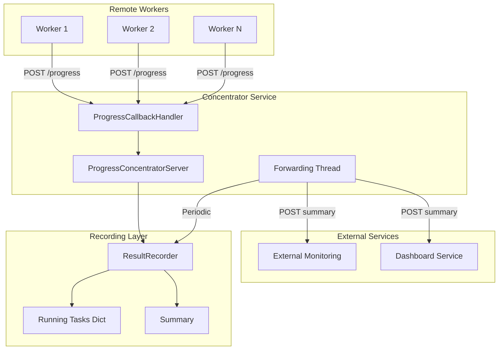

### Components

#### 1. ProgressConcentratorServer

The `ProgressConcentratorServer` is a threaded HTTP server that receives progress callbacks from remote test workers and aggregates them into the central `ResultRecorder`.

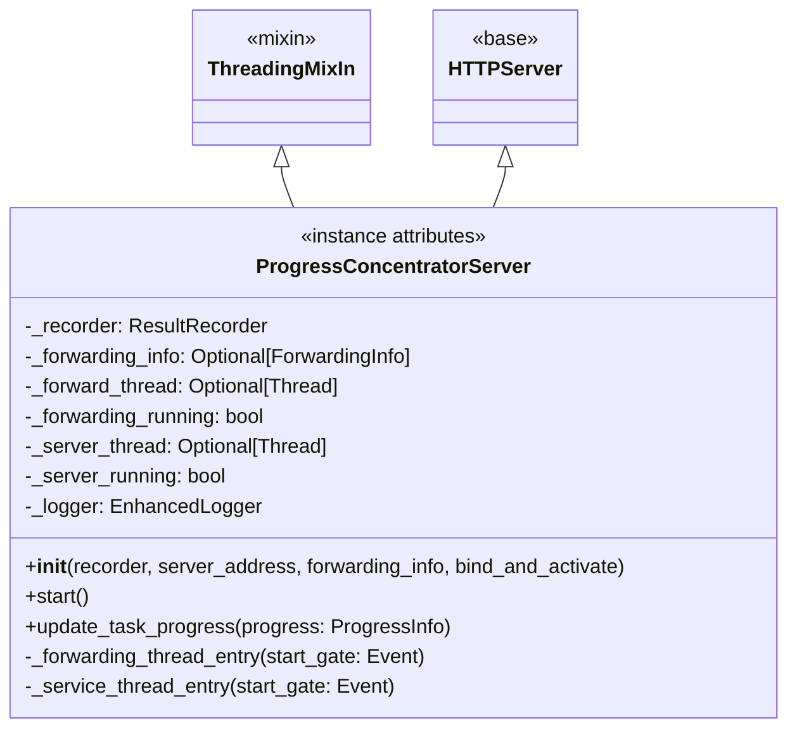

**Key Responsibilities:**

| Responsibility | Description |
|----------------|-------------|
| HTTP Server | Accepts incoming progress POST requests from workers |
| Progress Aggregation | Routes progress updates to the ResultRecorder |
| Summary Forwarding | Periodically forwards aggregated summaries to external services |
| Thread Management | Manages server and forwarding threads with proper lifecycle |
| Concurrent Handling | Uses ThreadingMixIn for concurrent request processing |

#### 2. ProgressCallbackHandler

The `ProgressCallbackHandler` processes incoming HTTP POST requests containing progress information from remote workers.

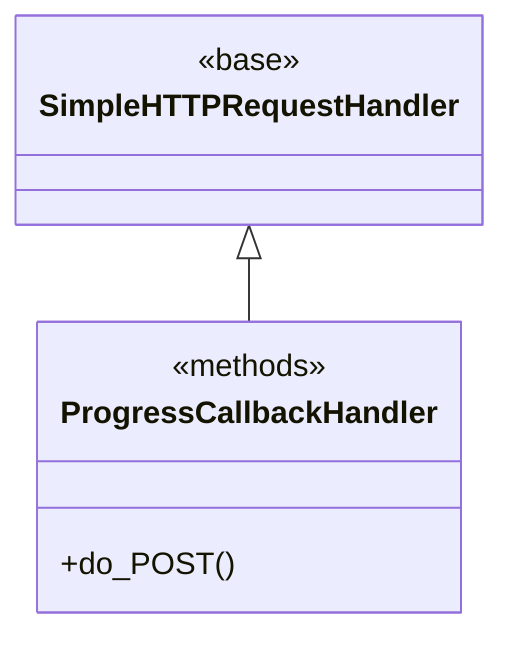

**Request Processing Flow:**

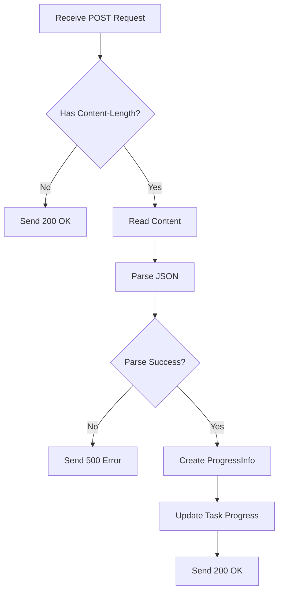

#### 3. Progress Data Model

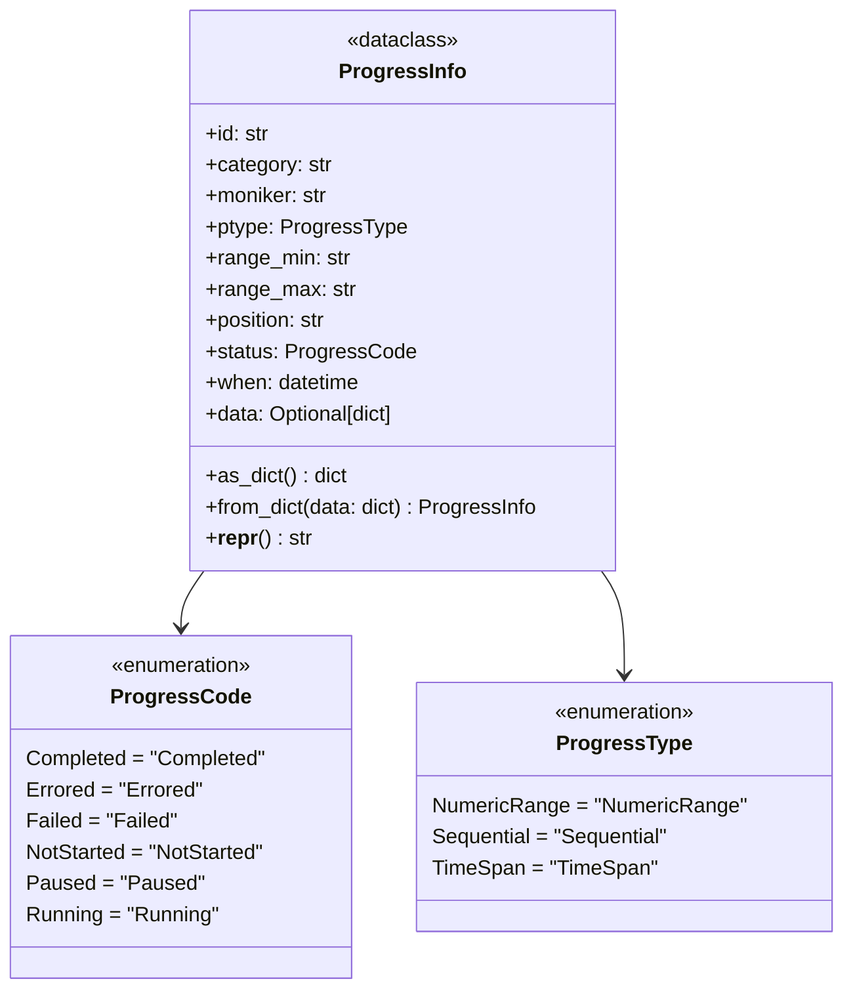

#### 4. Forwarding Configuration

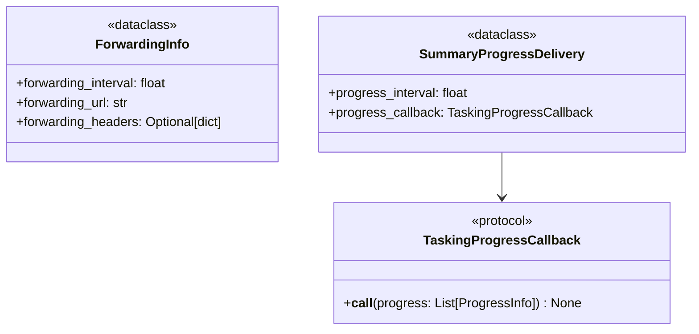

### Data Flow

#### Progress Collection Flow

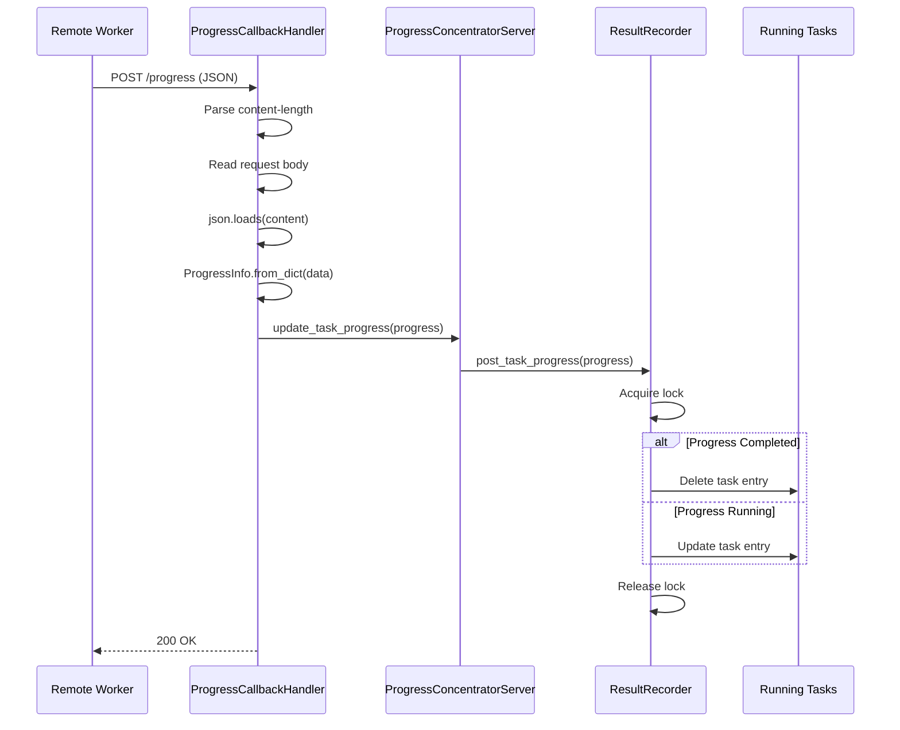

#### Summary Forwarding Flow

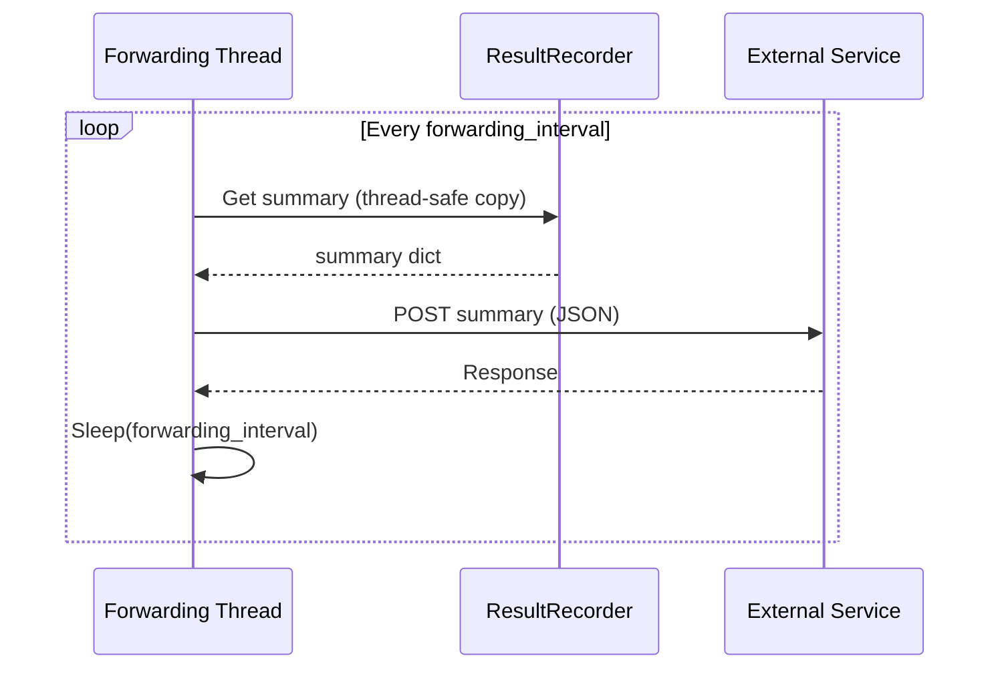

#### Server Startup Flow

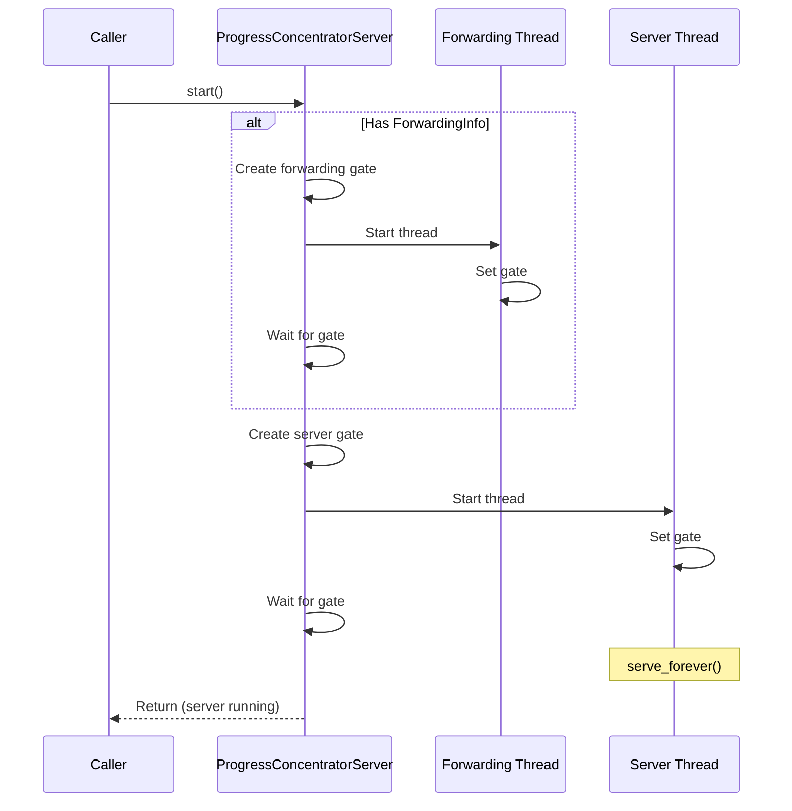

### Thread Architecture

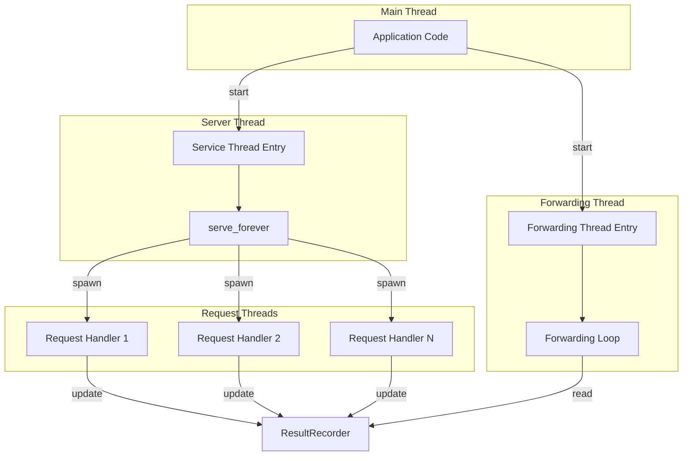

### Design Patterns

#### 1. Mixin Pattern

The `ProgressConcentratorServer` uses Python's `ThreadingMixIn` to enable concurrent request handling:

```python
class ProgressConcentratorServer(ThreadingMixIn, HTTPServer):
    """
    Combines threading capability with HTTP server functionality.
    Each incoming request is handled in a separate thread.
    """
```

#### 2. Observer Pattern

The progress forwarding system implements an observer-like pattern where the forwarding thread periodically observes the recorder's summary state:

```python
class TaskingProgressCallback(Protocol):
    def __call__(self, progress: List[ProgressInfo]) -> None: ...

@dataclass
class SummaryProgressDelivery:
    progress_interval: float
    progress_callback: TaskingProgressCallback
```

#### 3. Gate Pattern

Thread synchronization uses gate events to ensure proper startup sequencing:

```python
def start(self):
    svr_gate = threading.Event()
    svr_gate.clear()
    
    self._server_thread = threading.Thread(
        target=self._service_thread_entry,
        args=(svr_gate,),
        daemon=True
    )
    self._server_thread.start()
    
    svr_gate.wait()  # Wait for thread to signal ready
```

#### 4. Thread-Safe State Pattern

The `ResultRecorder` uses lock-based synchronization for thread-safe state updates:

```python
def post_task_progress(self, progress_list: List[ProgressInfo]):
    self._lock.acquire()
    try:
        for progress in progress_list:
            if progress.status == ProgressCode.Completed:
                del self._running_tasks[progress.id]
            else:
                self._running_tasks[progress.id] = progress.as_dict()
    finally:
        self._lock.release()
```

### Progress State Machine

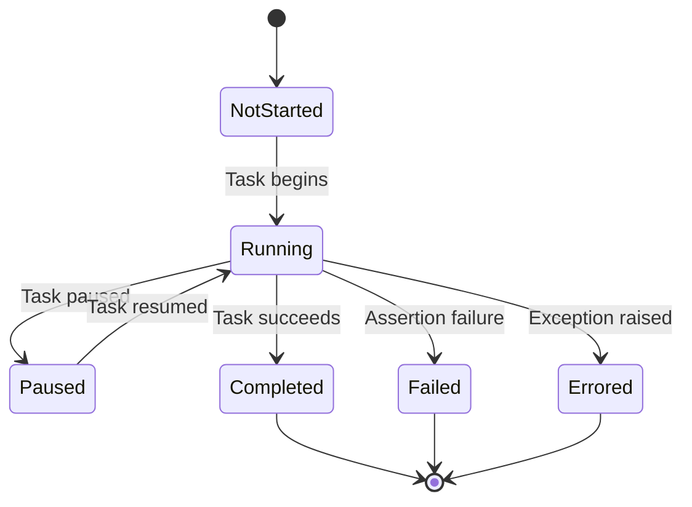

### Progress Types

| Type | Description | Use Case |
|------|-------------|----------|
| `NumericRange` | Progress within a numeric range (min to max) | Batch processing with known count |
| `Sequential` | Sequential step progress | Multi-step operations |
| `TimeSpan` | Time-based progress | Duration-based tasks |

## Integration Points

### With ResultRecorder

The concentrator integrates with `ResultRecorder` through:

- `post_task_progress()` - Updates running task state
- `clear_task_progress()` - Removes completed tasks
- `summary` property - Provides thread-safe summary access

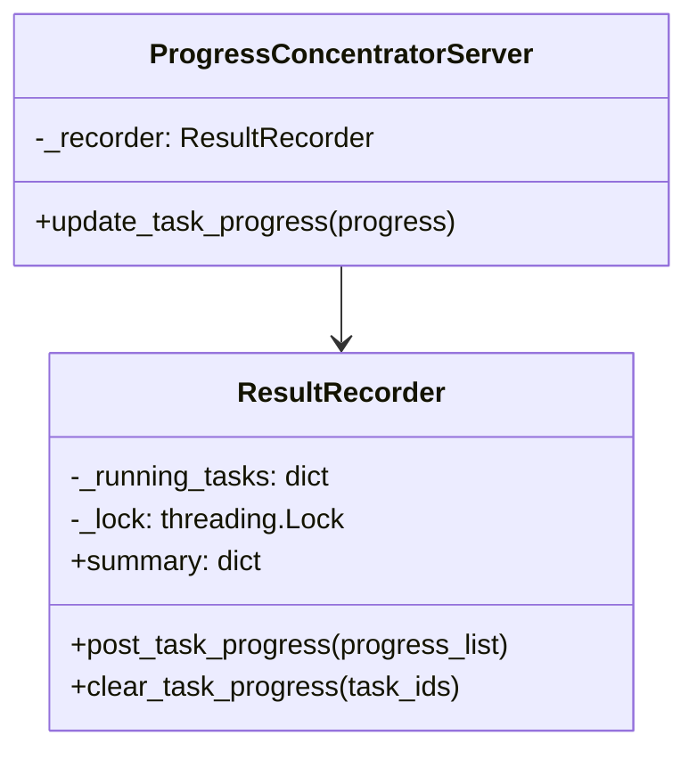

### With Remote Workers

Workers communicate via HTTP POST with JSON payloads:

```json
{
    "id": "task-uuid-123",
    "category": "test-execution",
    "moniker": "test_module.test_function",
    "ptype": "Sequential",
    "range_min": "0",
    "range_max": "10",
    "position": "5",
    "status": "Running",
    "when": "2025-02-20T10:30:00.000000",
    "data": {
        "worker_id": "worker-1",
        "additional_info": "..."
    }
}
```

### With External Monitoring Services

The forwarding thread sends periodic summary updates:

```python
headers = {
    "Content-Type": "application/json"
}
if forwarding_headers is not None:
    headers.update(forwarding_headers)

requests.post(forwarding_url, json=summary, headers=headers)
```

## Configuration

### Server Configuration

| Parameter | Type | Description |
|-----------|------|-------------|
| `recorder` | `ResultRecorder` | The recorder to aggregate progress into |
| `server_address` | `tuple` | (host, port) for the HTTP server |
| `forwarding_info` | `Optional[ForwardingInfo]` | Configuration for summary forwarding |
| `bind_and_activate` | `bool` | Whether to bind and activate immediately |

### ForwardingInfo Configuration

| Field | Type | Description |
|-------|------|-------------|
| `forwarding_interval` | `float` | Seconds between summary forwards |
| `forwarding_url` | `str` | URL to POST summaries to |
| `forwarding_headers` | `Optional[dict]` | Additional HTTP headers |

### Example Configuration

```python
from automojo.testbase.results.model.forwardinginfo import ForwardingInfo
from automojo.testbase.results.concentrators.progressconcentratorservice import (
    ProgressConcentratorServer
)

# Configure forwarding
forwarding_info = ForwardingInfo(
    forwarding_interval=5.0,  # Forward every 5 seconds
    forwarding_url="https://monitoring.example.com/api/progress",
    forwarding_headers={
        "Authorization": "Bearer token123",
        "X-Job-Id": "job-456"
    }
)

# Create and start concentrator
server = ProgressConcentratorServer(
    recorder=result_recorder,
    server_address=("0.0.0.0", 8080),
    forwarding_info=forwarding_info
)
server.start()
```

## Error Handling

### Request Processing Errors

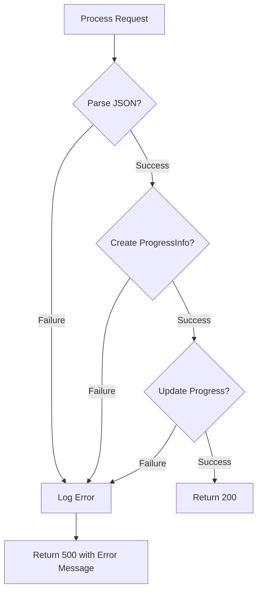

### Error Response Format

```python
def do_POST(self):
    errmsg = None
    
    try:
        # Process request
        ...
    except Exception as perr:
        errmsg_msg_lines = [
            "Error processing progress postback.",
            "EXCEPTION:",
            traceback.format_exc()
        ]
        errmsg = os.linesep.join(errmsg_msg_lines)
    
    if not errmsg:
        self.send_response(200, message=None)
    else:
        self.send_response(500, message=errmsg)
```

### Forwarding Thread Error Handling

The forwarding thread catches and logs exceptions without crashing:

```python
def _forwarding_thread_entry(self, start_gate: threading.Event):
    while self._forwarding_running:
        try:
            summary = self._recorder.summary
            requests.post(forwarding_url, json=summary, headers=headers)
            time.sleep(forwarding_interval)
        except Exception:
            errmsg = traceback.format_exc()
            self._logger.error(errmsg)
```

## Testing Strategy

### Unit Testing Focus Areas

1. **ProgressConcentratorServer**
   - Server startup and shutdown
   - Thread lifecycle management
   - Gate synchronization

2. **ProgressCallbackHandler**
   - JSON parsing
   - ProgressInfo creation
   - Error response generation

3. **Progress Data Model**
   - Serialization/deserialization
   - Status transitions
   - Progress type handling

4. **Integration with ResultRecorder**
   - Thread-safe progress updates
   - Running task management
   - Summary generation

### Test Categories

| Category | Components | Focus |
|----------|------------|-------|
| Lifecycle | ProgressConcentratorServer | Start/stop, thread management |
| HTTP | ProgressCallbackHandler | Request parsing, responses |
| Serialization | ProgressInfo | JSON round-trip |
| Threading | All | Concurrent access, locks |
| Integration | Server + Recorder | End-to-end progress flow |

### Integration Testing

1. **Multi-Worker Simulation**
   - Multiple concurrent progress updates
   - Progress aggregation accuracy
   - Thread safety under load

2. **Forwarding Verification**
   - Summary forwarding timing
   - External service integration
   - Header propagation

3. **Error Recovery**
   - Malformed request handling
   - Network failure resilience
   - Thread crash recovery

## Performance Considerations

### Scalability

- ThreadingMixIn enables concurrent request handling
- Lock contention minimized through short critical sections
- Daemon threads prevent blocking on shutdown

### Resource Management

- Threads are created as daemons for clean shutdown
- HTTP connections are short-lived
- Summary copies prevent lock holding during forwarding

### Bottlenecks

| Potential Bottleneck | Mitigation |
|---------------------|------------|
| Lock contention | Short critical sections, copy-on-read |
| Thread creation | ThreadingMixIn reuses thread pool |
| Network I/O | Async forwarding in separate thread |
| JSON parsing | Efficient stdlib json module |
