# Result Recording and Reporting - Design Document

## Overview

The Result Recording and Reporting system is responsible for capturing, persisting, and organizing test execution outcomes in the TestBase framework. It provides:

- A hierarchical result model that mirrors the test execution structure
- Streaming result recording for real-time progress tracking
- Result consolidation for post-run analysis and reporting
- Progress tracking and forwarding for distributed test execution
- Support for multiple output formats through extensible recorder implementations

The system operates through three primary layers: the Data Model (result types and containers), the Recording Layer (result recorders), and the Aggregation Layer (progress concentrators).

## Architecture

### High-Level Component Diagram

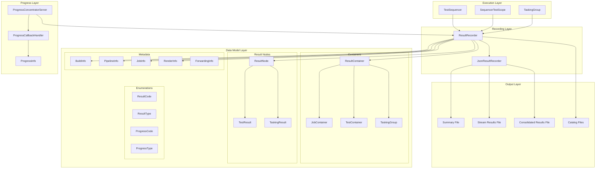

### Components

#### 1. ResultRecorder (Base Recorder)

The `ResultRecorder` class establishes the API patterns for recording test results. It manages the test run lifecycle, result counting, and summary generation.

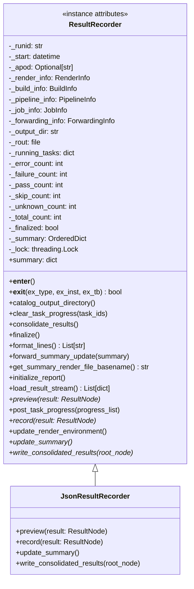

**Key Responsibilities:**

| Responsibility | Description |
|----------------|-------------|
| Lifecycle Management | Manages recording start/stop via context manager |
| Result Counting | Tracks pass/fail/error/skip counts |
| Summary Generation | Maintains and updates test run summary |
| Progress Tracking | Tracks running tasks for real-time status |
| Output Management | Manages output directory and file generation |
| Catalog Generation | Creates directory catalogs for HTML navigation |

#### 2. Result Data Model

The result data model consists of containers (for hierarchy) and nodes (for actual results).

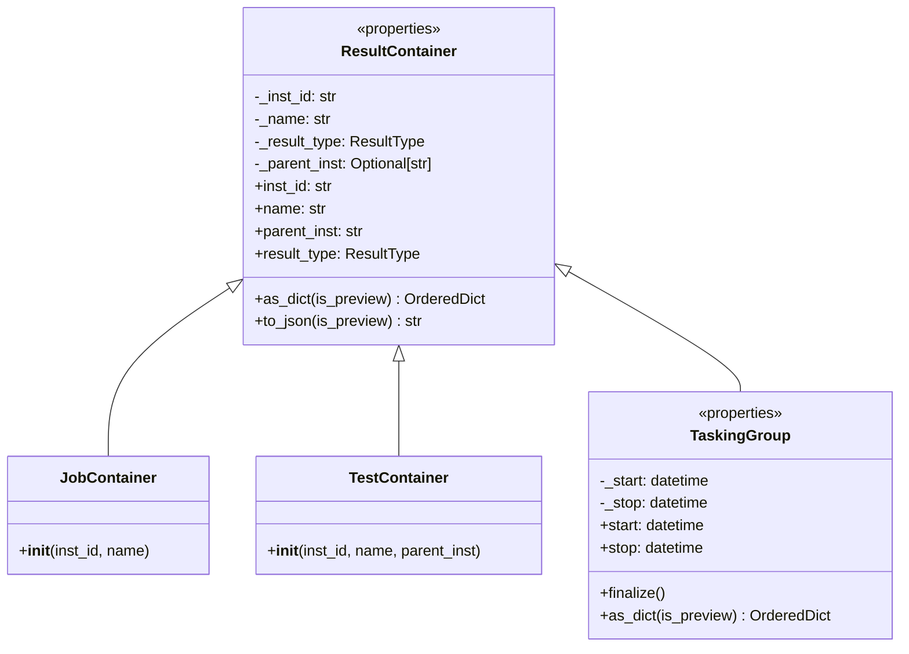

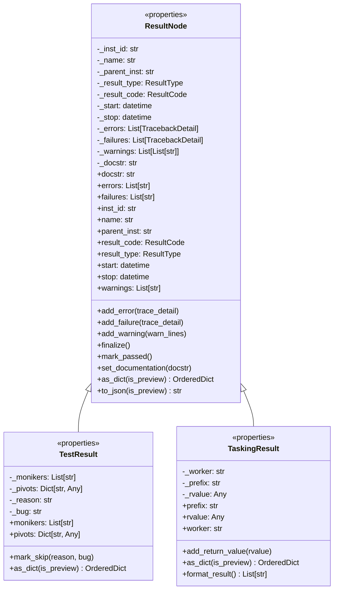

#### 3. Result Type Enumerations

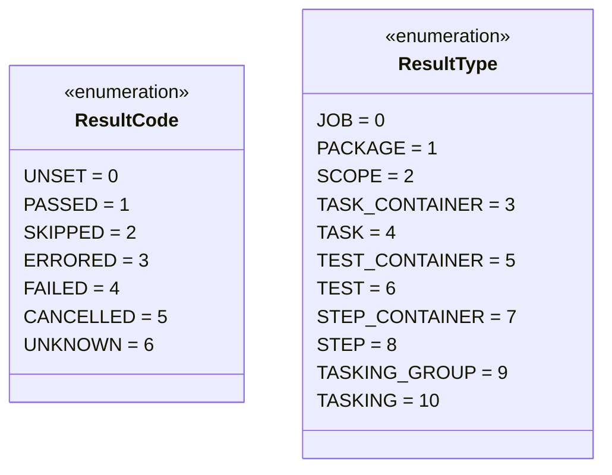

#### 4. Metadata Classes

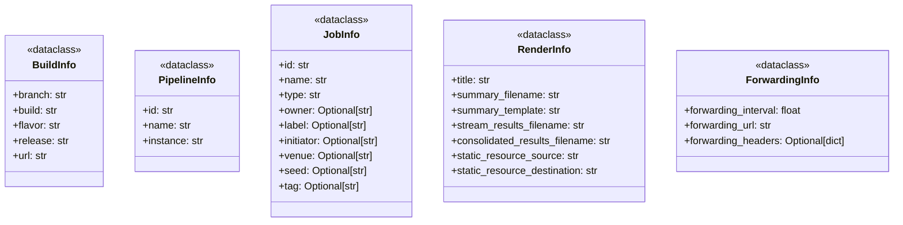

#### 5. Progress Tracking

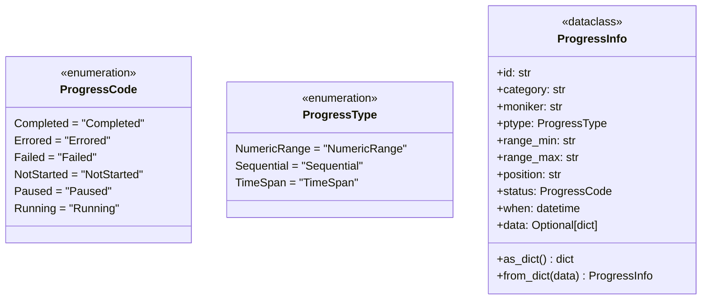

#### 6. Progress Concentrator Service

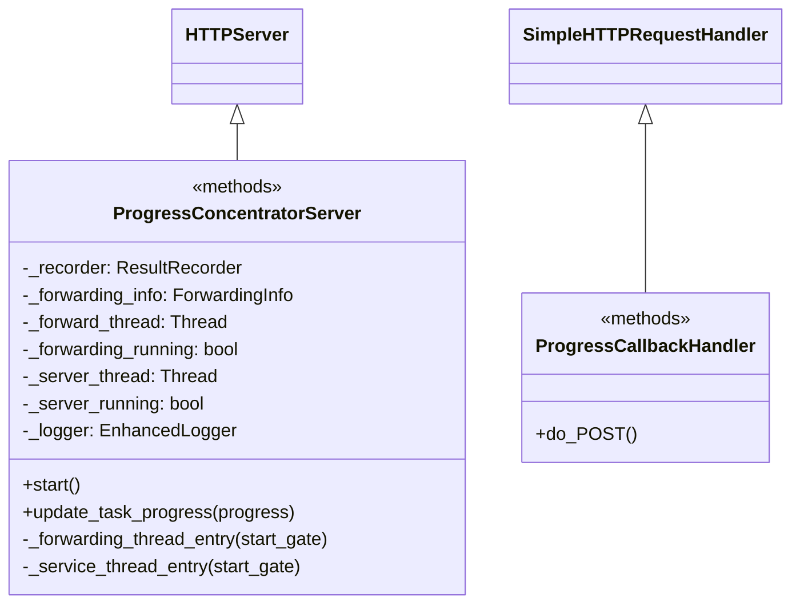

### Data Flow

#### Result Recording Flow

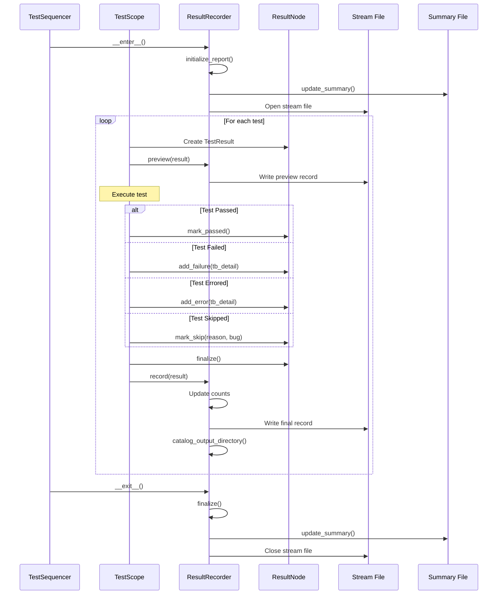

#### Result Consolidation Flow

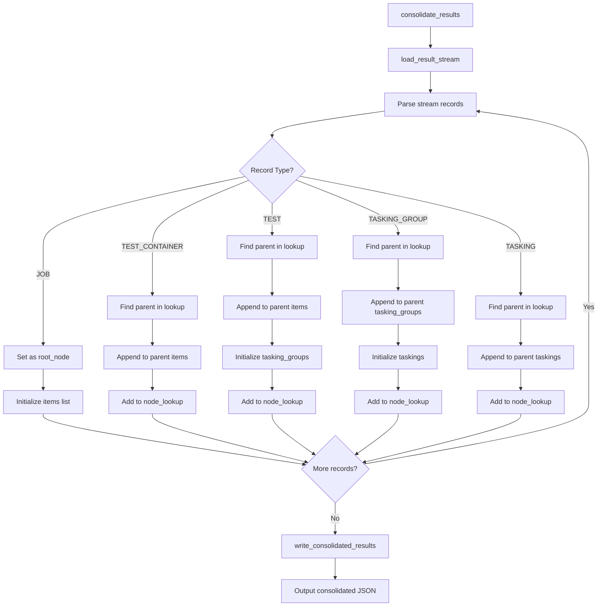

#### Progress Forwarding Flow

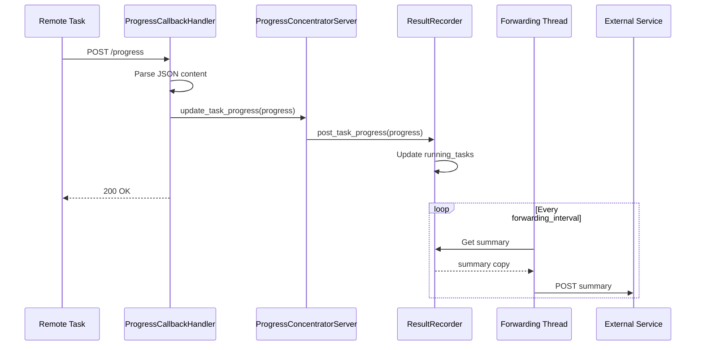

### Result Tree Structure

```
JobContainer (root)
├── TestContainer (package.module1)
│   ├── TestResult (test_function_1)
│   │   ├── TaskingGroup (setup_group)
│   │   │   ├── TaskingResult (task_1)
│   │   │   └── TaskingResult (task_2)
│   │   └── TaskingGroup (teardown_group)
│   │       └── TaskingResult (cleanup_task)
│   └── TestResult (test_function_2)
├── TestContainer (package.module2)
│   └── TestResult (test_function_3)
└── ...
```

### Design Patterns

#### 1. Context Manager Pattern

The `ResultRecorder` implements the context manager protocol for lifecycle management:

```python
class ResultRecorder:
    def __enter__(self):
        self.initialize_report()
        self.update_summary()
        self._rout = open(self._render_info.stream_results_filename, 'w')
        return self

    def __exit__(self, ex_type, ex_inst, ex_tb):
        if not self._finalized:
            self.finalize()
        return
```

#### 2. Template Method Pattern

The `ResultRecorder` base class defines abstract methods that derived classes must implement:

```python
class ResultRecorder:
    def preview(self, result: ResultNode):
        raise AbstractMethodError("...")
    
    def record(self, result: ResultNode):
        raise AbstractMethodError("...")
    
    def update_summary(self):
        raise AbstractMethodError("...")
    
    def write_consolidated_results(self, root_node: dict):
        raise AbstractMethodError("...")
```

#### 3. Observer Pattern

The progress tracking system uses callbacks for progress updates:

```python
class TaskingProgressCallback(Protocol):
    def __call__(self, progress: List[ProgressInfo]) -> None: ...

@dataclass
class SummaryProgressDelivery:
    progress_interval: float
    progress_callback: TaskingProgressCallback
```

#### 4. Composite Pattern

The result tree uses a composite structure with containers and nodes:

- `ResultContainer` - composite nodes (JobContainer, TestContainer, TaskingGroup)
- `ResultNode` - leaf nodes with actual result data (TestResult, TaskingResult)

#### 5. Strategy Pattern

The `TaskingResultFormatter` protocol allows customizable result formatting:

```python
class TaskingResultFormatter(Protocol):
    def __call__(self, result: TaskingResult) -> List[str]: ...

def default_tasking_result_formatter(result: TaskingResult) -> List[str]:
    # Default formatting implementation
    ...
```

### Output File Structure

```
output_directory/
├── testsummary.html          # HTML summary page
├── testsummary.json          # JSON summary data
├── testresults_stream.jsos   # Streaming results (JSOS format)
├── testresults.json          # Consolidated results
├── catalog.json              # Directory catalog
├── static/                   # Static resources
│   ├── css/
│   ├── js/
│   └── images/
└── diagnostics/              # Diagnostic captures
    ├── pre-run/
    └── post-run/
```

## Integration Points

### With Test Execution Engine

The Result Recording system integrates with the execution engine through:

- `TestSequencer` creates result containers and nodes
- `SequencerTestScope` records test results via the recorder
- `TaskingGroup` records tasking results for distributed tasks

### With HTML Report Templates

The system provides data for HTML rendering:

- Summary JSON for dashboard display
- Consolidated results for detailed views
- Catalog files for directory navigation
- Static resources for styling and interactivity

### With Progress Concentrators

The system supports distributed execution through:

- `ProgressConcentratorServer` receives progress callbacks
- `ForwardingInfo` configures external progress forwarding
- Real-time summary updates for monitoring

## Configuration

### ResultRecorder Parameters

| Parameter | Type | Description |
|-----------|------|-------------|
| `runid` | `str` | Unique identifier for the test run |
| `start` | `datetime` | Start time of the test run |
| `render_info` | `RenderInfo` | Output file paths and templates |
| `apod` | `Optional[str]` | Automation pod identifier |
| `build_info` | `Optional[BuildInfo]` | Build metadata |
| `pipeline_info` | `Optional[PipelineInfo]` | Pipeline metadata |
| `job_info` | `Optional[JobInfo]` | Job metadata |
| `forwarding_info` | `Optional[ForwardingInfo]` | Progress forwarding config |

### RenderInfo Configuration

| Field | Description |
|-------|-------------|
| `title` | Title for the test run summary |
| `summary_filename` | Path to summary JSON file |
| `summary_template` | Path to HTML template |
| `stream_results_filename` | Path to streaming results file |
| `consolidated_results_filename` | Path to consolidated results |
| `static_resource_source` | Source directory for static files |
| `static_resource_destination` | Destination for static files |

## Error Handling

### Result Code Determination

```python
def finalize(self):
    if len(self._failures) > 0:
        self._result_code = ResultCode.FAILED
    elif len(self._errors) > 0:
        self._result_code = ResultCode.ERRORED
    elif self._result_code == ResultCode.UNSET or self._result_code == ResultCode.PASSED:
        self._result_code = ResultCode.PASSED
    else:
        self._result_code = ResultCode.UNKNOWN
```

### Tasking Result Verification

The `verify_tasking_results` function validates tasking outcomes:

| Condition | Exception Type |
|-----------|----------------|
| Unknown result codes | `TaskingGroupRuntimeError` |
| Cancelled taskings | `TaskingGroupRuntimeError` |
| Errored taskings | `TaskingGroupRuntimeError` |
| Failed taskings | `TaskingGroupAssertionError` |

### Thread Safety

The `ResultRecorder` uses a lock for thread-safe operations:

```python
self._lock.acquire()
try:
    # Update shared state
    self._running_tasks[progress.id] = progress.as_dict()
finally:
    self._lock.release()
```

## Testing Strategy

### Unit Testing Focus Areas

1. **ResultRecorder**
   - Context manager lifecycle
   - Result counting accuracy
   - Summary generation
   - Thread safety

2. **Result Data Model**
   - Serialization/deserialization
   - Result code finalization
   - Error/failure tracking

3. **Progress Tracking**
   - Progress info serialization
   - Concentrator server operation
   - Forwarding thread behavior

4. **Utilities**
   - Catalog tree generation
   - Directory traversal

### Test Categories

| Category | Components | Focus |
|----------|------------|-------|
| Lifecycle | ResultRecorder | Context manager, finalization |
| Serialization | ResultNode, ResultContainer | JSON output, as_dict |
| Counting | ResultRecorder | Pass/fail/error/skip counts |
| Progress | ProgressInfo, Concentrator | Real-time tracking |
| Threading | ResultRecorder, Concentrator | Thread safety |

### Integration Testing

1. **End-to-End Recording**
   - Complete test run with result recording
   - File output validation
   - Consolidation correctness

2. **Progress Forwarding**
   - Remote task progress reception
   - Summary forwarding to external services

3. **HTML Report Generation**
   - Catalog file generation
   - Static resource deployment
