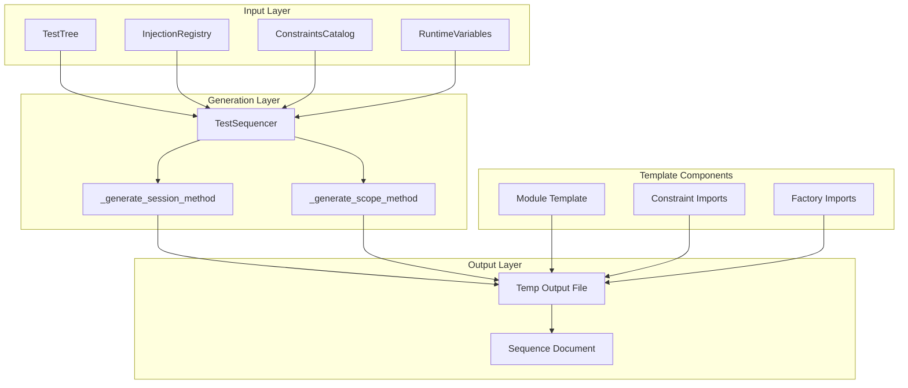
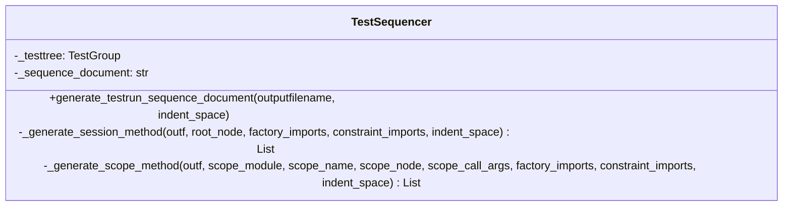
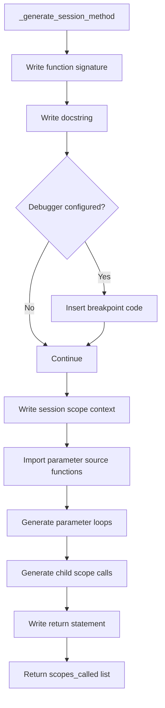
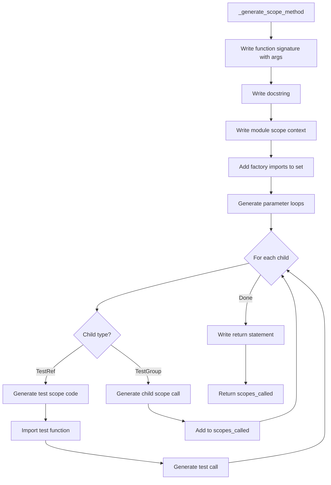
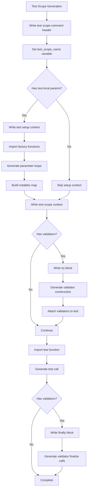
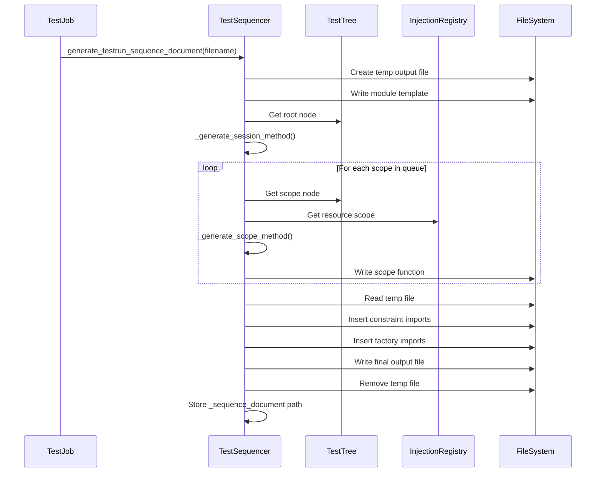
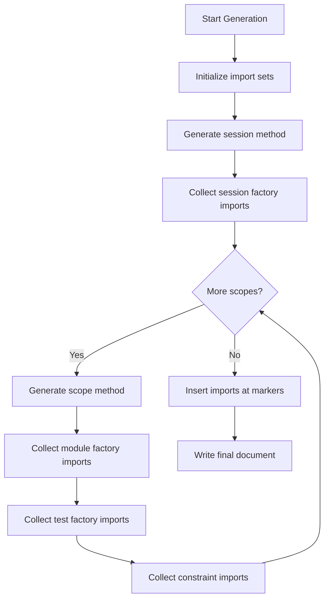
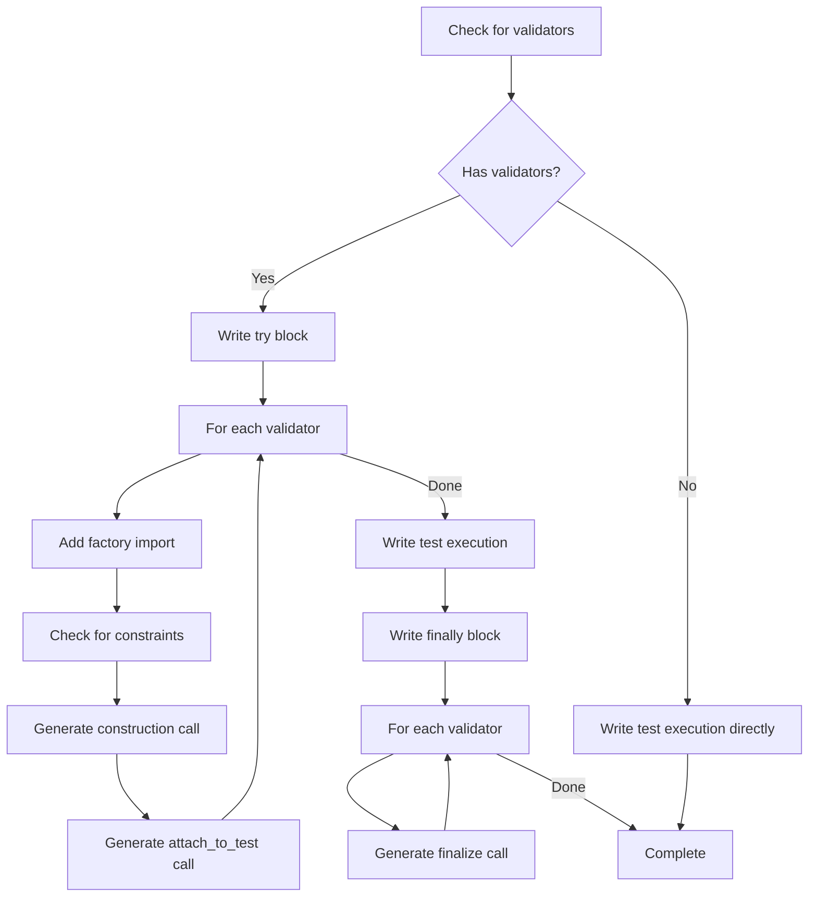

# Test Sequence Document Generation - Design Document

## Overview

The Test Sequence Document Generation system is responsible for creating executable Python modules that encode the test execution order, parameter provisioning, and scope management for TestBase test runs. These generated documents serve as the bridge between test discovery and test execution, providing a human-readable and debuggable representation of the test run structure.

The system is responsible for:

- Generating Python modules that define the test execution sequence
- Creating hierarchical scope functions that mirror the test tree structure
- Encoding parameter factory invocations for dependency injection
- Inserting constraint lookups for parameterized factories
- Supporting debugger breakpoint integration
- Producing reproducible and deterministic test execution flows

## Architecture

### High-Level Component Diagram



### Document Structure

A generated sequence document follows this structure:

```
┌─────────────────────────────────────────────┐
│ Module Header (docstring, imports)          │
├─────────────────────────────────────────────┤
│ Constraint Import Insertion Point           │
├─────────────────────────────────────────────┤
│ Factory Import Insertion Point              │
├─────────────────────────────────────────────┤
│ session(sequencer) function                 │
│   - Debugger breakpoint (optional)          │
│   - Session scope context                   │
│   - Session-level parameter loops           │
│   - Child scope function calls              │
├─────────────────────────────────────────────┤
│ scope_package_module(sequencer, ...) funcs  │
│   - Module scope context                    │
│   - Module-level parameter loops            │
│   - Test scope blocks or child scope calls  │
└─────────────────────────────────────────────┘
```

### Components

#### 1. TestSequencer (Generator Orchestrator)

The `TestSequencer` class contains the sequence document generation logic through its `generate_testrun_sequence_document` method.



**Key Responsibilities:**

| Responsibility | Description |
|----------------|-------------|
| Document Generation | Creates the complete sequence document file |
| Session Method Generation | Generates the entry point `session()` function |
| Scope Method Generation | Generates `scope_*()` functions for each module |
| Import Collection | Collects and inserts factory and constraint imports |
| Breakpoint Integration | Inserts debugger breakpoint code when configured |

#### 2. Module Template

The base template that forms the foundation of every sequence document:

```python
TEMPLATE_TESTRUN_SEQUENCE_MODULE = '''"""
    ======================================= CODE GENERATED - DO NOT EDIT =======================================
    This is a code generated execution sequence document, do not manually edit this document.  The 'testbase'
    test framework generates this document in order to layout the test run scopes, parameter creations, and
    test calls in a user ledgible way which is easy to read and also to debug.
"""

__traceback_format_policy__ = "Brief"

import logging

from automojo.xmodules.xlogging.enhancedloggers import getEnhancedLogger

from automojo.testbase.constraints import ConstraintsCatalog

logger = getEnhancedLogger()

constraints_catalog = ConstraintsCatalog()

# ------- INSERT CONSTRAINT IMPORTS HERE -------

# ------- INSERT FACTORY IMPORTS HERE -------

'''
```

**Template Components:**

| Component | Purpose |
|-----------|---------|
| Docstring | Identifies file as generated, warns against manual editing |
| `__traceback_format_policy__` | Controls traceback formatting for debugging |
| Logger | Provides logging capability within sequence document |
| `constraints_catalog` | Global catalog for constraint lookups |
| Insertion Points | Markers for dynamic import insertion |

#### 3. Session Method Generator

The `_generate_session_method` creates the entry point function for test execution.



**Generated Session Function Structure:**

```python
def session(sequencer):
    """
    This is the entry point for the test run sequence document.
    """
    # Optional: debugger breakpoint
    
    with sequencer.enter_session_scope_context() as ssc:
        
        # Import session-scoped parameter factories
        from package.factories import create_session_resource
        
        # Create session-scoped parameters
        for session_param in create_session_resource():
            scope_package_module(sequencer, session_param)
    
    return
```

#### 4. Scope Method Generator

The `_generate_scope_method` creates functions for each module in the test tree.



**Generated Scope Function Structure:**

```python
def scope_package_module(sequencer, session_param):
    """
    This is the entry point for the 'package.module' test scope.
    """
    
    with sequencer.enter_module_scope_context("package.module") as msc:
        
        # Module-scoped parameter creation
        for module_param in create_module_resource():
            
            # ================ Test Scope: test_function ================
            
            test_scope_name = "test_function"
            
            with sequencer.enter_test_setup_context(test_scope_name) as tsetup:
                # Test-local parameter creation
                for test_param in create_test_resource():
                    notables = { 'test_param': test_param, }
                    
                    with sequencer.enter_test_scope_context(test_scope_name, notables=notables) as tscope:
                        from package.module import test_function
                        test_function(session_param, module_param, test_param)
    
    return
```

#### 5. Test Scope Code Generator

Generates the code block for individual test execution within a scope method.



### Data Flow

#### Document Generation Flow



#### Import Collection Flow



### Design Patterns

#### 1. Two-Pass Generation Pattern

The document is generated in two passes to handle forward references:

```python
def generate_testrun_sequence_document(self, outputfilename, indent_space="    "):
    # Pass 1: Generate code with import placeholders
    with open(temp_outputfile, 'w') as sdf:
        sdf.write(TEMPLATE_TESTRUN_SEQUENCE_MODULE)
        scopes_called = self._generate_session_method(...)
        while len(scopes_called) > 0:
            # Generate scope methods, collect imports
            ...
    
    # Pass 2: Insert collected imports at placeholders
    with open(temp_outputfile, 'r') as tmpf:
        with open(outputfilename, 'w') as sdf:
            while True:
                nxtline = tmpf.readline()
                if nxtline.startswith(CONSTRAINT_IMPORT_INSERTION_POINT):
                    for cimp in constraint_imports:
                        sdf.write(cimp)
                elif nxtline.startswith(FACTORY_IMPORT_INSERTION_POINT):
                    for fimp in factory_imports:
                        sdf.write(fimp)
                else:
                    sdf.write(nxtline)
```

#### 2. Breadth-First Scope Traversal

Scope methods are generated using breadth-first traversal of the test tree:

```python
scopes_called = self._generate_session_method(...)

while len(scopes_called) > 0:
    scope_module, scope_name, scope_node, scope_call_args = scopes_called.pop(0)
    child_scopes_called = self._generate_scope_method(...)
    child_scopes_called.extend(scopes_called)
    scopes_called = child_scopes_called
```

#### 3. Code Builder Pattern

Method lines are accumulated in a list before being joined and written:

```python
method_lines: List[str] = [
    'def session(sequencer):',
    '{}"""'.format(current_indent),
    '{}This is the entry point...'.format(indent_space),
    '{}"""'.format(current_indent)
]

# Add more lines...
method_lines.append('{}with sequencer.enter_session_scope_context() as ssc:'.format(current_indent))

# Write all at once
method_content = os.linesep.join(method_lines)
outf.write(method_content)
```

#### 4. Visitor Pattern

The generation process visits each node in the test tree:

```python
for child_name in child_name_list:
    child_node = scope_node.children[child_name]
    
    if isinstance(child_node, TestRef):
        # Generate test execution code
        ...
    else:
        # Generate child scope call
        scopes_called.append((scope_module, scope_name, child_node, child_call_args))
```

### Parameter Handling

#### Parameter Origination Types

| Scope Level | Parameter Source | Loop Generation |
|-------------|------------------|-----------------|
| Session | Session-scoped factories | Outermost loops in session() |
| Module | Module-scoped factories | Loops in scope_*() functions |
| Test | Test-local factories | Loops in test setup context |

#### Constraint Integration

When a factory function accepts a `constraints` parameter:

```python
if 'constraints' in sp_parameter_names:
    constraints_key = porigin.constraints_key
    if constraints_key is not None:
        method_lines.append('{}constraints=constraints_catalog.lookup_constraints({})'.format(
            current_indent, repr(constraints_key)))
```

#### Notables Map Generation

For parameterized tests, notables track parameter values:

```python
notables_map_names = []
for param_name, param_obj in test_local_args:
    # Generate parameter loop
    notables_map_names.append(param_name)

notables_map = ", ".join(map(lambda arg: "'{}': {}".format(arg, arg), notables_map_names))
if len(notables_map_names) == 1:
    notables_map += ","  # Ensure dict syntax for single item
```

### Validator Integration

#### Validator Code Generation



**Generated Validator Code:**

```python
try:
    validator = create_validator(constraints=constraints_catalog.lookup_constraints('key'))
    validator.attach_to_test(tscope, 'suffix')
    
    from package.module import test_function
    test_function(param1, param2)

finally:
    validator.finalize()
```

## Integration Points

### With Test Tree

The generator traverses the test tree structure:

- `TestGroup` nodes become scope functions
- `TestRef` nodes become test execution blocks
- Tree hierarchy determines function call relationships

### With Injection Registry

The generator queries the injection registry for:

- Parameter originations at each scope level
- Factory function signatures
- Constraint keys for parameterized factories
- Validator originations for test scopes

```python
resource_scope = scope_node.get_resource_scope()
for pname, porigin in resource_scope.parameter_originations.items():
    # Generate parameter loop
    ...
```

### With Constraints Catalog

Constraints are looked up at runtime through the catalog:

```python
constraints_catalog = ConstraintsCatalog()

# In generated code:
constraints = constraints_catalog.lookup_constraints('constraint_key')
```

### With Debugger Integration

When debugger breakpoints are configured:

```python
debugger_name = RuntimeVariables.AM_DEBUG_DEBUGGER
configured_breakpoints = RuntimeVariables.AM_DEBUG_BREAKPOINTS

if debugger_name is not None and configured_breakpoints is not None:
    debugger_wellknown_breakpoint_code_append(
        debugger_name, 
        WELLKNOWN_BREAKPOINTS.TESTRUN_START, 
        method_lines, 
        current_indent, 
        configured_breakpoints
    )
```

## Configuration

### Generation Parameters

| Parameter | Type | Default | Description |
|-----------|------|---------|-------------|
| `outputfilename` | `str` | Required | Path for the generated document |
| `indent_space` | `str` | `"    "` | Indentation string (4 spaces) |

### Runtime Variables

| Variable | Purpose |
|----------|---------|
| `AM_DEBUG_DEBUGGER` | Debugger name for breakpoint generation |
| `AM_DEBUG_BREAKPOINTS` | List of configured breakpoint locations |

### Import Insertion Points

| Marker | Purpose |
|--------|---------|
| `# ------- INSERT CONSTRAINT IMPORTS HERE -------` | Location for constraint-related imports |
| `# ------- INSERT FACTORY IMPORTS HERE -------` | Location for factory function imports |

## Error Handling

### Generation Errors

| Error Condition | Handling |
|-----------------|----------|
| Missing constraint | `RuntimeError` with constraint key |
| Invalid tree structure | Propagated exception |
| File write failure | OS-level exception |

### Runtime Errors in Generated Code

The generated code includes error handling for:

- Missing constraints at lookup time
- Factory function failures
- Test function import failures

## Testing Strategy

### Unit Testing Focus Areas

1. **Session Method Generation**
   - Correct function signature
   - Proper scope context usage
   - Parameter loop generation
   - Child scope call generation

2. **Scope Method Generation**
   - Module scope context
   - Factory import collection
   - Test scope code generation
   - Nested parameter loops

3. **Import Collection**
   - Factory import deduplication
   - Constraint import collection
   - Correct insertion at markers

4. **Test Scope Code**
   - Test setup context generation
   - Notables map construction
   - Validator integration
   - Test function import and call

5. **Breakpoint Integration**
   - Conditional breakpoint insertion
   - Correct breakpoint location

### Test Categories

| Category | Focus |
|----------|-------|
| Structure | Generated code structure validity |
| Imports | Correct import statements |
| Parameters | Parameter loop correctness |
| Validators | Validator lifecycle code |
| Execution | Generated code executability |

### Integration Testing

1. **End-to-End Generation**
   - Generate document from real test tree
   - Verify document is valid Python
   - Execute generated document

2. **Parameter Variations**
   - Session-only parameters
   - Module-level parameters
   - Test-local parameters
   - Mixed parameter scopes

3. **Validator Scenarios**
   - Tests with validators
   - Tests without validators
   - Multiple validators per test

## Appendix

### Generated Document Example

```python
"""
    ======================================= CODE GENERATED - DO NOT EDIT =======================================
    This is a code generated execution sequence document...
"""

__traceback_format_policy__ = "Brief"

import logging

from automojo.xmodules.xlogging.enhancedloggers import getEnhancedLogger
from automojo.testbase.constraints import ConstraintsCatalog

logger = getEnhancedLogger()
constraints_catalog = ConstraintsCatalog()

from package.constraints import TestConstraints
from package.factories import create_session_resource
from package.factories import create_module_resource
from tests.factories import create_test_param

def session(sequencer):
    """
    This is the entry point for the test run sequence document.
    """
    
    with sequencer.enter_session_scope_context() as ssc:
        
        from package.factories import create_session_resource
        
        for session_resource in create_session_resource():
            scope_tests_unit_test_example(sequencer, session_resource)
    
    return

def scope_tests_unit_test_example(sequencer, session_resource):
    """
    This is the entry point for the 'tests.unit.test_example' test scope.
    """
    
    with sequencer.enter_module_scope_context("tests.unit.test_example") as msc:
        for module_resource in create_module_resource():
            
            # ================ Test Scope: test_basic_functionality ================
            
            test_scope_name = "test_basic_functionality"
            
            with sequencer.enter_test_setup_context(test_scope_name) as tsetup:
                for test_param in create_test_param():
                    notables = { 'test_param': test_param, }
                    
                    with sequencer.enter_test_scope_context(test_scope_name, notables=notables) as tscope:
                        from tests.unit.test_example import test_basic_functionality
                        test_basic_functionality(session_resource, module_resource, test_param)
    
    return
```

### File Locations

| Component | File Path |
|-----------|-----------|
| TestSequencer | `sequencing/testsequencer.py` |
| Module Template | `sequencing/testsequencer.py` (TEMPLATE_TESTRUN_SEQUENCE_MODULE) |
| Constraints Catalog | `constraints.py` |
| Injection Registry | `injection/injectionregistry.py` |

### Related Specifications

- [Test Execution Engine](../execution/design.md) - Orchestrates document generation and execution
- [Sequencer Scopes](../sequencer/design.md) - Scope context managers used in generated code
- [Dependency Injection](../dependencies/design.md) - Parameter origination system
- [Constraints System](../constraints/design.md) - Constraint catalog and lookups
