# Sequencer Scopes - Design Document

## Overview

The Sequencer Scopes system provides hierarchical execution context management for the TestBase framework. It defines a set of scope context managers that control the lifecycle of test execution at different granularity levels: session, module, test setup, and individual test.

The system is responsible for:

- Managing hierarchical scope contexts during test execution
- Tracking scope identity through a scope stack mechanism
- Coordinating result recording at each scope level
- Handling exceptions and propagating failure states to descendant tests
- Supporting activity tracking within test scopes
- Enabling debuggable, reproducible test execution flows

## Architecture

### High-Level Component Diagram

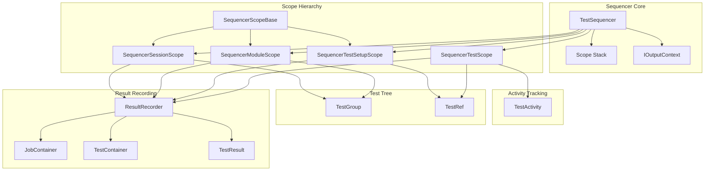

### Scope Hierarchy

The scope system implements a strict hierarchical nesting model:

```
Session Scope (root - one per test run)
├── Module Scope (package.module - one per test module)
│   ├── Test Setup Scope (setup:test_name - optional, for test-local parameters)
│   │   └── Test Scope (test_name - one per test execution)
│   ├── Test Setup Scope (setup:test_name_2)
│   │   └── Test Scope (test_name_2)
│   └── Test Scope (test_without_setup - direct test without setup)
└── Module Scope (package.module_2)
    └── ...
```

### Components

#### 1. SequencerScopeBase (Abstract Base)

The base class providing common functionality for all scope implementations.

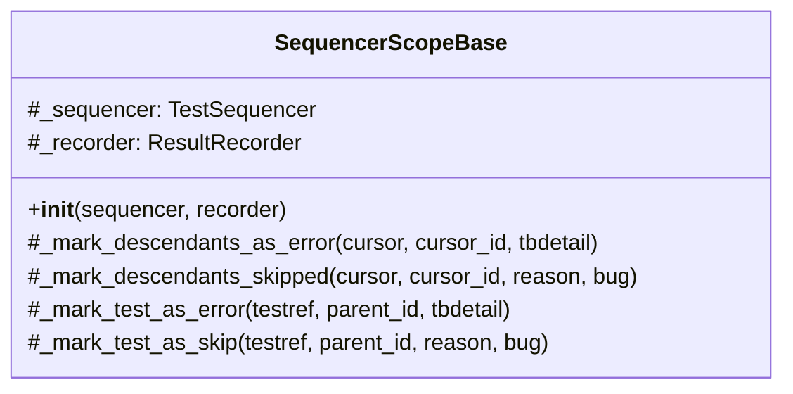

**Key Responsibilities:**

| Responsibility | Description |
|----------------|-------------|
| Error Propagation | Marks all descendant tests as errored when scope setup fails |
| Skip Propagation | Marks all descendant tests as skipped when scope is skipped |
| Result Creation | Creates result nodes for tests marked as error/skip |
| Tree Traversal | Recursively processes test tree for failure propagation |

#### 2. SequencerSessionScope (Root Scope)

The root-level scope that encompasses the entire test run session.

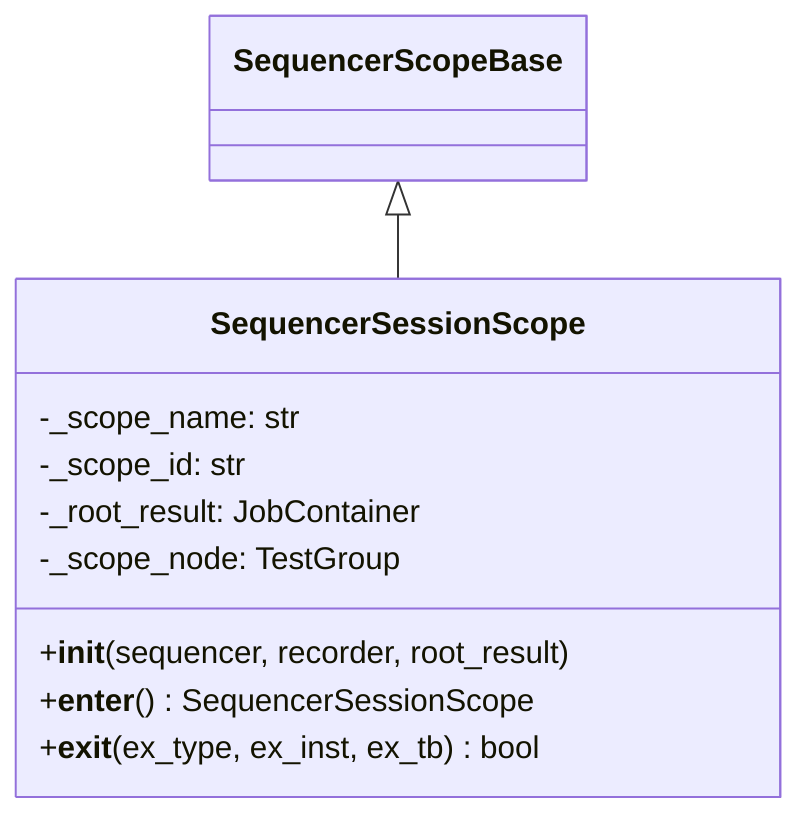

**Lifecycle:**

| Phase | Action |
|-------|--------|
| Enter | Push scope ID to stack, log session entry |
| Active | Execute child module scopes |
| Exit (success) | Finalize scope node, pop from stack |
| Exit (error) | Mark all descendants as error, finalize, pop |
| Exit (skip) | Mark all descendants as skipped, finalize, pop |

#### 3. SequencerModuleScope (Module-Level Scope)

Manages the execution context for a test module (Python module containing tests).

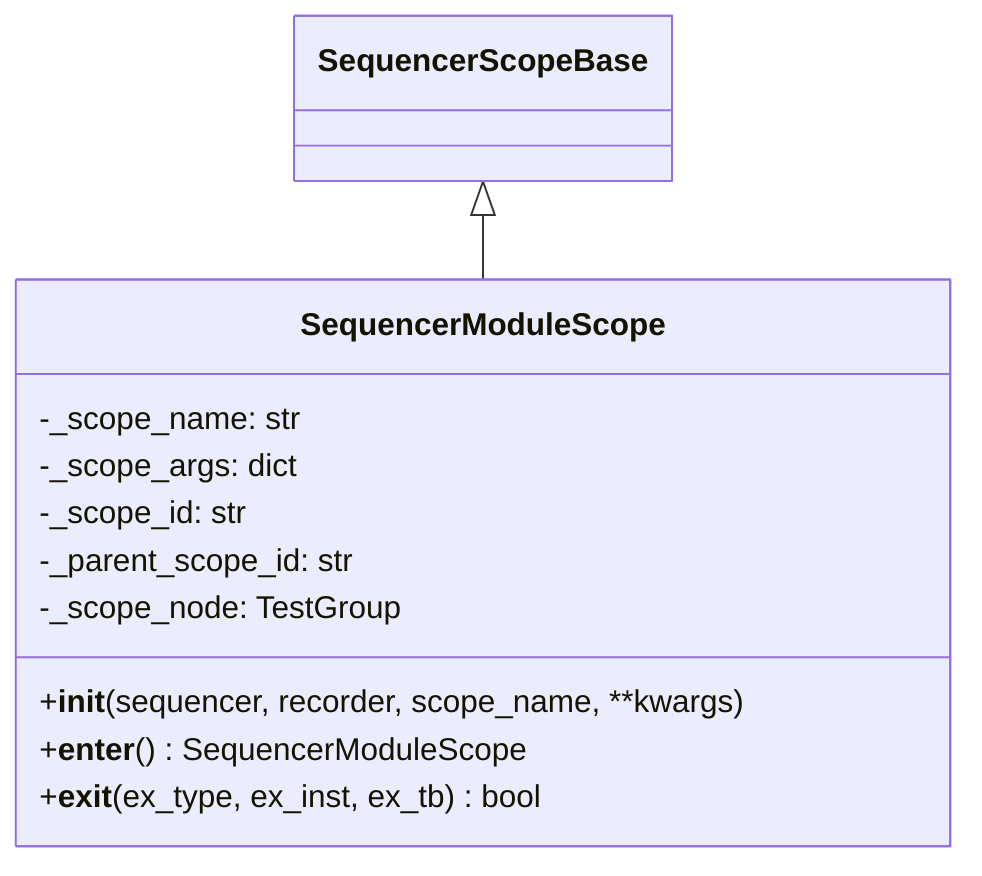

**Key Features:**

- Creates a new scope ID and links to parent scope
- Records a `TestContainer` result for the module
- Finds the corresponding `TestGroup` node in the test tree
- Propagates failures to all tests within the module

#### 4. SequencerTestSetupScope (Test Setup Scope)

Manages the setup phase for individual tests, particularly for test-local parameter creation.

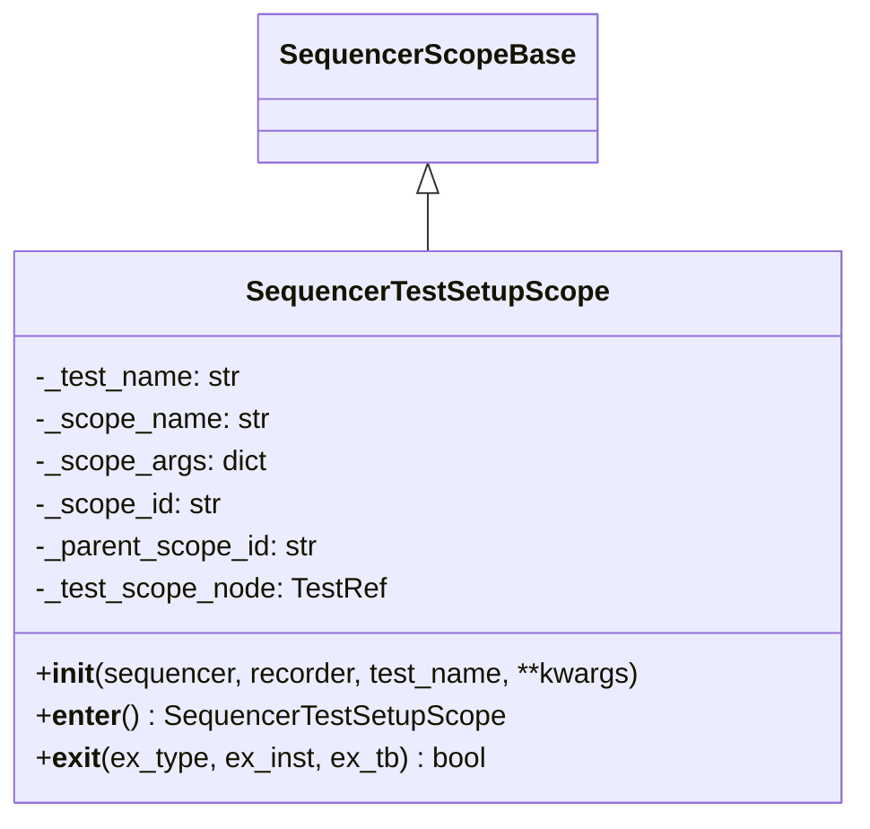

**Purpose:**

- Provides a scope for test-local parameter factory execution
- Isolates setup failures from test execution failures
- Enables proper error attribution when setup fails

#### 5. SequencerTestScope (Test Execution Scope)

Manages the execution of a single test function.

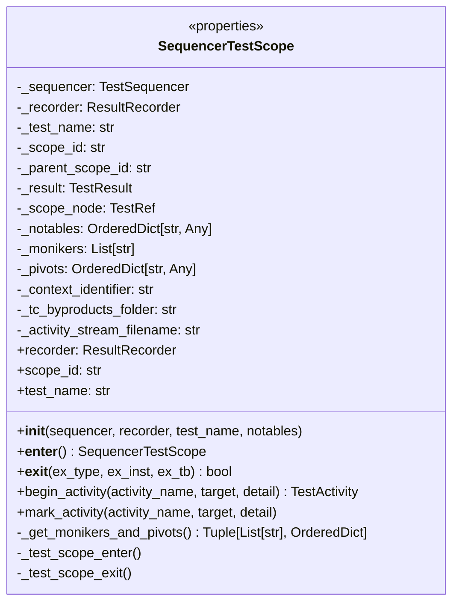

**Key Features:**

| Feature | Description |
|---------|-------------|
| Notables | Tracks parameterized test values for identification |
| Monikers | Human-readable identifiers for test instances |
| Pivots | Structured data for parameterized test values |
| Activity Tracking | Records test activities with timing information |
| Result Management | Creates, previews, and records test results |

**Exception Handling:**

| Exception Type | Result Status | Description |
|----------------|---------------|-------------|
| `SkipError` | SKIPPED | Test intentionally skipped |
| `AssertionError` | FAILED | Test assertion failed (product issue) |
| Other | ERRORED | Unexpected error (test/infrastructure issue) |

#### 6. TestActivity (Activity Tracker)

Records timing and context information for activities within a test.

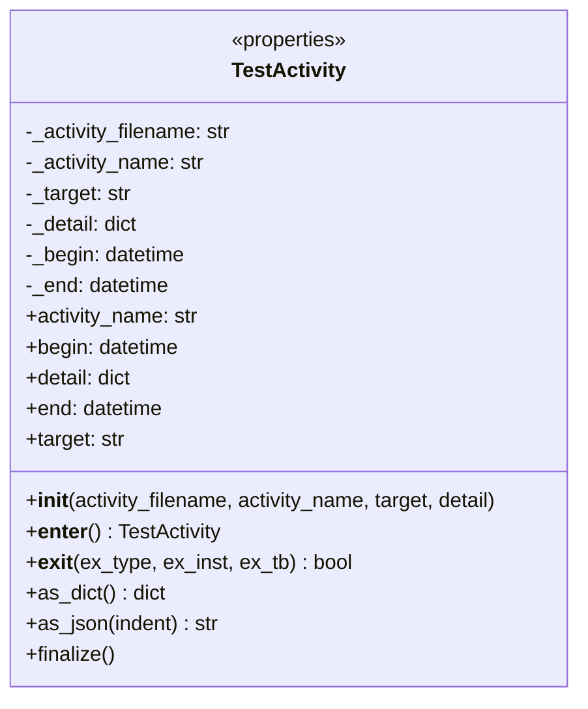

**Usage Patterns:**

```python
# Context manager usage
with test_scope.begin_activity("api_call", target="endpoint") as activity:
    response = make_api_call()

# Simple marker usage
test_scope.mark_activity("checkpoint", target="validation_complete")
```

### Data Flow

#### Scope Entry/Exit Flow

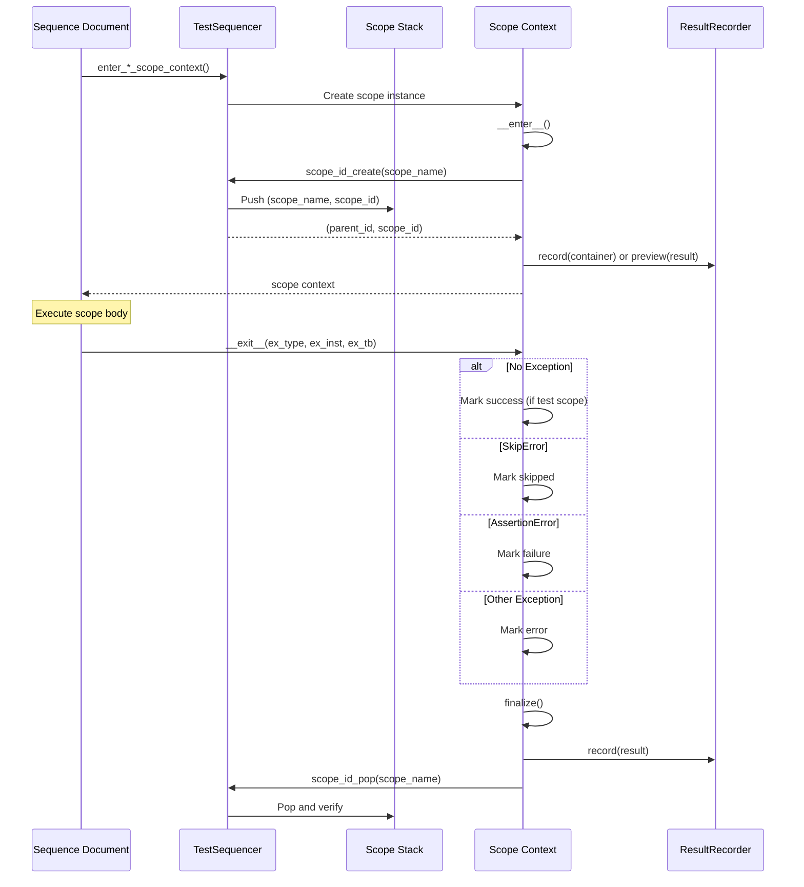

#### Failure Propagation Flow

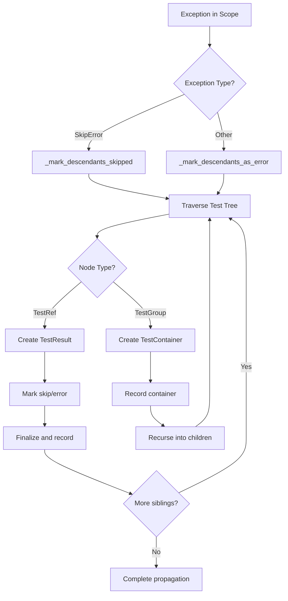

#### Activity Recording Flow

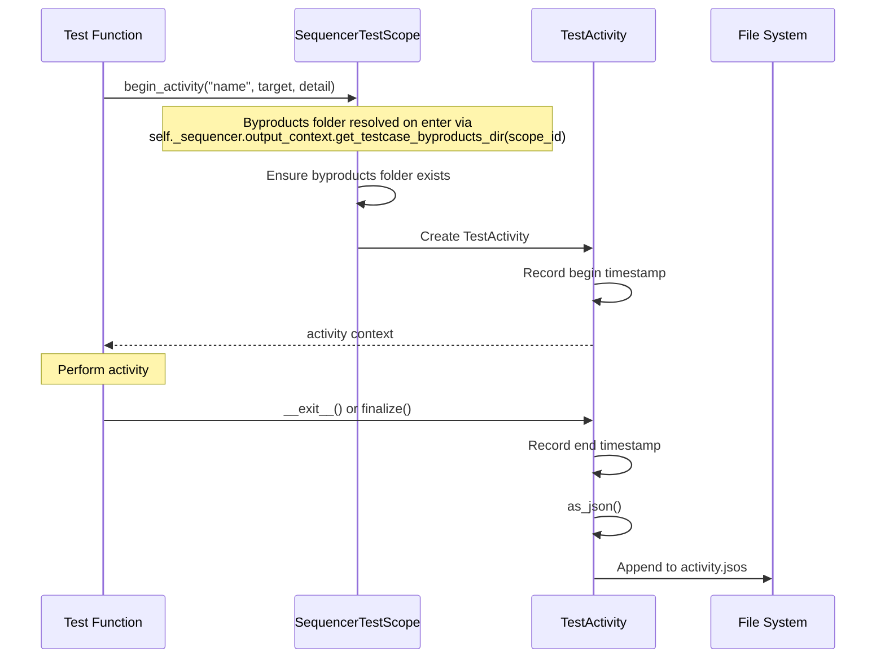

### Design Patterns

#### 1. Context Manager Pattern

All scope classes implement the context manager protocol for deterministic resource management:

```python
class SequencerModuleScope(SequencerScopeBase):
    def __enter__(self):
        self._parent_scope_id, self._scope_id = self._sequencer.scope_id_create(self._scope_name)
        result = self._sequencer.create_test_result_container(...)
        self._recorder.record(result)
        return self
    
    def __exit__(self, ex_type, ex_inst, ex_tb):
        handled = False
        if ex_type is not None:
            # Handle exception
            handled = True
        self._scope_node.finalize()
        self._sequencer.scope_id_pop(self._scope_name)
        return handled
```

#### 2. Template Method Pattern

The `SequencerTestScope` provides hook methods for customization:

```python
class SequencerTestScope:
    def __enter__(self):
        # ... setup ...
        self._test_scope_enter()  # Hook for subclasses
        return self
    
    def __exit__(self, ex_type, ex_inst, ex_tb):
        self._test_scope_exit()  # Hook for subclasses
        # ... cleanup ...
        return handled
    
    def _test_scope_enter(self):
        """Override in subclasses for custom enter behavior."""
        return
    
    def _test_scope_exit(self):
        """Override in subclasses for custom exit behavior."""
        return
```

#### 3. Composite Pattern

The test tree uses composite pattern with `TestGroup` (composite) and `TestRef` (leaf):

```python
def _mark_descendants_as_error(self, cursor, cursor_id, tbdetail):
    for chkey in cursor.children:
        child = cursor.children[chkey]
        if not child.finalized:
            if isinstance(child, TestRef):
                self._mark_test_as_error(child, cursor_id, tbdetail)
            elif isinstance(child, TestGroup):
                # Create container and recurse
                scope_id = str(uuid.uuid4())
                result = self._sequencer.create_test_result_container(...)
                self._recorder.record(result)
                self._mark_descendants_as_error(child, scope_id, tbdetail)
```

#### 4. Stack-Based State Management

The scope stack maintains execution context hierarchy:

```python
class TestSequencer:
    def scope_id_create(self, scope_name: str) -> Tuple[str, str]:
        parent_id = None
        if len(self._scope_stack) > 0:
            parent_id = self._scope_stack[-1][1]
        scope_id = str(uuid.uuid4())
        self._scope_stack.append((scope_name, scope_id))
        return parent_id, scope_id
    
    def scope_id_pop(self, scope_name: str):
        top_entry_name, _ = self._scope_stack.pop()
        if top_entry_name != scope_name:
            raise RuntimeError(f"Scope mismatch: expected {scope_name}, got {top_entry_name}")
```

### Scope Stack Management

The scope stack is a critical data structure that maintains the execution context hierarchy:

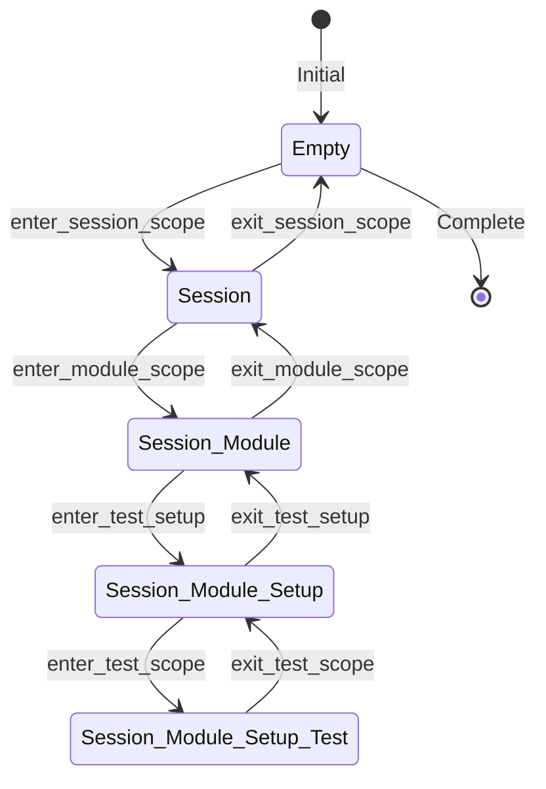

**Stack Operations:**

| Operation | Method | Effect |
|-----------|--------|--------|
| Create & Push | `scope_id_create()` | Generate UUID, push (name, id) tuple |
| Push Only | `scope_id_push()` | Push existing (name, id) tuple |
| Pop | `scope_id_pop()` | Remove top entry, verify name match |
| Get Top | `get_top_scope_id()` | Return ID of current scope |
| Find Test | `find_test_scope()` | Search stack for SequencerTestScope |


## Integration Points

### With the Output Context (IOutputContext)

The `TestSequencer` resolves all run artefact locations through an injected `IOutputContext`
seam rather than the well-known-path helpers (`get_path_for_*`), `RuntimeVariables`, or
`ThisApplicationSingleton`. The context is supplied via the `output_context` constructor
parameter (defaulting to `SimpleOutputContext`, which roots artefacts under a single base
directory) and exposed as the `output_context` property.

| Resolved Path | Method |
|---------------|--------|
| Test results directory | `output_context.get_test_results_dir()` |
| Diagnostics directory (per label) | `output_context.get_diagnostics_dir(label)` |
| Per-testcase by-products directory | `output_context.get_testcase_byproducts_dir(scope_id)` |

`SequencerTestScope` reaches the by-products path through `self._sequencer.output_context`
during `__enter__`, then derives the `activity.jsos` stream filename from it. The rich
integration variants (presence-folder paths, `RuntimeVariables`-sourced metadata) are
supplied by binding a different `IOutputContext` implementation (e.g. `RuntimeOutputContext`)
in `codecraftai-integration-runtime`; the sequencer core itself stays dependency-free.

`AM_DIAGNOSTICS_PRERUN` / `AM_DIAGNOSTICS_POSTRUN` gating is read through the dependency-free
`ccai.testbase.environment` module (`environment.diagnostics_prerun_enabled()` /
`environment.diagnostics_postrun_enabled()`) rather than `RuntimeVariables`.

### With TestSequencer

The scope system is tightly integrated with the `TestSequencer`:

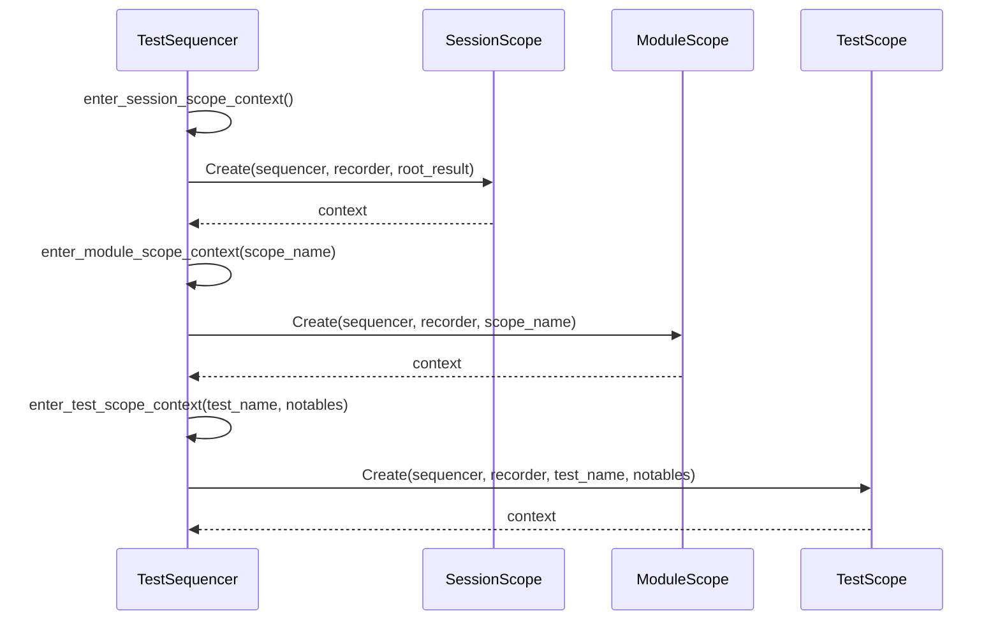

**Factory Methods on TestSequencer:**

| Method | Returns | Purpose |
|--------|---------|---------|
| `enter_session_scope_context()` | `SequencerSessionScope` | Create root session scope |
| `enter_module_scope_context(name)` | `SequencerModuleScope` | Create module-level scope |
| `enter_test_setup_context(name)` | `SequencerTestSetupScope` | Create test setup scope |
| `enter_test_scope_context(name, notables)` | `SequencerTestScope` | Create test execution scope |

### With Result Recording System

Each scope interacts with the `ResultRecorder` to persist execution results:

| Scope | Result Type | Recording Method |
|-------|-------------|------------------|
| Session | `JobContainer` | Pre-created, passed to scope |
| Module | `TestContainer` | `record()` on enter |
| Test Setup | None | No direct recording |
| Test | `TestResult` | `preview()` on enter, `record()` on exit |

### With Test Tree

Scopes reference nodes in the test tree for:

- Finding the corresponding `TestGroup` or `TestRef` node
- Marking nodes as finalized after execution
- Propagating failures to descendant nodes

```python
# Finding tree node
self._scope_node = self._sequencer.find_treenode_for_scope(scope_name)

# Marking as finalized
self._scope_node.finalize()
```

### With Dependency Injection

The scope system works with the injection system through:

- Parameter originations that define factory functions
- Constraints passed to factory functions
- Validators attached to test scopes

## Configuration

### Scope Naming Conventions

| Scope Type | Name Format | Example |
|------------|-------------|---------|
| Session | `<session>` | `<session>` |
| Module | `package.module` | `tests.unit.test_auth` |
| Test Setup | `setup:test_name` | `setup:test_login_success` |
| Test | `test_name:moniker1,moniker2` | `test_login:admin,valid_creds` |

### Activity File Format

Activities are recorded in JSOS (JSON Separated Object Stream) format:

```json
{
    "activity-name": "api_call",
    "detail": {"endpoint": "/api/users", "method": "GET"},
    "target": "user_service",
    "begin": "2025-01-15T10:30:00.123456",
    "end": "2025-01-15T10:30:01.456789"
}
```

### Byproducts Directory Structure

The per-testcase by-products directory is resolved through the injected `IOutputContext`
(`output_context.get_testcase_byproducts_dir(scope_id)`), not through `RuntimeVariables`,
`get_path_for_*`, or `ThisApplicationSingleton`. The exact layout depends on the bound
context. The default `SimpleOutputContext` roots by-products under one base directory:

```
<base_dir>/
└── testcase_byproducts/
    └── <scope_id>/
        └── activity.jsos
```

## Error Handling

### Exception Classification

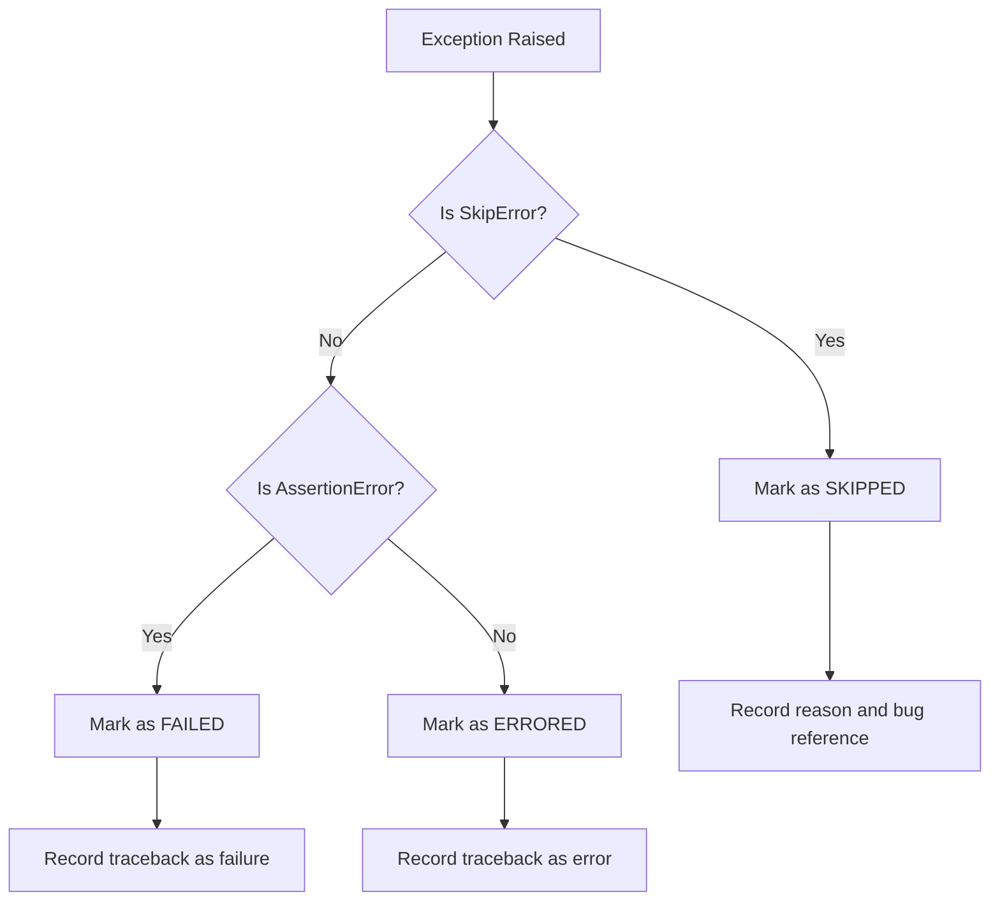

### Traceback Handling

The system uses `TracebackDetail` for structured exception information:

```python
from ccai.errors.xtraceback import create_traceback_detail, format_traceback_detail

tb_detail = create_traceback_detail(ex_inst)
errmsg_lines = format_traceback_detail(tb_detail)
```

### Scope-Level Error Handling

| Scope | Error Behavior |
|-------|----------------|
| Session | Mark all tests as error, log, suppress exception |
| Module | Mark module tests as error, log, suppress exception |
| Test Setup | Mark single test as error, log, suppress exception |
| Test | Mark test result appropriately, log, suppress exception |

### Scope Name Verification

The scope stack enforces proper nesting through name verification on pop:

```python
def scope_id_pop(self, scope_name: str):
    top_entry_name, _ = self._scope_stack.pop()
    if top_entry_name != scope_name:
        errmsg = f"Attempting to pop '{scope_name}' but encountered '{top_entry_name}'."
        raise RuntimeError(errmsg)
```

## Testing Strategy

### Unit Testing Focus Areas

1. **SequencerScopeBase**
   - Descendant marking for errors
   - Descendant marking for skips
   - Tree traversal correctness
   - Result creation for marked tests

2. **SequencerSessionScope**
   - Context manager protocol
   - Scope ID push/pop
   - Exception handling (skip, error)
   - Root result association

3. **SequencerModuleScope**
   - Container result creation
   - Parent scope ID linkage
   - Tree node lookup
   - Exception propagation

4. **SequencerTestSetupScope**
   - Setup scope naming
   - Single test error marking
   - Scope finalization

5. **SequencerTestScope**
   - Moniker and pivot extraction
   - Activity tracking
   - Result status determination
   - Preview and record sequencing

6. **TestActivity**
   - Timing capture accuracy
   - JSON serialization
   - File append behavior
   - Context manager support

### Test Categories

| Category | Components | Focus |
|----------|------------|-------|
| Lifecycle | All scopes | Enter/exit ordering, state management |
| Error Handling | All scopes | Exception classification, propagation |
| Result Recording | All scopes | Correct result types, timing |
| Stack Management | TestSequencer | Push/pop correctness, verification |
| Activity Tracking | TestScope, TestActivity | Timing, serialization |

### Integration Testing

1. **Nested Scope Execution**
   - Proper nesting of session → module → setup → test
   - Correct parent-child relationships in results
   - Stack integrity throughout execution

2. **Failure Propagation**
   - Module-level failure marks all tests
   - Setup failure marks single test
   - Session failure marks entire run

3. **Parameterized Tests**
   - Correct moniker generation
   - Pivot data preservation
   - Multiple instances of same test

## Appendix

### Class Hierarchy

```
SequencerScopeBase
├── SequencerSessionScope
├── SequencerModuleScope
└── SequencerTestSetupScope

SequencerTestScope (standalone, not derived from base)

TestActivity (standalone)
```

### File Locations

| Component | File Path |
|-----------|-----------|
| SequencerScopeBase | `sequencing/sequencerscopebase.py` |
| SequencerSessionScope | `sequencing/sequencersessionscope.py` |
| SequencerModuleScope | `sequencing/sequencermodulescope.py` |
| SequencerTestSetupScope | `sequencing/sequencertestsetupscope.py` |
| SequencerTestScope | `sequencing/sequencertestscope.py` |
| TestActivity | `sequencing/testactivity.py` |
| TestSequencer | `sequencing/testsequencer.py` |

### Related Specifications

- [Test Execution Engine](../execution/design.md) - High-level orchestration
- [Result Recording](../results/design.md) - Result persistence
- [Dependency Injection](../dependencies/design.md) - Parameter provisioning
- [Test Declaration](../declaration/design.md) - Test registration
