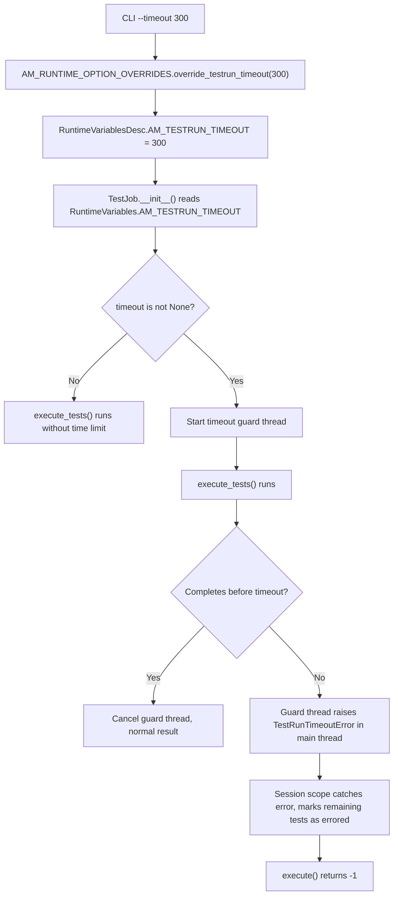
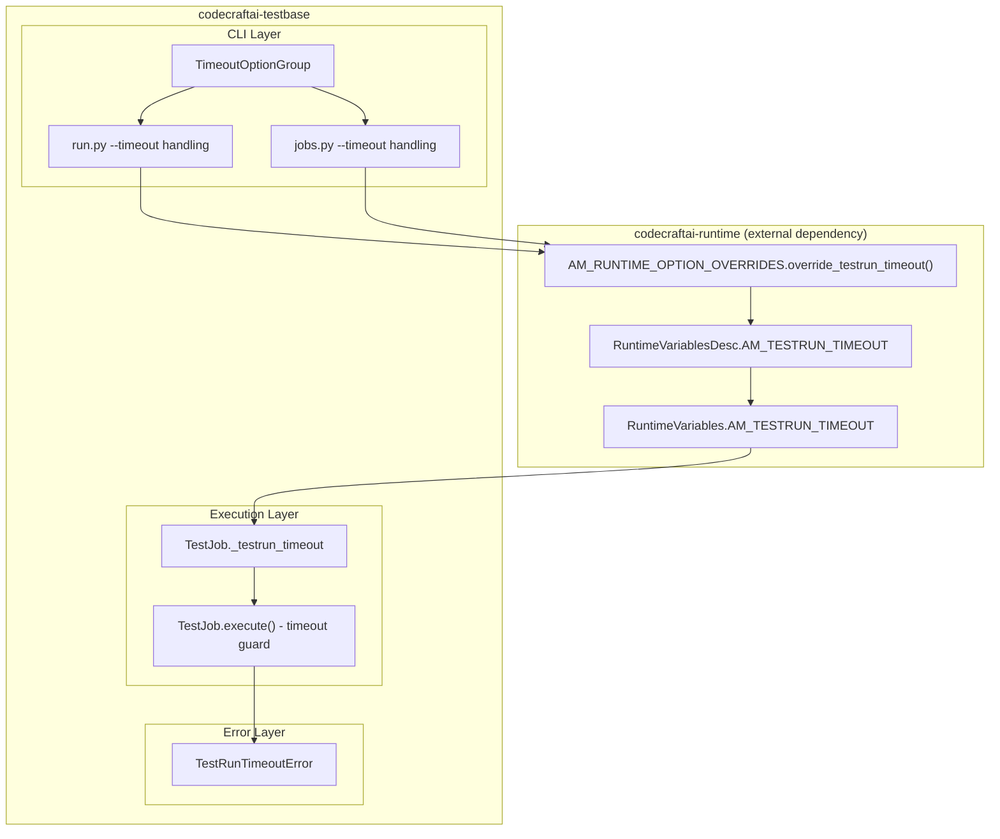

# Test Run Timeout - Design Document

## Overview

The Test Run Timeout feature adds the ability to enforce a maximum duration for the test execution phase of a `TestJob`. It follows the established runtime variable → CLI option → override → TestJob consumption pattern. The timeout is implemented using a daemon thread that monitors elapsed time and interrupts the main thread via `ctypes` when exceeded.

## Architecture

### Data Flow



### Component Overview



## Detailed Design

### 1. TestRunTimeoutError (`errors/testruntimeouterror.py`)

A new exception class for signaling timeout events:

```python
class TestRunTimeoutError(Exception):
    def __init__(self, timeout_seconds: int):
        self._timeout_seconds = timeout_seconds
        super().__init__(
            "Test run exceeded the configured timeout of %d seconds." % timeout_seconds
        )

    @property
    def timeout_seconds(self) -> int:
        return self._timeout_seconds
```

### 2. Runtime Variable Additions (`codecraftai-runtime`)

Add `AM_TESTRUN_TIMEOUT` to the existing runtime variable infrastructure:

- **`RuntimeVariablesDesc`**: `AM_TESTRUN_TIMEOUT = AppVarDesc(default=None)`
- **`RuntimeVariables`**: `AM_TESTRUN_TIMEOUT = AppVarAccessor(RuntimeVariablesDesc.AM_TESTRUN_TIMEOUT)`
- **`AM_RUNTIME_OPTION_OVERRIDES`**: `override_testrun_timeout(timeout: int)` static method

### 3. CLI Option Group (`cli/options.py`)

A new `TimeoutOptionGroup`:

```python
class TimeoutOptionGroup(OptionGroup):
    name = "timeout"
    timeout = OptionField("--timeout", default=None, required=False, help=HELP_TIMEOUT)
```

### 4. TestJob Timeout Enforcement (`testjob.py`)

The timeout is enforced using a `threading.Timer` daemon thread:

```python
def execute(self) -> int:
    # ... existing discovery, integration, setup code ...

    if self._testrun_timeout is not None:
        timer = threading.Timer(self._testrun_timeout, self._raise_timeout)
        timer.daemon = True
        timer.start()

    try:
        tseq.execute_tests(runid, recorder)
    except TestRunTimeoutError:
        self._logger.error("Test run timed out after %d seconds." % self._testrun_timeout)
        result_code = -1
    finally:
        if timer is not None:
            timer.cancel()
```

The timeout interruption uses `ctypes.pythonapi.PyThreadState_SetAsyncExc` to raise the `TestRunTimeoutError` in the main thread, which is the standard CPython mechanism for thread interruption.

### 5. Session Scope Handling

The `SequencerSessionScope.__exit__` already handles unexpected exceptions by marking all descendants as errored. When a `TestRunTimeoutError` propagates, this existing mechanism will mark any remaining unexecuted tests as errored, which satisfies Requirement 3.5.

## Integration Points

### With Existing Option Override Pattern

The timeout follows the exact same pattern as `--job-seed`:
1. CLI option defined in `TimeoutOptionGroup`
2. `run.py` calls `AM_RUNTIME_OPTION_OVERRIDES.override_testrun_timeout(timeout)`
3. `TestJob.__init__` reads `RuntimeVariables.AM_TESTRUN_TIMEOUT`

### With Session Scope Error Handling

The `TestRunTimeoutError` will be raised inside the `SequencerSessionScope` context manager during `execute_tests()`. The existing `__exit__` handler in `SequencerSessionScope` will catch this exception and call `_mark_descendants_as_error()`, which marks all unfinished tests as errored.

## Configuration

| Setting | CLI Option | Default | Description |
|---------|-----------|---------|-------------|
| `AM_TESTRUN_TIMEOUT` | `--timeout` | `None` | Max test run duration in seconds |

## Error Handling

| Scenario | Behavior |
|----------|----------|
| No timeout configured | No timeout monitoring, identical to current behavior |
| Timeout exceeded | `TestRunTimeoutError` raised → remaining tests marked errored → result code -1 |
| Tests complete before timeout | Timer cancelled, normal result processing |

## File Locations

| Component | File Path |
|-----------|-----------|
| `TestRunTimeoutError` | `testbase/errors/testruntimeouterror.py` |
| `TimeoutOptionGroup` | `testbase/cli/options.py` |
| CLI integration (run) | `testbase/cli/cmdtree/testing/run.py` |
| CLI integration (jobs run) | `testbase/cli/cmdtree/testing/jobs.py` |
| `TestJob` timeout logic | `testbase/testjob.py` |
| Runtime variable/override | `codecraftai-runtime` (external) |

## Testing Strategy

### Unit Testing

1. **TestRunTimeoutError** - Exception creation, message, property access
2. **TestJob timeout init** - Reading `AM_TESTRUN_TIMEOUT`, default `None`
3. **TestJob timeout enforcement** - Timeout triggers error, no timeout runs normally
4. **CLI option parsing** - `--timeout` option accepted and overridden

### Integration Testing

1. End-to-end: `testbase testing run --timeout 5` with long-running tests
