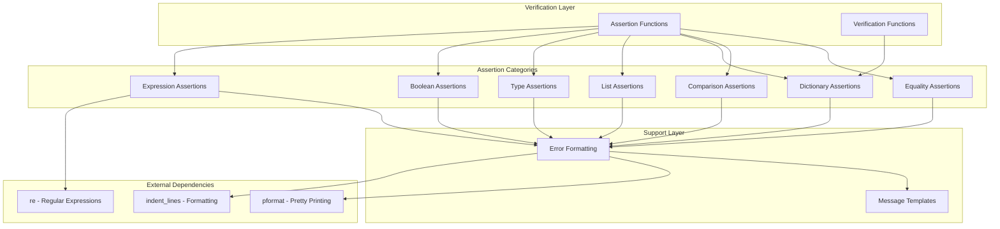
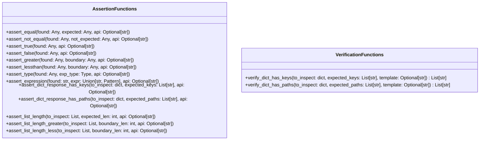
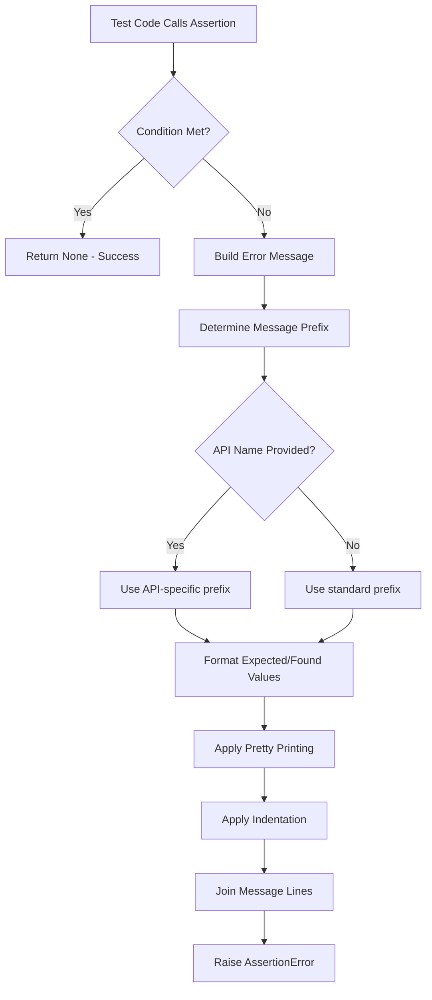
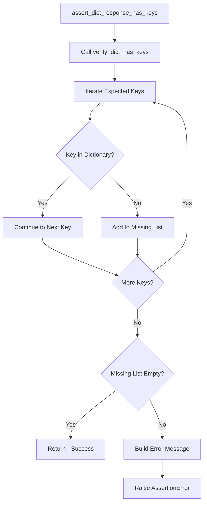

# Test Verification/Assertions - Design Document

## Overview

The Test Verification/Assertions system provides a comprehensive set of assertion functions for validating test outcomes in the TestBase framework. Unlike traditional assertion libraries that simply raise exceptions on failure, this system is designed with debuggability as a primary concern, providing detailed, well-formatted error messages that clearly communicate what was expected versus what was found.

The verification module serves as the primary mechanism for test authors to validate API responses, data structures, and computed values during test execution.

## Architecture

### High-Level Component Diagram



### Components

#### 1. Assertion Functions

Assertion functions are the primary interface for test authors. They validate conditions and raise `AssertionError` with detailed messages on failure.

| Function | Category | Purpose |
|----------|----------|---------|
| `assert_equal` | Equality | Verifies two values are equal |
| `assert_not_equal` | Equality | Verifies two values are not equal |
| `assert_true` | Boolean | Verifies a value evaluates to True |
| `assert_false` | Boolean | Verifies a value evaluates to False |
| `assert_greater` | Comparison | Verifies a value is greater than a boundary |
| `assert_lessthan` | Comparison | Verifies a value is less than a boundary |
| `assert_type` | Type | Verifies a value has the expected type |
| `assert_expression` | Expression | Verifies a string matches a regex pattern |
| `assert_dict_response_has_keys` | Dictionary | Verifies a dictionary contains expected keys |
| `assert_dict_response_has_paths` | Dictionary | Verifies a dictionary contains expected paths |
| `assert_list_length` | List | Verifies a list has exact expected length |
| `assert_list_length_greater` | List | Verifies a list length exceeds a boundary |
| `assert_list_length_less` | List | Verifies a list length is below a boundary |

#### 2. Verification Functions

Verification functions perform checks without raising exceptions, returning results for further processing.

| Function | Purpose |
|----------|---------|
| `verify_dict_has_keys` | Returns list of missing keys from a dictionary |
| `verify_dict_has_paths` | Returns list of missing paths from a nested dictionary |

### Function Signatures



### Data Flow

#### Assertion Execution Flow



#### Dictionary Verification Flow



### Design Patterns

#### 1. Template Method Pattern

All assertion functions follow a consistent template:

1. Evaluate the condition
2. If condition fails, build error message with consistent formatting
3. Raise `AssertionError` with the formatted message

```python
def assert_<condition>(found: Any, expected: Any, api: Optional[str] = None):
    if not <condition_check>:
        msg_prefix = PREFIX_STD if api is None else PREFIX_API.format(api)
        err_msg_lines = [
            "{} verification failed...".format(msg_prefix)
        ]
        # Format values
        # Build message
        errmsg = os.linesep.join(err_msg_lines)
        raise AssertionError(errmsg)
    return
```

#### 2. Strategy Pattern

The `api` parameter allows customization of error message prefixes:

| Prefix Type | Format | Use Case |
|-------------|--------|----------|
| Standard | `"Result"` | General assertions |
| API-specific | `"'{api}' API result"` | API response validation |

#### 3. Decorator Pattern (Traceback Policy)

The module uses `__traceback_format_policy__` to control traceback display:

```python
__traceback_format_policy__ = TracebackFormatPolicy.Hide
```

This hides the verification module from tracebacks, making error messages cleaner and focusing attention on the test code.

## Integration Points

### With Test Execution Engine

- Assertion functions are called during test execution
- `AssertionError` exceptions are caught and recorded as test failures
- Error messages are captured for reporting

### With Result Recording System

- Assertion failure messages are stored in test results
- The detailed formatting aids in debugging and reporting

### With Traceback Formatting

- The `TracebackFormatPolicy.Hide` setting removes verification module frames from tracebacks
- This improves readability by showing only relevant test code in stack traces

## Configuration

### Message Prefixes

| Constant | Value | Purpose |
|----------|-------|---------|
| `PREFIX_STD` | `"Result"` | Default prefix for assertions |
| `PREFIX_API` | `"'{api}' API result"` | Template for API-specific assertions |

### Traceback Policy

The module sets `__traceback_format_policy__ = TracebackFormatPolicy.Hide` to exclude verification functions from exception tracebacks.

## Error Message Formatting

### Message Structure

All assertion error messages follow a consistent structure:

```
{prefix} verification failed {reason}:
{label}: {value}
...
```

### Value Formatting Rules

1. **Single-line values**: Displayed inline with label
   ```
   EXPECTED: value
   ```

2. **Multi-line values**: Displayed on subsequent lines with indentation
   ```
   EXPECTED:
       line1
       line2
   ```

### Example Error Messages

#### Equality Assertion Failure
```
'MyAPI' API result verification failed because the found value did not match expected value:
EXPECTED: {'key': 'expected_value'}
FOUND: {'key': 'actual_value'}
```

#### List Length Failure
```
Result verification failed because the actual length (3) did not match expected length (2):
ITEMS:
    item1
    item2
    item3
```

#### Dictionary Key Failure
```
'GetUser' API result verification failed with the following errors:
    'email' key not found.
    'phone' key not found.
```

## Error Handling

### AssertionError

All assertion functions raise `AssertionError` on failure with:

- Descriptive message explaining the failure
- Expected value (when applicable)
- Found/actual value
- Context about which API produced the result (when provided)

### Return Behavior

- On success: All assertion functions return `None`
- On failure: `AssertionError` is raised (never returns)

## Testing Strategy

### Unit Testing Focus Areas

1. **Success Cases**
   - Verify assertions pass when conditions are met
   - Verify return value is `None` on success

2. **Failure Cases**
   - Verify `AssertionError` is raised when conditions fail
   - Verify error message contains expected information
   - Verify API name appears in message when provided

3. **Edge Cases**
   - Empty collections
   - None values
   - Complex nested structures
   - Unicode and special characters

4. **Message Formatting**
   - Single-line vs multi-line value formatting
   - Proper indentation
   - Prefix selection based on API parameter

### Test Categories

| Category | Functions | Focus |
|----------|-----------|-------|
| Equality | `assert_equal`, `assert_not_equal` | Value comparison |
| Boolean | `assert_true`, `assert_false` | Truthiness evaluation |
| Comparison | `assert_greater`, `assert_lessthan` | Boundary checking |
| Type | `assert_type` | Type validation |
| Expression | `assert_expression` | Regex matching |
| Dictionary | `assert_dict_*`, `verify_dict_*` | Key/path presence |
| List | `assert_list_length*` | Collection size |

## Known Issues

### verify_dict_has_paths Implementation

The `verify_dict_has_paths` function and its helper `_verify_dict_has_paths_descend` have incomplete implementations:

```python
def verify_dict_has_paths(to_inspect: dict, expected_paths: List[str], template: Optional[str]=None) -> List[str]:
    missing_list = []
    for next_exp_path in expected_paths:
        next_exp_path = next_exp_path.strip("/")
        leaf_parts = []  # Not used - incomplete implementation
    return missing_list
```

The function currently returns an empty list regardless of input, as the path traversal logic is not connected.

## Future Enhancements

### Potential Additions

1. **Soft Assertions**: Collect multiple failures before raising
2. **Custom Comparators**: Support for custom equality functions
3. **Assertion Chaining**: Fluent API for multiple assertions
4. **Detailed Diff Output**: Show differences for complex structures
5. **Complete Path Verification**: Fix `verify_dict_has_paths` implementation
