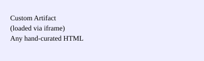

Test Result Encoding and Report Rendering
=========================================

Audience
--------

QA engineers and developers maintaining ``automojo.testbase``.

1. Results Folder Layout
------------------------

A typical ``result-tests`` run (``example3``) contains::

   catalog.json
   landscape-declared.json
   landscape-declared.yaml
   runtime-declared.yaml
   startup-configuration.json
   testrun_results.jsos
   testrun_sequence.py
   testrun_summary.json
   testsummary.html
   artifacts/
       catalog.json
       images/
       audio/
   taskings/
       catalog.json
       <task-name>-<uuid>/
           catalog.json
           task-summary.json
   tc-by-products/
       <uuid>/...

Key files:

* ``catalog.json`` – inventory of files/folders for quick navigation.  Rendering code requests this JSON to display file listings to report viewers.
* ``landscape-declared.{json,yaml}`` – test landscape description; YAML copy is for human readability.
* ``runtime-declared.yaml`` – runtime settings such as debugger, logging, and path templates.
* ``startup-configuration.json`` – command, environment, and loaded packages snapshot.
* ``testrun_results.jsos`` – streaming JSON object sequence representing the result tree.
* ``testrun_summary.json`` – high-level outcome, timing, and counts.
* ``taskings/<task>/task-summary.json`` – per-task status, progress, and metrics.
* ``artifacts/*`` – captured images, audio, or custom tabs grouped by catalog files.
* ``tc-by-products/*`` – test-case specific files such as logs or generated data.

2. Encoded vs. Pre-rendered Data
--------------------------------

Most output is *encoded* as JSON or YAML rather than emitted as pre-rendered text:

* **Lazy Rendering:** Web components decode data on demand, allowing dynamic filtering, sorting, and theming without re-running tests.
* **Lossless Post-Processing:** Raw structured data feeds log aggregation, analytics pipelines, or custom tooling without the need to reparse text logs.
* **Downstream Promotion:** Because every field is typed and timestamped, ETL jobs can lift data directly into data stores (e.g., time-series or relational analytics) with minimal transformation.
* **Human-Readable Configuration:** Configuration files intended for operators (landscape, runtime) are duplicated in YAML for readability, while the JavaScript consumer reads JSON equivalents when present.
* **Extensibility:** New metrics or fields can be added without altering textual renderers; components simply pick up additional properties.

3. Result Model Classes
-----------------------

The ``automojo.testbase.results.model`` package defines structures used in the JSON streams:

+-------------------+---------------------------------------+
| Class             | Purpose                               |
+===================+=======================================+
| ``BuildInfo``     | Release, branch, build, flavor, URL.  |
| ``PipelineInfo``  | Pipeline identifier and instance.     |
| ``JobInfo``       | Job metadata (owner, label, venue).   |
| ``JobContainer``  | Root node grouping run artifacts.     |
| ``TestContainer`` | Hierarchical grouping of test scopes. |
| ``TestResult``    | Individual test outcome and metrics.  |
| ``TaskingGroup``  | Collection of asynchronous tasks.     |
| ``TaskingResult`` | Result for a single task or workflow. |
| ``ResultContainer`` | Generic container linking nodes in the result tree. |
| ``ResultNode``    | Leaf node representing a concrete result item. |
| ``ResultCode``    | Enumeration of ``PASSED``, ``FAILED``, etc. |
| ``ResultType``    | Enumeration: ``JOB``, ``TEST_CONTAINER``, ``TEST``, ``TASK``… |
| ``ProgressInfo``  | Timestamped progress update events.   |
| ``ProgressCode`` / ``ProgressType`` | Status and range typing for progress bars. |
| ``RenderInfo``    | Hints for rendering specialized nodes.|
| ``ForwardingInfo``| Links to log brokers or external systems. |
+-------------------+---------------------------------------+

All classes implement ``as_dict`` or ``to_json`` helpers to produce the encoded form consumed by the renderer.

4. JSON/YAML Data Objects and Rendering Components
--------------------------------------------------

testrun_summary.json
~~~~~~~~~~~~~~~~~~~~

.. code-block:: json

   {
       "version": "2",
       "runid": "73c241cd-dc48-444d-b4a7-d3607820cb3e",
       "job": {
           "id": "36144095-5841-48f5-b713-422b9437eb67",
           "type": "testrun"
       },
       "start": "2025-01-19 13:20:26.191993",
       "stop": "2025-01-19 13:20:40.512256",
       "result": "FAILED",
       "detail": { "errors": 1, "failed": 1, "passed": 8, "total": 10 }
   }

Rendered by:

* ``<testsummary-banner>`` – header showing build and timing.
* ``<testsummary-resultdetail>`` – statistics and result breakdown.

testrun_results.jsos
~~~~~~~~~~~~~~~~~~~~

.. code-block:: json

   {
       "name": "<session>",
       "instance": "73c241cd-dc48-444d-b4a7-d3607820cb3e",
       "parent": null,
       "rtype": "JOB"
   }
   {
       "name": "automojo.tests.testbase.local.injection.test_constraints",
       "instance": "2957cb90-098d-4103-bf6f-5e3296acb7a9",
       "parent": "bf59c389-5d80-4c3a-854b-3d15dfe86ef8",
       "rtype": "TEST_CONTAINER"
   }
   … additional container and test result objects …

Rendered by:

* ``<testsummary-resultdetail>`` using ``TestSummaryResultGroup`` and ``TestSummaryResultItem`` subcomponents.
* Utilizes ``MojoCollapsible`` from ``mojo-components.js`` for expandable result groups.

runtime-declared.yaml
~~~~~~~~~~~~~~~~~~~~~

.. code-block:: yaml

   debugger: debugpy
   logging:
     logname: '{jobtype}.log'
     levels:
       console: INFO
       logfile: DEBUG
   paths:
     results:
       tests: /Users/myron/mjr/results/testresults/2025-01-19T1320S26.191993
   version: 1.0.0

Rendered by:

* ``<testsummary-configuration>`` with ``TestSummaryConfigurationEnvironment`` and ``TestSummaryConfigurationLandscape`` subcomponents.

landscape-declared.json / landscape-declared.yaml
~~~~~~~~~~~~~~~~~~~~~~~~~~~~~~~~~~~~~~~~~~~~~~~~

Provide the declared topology of services and devices. YAML is intended for manual inspection; the JSON copy is parsed by JavaScript.

Rendered by:

* ``<testsummary-configuration>`` and landscape-specific elements such as ``TestSummaryDeviceObject`` and ``TestSummaryServiceObject``.

startup-configuration.json
~~~~~~~~~~~~~~~~~~~~~~~~~~

Captures the invocation command, environment variables, and the exact Python packages used. Allows reproducibility and auditing. Displayed in a collapsible section of ``<testsummary-configuration>``.

taskings/<uuid>/task-summary.json
~~~~~~~~~~~~~~~~~~~~~~~~~~~~~~~~~

.. code-block:: json

   {
       "name": "automojo.interop.protocols.tasker.examples.helloworldtasking@HelloWorldTasking",
       "id": "7c8aee68-e9fd-4f63-ae99-ba82c7ecabf6",
       "worker": "172.16.1.42",
       "start": "2025-01-19 12:09:23.338436",
       "status": "Running",
       "progress": {
           "ptype": "NumericRange",
           "position": 100,
           "status": "Completed"
       }
   }

Rendering component: **(to be implemented)** – a future web component will render task progress and result details using the same encoded structure. Until then, task summaries remain a raw JSON artifact.

import_errors.jsos
~~~~~~~~~~~~~~~~~~

Optional stream logging modules that failed to import and their traceback details. Rendered by ``<testsummary-importfailures>`` using ``TestSummaryImportFailureItem`` and ``TestSummaryImportFailureTrace``.

artifacts catalog
~~~~~~~~~~~~~~~~~

``artifacts/catalog.json`` lists captured media. Displayed by ``<testsummary-artifacts>`` which creates buttons and tabs via the shared ``MojoTabSet`` component.

Custom Artifacts
----------------

Tests can publish **custom artifacts** through a simple API: pass a unique label to obtain a folder under ``artifacts``. All files placed there become part of the report, letting teams expose specialized logs or visualizations.

Folder layout::

   <results>/artifacts/
       catalog.json
       <label>/
           catalog.json
           tab.html
           … user-provided files …

Example folder catalog:

.. code-block:: json

   {
       "files": ["tab.html", "custom-data.csv", "chart.png"],
       "folders": []
   }

Rendering workflow:

1. During reporting, ``<testsummary-artifacts>`` loads the main ``artifacts/catalog.json`` and each labeled folder catalog.
2. If a folder's file list includes ``tab.html``, the component creates an ``<iframe>`` pointing to ``artifacts/<label>/tab.html``.
3. The iframe is wrapped in a ``MojoTabPage`` so that each custom artifact appears as its own tab, displaying any HTML/CSS/JS content authored by the test.

5. Impact on Downstream Tooling
-------------------------------

* **Structured ingestion:** Analytics or dashboard services can ingest the JSON streams directly, mapping ``ResultCode`` and ``ResultType`` to normalized tables.
* **Filtering & aggregation:** Because each object is isolated, data pipelines can filter by test scope, execution host, or time without parsing brittle log lines.
* **Reproducibility:** ``startup-configuration.json`` and package listings enable rebuilding the exact execution environment in a container or virtual machine.
* **Future promotion:** As additional result fields (e.g., performance metrics, custom artifacts) are captured, ETL jobs can promote them into long-term data stores without changing the report renderer.

6. Future Enhancements
----------------------

* Implement web components to render ``task-summary.json`` objects.
* Add richer progress visualizations using ``ProgressInfo``.
* Provide API endpoints for exporting encoded data to analytics platforms.
* Introduce versioned schemas for ``testrun_results.jsos`` and ``testrun_summary.json`` to ensure backward compatibility.

Appendix: Component Inventory
-----------------------------

``templates/v2/static/javascript`` contains all custom components. Current gaps (to be added):

* Task result viewers for ``taskings/*/task-summary.json``.
* Additional artifact previewers (e.g., video, log text).

``mojo-components.js`` supplies reusable building blocks such as ``MojoCollapsible`` and ``MojoTabSet`` used across the report.

``testsummary-components.js`` defines report-specific elements:

* ``TestSummaryBanner`` – displays high-level run info.
* ``TestSummaryConfiguration`` – renders environment and landscape.
* ``TestSummaryResultDetail`` with ``TestSummaryResultGroup`` and ``TestSummaryResultItem`` – expandable result tree.
* ``TestSummaryArtifacts`` – artifact catalogs and custom tabs.
* ``TestSummaryImportFailures`` – import error traces.
* ``TestSummaryFilesAndFolders`` – file catalog navigation.
